## Resumen

El presente documento describe el análisis y el diseño de un sistema de gestión de inventario para un taller mecánico de pequeña escala dedicado al mantenimiento preventivo y correctivo de vehículos livianos. Actualmente el control de existencias se realiza con registros manuales y hojas de cálculo, lo que genera diferencias entre el stock registrado y el disponible físicamente, desconocimiento del consumo por operación, falta de trazabilidad y riesgo de desabastecimiento.

Dentro del almacén del taller se han identificado cuatro procesos, los cuales se modelan en primera instancia para posteriormente automatizarlos:

1. Gestión de productos, categorías y proveedores.
2. Gestión de inventario (entradas, consumos y ajustes).
3. Control y abastecimiento.
4. Consultas y reportes.

A diferencia de un almacén con personal dedicado, el taller no cuenta con un encargado de almacén: las funciones de administración del inventario las ejerce el Jefe de taller, quien también es el propietario, mientras que los mecánicos registran directamente los productos que utilizan en cada servicio. Esta particularidad se refleja en los actores, las reglas de negocio y los casos de uso del documento.

Los beneficios esperados son la reducción del tiempo destinado al control manual, la disminución de errores y duplicidades, la identificación oportuna de productos que requieren reposición y la disponibilidad de información confiable sobre existencias, consumo y valor estimado del inventario.

**Alcance actual del sistema.** El sistema cubre el catálogo de productos (alta, consulta paginada con filtros por nombre y categoría, edición, actualización del stock mínimo y desactivación lógica), el registro de categorías y proveedores, las entradas de stock, los consumos atómicos, los ajustes de inventario, la consulta de existencias, las alertas de bajo stock, el panel de resumen, los reportes de movimientos, consumo, bajo stock y valor estimado, las estadísticas por período y la exportación de reportes a PDF y Excel. El acceso se controla mediante autenticación con credenciales y roles; el registro de usuarios lo realiza el administrador del sistema. No forman parte de la versión actual la interfaz de usuario, la edición ni la desactivación de categorías y proveedores, la gestión completa de usuarios y roles, el cambio de contraseña ni la consulta del historial con filtros por producto o usuario. Cuando el diseño del documento difiere del alcance actual, se indica expresamente.

El trabajo se organiza en cinco capítulos:

- **Capítulo 1: Descripción del proyecto.** Objeto de estudio, campo de acción, objetivos y beneficios.
- **Capítulo 2: Modelado del negocio.** Actores, casos de uso del negocio, realización de cada caso y modelo de análisis del negocio.
- **Capítulo 3: Requerimientos.** Requerimientos funcionales y no funcionales, modelo de casos de uso del sistema, especificaciones y modelo conceptual.
- **Capítulo 4: Arquitectura de software.** Vistas de casos de uso, capas, mecanismos, paquetes, secuencia de diseño, implementación, despliegue y datos.
- **Capítulo 5: Análisis.** Diagramas de secuencia y de clases de análisis por escenario.

La metodología empleada es el proceso de ingeniería de software orientado a objetos con RUP, utilizando UML como lenguaje de modelado. Los diagramas de este documento se presentan en notación **Mermaid** para que puedan visualizarse y mantenerse junto con el documento.

---

## Introducción

El estudio del negocio permitió identificar las actividades que el taller desarrolla diariamente para administrar su almacén de repuestos, herramientas e insumos. Estas actividades se documentan mediante la especificación de los casos de uso del negocio y diagramas UML que permiten a los interesados comprender el alcance del proyecto.

También se detallan las actividades que se propone automatizar, los requerimientos funcionales y no funcionales, la arquitectura propuesta y la estimación de esfuerzo y costo. El documento permitirá, tras la aprobación del usuario, pasar a la fase de diseño detallado e implementación.

El alcance se concentra en el inventario del taller. No se modelan la facturación, las ventas, las órdenes de trabajo completas ni la contabilidad. El sistema tampoco administra órdenes de compra: cuando el stock llega al mínimo, la aplicación alerta y proporciona la información del proveedor principal, pero la compra y el seguimiento del pedido se realizan fuera del sistema.

Finalmente, la metodología empleada para el desarrollo será el proceso de ingeniería de software orientado a objetos utilizando RUP, teniendo como guía UML. La solución se construye como un servicio de aplicación con base de datos relacional, autenticación mediante credenciales y exportación de reportes a PDF y Excel; la versión actual no incluye una interfaz de usuario.

---

# 1. DESCRIPCIÓN DEL PROYECTO

## 1.1 Objeto de Estudio

### 1.1.1 Descripción de la Organización

#### La Empresa

El objeto de estudio es un taller mecánico de pequeña escala dedicado a la prestación de servicios de mantenimiento preventivo y correctivo para vehículos livianos. Entre las actividades que realiza se encuentran el diagnóstico mecánico, el cambio de aceite y filtros, la revisión y reparación del sistema de frenos, la reparación de sistemas eléctricos, el mantenimiento de la suspensión y la dirección, y otras labores relacionadas con la conservación y reparación de vehículos.

Para el desarrollo de sus actividades, el taller dispone de un almacén donde se gestionan repuestos, herramientas e insumos necesarios para la ejecución de los servicios. Dentro de los productos administrados se encuentran filtros, lubricantes, baterías, bujías, pastillas de freno, amortiguadores, fusibles, accesorios automotrices y consumibles utilizados durante las reparaciones.

El taller no cuenta con un encargado de almacén. Las funciones de administración del inventario las ejerce directamente el Jefe de taller, quien también es el propietario: registra productos, categorías y proveedores, recibe y registra las entradas, autoriza y registra los ajustes, configura los stocks mínimos, supervisa las alertas y consulta los reportes. Los mecánicos realizan los servicios y registran directamente los productos que efectivamente utilizan, indicando la finalidad del uso. El Jefe de taller también puede registrar consumos cuando lo requiera. La compra al proveedor se coordina fuera del sistema.

La siguiente tabla sintetiza los rasgos de la organización que delimitan el objeto de estudio. La columna «Aspecto» identifica la dimensión analizada y la columna «Descripción» precisa cómo se manifiesta en el taller; estos datos sirven de base para justificar los procesos, los actores y el alcance que se desarrollan en los capítulos siguientes.

| Aspecto | Descripción |
|---|---|
| Tipo de organización | Taller mecánico de pequeña escala, con administración directa del propietario y un equipo reducido de mecánicos. |
| Servicios | Mantenimiento preventivo y correctivo de vehículos livianos: diagnóstico, cambio de aceite y filtros, frenos, sistema eléctrico, suspensión y dirección. |
| Área involucrada | Almacén de repuestos, herramientas e insumos, integrado físicamente al taller y sin personal dedicado a su control. |
| Responsable del almacén | Jefe de taller (propietario), quien asume las funciones de administración, autorización y supervisión del inventario. |
| Usuarios del sistema | Jefe de taller, mecánicos y, si se requiere, un administrador del sistema para la gestión de usuarios y roles. |
| Situación actual | Registros manuales y hojas de cálculo, con actualización tardía, escasa trazabilidad y diferencias entre el stock registrado y el físico. |
| Alcance del proyecto | Gestión de productos, inventario, abastecimiento y reportes; se excluyen facturación, ventas y órdenes de trabajo completas. |

#### Problemática actual

El control del inventario se realiza mediante registros manuales y hojas de cálculo, lo que dificulta mantener una visión confiable y actualizada de las existencias. La actualización tardía o duplicada de movimientos puede generar diferencias entre el stock registrado y el disponible físicamente, desconocimiento del consumo por operación y demoras al identificar los productos que requieren reposición.

Esta situación genera los siguientes inconvenientes operativos:

- Dificultad para conocer el stock real disponible de los productos.
- Riesgo de desabastecimiento de repuestos necesarios para la atención de los servicios.
- Errores y duplicidad en el registro de entradas, consumos y ajustes.
- Falta de trazabilidad de los movimientos realizados dentro del almacén.
- Desconocimiento del consumo real de materiales por servicio o por mecánico.
- Dificultad para identificar productos con bajo nivel de existencias.
- Información poco clara para apoyar las decisiones de compra y abastecimiento.
- Incremento del tiempo requerido para gestionar el inventario y reducción de la eficiencia de las operaciones del taller.

#### Categorías de productos gestionados

El taller administra principalmente las siguientes categorías:

La clasificación agrupa los productos según su función en el vehículo y su forma de uso, lo que facilita la búsqueda en el catálogo, la definición de stock mínimo y el análisis del consumo por tipo de repuesto. La tabla presenta cada categoría con ejemplos representativos; los repuestos, lubricantes y consumibles se controlan por existencias y se descuentan cuando el mecánico declara su uso, mientras que las herramientas y equipos solo se inventarían y no se gestionan como préstamos.

| Categoría | Ejemplos de productos |
|---|---|
| Repuestos de motor | Pistones, anillos, empaquetaduras, correas, bombas de agua |
| Sistema de frenos | Pastillas, discos, tambores, líquido de frenos, cilindros |
| Sistema de suspensión y dirección | Amortiguadores, resortes, rótulas, terminales, bujes |
| Sistema eléctrico | Baterías, bujías, fusibles, relés, cables, focos |
| Filtros y lubricantes | Filtros de aceite, aire y combustible; aceites y grasas |
| Accesorios automotrices | Limpiaparabrisas, espejos, tapetes, emblemas |
| Herramientas y equipos | Llaves, gatos, extractores, equipos de diagnóstico |
| Consumibles de taller | Trapos, guantes, desengrasantes, cintas, tornillería |

Las herramientas y equipos solo se controlan por existencias; no se gestionan préstamos ni devoluciones. Los consumibles se descuentan cuando el mecánico declara su uso.

### 1.1.2 Objetivos de la Organización

- Mantener la disponibilidad de repuestos e insumos necesarios para la prestación de los servicios.
- Controlar las existencias y reducir las diferencias causadas por registros incompletos o tardíos.
- Reducir las pérdidas ocasionadas por errores en el control manual del inventario.
- Identificar oportunamente los productos que podrían requerir reposición.
- Mejorar la eficiencia operativa y la atención a los clientes.
- Brindar una atención oportuna y de calidad a los clientes.

### 1.1.3 Visión de la Organización

Ser un taller mecánico reconocido por la calidad de sus servicios, la eficiencia de sus procesos y la adecuada gestión de sus recursos, logrando la satisfacción y fidelización de sus clientes.

### 1.1.4 Misión de la Organización

Brindar servicios de mantenimiento y reparación vehicular de manera eficiente y confiable, utilizando repuestos de calidad y gestionando adecuadamente los recursos del taller para satisfacer las necesidades de sus clientes.

---

## 1.2 Campo de Acción

El control de inventario del taller se realiza actualmente mediante registros manuales, lo que dificulta mantener información actualizada y confiable sobre las existencias disponibles. Por tanto, el sistema a desarrollar estará enfocado en la automatización de los procesos relacionados con la gestión del inventario, sin intervenir en la facturación ni en la administración completa de las órdenes de trabajo.

### 1.2.1 Descripción de los Procesos del Negocio

El campo de acción se organiza en cuatro procesos que cubren el ciclo completo del inventario: el mantenimiento del catálogo, el registro de los movimientos, la detección de necesidades de reposición y la consulta de información. Cada proceso se describe a continuación en orden, desde su propósito y participantes hasta las actividades, los controles y los límites que lo separan de los demás. Los procesos no se ejecutan de forma aislada: las entradas, los consumos y los ajustes alimentan las existencias, y estas alimentan las alertas y los reportes.

#### a) Proceso de Gestión de Productos

El proceso de gestión de productos tiene como propósito mantener un catálogo maestro confiable de productos, categorías y proveedores, de modo que las entradas, los consumos y los reportes se realicen siempre sobre información válida y consistente. Se activa cuando el Jefe de taller necesita incorporar un producto, una categoría o un proveedor, corregir sus datos o retirarlo del uso. El Jefe de taller ejecuta el proceso; el proveedor aporta sus datos de identificación y contacto, y el mecánico solo consulta el catálogo, sin capacidad de modificarlo.

El proceso comienza con el registro y mantenimiento de las categorías que clasifican los productos, verificando que estén activas antes de asociarlas. Luego se registran y mantienen los proveedores con RUC único, razón social y datos de contacto, y se desactivan cuando ya no se utilizan sin perder su historial. Con esa base, el Jefe de taller crea los productos con código único, nombre, descripción, categoría, unidad de medida, stock mínimo y proveedor principal; posteriormente puede actualizar los datos descriptivos y la configuración del producto sin alterar su stock ni sus movimientos, o desactivar los productos que ya no se utilizarán en nuevas operaciones, conservando su información histórica.

Durante el proceso se controla que el código del producto y el RUC del proveedor sean únicos, que la categoría y el proveedor existan y estén activos, que el stock inicial de un producto nuevo sea cero y no se edite desde el formulario del producto, que los productos con movimientos no se eliminen físicamente y que solo el Jefe de taller pueda administrar el catálogo; estas condiciones se concretan en las reglas RN101–RN109. El proceso termina cuando el catálogo queda consistente y disponible para las operaciones del inventario. No registra entradas, consumos ni ajustes, no modifica existencias y no interviene en la compra al proveedor.

#### b) Proceso de Gestión de Inventario

El proceso de gestión de inventario tiene como propósito registrar de forma fiel y trazable cada variación de las existencias, de manera que el stock del sistema refleje lo que realmente ingresa, se consume y se corrige en el almacén. Se activa por tres situaciones: la entrega de productos por parte del proveedor, la finalización de una tarea por parte del mecánico y la detección de una diferencia entre el conteo físico y el stock registrado. El Jefe de taller registra las entradas y los ajustes, y también puede registrar consumos; el mecánico registra directamente los consumos de los productos que utilizó.

En la entrada, el Jefe de taller selecciona el producto y el proveedor real de la entrega, registra la cantidad y el costo unitario, y confirma; el sistema incrementa el stock y actualiza el costo de última compra. En el consumo, el mecánico selecciona los productos utilizados, indica la cantidad y la finalidad del uso, y confirma; el sistema valida el stock de todos los ítems, registra un movimiento de salida por producto y descuenta las existencias en una sola transacción. En el ajuste, el Jefe de taller registra el conteo físico y la justificación obligatoria; el sistema calcula la diferencia, actualiza el stock y conserva el movimiento con el stock anterior y posterior. Este mecanismo también se utiliza para la carga del inventario inicial.

El proceso exige que las cantidades sean mayores que cero, que no se permita stock negativo, que el consumo de varios productos sea atómico y que cada movimiento conserve tipo, producto, cantidad o variación, stock anterior, stock posterior, fecha y usuario; además, los movimientos confirmados no se eliminan ni se alteran, condiciones que se concretan en las reglas RN201–RN209. El proceso termina cuando la operación queda confirmada, el stock actualizado y el movimiento disponible en el historial. No administra órdenes de trabajo, facturación ni cuentas por pagar, y no requiere una solicitud o aprobación previa para el consumo.

#### c) Proceso de Control y Abastecimiento

El proceso de control y abastecimiento tiene como propósito detectar de forma oportuna los productos que están en el nivel mínimo o por debajo, para que el Jefe de taller pueda decidir la reposición antes de que se produzca un desabastecimiento. Se activa después de cada movimiento que afecta las existencias o cuando el Jefe de taller revisa periódicamente el estado del almacén. El Jefe de taller analiza las alertas y decide; el proveedor participa fuera del sistema en la coordinación de la compra.

El proceso compara el stock actual de los productos activos con su stock mínimo y muestra los productos en situación crítica con código, nombre, stock actual, stock mínimo, cantidad sugerida y proveedor principal. La alerta se calcula al consultar las existencias y una tarea programada revisa el stock periódicamente; como no se persiste, desaparece automáticamente cuando el stock supera el mínimo. Con esa información, el Jefe de taller apoya la decisión de reposición en la cantidad sugerida y en los datos de contacto del proveedor, y registra la entrada correspondiente cuando la reposición se recibe, mediante el proceso de gestión de inventario.

El proceso solo considera productos activos; la alerta se calcula cuando el stock actual es menor o igual al stock mínimo; la cantidad sugerida es la diferencia entre el mínimo y el stock actual y es solo referencial; y el sistema no genera órdenes de compra, no sigue pedidos pendientes ni compromete entregas, condiciones que se concretan en las reglas RN301–RN308. El proceso termina cuando el Jefe de taller conoce la necesidad y decide la reposición, o cuando el producto deja de estar en situación crítica. La compra, la negociación y el seguimiento del pedido permanecen fuera del alcance del sistema.

#### d) Proceso de Consultas y Reportes

El proceso de consultas y reportes tiene como propósito proporcionar información confiable y oportuna sobre existencias, movimientos, consumo, bajo stock y valor estimado, para apoyar la operación diaria y la toma de decisiones del propietario. Se activa cuando el Jefe de taller necesita revisar el estado del inventario o analizar el comportamiento de un periodo, o cuando el mecánico necesita consultar la disponibilidad de un producto. El Jefe de taller accede a las consultas, los reportes, el dashboard y las estadísticas; el mecánico consulta el listado de productos, las existencias y las alertas, y no accede al dashboard ni a los reportes administrativos.

El proceso permite listar productos por nombre o categoría, consultar existencias por identificador, revisar los movimientos y el consumo de un periodo, consultar el bajo stock agrupado por proveedor, calcular el valor estimado del inventario multiplicando el stock actual por el costo de la última compra, consultar el dashboard y las estadísticas, y exportar los reportes a PDF o Excel para su revisión y archivo.

Durante el proceso se controla que los filtros por fecha sean válidos, que las consultas y reportes sean de solo lectura, que se respete el rol del usuario, que se conserve la información histórica aunque los registros estén inactivos y que el valor del inventario se identifique como estimación operativa, no como valoración contable oficial; estas condiciones se concretan en las reglas RN401–RN408. El proceso termina cuando el usuario obtiene la información solicitada o cierra la consulta. No modifica stock, productos ni movimientos, y no sustituye la contabilidad ni los estados financieros del taller.

La siguiente tabla resume los cuatro procesos y permite comparar su disparador, su actor principal, su resultado y las reglas que los gobiernan.

| Proceso | Disparador | Actor principal | Resultado | Reglas |
|---|---|---|---|---|
| Gestión de productos | Alta, actualización o desactivación de un producto, categoría o proveedor | Jefe de taller | Catálogo consistente y disponible | RN101–RN109 |
| Gestión de inventario | Entrega del proveedor, consumo del mecánico o diferencia de conteo | Jefe de taller y mecánico | Stock actualizado y movimiento trazable | RN201–RN209 |
| Control y abastecimiento | Movimiento de stock o revisión periódica | Jefe de taller | Alerta y decisión de reposición | RN301–RN308 |
| Consultas y reportes | Necesidad de información operativa o de gestión | Jefe de taller; mecánico solo existencias | Consulta o reporte de solo lectura | RN401–RN408 |

#### Alcance y exclusiones

El sistema cubre el catálogo de productos, categorías y proveedores; las entradas, los consumos y los ajustes; las alertas de stock mínimo; y las consultas y reportes. La tabla siguiente precisa qué queda dentro del alcance y qué se excluye, para evitar expectativas que el proyecto no cubre.

| Incluido en el alcance | Excluido del alcance |
|---|---|
| Registro y mantenimiento de productos; alta de categorías y proveedores | Facturación, ventas, cotizaciones y pagos |
| Registro de entradas con proveedor, cantidad y costo unitario | Órdenes de trabajo completas |
| Registro de consumos por parte del mecánico o del Jefe de taller, con finalidad | Contabilidad y valoración contable oficial |
| Registro de ajustes con justificación obligatoria | Gestión de múltiples almacenes |
| Actualización automática del stock y del costo de última compra | Lectura de códigos de barras |
| Alertas de bajo stock y consulta del proveedor principal | Préstamo y devolución de herramientas |
| Consultas de productos y existencias, reportes de movimientos, consumo y bajo stock | Órdenes de compra y seguimiento de pedidos |
| Dashboard, estadísticas y valor estimado del inventario | Edición y desactivación de categorías y proveedores |
| Exportación de reportes a PDF y Excel | Gestión completa de usuarios, roles y cambio de contraseña |
| Autenticación con credenciales y registro de usuarios por parte del administrador del sistema | Interfaz de usuario (la versión actual no la incluye) |
| Revisión programada de stock con registro del resultado | Historial con filtros por producto o usuario |

La finalidad del consumo será una descripción breve. Los datos del vehículo o del cliente podrán registrarse como referencia opcional si se acuerda incluirlos; no forman parte del núcleo del inventario.

### 1.2.2 Reglas del Negocio

Las reglas se organizan por proceso y establecen las condiciones que deben respetarse tanto en la operación del taller como en el sistema. Cada proceso contiene entre siete y nueve reglas. El código de cada regla tiene tres dígitos: el primero identifica el proceso (1, gestión de productos; 2, gestión de inventario; 3, control y abastecimiento; 4, consultas y reportes) y los dos siguientes la numeración secuencial dentro de ese proceso. Las reglas se citan en los casos de uso, los requerimientos y el diccionario de datos para conservar la trazabilidad entre el negocio y el sistema.

**Estado de aplicación de las reglas.** El sistema aplica las reglas de los procesos A, B, C y D que cuentan con una operación disponible: unicidad y obligatoriedad de los datos del producto (RN101, RN102), stock mínimo no negativo (RN104), proveedor principal activo (RN105), stock inicial en cero y modificación exclusiva mediante movimientos (RN106), desactivación lógica sin borrado físico (RN108), restricciones de edición de productos con historial (RN118), registro de entradas y consumos con sus validaciones y atomicidad (RN201–RN208) y ajustes con justificación (RN209). También se cumplen el umbral de bajo stock, el cálculo de la cantidad sugerida y la estimación del inventario (RN301, RN302, RN305, RN407), junto con la validación de rangos de fechas y la conservación del histórico en los reportes (RN405, RN408). La regla RN107 se cumple porque solo el Jefe de taller administra el catálogo, mientras que el Mecánico únicamente lo consulta y el administrador del sistema solo registra usuarios. Las reglas RN103 y RN109 se reflejan como restricciones del modelo y de la base de datos, sin operaciones propias de consulta o edición. Las reglas RN203 y RN307 se cumplen parcialmente: la entrada actualiza el stock y el costo, pero el proveedor de la entrega queda registrado en el motivo del movimiento y no como una relación, y el proveedor principal solo puede cambiarse mientras el producto no tenga movimientos. Las reglas RN303, RN304, RN306 y RN308 describen el comportamiento esperado de la alerta y de la operación: la alerta se calcula en cada consulta y el sistema no incluye módulos de órdenes de compra ni de pedidos pendientes. La regla RN401 debe leerse conforme al acceso real por rol: las consultas de productos, existencias y alertas están disponibles para el Jefe de taller y el Mecánico; el panel de resumen, las estadísticas y los reportes, solo para el Jefe de taller; y el registro de consumos, para ambos. Las reglas RN402, RN403, RN404 y RN406 se cumplen en las consultas y reportes disponibles, con la salvedad de que el historial no admite filtros por producto ni por usuario.

#### A. Gestión de Productos

Las reglas RN101–RN109 regulan la identidad del producto, la obligatoriedad de sus datos maestros, la unidad de medida, el stock mínimo, el proveedor principal, el stock inicial y la conservación del historial. También delimitan quién puede administrar el catálogo y exigen que el RUC del proveedor sea único.

| Código | Regla de negocio |
|---|---|
| RN101 | Cada producto tendrá un identificador interno y un código únicos; no se admitirán códigos duplicados. |
| RN102 | El registro requiere nombre, categoría, unidad de medida y estado; la categoría debe existir y estar activa. |
| RN103 | Cada producto tendrá una única unidad de medida principal, que se utilizará para expresar sus entradas, consumos y ajustes. |
| RN104 | El stock mínimo será numérico y mayor o igual que cero. |
| RN105 | Cada producto tendrá un proveedor principal registrado y activo; registrar una entrada con otro proveedor no cambiará automáticamente esa asociación. |
| RN106 | El stock inicial de un producto nuevo será cero y no podrá editarse directamente desde el formulario del producto. |
| RN107 | Solo el Jefe de taller podrá administrar productos, categorías y proveedores; el mecánico no podrá modificar estos catálogos. |
| RN108 | Los productos con movimientos históricos no se eliminarán físicamente. Un producto inactivo no podrá incluirse en nuevas entradas ni consumos, y su historial se conservará. |
| RN109 | Todo proveedor tendrá un RUC único y datos de contacto registrados; no se admitirán proveedores duplicados. |

#### B. Gestión de Inventario

Las reglas RN201–RN209 regulan las entradas, los consumos y los ajustes: quién registra cada operación, qué datos son obligatorios, cómo se actualiza el stock y el costo de última compra, y cómo se garantiza que un consumo de varios productos sea atómico y quede trazado con stock anterior y posterior. Además, establecen que los movimientos confirmados no se eliminan ni se alteran.

| Código | Regla de negocio |
|---|---|
| RN201 | El Jefe de taller registrará cada entrada con producto, proveedor, cantidad recibida y costo unitario; el sistema asignará automáticamente fecha y usuario. |
| RN202 | La cantidad de entrada debe ser mayor que cero, el costo unitario igual o mayor que cero y el proveedor debe estar activo. |
| RN203 | Al confirmar una entrada, el sistema incrementará el stock y actualizará el costo de última compra; los consumos y ajustes no modificarán ese costo. |
| RN204 | El mecánico registrará directamente los productos utilizados, sus cantidades y la finalidad del uso, sin crear una solicitud al Jefe de taller ni duplicar el registro de salida. |
| RN205 | Cada consumo identificará al mecánico autenticado, fecha, producto o productos, cantidades y finalidad; el vehículo o cliente serán referencias opcionales si se incluyen en el alcance. |
| RN206 | Cada producto consumido debe existir, estar activo y contar con stock suficiente; toda cantidad debe ser mayor que cero y expresarse en su unidad de medida. |
| RN207 | Un consumo de varios productos será atómico: si alguna validación falla o se produce un error, no se aplicará ningún descuento parcial. |
| RN208 | Cada movimiento confirmado conservará tipo, producto, cantidad o variación, stock anterior y posterior, fecha y usuario, además de motivo o finalidad cuando corresponda. |
| RN209 | Solo el Jefe de taller podrá ajustar existencias, con conteo físico no negativo y justificación obligatoria. Los movimientos confirmados no se eliminarán ni alterarán; los errores se corregirán mediante una operación autorizada y trazable. |

#### C. Control y Abastecimiento

Las reglas RN301–RN308 definen el umbral de bajo stock, el contenido mínimo de la alerta, su recálculo automático y el cálculo de la cantidad sugerida. También distinguen la alerta del sistema de la decisión de compra: la aplicación informa qué reponer y a qué proveedor contactar, pero no genera órdenes de compra ni gestiona pedidos pendientes.

| Código | Regla de negocio |
|---|---|
| RN301 | Cada producto activo tendrá un stock mínimo configurado por el Jefe de taller. |
| RN302 | Se considerará bajo stock cuando las existencias de un producto activo sean menores o iguales a su stock mínimo. |
| RN303 | La alerta mostrará como mínimo código, nombre, stock actual, stock mínimo y proveedor principal. |
| RN304 | Las alertas se calcularán en cada consulta, por lo que reflejan cada movimiento que afecte las existencias y desaparecen cuando el stock supera el mínimo. |
| RN305 | El sistema podrá mostrar una cantidad sugerida para alcanzar el mínimo, calculada como stock mínimo menos stock actual; será solo una referencia. |
| RN306 | El Jefe de taller decidirá qué reponer, cuánto comprar y cuándo contactar al proveedor; la aplicación no generará órdenes de compra. |
| RN307 | El Jefe de taller podrá actualizar el proveedor principal mientras el producto no tenga movimientos; cada entrada conservará el proveedor real utilizado en esa operación. |
| RN308 | El sistema no gestionará pedidos pendientes ni entregas comprometidas. Los proveedores vinculados a productos o movimientos históricos se desactivarán en lugar de eliminarse físicamente. |

#### D. Consultas y Reportes

Las reglas RN401–RN408 delimitan el acceso a las consultas, validan los filtros por fecha, definen el contenido del historial y de los reportes de consumo y bajo stock, y aclaran que el valor del inventario es una estimación operativa basada en el costo de la última compra, no una valoración contable oficial. Las consultas y los reportes son de solo lectura y conservan la información histórica aunque los registros estén inactivos.

| Código | Regla de negocio |
|---|---|
| RN401 | Solo el Jefe de taller podrá consultar los reportes administrativos; el mecánico podrá registrar consumos, pero no acceder a reportes restringidos. |
| RN402 | La consulta de existencias mostrará el stock vigente del sistema y los datos relevantes del producto. |
| RN403 | El historial distinguirá entradas, consumos y ajustes, con producto, cantidad o variación, fecha, usuario, stock anterior y posterior, y motivo o finalidad cuando corresponda. |
| RN404 | El reporte de consumo permitirá identificar producto, cantidad utilizada, fecha, mecánico y finalidad declarada. |
| RN405 | Los filtros por fecha validarán que el rango sea correcto y que la fecha inicial no sea posterior a la final; los demás filtros deberán aplicarse de forma consistente. |
| RN406 | Cuando no existan resultados, el sistema mostrará un mensaje claro y no reutilizará datos de consultas anteriores. |
| RN407 | El valor estimado del inventario será la suma de stock actual multiplicado por el costo de última compra de cada producto incluido; se identificará como estimación operativa, no como valoración contable oficial. |
| RN408 | Los reportes usarán datos actuales y movimientos confirmados, serán de solo lectura y conservarán la consulta histórica aunque un producto, proveedor o usuario esté inactivo. |

---

## 1.3 Objetivos del Proyecto

### 1.3.1 Objetivo General

Desarrollar un sistema de gestión de inventario para un taller mecánico de pequeña escala que permita controlar productos, entradas, consumos, ajustes y niveles de stock, ofreciendo información confiable y trazable para las operaciones del taller y para la toma de decisiones de abastecimiento.

### 1.3.2 Objetivos Específicos

- Automatizar el registro y mantenimiento de productos y el registro de categorías y proveedores.
- Registrar entradas, consumos y ajustes con validaciones y trazabilidad.
- Permitir que los mecánicos y el Jefe de taller registren directamente los productos utilizados y su finalidad.
- Actualizar las existencias automáticamente después de cada operación confirmada.
- Detectar productos con bajo stock y mostrar sus proveedores principales.
- Proporcionar consultas, indicadores y reportes sobre existencias, movimientos, consumo, bajo stock y valor estimado, con exportación a PDF y Excel.
- Reducir los errores y la duplicidad derivados del control manual del inventario.
- Conservar el historial de movimientos con stock anterior y posterior para cada operación.

---

## 1.4 Beneficios del Proyecto

Los beneficios se separan en tangibles e intangibles. Los primeros son aquellos que pueden asociarse a una reducción de tiempo, errores o costos operativos; los segundos corresponden a mejoras en la confianza, la trazabilidad, la visibilidad y la imagen del taller. Esta distinción permite valorar el proyecto desde la operación diaria y desde la toma de decisiones del propietario.

### 1.4.1 Beneficios Tangibles

- Menor tiempo destinado al control manual del inventario.
- Disminución de errores y duplicidad en el registro de movimientos.
- Mayor precisión de las existencias registradas.
- Identificación oportuna de productos que requieren reposición.
- Disponibilidad de información sobre consumo y valor estimado del inventario.
- Mayor rapidez en la búsqueda y consulta de información del inventario.
- Disponibilidad de reportes para el seguimiento de las operaciones realizadas.

### 1.4.2 Beneficios Intangibles

- Mayor confianza en la información del inventario.
- Mejor trazabilidad sobre quién registró cada operación.
- Mayor visibilidad sobre el uso de materiales en las tareas del taller.
- Mejor soporte para las decisiones operativas del propietario.
- Incremento de la satisfacción de los clientes al reducir retrasos por falta de productos.
- Fortalecimiento de la imagen profesional y tecnológica de la organización.

# 2. MODELADO DEL NEGOCIO

## 2.1 Modelo de Casos de Uso del Negocio

### 2.1.1 Lista de los Actores del Negocio

Un actor del negocio representa a una persona, área o entidad externa que participa en los procesos del taller y obtiene un resultado de ellos. La siguiente tabla distingue a los actores internos que ejecutan las actividades —el Jefe de taller y el Mecánico— de los actores externos que intervienen en el contexto —el Proveedor y el Cliente—. Para cada uno se indica su responsabilidad, su relación con el almacén y, cuando corresponde, su grado de interacción con el sistema.

| Actor del negocio | Descripción |
|---|---|
| **Jefe de taller (propietario)** | Responsable del taller y administrador del almacén. Registra productos, categorías y proveedores; recibe y registra entradas; autoriza y registra ajustes; configura los stocks mínimos; supervisa las alertas; decide las compras y contacta al proveedor; consulta los reportes. |
| **Mecánico** | Operario que realiza los servicios de mantenimiento y reparación. Registra directamente los productos que utiliza, las cantidades y la finalidad del uso. No modifica el catálogo ni los ajustes. |
| **Proveedor** | Empresa o persona que abastece repuestos, insumos y herramientas. Entrega los productos y confirma pedidos durante la coordinación externa de reposición. No interactúa directamente con el sistema. |
| **Cliente** | Propietario del vehículo que solicita el servicio. Origina la necesidad de utilizar repuestos e insumos, pero no participa en los casos de uso del inventario. |

### 2.1.2 Lista de los Casos de Uso del Negocio

Los casos de uso del negocio describen qué hace el taller para administrar su inventario, sin entrar todavía en las pantallas ni en las operaciones del sistema. La lista se organiza con el prefijo CUN y tres dígitos: el primer bloque identifica el proceso del negocio y los dos siguientes la numeración secuencial. Cada descripción resume el disparador, las actividades principales, las validaciones del negocio y el estado final que deja la ejecución.

| Caso de uso del negocio | Descripción |
|---|---|
| **CUN101 – Gestionar productos, categorías y proveedores** | Se activa cuando el Jefe de taller necesita incorporar un producto, una categoría o un proveedor, o actualizar los datos de un producto. Verifica si el registro existe para evitar duplicados y luego ingresa los datos maestros: para el producto, código, nombre, descripción, categoría, unidad de medida, stock mínimo y proveedor principal; para el proveedor, RUC, razón social y datos de contacto; para la categoría, nombre y descripción. El sistema valida los campos obligatorios, la unicidad del código y del RUC, y que la categoría y el proveedor estén activos. Genera además un SKU interno a partir del identificador. Si el producto es nuevo, asigna stock inicial cero; si ya tiene movimientos, limita la edición de sus campos y permite desactivarlo, pero no eliminarlo. Las categorías y los proveedores solo se registran; no pueden listarse, editarse ni desactivarse. Termina cuando el catálogo queda registrado y disponible para las operaciones del inventario. |
| **CUN201 – Registrar entrada de productos** | Se activa cuando el proveedor entrega los productos y el Jefe de taller los recibe en el almacén. El Jefe identifica el producto y el proveedor real de la entrega y registra la cantidad y el costo unitario. Cada entrada corresponde a un solo producto y no admite una referencia opcional ni varias líneas; el proveedor de la entrega queda registrado en el motivo del movimiento. El sistema valida que el producto y el proveedor estén activos, que la cantidad sea mayor que cero y que el costo no sea negativo. Al confirmar, registra un movimiento de entrada, incrementa el stock y actualiza el costo de última compra; si falla la actualización del stock, no se registra el movimiento y se informa el error. Termina cuando la entrada queda confirmada y disponible en el historial. |
| **CUN202 – Registrar consumo de productos** | Se activa cuando el mecánico ha utilizado uno o varios productos en un servicio; el Jefe de taller también puede registrar el consumo. El usuario registra directamente los artículos, las cantidades y la finalidad del uso, y puede consultar el stock disponible. El sistema valida que la finalidad esté indicada, que las cantidades sean mayores que cero, que los productos estén activos y que exista stock suficiente para todos los ítems; si un producto se repite, agrupa las cantidades antes de validar. Si alguna validación falla, no descuenta ningún producto; si todo es correcto, registra el consumo, genera un movimiento de salida por producto y descuenta el stock en una sola transacción. No existe solicitud previa ni aprobación del Jefe de taller. Termina cuando el consumo queda confirmado y el historial refleja la salida. |
| **CUN203 – Registrar ajuste de inventario** | Se activa cuando el Jefe de taller detecta una diferencia entre el stock del sistema y el conteo físico, o cuando necesita cargar el inventario inicial. Registra el producto, la cantidad física contada y la justificación obligatoria. El sistema calcula la diferencia respecto del stock actual, registra un movimiento de ajuste con stock anterior y posterior, y actualiza las existencias. La operación queda asociada al usuario y a la fecha, no admite conteos negativos ni ajustes sin justificación y conserva el historial para auditoría. Termina cuando el stock queda corregido y el ajuste disponible para consulta. |
| **CUN301 – Controlar abastecimiento de productos** | Se activa cuando el Jefe de taller revisa las alertas de bajo stock o después de un movimiento que deja un producto en el umbral. El sistema compara el stock de los productos activos con su stock mínimo y muestra los que están iguales o por debajo, junto con el stock actual, la cantidad sugerida para alcanzar el mínimo y el proveedor principal. El Jefe evalúa la prioridad, decide qué reponer y contacta al proveedor fuera del sistema; la aplicación no genera órdenes de compra ni sigue pedidos pendientes. Cuando la reposición se recibe, se registra mediante CUN201 y la alerta se recalcula. Termina cuando la necesidad queda atendida o cuando el Jefe decide postergar la reposición. |
| **CUN401 – Consultar información del inventario** | Se activa cuando el Jefe de taller necesita información para operar o decidir, o cuando el mecánico consulta la disponibilidad de un producto. El usuario selecciona el tipo de consulta —existencias, movimientos, consumo, bajo stock, valor estimado, dashboard o estadísticas— y, cuando la consulta lo admite, define filtros por tipo o rango de fechas. El historial no admite filtros por producto ni por usuario, y el listado de productos se pagina y filtra por nombre y categoría, e incluye productos activos e inactivos. El sistema valida el rango de fechas, respeta el rol del usuario y no modifica stock, productos ni movimientos. El mecánico accede al listado de productos, a las existencias por identificador y a las alertas; el Jefe de taller accede además al panel de resumen, las estadísticas y los reportes; los de movimientos, consumo y bajo stock pueden exportarse a PDF y Excel. Termina cuando el usuario obtiene la información o cierra la consulta. |

### 2.1.3 Diagrama de Casos de Uso del Negocio


**Lectura del diagrama.** El Jefe de taller concentra la administración del catálogo, las entradas, los ajustes, el control de abastecimiento y las consultas. El mecánico participa únicamente en el registro del consumo. El proveedor y el cliente son actores externos: el primero interviene en la entrega y en la coordinación de la reposición; el segundo origina el servicio, pero no ejecuta ningún caso de uso del inventario.

---

## 2.2 Realización de los Casos de Uso del Negocio

Cada caso de uso se especifica con los once apartados requeridos. Los diagramas de actividades y de clases se presentan en notación Mermaid y reflejan las reglas de negocio, la validación de stock y la trazabilidad de los movimientos.

### 2.2.1 Especificación del caso de uso del negocio CUN101 – Gestionar productos, categorías y proveedores

#### 1. Actores

Jefe de taller.

#### 2. Propósito

Registrar y mantener la información de los productos, sus categorías y proveedores para disponer de un catálogo consistente para las operaciones de inventario.

#### 3. Breve descripción

El caso comienza cuando el Jefe de taller necesita incorporar un producto o actualizar datos del catálogo. Registra la información requerida, relaciona el producto con una categoría y un proveedor principal, y configura unidad de medida y stock mínimo. El sistema valida los datos y conserva la información. Cuando el producto ya tiene movimientos, no se elimina físicamente: se desactiva para preservar el historial.

#### 4. Flujo Básico de Eventos

1. El Jefe de taller accede a la gestión del catálogo.
2. Selecciona si desea gestionar productos, categorías o proveedores.
3. Para un producto nuevo, introduce código, nombre, descripción si corresponde, categoría, unidad de medida, stock mínimo y proveedor principal.
4. Para una categoría o proveedor nuevo, introduce los datos identificativos y de contacto que correspondan.
5. El sistema valida los campos obligatorios, la unicidad del código del producto, la unicidad del RUC del proveedor y la existencia y estado de la categoría y del proveedor asociados.
6. El Jefe de taller revisa los datos ingresados.
7. Confirma el registro o la actualización.
8. El sistema guarda los datos válidos y asigna stock inicial cero a todo producto nuevo.
9. El sistema muestra la confirmación de la operación.

#### 5. Subflujos

**SF1 – Registrar una categoría**

1. El Jefe de taller selecciona la opción "Categorías".
2. Ingresa el nombre y la descripción de la categoría.
3. El sistema valida que el nombre esté completo y que los campos obligatorios estén completos.
4. El sistema guarda la categoría y actualiza la lista.
5. El flujo regresa al paso 6 del flujo básico si el Jefe de taller continúa con el registro de un producto.

**SF2 – Registrar un proveedor**

1. El Jefe de taller selecciona la opción "Proveedores".
2. Ingresa RUC, razón social, contacto, teléfono, correo y dirección.
3. El sistema valida la unicidad del RUC y los campos obligatorios.
4. El sistema guarda el proveedor y lo deja disponible para asociarlo a un producto.
5. El flujo regresa al paso 6 del flujo básico.

**SF3 – Desactivar un producto con historial**

1. El Jefe de taller selecciona un producto existente.
2. Elige la opción "Desactivar".
3. El sistema verifica que el producto tenga movimientos registrados.
4. El sistema confirma la desactivación lógica y conserva el historial y los movimientos.
5. El flujo termina sin eliminar físicamente el producto.

#### 6. Flujos Alternativos

**6.1. Código de producto duplicado**

1. El sistema rechaza el registro y señala que debe utilizarse un código único.
2. El Jefe de taller corrige el código y continúa en el paso 5 del flujo básico.

**6.2. Datos obligatorios incompletos o inválidos**

1. El sistema identifica los campos que deben completarse o corregirse.
2. El Jefe de taller corrige los datos y continúa en el paso 5.

**6.3. Categoría o proveedor inexistente o inactivo**

1. El sistema impide asociar el producto con ese registro.
2. El Jefe de taller selecciona una categoría o proveedor válido, o actualiza el catálogo antes de continuar.

**6.4. Intento de eliminar un producto con historial**

1. El sistema impide la eliminación física.
2. El Jefe de taller desactiva el producto si ya no debe utilizarse en nuevas operaciones.

#### 7. Precondiciones

- El Jefe de taller está autenticado y autorizado para administrar el catálogo.
- Para asociar un producto, existe al menos una categoría y un proveedor principal válidos, o estos se registran antes de confirmar el producto.

#### 8. Poscondiciones

- El producto, categoría o proveedor queda registrado o actualizado.
- Los productos nuevos tienen stock cero y quedan disponibles para operaciones si su estado es activo.
- Los datos históricos y movimientos existentes no se alteran por cambios descriptivos ni por desactivaciones.

#### 9. Puntos de Extensión

CUN201 y CUN202 dependen de que los productos y proveedores necesarios estén registrados y activos.

#### 10. Requerimientos Especiales

- El código del producto debe ser único.
- El RUC del proveedor debe ser único.
- El stock no se modifica desde el formulario del catálogo.
- Los productos con movimientos históricos se desactivan, no se eliminan físicamente.
- Solo el Jefe de taller administra los catálogos.
- **Alcance actual:** se pueden registrar categorías y proveedores; crear, editar, listar y desactivar productos; y actualizar el stock mínimo. No es posible listar, editar ni desactivar categorías y proveedores, ni eliminarlos físicamente. La edición de un producto con movimientos se limita a nombre, descripción y unidad de medida; el stock mínimo se actualiza mediante una operación específica.

#### 11. Información Adicional

##### 11.1 Diagrama de Actividades

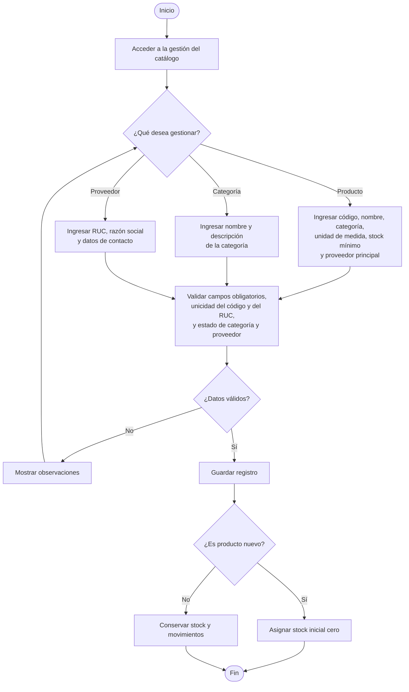

##### 11.2 Diagrama de Clases

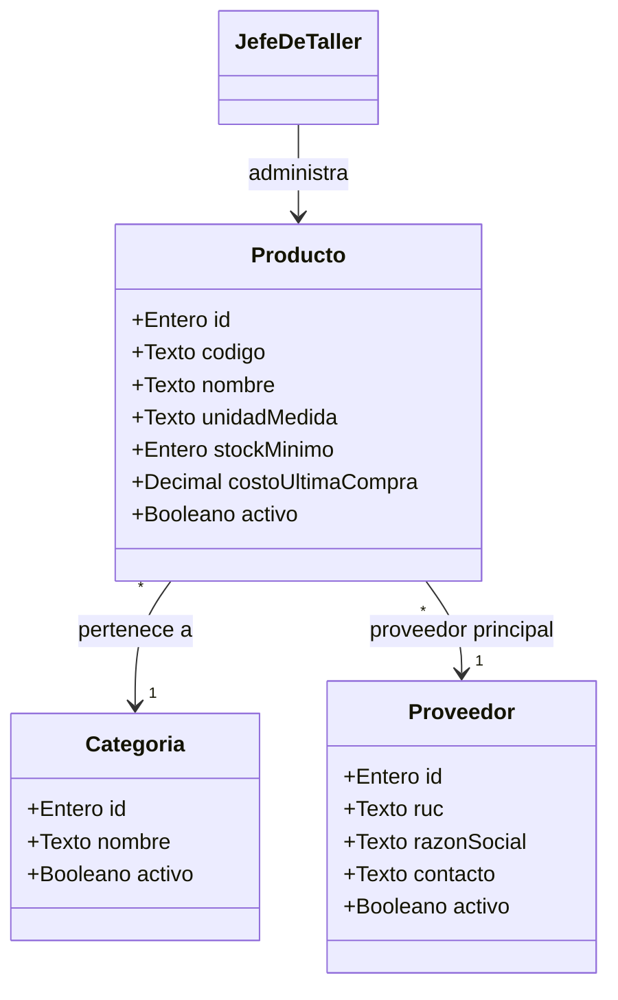

##### 11.3 Actividades a Automatizar

- Registrar producto.
- Validar la unicidad del código y los campos obligatorios.
- Validar la unicidad del RUC del proveedor.
- Seleccionar categoría y proveedor principal.
- Configurar unidad de medida y stock mínimo.
- Registrar o actualizar categoría y proveedor.
- Activar o desactivar registros del catálogo.
- Validar que no se eliminen físicamente productos con historial.

---

### 2.2.2 Especificación del caso de uso del negocio CUN201 – Registrar entrada de productos

#### 1. Actores

Jefe de taller; Proveedor como actor externo de la entrega.

#### 2. Propósito

Registrar los productos recibidos, incrementar el stock disponible y conservar la información de la entrada y el costo de última compra.

#### 3. Breve descripción

El caso comienza cuando el taller recibe productos. El Jefe de taller verifica las cantidades recibidas y registra producto, proveedor real de la entrega, cantidad y costo unitario. Tras validar y confirmar, el sistema registra el movimiento, aumenta las existencias y actualiza el costo de última compra.

#### 4. Flujo Básico de Eventos

1. El proveedor entrega los productos al taller.
2. El Jefe de taller verifica los productos y las cantidades recibidas.
3. Accede al registro de entradas.
4. Selecciona el producto y el proveedor que realizó la entrega.
5. Introduce la cantidad recibida y el costo unitario.
6. El sistema valida que el producto y el proveedor estén activos, que la cantidad sea mayor que cero y que el costo unitario no sea negativo.
7. El Jefe de taller revisa y confirma la entrada.
8. El sistema registra el movimiento con fecha y usuario, incrementa el stock y actualiza el costo de última compra.
9. El sistema informa que la entrada se registró correctamente; las alertas se recalculan cuando se consultan.

#### 5. Subflujos

**SF1 – Registrar una entrada de un solo producto**

1. El Jefe de taller selecciona el producto y el proveedor de la entrega.
2. Introduce la cantidad recibida y el costo unitario.
3. El sistema valida los datos y muestra el stock resultante del producto.
4. Al confirmar, el sistema genera un movimiento de entrada y actualiza el stock.
5. El flujo regresa al paso 8 del flujo básico.

**SF2 – Corregir los datos antes de confirmar**

1. El Jefe de taller revisa la entrada registrada.
2. Modifica la cantidad o el costo unitario, o cancela la operación.
3. El sistema recalcula el stock resultante.
4. El flujo continúa en el paso 7 del flujo básico.

#### 6. Flujos Alternativos

**6.1. Producto no registrado o inactivo**

1. El sistema impide registrar la entrada.
2. El Jefe de taller registra o reactiva el producto mediante CUN101 y vuelve al paso 4.

**6.2. Proveedor inactivo o no registrado**

1. El sistema rechaza el proveedor seleccionado.
2. El Jefe de taller registra, activa o selecciona un proveedor válido y vuelve al paso 4.

**6.3. Cantidad no válida**

1. El sistema rechaza una cantidad igual o menor que cero y solicita corregirla.
2. El flujo continúa en el paso 5 cuando la cantidad es válida.

**6.4. Costo unitario inválido**

1. El sistema rechaza un costo negativo o un valor no válido.
2. El Jefe de taller corrige el costo y continúa en el paso 6.

**6.5. Error al confirmar**

1. El sistema revierte la operación completa si no puede registrar el movimiento y actualizar el stock.
2. El sistema informa que no se registró la entrada; el Jefe de taller puede reintentar verificando que no exista un movimiento duplicado.

#### 7. Precondiciones

- El Jefe de taller está autenticado y autorizado para registrar entradas.
- El producto y el proveedor de la entrega están registrados y activos.

#### 8. Poscondiciones

- El stock del producto aumenta por la cantidad recibida.
- El costo de última compra se actualiza con el costo unitario de la entrada confirmada.
- El movimiento queda en el historial con fecha, usuario, cantidad y stock anterior y posterior; el proveedor de la entrega se conserva en el motivo del movimiento.

#### 9. Puntos de Extensión

La confirmación de la entrada actualiza las alertas del CUN301.

#### 10. Requerimientos Especiales

- La cantidad debe ser mayor que cero y el costo unitario no puede ser negativo.
- El movimiento y la actualización del stock deben confirmarse en una sola transacción.
- Cada entrada corresponde a un solo producto; el proveedor de la entrega se conserva en el texto del motivo del movimiento.
- **Alcance actual:** no existe una referencia opcional ni un registro de varias líneas por entrada; cada entrada recibe un producto, un proveedor, la cantidad y el costo unitario, y el proveedor de la entrega queda registrado en el motivo del movimiento.

#### 11. Información Adicional

##### 11.1 Diagrama de Actividades

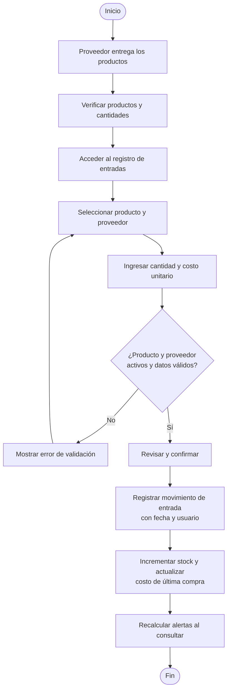

##### 11.2 Diagrama de Clases

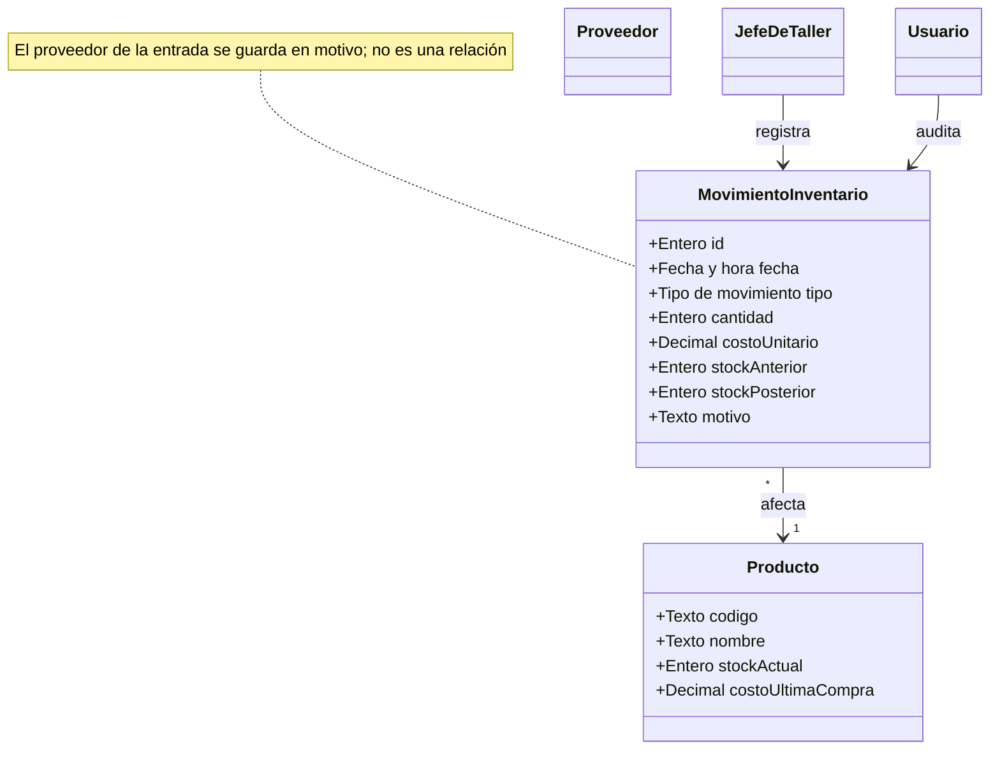

##### 11.3 Actividades a Automatizar

- Seleccionar producto y proveedor.
- Registrar cantidad y costo unitario.
- Validar datos y estado de los registros.
- Calcular el stock posterior.
- Registrar el movimiento de entrada.
- Actualizar stock y costo de última compra de forma atómica.
- Recalcular alertas y mostrar confirmación.

---

### 2.2.3 Especificación del caso de uso del negocio CUN202 – Registrar consumo de productos

#### 1. Actores

Mecánico; el Jefe de taller también puede registrar consumos.

#### 2. Propósito

Registrar los productos efectivamente utilizados durante una tarea de mantenimiento o reparación, asociarlos a una finalidad declarada y descontarlos del inventario.

#### 3. Breve descripción

El caso comienza cuando el mecánico ha utilizado uno o varios productos. El mecánico registra directamente los artículos, las cantidades y la finalidad del uso. El sistema valida los productos y el stock disponible para todos los artículos; al confirmar, registra los movimientos de salida y descuenta las cantidades. No se crea una solicitud al Jefe de taller ni se requiere que este vuelva a registrar el consumo.

#### 4. Flujo Básico de Eventos

1. El mecánico realiza una tarea de mantenimiento o reparación.
2. Accede al registro de consumo.
3. Describe la finalidad del uso, por ejemplo, cambio de aceite o reparación del sistema de frenos.
4. Selecciona el primer producto utilizado e indica la cantidad consumida.
5. Agrega los demás productos utilizados en la misma tarea, si corresponde.
6. Si la funcionalidad está habilitada, añade una referencia opcional del vehículo o cliente.
7. El sistema valida que la finalidad esté registrada, que las cantidades sean mayores que cero y que todos los productos estén activos.
8. El sistema comprueba que exista stock suficiente para cada producto incluido.
9. El usuario revisa y confirma el consumo.
10. El sistema registra un movimiento de salida por producto, asociado al usuario, la fecha y la finalidad, y descuenta las cantidades del stock.
11. El sistema confirma que el consumo se registró completamente.

#### 5. Subflujos

**SF1 – Incorporar otro producto al consumo**

1. El mecánico selecciona otro producto utilizado.
2. Indica la cantidad correspondiente.
3. El sistema incorpora el producto a la lista de consumo pendiente de confirmación.
4. El flujo retorna al paso 7 del flujo básico para validar la lista completa.

#### 6. Flujos Alternativos

**6.1. Cantidad inválida**

1. El sistema identifica la cantidad que no es mayor que cero.
2. El mecánico corrige el dato y continúa en el paso 7.

**6.2. Producto no registrado o inactivo**

1. El sistema impide agregar ese producto.
2. El mecánico selecciona un producto válido y continúa en el paso 7.

**6.3. Stock insuficiente**

1. El sistema indica qué producto o productos no tienen existencias suficientes.
2. No se registra ningún movimiento ni se descuenta parcialmente el stock.
3. El mecánico corrige las cantidades o excluye los productos que no puede registrar y vuelve al paso 7.

**6.4. Error durante la confirmación**

1. El sistema revierte el consumo completo si falla el registro de algún movimiento o la actualización de existencias.
2. El sistema informa que el consumo no fue confirmado y evita duplicarlo al reintentar.

#### 7. Precondiciones

- El usuario que registra está autenticado y autorizado para registrar consumos (Mecánico o Jefe de taller).
- Los productos que se desean consumir están registrados en el catálogo.

#### 8. Poscondiciones

- El consumo queda asociado al usuario autenticado, a la fecha, a los productos, las cantidades y la finalidad declarada.
- El stock disminuye por las cantidades confirmadas y el historial contiene los movimientos de salida.
- Si alguna validación falla, el stock y el historial permanecen sin cambios para esa operación.

#### 9. Puntos de Extensión

CUN202 genera movimientos de salida que pueden consultarse mediante CUN401 y que se reflejan en las alertas de CUN301.

#### 10. Requerimientos Especiales

- El consumo lo registra directamente quien utiliza los productos; no se modela como solicitud o aprobación del Jefe de taller.
- Todos los productos se validan antes de confirmar; no se permite stock negativo ni descuento parcial. Si un producto se repite, las cantidades se agrupan para validar el stock total.
- El registro del consumo y los descuentos deben ser atómicos.
- La finalidad del uso es obligatoria; la referencia de vehículo o cliente es opcional.
- **Alcance actual:** el consumo admite una lista de ítems con producto y cantidad, además de la finalidad y la referencia opcional del vehículo o cliente. El administrador del sistema no puede registrar consumos.

#### 11. Información Adicional

##### 11.1 Diagrama de Actividades

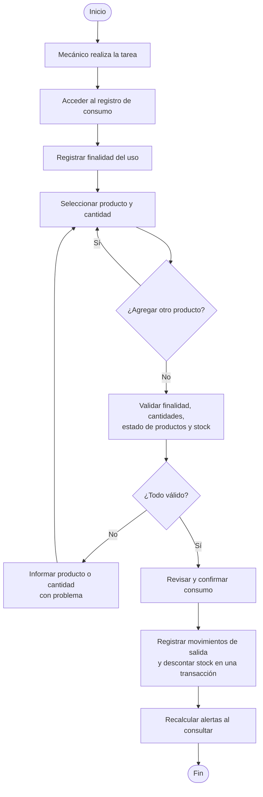

##### 11.2 Diagrama de Clases

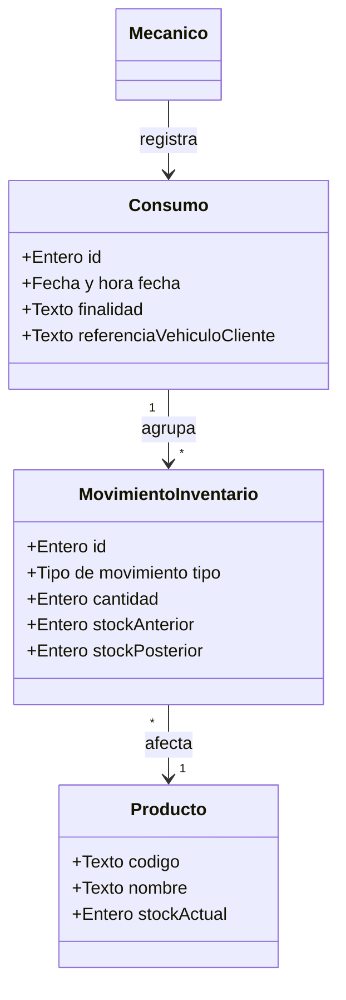

##### 11.3 Actividades a Automatizar

- Capturar la finalidad del consumo.
- Seleccionar productos y cantidades.
- Agregar o retirar productos antes de confirmar.
- Validar estado, cantidad y stock de todos los productos.
- Registrar el consumo y sus movimientos de salida.
- Descontar existencias en una sola transacción.
- Evitar confirmaciones duplicadas.
- Mostrar confirmación o errores de validación.

### 2.2.4 Especificación del caso de uso del negocio CUN203 – Registrar ajuste de inventario

#### 1. Actores

Jefe de taller.

#### 2. Propósito

Corregir las existencias registradas cuando el conteo físico evidencia una diferencia, conservando la justificación y la trazabilidad del ajuste.

#### 3. Breve descripción

El caso comienza cuando el Jefe de taller compara el stock registrado con el conteo físico y detecta una diferencia. Registra el producto, la cantidad física observada y una justificación. El sistema calcula la diferencia, valida los datos y registra un movimiento de ajuste que actualiza el stock. La misma operación se utiliza para la carga del inventario inicial.

#### 4. Flujo Básico de Eventos

1. El Jefe de taller realiza o recibe el conteo físico de un producto.
2. Accede a la función de ajuste de inventario.
3. Selecciona el producto que se va a ajustar.
4. Introduce la cantidad física contada y la justificación del ajuste.
5. El sistema obtiene el stock registrado y calcula la diferencia entre la cantidad física y el stock registrado.
6. El sistema valida que el producto esté activo, que la cantidad física no sea negativa y que la justificación esté completa.
7. El Jefe de taller revisa el stock registrado, el conteo físico y la diferencia calculada.
8. Confirma el ajuste.
9. El sistema registra el movimiento con la variación, stock anterior y posterior, fecha, usuario y justificación.
10. El sistema actualiza las existencias y recalcula las alertas de stock.
11. El sistema confirma que el ajuste fue registrado.

#### 5. Subflujos

**SF1 – Cargar el inventario inicial**

1. El Jefe de taller selecciona la opción "Carga de inventario inicial".
2. Registra el producto, la cantidad física contada y la justificación "Inventario inicial".
3. El sistema calcula la diferencia contra el stock actual, que para un producto nuevo es cero.
4. El sistema registra el movimiento de ajuste con stock anterior y posterior.
5. El Jefe de taller repite la operación para cada producto y el flujo termina cuando el inventario inicial queda cargado.

#### 6. Flujos Alternativos

**6.1. Producto inactivo o inexistente**

1. El sistema rechaza el ajuste.
2. El Jefe de taller verifica el catálogo y selecciona un producto válido.

**6.2. Cantidad física negativa o inválida**

1. El sistema rechaza el valor e indica que debe ser numérico y mayor o igual que cero.
2. El Jefe de taller corrige el conteo y vuelve al paso 6.

**6.3. Justificación no indicada**

1. El sistema impide confirmar el ajuste hasta que se introduzca un motivo.
2. El Jefe de taller registra la justificación y continúa.

**6.4. Error al guardar**

1. El sistema revierte la operación completa y mantiene las existencias previas.
2. El Jefe de taller recibe un mensaje de error y puede reintentar tras verificar el historial.

#### 7. Precondiciones

- El Jefe de taller está autenticado y autorizado para ajustar el inventario.
- El producto que se va a ajustar existe en el catálogo.

#### 8. Poscondiciones

- El stock queda igual a la cantidad física confirmada.
- El movimiento de ajuste conserva la variación calculada, la justificación, el usuario, la fecha y el stock anterior y posterior.
- Las alertas se recalculan según las nuevas existencias.

#### 9. Puntos de Extensión

CUN203 actualiza el stock utilizado por CUN301 y la información histórica consultada mediante CUN401.

#### 10. Requerimientos Especiales

- Solo el Jefe de taller puede confirmar ajustes.
- La cantidad física debe ser mayor o igual que cero y la justificación es obligatoria.
- La diferencia se calcula como cantidad física menos stock registrado.
- Los ajustes no modifican el costo de última compra.
- Los movimientos confirmados no se borran ni editan; los errores requieren una operación correctiva trazable.

#### 11. Información Adicional

##### 11.1 Diagrama de Actividades


##### 11.2 Diagrama de Clases

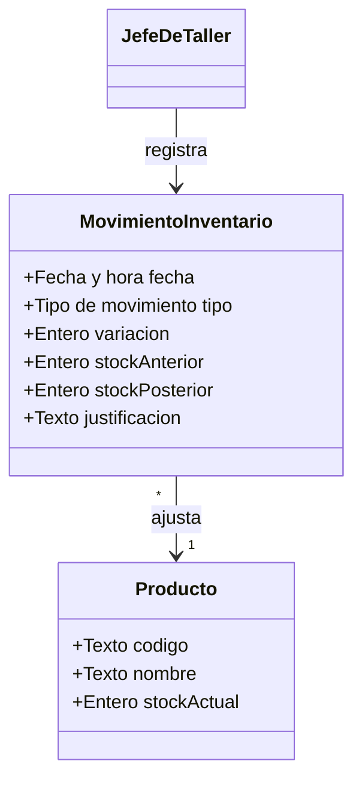

##### 11.3 Actividades a Automatizar

- Seleccionar producto.
- Registrar conteo físico y justificación.
- Obtener el stock actual y calcular la diferencia.
- Validar permisos y datos.
- Registrar el movimiento de ajuste.
- Actualizar existencias de forma transaccional.
- Recalcular alertas.
- Conservar la trazabilidad del ajuste.

---

### 2.2.5 Especificación del caso de uso del negocio CUN301 – Controlar abastecimiento de productos

#### 1. Actores

Jefe de taller; Proveedor como actor externo de la coordinación de compra.

#### 2. Propósito

Identificar productos con existencias bajas y proporcionar información para que el Jefe de taller decida si debe reponerlos.

#### 3. Breve descripción

El caso comienza cuando el Jefe de taller consulta las alertas de bajo stock. El sistema compara las existencias de los productos activos con sus mínimos y muestra aquellos que están en el umbral o por debajo. El Jefe de taller revisa la información y decide qué productos reponer; el contacto y la compra se realizan fuera del sistema. Cuando llegan productos, la entrada se registra mediante CUN201.

#### 4. Flujo Básico de Eventos

1. El Jefe de taller abre la consulta de bajo stock.
2. El sistema obtiene las existencias vigentes de los productos activos.
3. Compara el stock actual con el mínimo configurado para cada producto.
4. El sistema muestra los productos cuyo stock es menor o igual al mínimo, incluyendo código, nombre, stock actual, stock mínimo y proveedor principal.
5. Cuando corresponde, el sistema muestra una cantidad de referencia para alcanzar el stock mínimo.
6. El Jefe de taller revisa las alertas y decide qué productos requieren reposición.
7. El Jefe de taller contacta al proveedor fuera del sistema y consulta disponibilidad y condiciones.
8. El Jefe de taller coordina la compra y recibe los productos fuera del sistema.
9. Al recibirlos, verifica las cantidades y registra la entrada mediante CUN201.
10. El sistema actualiza el stock; las alertas se recalculan en la siguiente consulta.
11. El Jefe de taller revisa el resultado actualizado.

#### 5. Subflujos

**SF1 – Consultar el detalle de un producto en alerta**

1. El Jefe de taller selecciona un producto de la lista de alertas.
2. El sistema muestra stock actual, stock mínimo, cantidad sugerida y razón social del proveedor principal.
3. El Jefe de taller evalúa la prioridad y decide contactar al proveedor fuera del sistema.
4. El flujo regresa al paso 11 del flujo básico para continuar con la revisión de otras alertas.

#### 6. Flujos Alternativos

**6.1. No existen productos con bajo stock**

1. El sistema informa que no hay productos activos con stock igual o inferior al mínimo.
2. El caso de uso termina sin necesidad de gestionar una reposición.

**6.2. El producto no tiene un proveedor principal válido**

1. El sistema muestra que no existe un proveedor principal disponible.
2. El Jefe de taller revisa o actualiza la asociación del proveedor mediante CUN101.

**6.3. El proveedor no dispone del producto**

1. El Jefe de taller consulta otra alternativa o posterga la reposición fuera del sistema.
2. No se registra un pedido pendiente en la aplicación.

**6.4. Se recibe una cantidad diferente a la esperada**

1. El Jefe de taller registra únicamente la cantidad efectivamente recibida y verificada mediante CUN201.

#### 7. Precondiciones

- Los productos que se desean supervisar tienen configurado un stock mínimo.
- El Jefe de taller está autenticado y autorizado para consultar alertas.

#### 8. Poscondiciones

- El Jefe de taller obtiene la lista actualizada de productos con bajo stock y sus proveedores principales.
- Si se registran entradas, el stock se actualiza mediante CUN201; las alertas se recalculan cada vez que se consultan.
- El sistema no registra órdenes de compra ni controla entregas pendientes.

#### 9. Puntos de Extensión

La recepción de productos se realiza mediante CUN201; la actualización del proveedor principal, si es necesaria, se realiza mediante CUN101.

#### 10. Requerimientos Especiales

- El umbral de bajo stock incluye la igualdad: stock actual menor o igual al mínimo.
- Los productos inactivos se excluyen de las alertas operativas.
- La cantidad sugerida es informativa y no crea una orden de compra.
- La coordinación con el proveedor y la compra ocurren fuera del sistema.
- **Alcance actual:** las alertas se calculan en el momento de la consulta y se ordenan por cantidad sugerida descendente y luego por nombre; están disponibles para el Jefe de taller y el Mecánico. Una tarea programada revisa periódicamente las alertas y solo registra el resultado en la bitácora, sin persistirlas. La consulta devuelve la lista completa, sin detalle por producto.

#### 11. Información Adicional

##### 11.1 Diagrama de Actividades

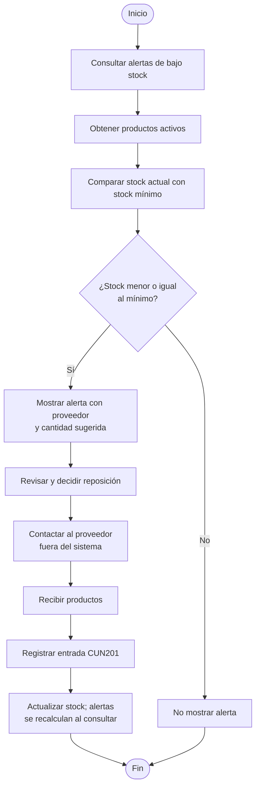

##### 11.2 Diagrama de Clases

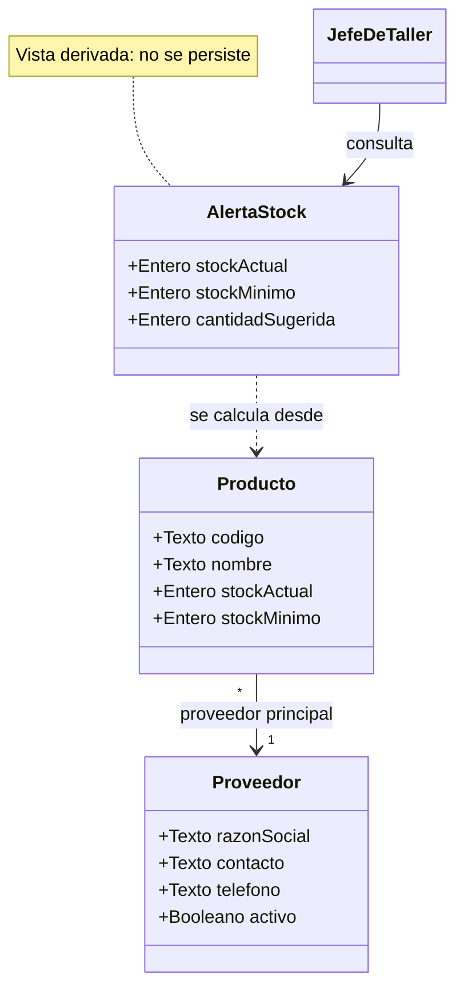

##### 11.3 Actividades a Automatizar

- Consultar productos activos.
- Comparar stock actual con stock mínimo.
- Generar y mostrar alertas de bajo stock.
- Mostrar proveedor principal y cantidad de referencia.
- Acceder a la gestión de productos y proveedores.
- Acceder al registro de entrada cuando se reciban productos.
- Recalcular las alertas después de actualizar el stock.

---

### 2.2.6 Especificación del caso de uso del negocio CUN401 – Consultar información del inventario

#### 1. Actores

Jefe de taller; Mecánico para consultas de productos, existencias y alertas.

#### 2. Propósito

Consultar las existencias, el historial de movimientos, el consumo de productos, el bajo stock y el valor estimado del inventario para apoyar la supervisión y la toma de decisiones.

#### 3. Breve descripción

El caso comienza cuando el usuario necesita revisar el estado del inventario. Selecciona una consulta o reporte y define filtros cuando corresponde. El sistema valida los criterios, obtiene los datos vigentes y presenta los resultados sin modificar productos, existencias ni movimientos. El Jefe de taller accede además al dashboard, las estadísticas y las exportaciones.

#### 4. Flujo Básico de Eventos

1. El usuario accede al módulo de consultas y reportes.
2. Selecciona el tipo de consulta: productos, existencias por identificador, bajo stock, movimientos, consumo por periodo, valor estimado, dashboard o estadísticas.
3. Cuando corresponde, define filtros por nombre, categoría, tipo de movimiento o rango de fechas.
4. El sistema valida los filtros y comprueba que la fecha inicial no sea posterior a la fecha final.
5. El sistema consulta las existencias actuales o los movimientos confirmados que cumplen los criterios.
6. Si se solicita el valor estimado, calcula la suma del stock actual multiplicado por el costo de última compra de cada producto incluido.
7. El sistema presenta los resultados con los campos pertinentes para el tipo de consulta.
8. El usuario revisa la información y, si lo necesita, modifica los filtros para realizar otra consulta.
9. El sistema presenta el nuevo resultado o informa que no existen registros coincidentes.
10. El usuario finaliza la consulta.

#### 5. Subflujos

**SF1 – Consultar existencias**

1. El usuario selecciona "Existencias".
2. Indica los identificadores de los productos que desea consultar.
3. El sistema muestra código, producto, categoría, unidad, stock actual y estado respecto al mínimo. El listado general de productos permite filtrar por nombre y categoría.

**SF2 – Consultar historial de movimientos**

1. El Jefe de taller selecciona "Movimientos".
2. Define un rango de fechas y, opcionalmente, el tipo de movimiento.
3. El sistema valida el rango y muestra los movimientos con stock anterior y posterior, paginados. No existen filtros por producto ni por usuario.

**SF3 – Consultar reporte de bajo stock**

1. El Jefe de taller selecciona "Bajo stock".
2. El sistema lista los productos activos con stock menor o igual al mínimo, la cantidad sugerida y el proveedor principal.

**SF4 – Consultar valor estimado**

1. El Jefe de taller selecciona "Valor estimado".
2. El sistema multiplica el stock actual por el costo de última compra y muestra el detalle y el total.
3. El sistema identifica los productos sin costo y los excluye del total.

#### 6. Flujos Alternativos

**6.1. Filtros inválidos**

1. El sistema indica los criterios incorrectos, como un rango de fechas invertido.
2. El Jefe de taller corrige los filtros y continúa en el paso 4.

**6.2. No existen registros coincidentes**

1. El sistema muestra un mensaje de resultado vacío.
2. El caso termina o el Jefe de taller modifica los filtros en el paso 8.

**6.3. El producto no tiene costo de última compra registrado**

1. El sistema no inventa un costo; identifica el dato faltante o excluye ese producto del cálculo según la política definida y lo informa en el resultado.
2. El Jefe de taller puede registrar una entrada con costo para completar la información.

#### 7. Precondiciones

- El usuario está autenticado; el acceso a cada consulta depende de su rol (Jefe de taller o Mecánico).
- El sistema dispone de datos de productos y, si se consulta historial, de movimientos registrados.

#### 8. Poscondiciones

- El sistema presenta la información que coincide con los criterios de consulta.
- La consulta no modifica stock, productos ni movimientos.
- El valor estimado se identifica como referencia operativa y no como valoración contable oficial.

#### 9. Puntos de Extensión

Las consultas de bajo stock corresponden funcionalmente a CUN301; la consulta de movimientos permite revisar operaciones generadas por CUN201, CUN202 y CUN203.

#### 10. Requerimientos Especiales

- Los reportes son de solo lectura.
- Los rangos de fechas deben validarse.
- Las consultas deben usar datos vigentes y movimientos confirmados.
- El valor estimado se calcula con el costo de última compra y no representa FIFO, costo promedio ni valoración contable oficial.
- Los datos históricos deben seguir siendo consultables aunque un producto, proveedor o usuario esté inactivo.
- **Alcance actual:** el listado de productos se pagina y filtra por nombre y categoría e incluye productos inactivos; las existencias se consultan por una lista de identificadores de productos activos; las alertas se consultan sin parámetros; el reporte de movimientos exige un rango de fechas, admite un filtro opcional por tipo y está paginado; los reportes de consumo y bajo stock y el valor estimado devuelven el resultado completo. El panel de resumen y las estadísticas son exclusivos del Jefe de taller. Los reportes de movimientos, consumo y bajo stock pueden exportarse a PDF y Excel.

#### 11. Información Adicional

##### 11.1 Diagrama de Actividades

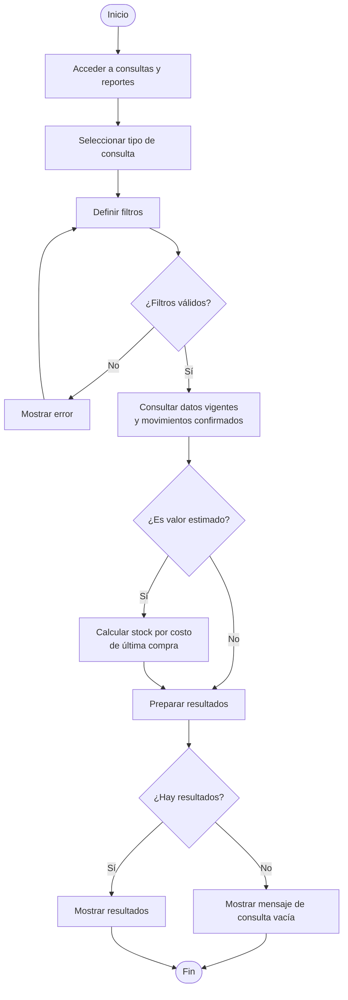

##### 11.2 Diagrama de Clases

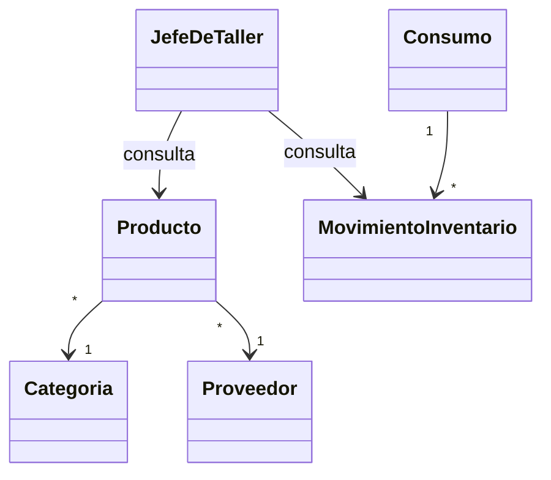

##### 11.3 Actividades a Automatizar

- Seleccionar el tipo de consulta.
- Validar fechas y filtros.
- Consultar el stock actual.
- Consultar movimientos confirmados por tipo o periodo, con paginación.
- Consultar el consumo y la finalidad declarada.
- Calcular el valor estimado del inventario.
- Mostrar resultados o mensaje de consulta vacía.
- Restringir el acceso según el rol.
- Evitar modificaciones desde las vistas de reporte.

---

## 2.3 Modelo de Análisis del Negocio

El modelo de análisis del negocio identifica a los trabajadores que ejecutan los procesos y las entidades que se crean, consultan o modifican durante su ejecución. A partir de esta base se construye el diagrama de clases del negocio y se prepara el paso a los requerimientos del sistema. Las entidades y los trabajadores definidos aquí se reutilizan en el modelo conceptual del capítulo 3.

### 2.3.1 Lista de Trabajadores del Negocio

Los trabajadores del negocio son los roles internos que ejecutan las actividades del taller y asumen responsabilidades dentro de los procesos. La tabla incluye al Jefe de taller y al Mecánico como trabajadores internos, y al Proveedor como colaborador externo cuya actuación se limita a la entrega de productos y a la confirmación de pedidos; por ello no opera el sistema ni participa en los casos de uso del sistema.

| Trabajador del negocio | Responsabilidades |
|---|---|
| **Jefe de taller** | Administrar productos, categorías y proveedores; registrar entradas; autorizar y registrar ajustes; configurar stocks mínimos; supervisar alertas; decidir y coordinar la reposición; consultar reportes. |
| **Mecánico** | Ejecutar los servicios de mantenimiento y reparación y registrar los productos utilizados, sus cantidades y la finalidad del uso, sin modificar el catálogo ni los ajustes. |
| **Proveedor** (externo) | Entregar los productos solicitados y confirmar pedidos. Es un actor externo y no opera el sistema. |

### 2.3.2 Lista de Entidades del Negocio

Las entidades del negocio representan los objetos o conceptos sobre los que actúan los trabajadores y que deben conservarse para mantener la trazabilidad del inventario. La tabla indica el identificador, una descripción del rol de la entidad y los atributos principales que se reconocen en el análisis; en el capítulo 3 estos atributos se refinan como clases del sistema, con tipos, visibilidad y relaciones.

| Entidad | Descripción | Atributos principales |
|---|---|---|
| **EN001 – Producto** | Repuesto, herramienta o insumo administrado en el almacén, identificado por un código único y controlado mediante stock actual y stock mínimo. | código, nombre, descripción, unidad de medida, stock actual, stock mínimo, costo de última compra, estado |
| **EN002 – Categoría** | Clasificación funcional de los productos que permite agruparlos para la búsqueda, el control y los reportes. | nombre, descripción, estado |
| **EN003 – Proveedor** | Empresa o persona que abastece los productos; se identifica por su RUC y mantiene los datos de contacto para la reposición. | RUC, razón social, contacto, teléfono, correo, dirección, estado |
| **EN004 – Movimiento de inventario** | Registro histórico de una entrada, un consumo o un ajuste, con el stock anterior y posterior para reconstruir la trazabilidad. | fecha, tipo, producto, cantidad o variación, stock anterior, stock posterior, costo unitario, usuario, motivo o justificación, identificador de consumo |
| **EN005 – Consumo** | Agrupación de los productos utilizados en una misma tarea, con la finalidad declarada por el usuario y una referencia opcional del vehículo o cliente. | fecha, usuario, finalidad, referencia opcional de vehículo o cliente |
| **EN006 – Alerta de stock** | Vista derivada de los productos activos cuyas existencias están en el mínimo o por debajo; no se almacena como entidad independiente. | producto, stock actual, stock mínimo, cantidad sugerida, proveedor principal |
| **EN007 – Usuario** | Persona que opera el sistema, con credenciales, rol y estado que determinan sus permisos. | nombre de usuario, contraseña cifrada, rol, estado, fecha de creación |

#### Diagrama de Clases de Entidades del Negocio

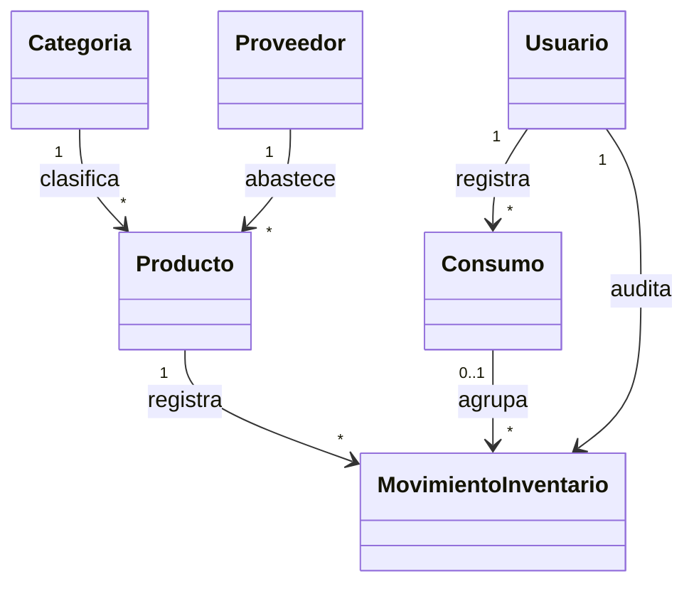

# 3. REQUERIMIENTOS

## 3.1 Lista de Requerimientos Funcionales

Los requerimientos funcionales describen qué debe hacer el sistema para apoyar los procesos del negocio. Se agrupan por proceso, usan el prefijo RF y tres dígitos —el primer bloque coincide con el proceso y los dos siguientes con la numeración secuencial— y, cuando una regla de negocio condiciona el comportamiento, se indica entre corchetes para conservar la trazabilidad. La descripción de cada requerimiento precisa la acción esperada, los datos que intervienen y la restricción principal que debe respetarse.

### Gestión de productos

Este grupo reúne las funciones de mantenimiento del catálogo: crear y actualizar productos, desactivarlos sin perder su historial, buscarlos y administrar las categorías y los proveedores asociados. Las restricciones de unicidad, obligatoriedad y conservación del historial provienen de las reglas RN101–RN109.

| Código | Requerimiento | Descripción |
|---|---|---|
| RF101 | Registrar producto | Permite crear un producto con código único, categoría, unidad de medida, proveedor principal y stock mínimo. [RN101, RN102, RN103, RN104, RN105, RN106] |
| RF102 | Actualizar producto | Permite modificar los datos de un producto registrado sin alterar su stock. Si el producto ya tiene movimientos, solo admite cambios de nombre, descripción y unidad de medida; el stock mínimo se actualiza por una operación específica. [RN101, RN102, RN105, RN118] |
| RF103 | Desactivar producto | Permite desactivar un producto que ya no se utilizará. No existe eliminación física; el historial se conserva. [RN108] |
| RF104 | Buscar producto | Permite listar y localizar productos con paginación y filtros por nombre y categoría, incluyendo los inactivos; devuelve el stock actual, la unidad de medida, el SKU y el indicador de stock crítico. |
| RF105 | Registrar categorías | Permite registrar categorías con nombre único y descripción. No es posible listarlas, editarlas, activarlas ni desactivarlas. [RN102] |
| RF106 | Registrar proveedores | Permite registrar proveedores con RUC único y datos de contacto. No es posible listarlos, editarlos, activarlos ni desactivarlos. [RN105, RN109] |
| RF107 | Restringir la administración del catálogo | Solo el Jefe de taller puede crear, actualizar y desactivar productos y registrar categorías y proveedores; el administrador del sistema solo registra usuarios. [RN107] |
| RF108 | Conservar productos con historial | Impide la eliminación física de productos con movimientos y conserva su información histórica. [RN108] |

### Gestión de inventario

Este grupo describe el registro de entradas, consumos y ajustes, la validación de stock y la actualización automática de existencias. Su comportamiento se deriva de las reglas RN201–RN209 y constituye el núcleo transaccional del sistema, porque cada operación confirmada debe dejar un movimiento trazable y actualizar el stock en una sola transacción.

| Código | Requerimiento | Descripción |
|---|---|---|
| RF201 | Registrar entrada | Registra el ingreso de un solo producto con proveedor, cantidad y costo unitario, asignando fecha y usuario. [RN201, RN202, RN203] |
| RF202 | Registrar consumo | Permite al mecánico o al Jefe de taller registrar los productos utilizados, sus cantidades y la finalidad. [RN204, RN205, RN206] |
| RF203 | Validar stock suficiente | Impide confirmar consumos que superen las existencias disponibles, verifica todos los ítems del consumo y no aplica descuentos parciales cuando algún producto no tiene stock. [RN206, RN207] |
| RF204 | Actualizar stock automáticamente | Actualiza las existencias después de cada entrada, consumo o ajuste confirmado. [RN203, RN205] |
| RF205 | Registrar ajuste de inventario | Permite corregir el stock con conteo físico y justificación obligatoria. [RN209] |
| RF206 | Registrar historial | Guarda todos los movimientos con stock anterior y posterior, fecha y usuario. [RN208] |
| RF207 | Registrar consumo atómico | Un consumo con varios productos se registra por completo o no se registra. [RN207] |
| RF208 | Actualizar costo de última compra | Actualiza el costo del producto con el costo unitario de la entrada confirmada. [RN203] |

### Control y abastecimiento

Este grupo cubre la configuración del stock mínimo, la generación de alertas y la información que apoya la reposición. No incluye órdenes de compra: el sistema identifica la necesidad y muestra el proveedor principal, mientras que la decisión y la coordinación de la compra permanecen en el negocio.

| Código | Requerimiento | Descripción |
|---|---|---|
| RF301 | Configurar stock mínimo | Permite establecer y modificar el stock mínimo de cada producto activo, con un valor numérico mayor o igual que cero que sirve de umbral para la alerta. [RN104, RN301] |
| RF302 | Generar alertas de bajo stock | Genera una alerta cuando el stock de un producto activo es menor o igual a su mínimo; la alerta se calcula en cada consulta y refleja de inmediato los movimientos y los cambios de stock mínimo. [RN302, RN304] |
| RF303 | Mostrar cantidad sugerida | Muestra la cantidad de referencia para alcanzar el stock mínimo, calculada como la diferencia entre el mínimo y el stock actual, sin generar una orden de compra. [RN305] |
| RF304 | Mostrar proveedor principal | Incluye en la alerta la razón social del proveedor principal. [RN303, RN307] |
| RF305 | Recalcular alertas | Recalcula las alertas en cada consulta, de modo que desaparecen cuando el stock supera el mínimo. [RN304] |
| RF306 | Restringir la eliminación de proveedores | No ofrece la eliminación de proveedores, de modo que los asociados a productos o movimientos se conservan; la desactivación no está disponible en la versión actual. [RN308] |
| RF307 | Revisar el stock de forma programada | Una tarea programada revisa periódicamente el stock en la zona horaria del taller y registra en la bitácora un resumen y el detalle de las alertas, sin modificar datos. [RN302, RN304] |

### Consultas y reportes

Este grupo reúne las consultas de existencias e historial y los reportes de movimientos, consumo, bajo stock y valor estimado. Todos son de solo lectura, respetan el rol del usuario y conservan la información histórica; el valor estimado se calcula con el costo de la última compra y se presenta como referencia operativa.

| Código | Requerimiento | Descripción |
|---|---|---|
| RF401 | Consultar existencias | Muestra el stock actual, el stock mínimo y el indicador de stock crítico de los productos activos indicados por identificador, junto con su código y nombre. [RN402] |
| RF402 | Consultar historial de movimientos | Permite consultar los movimientos de un rango de fechas con filtro opcional por tipo, mostrando stock anterior, stock posterior, motivo y usuario; no admite filtros por producto ni por usuario. [RN403] |
| RF403 | Reporte de movimientos por periodo | Genera un reporte paginado de entradas, consumos y ajustes en un rango de fechas, con totales por tipo calculados sobre todo el filtro. [RN405, RN408] |
| RF404 | Reporte de consumo por periodo | Genera un reporte de consumo por producto, mecánico y finalidad, con cantidades y fechas, para analizar el uso de materiales en el taller. [RN404, RN405] |
| RF405 | Reporte de bajo stock | Lista los productos activos con stock menor o igual al mínimo e incluye stock actual, mínimo, cantidad sugerida y proveedor principal. [RN302, RN303] |
| RF406 | Consultar valor estimado del inventario | Calcula el stock actual por el costo de última compra, identifica los productos sin costo, los excluye del total y lo presenta como estimación operativa. [RN407, RN408] |
| RF407 | Exportar reportes | Permite exportar los reportes de movimientos, consumo y bajo stock a PDF o Excel, con el mismo contenido y los mismos filtros del reporte de origen; las exportaciones no se paginan. |
| RF408 | Restringir reportes administrativos | Solo el Jefe de taller accede a los reportes administrativos; el mecánico puede consultar existencias y registrar consumos, pero no generar reportes restringidos. [RN401] |
| RF409 | Consultar el panel de resumen | Muestra el resumen del inventario activo (total de productos, con stock normal, con bajo stock y sin stock), los indicadores del mes en curso (valor estimado, productos sin costo, entradas, consumos y ajustes), las cinco alertas más urgentes y los cinco movimientos más recientes. Es exclusivo del Jefe de taller. [RN407] |
| RF410 | Consultar estadísticas de movimientos | Cuenta los movimientos de un rango de fechas agrupados por día, semana o mes, omitiendo los períodos sin movimientos. Es exclusivo del Jefe de taller. [RN405] |

### Seguridad

Este grupo contiene los requerimientos de autenticación, gestión de usuarios y roles, y auditoría de movimientos. Aunque la seguridad es transversal, se separa en este bloque para identificar las funciones que habilitan el acceso controlado al resto del sistema.

| Código | Requerimiento | Descripción |
|---|---|---|
| RF501 | Iniciar sesión | Autentica al usuario con su nombre de usuario y contraseña, valida que la cuenta esté activa y emite una credencial de acceso temporal que determina sus permisos según su rol. |
| RF502 | Gestionar usuarios y roles | Permite al administrador del sistema registrar usuarios con rol de Jefe de taller o Mecánico; el rol de administrador lo crea el sistema al iniciar y no se asigna por registro. La edición y la desactivación de usuarios no están disponibles en la versión actual. |
| RF503 | Auditar movimientos | Todo movimiento registra el usuario que lo realizó, la fecha y el stock anterior y posterior, de modo que la operación pueda reconstruirse. [RN208] |

## 3.2 Lista de Requerimientos No Funcionales

Los requerimientos no funcionales establecen las cualidades que debe cumplir el sistema y las restricciones que condicionan su diseño. Se agrupan por categoría —usabilidad, disponibilidad, rendimiento, seguridad, integridad, mantenibilidad, respaldo y restricciones de diseño— y se identifican con el prefijo RNF. Cada fila indica la categoría, el código, el requerimiento y el criterio de verificación que se espera; cuando el valor es una propuesta, se señala expresamente para que el equipo lo valide con el usuario.

| Categoría | Código | Requerimiento | Criterio de verificación |
|---|---|---|---|
| **Usabilidad** | RNF01 | La interfaz debe ser intuitiva para usuarios sin formación técnica. | Un usuario nuevo completa las tareas básicas de consulta y registro sin ayuda externa, tras una demostración breve. |
| | RNF02 | Los formularios mostrarán mensajes claros de validación y error. | Cada validación indica el campo afectado, la causa y la acción esperada; no se muestran mensajes técnicos ni códigos internos. |
| | RNF03 | La interfaz será responsive y usable desde computadora y tablet. | Las pantallas principales se visualizan y operan sin desplazamiento horizontal en resoluciones de 1 366 × 768 y superiores. |
| **Disponibilidad** | RNF04 | El sistema estará disponible al menos el 98 % del horario de atención del taller. | Se mide el tiempo disponible frente al horario acordado; las caídas planificadas se registran y no superan el 2 %. |
| **Rendimiento** | RNF05 | Las consultas simples responderán en menos de 3 segundos. | Una búsqueda de productos o existencias con hasta 1 000 registros devuelve resultados en menos de 3 segundos en condiciones normales. |
| | RNF06 | Los reportes por periodo se generarán en menos de 10 segundos. | Un reporte de movimientos o consumo de un mes se genera y muestra en menos de 10 segundos con la base de prueba definida. |
| **Seguridad** | RNF07 | El acceso se controlará por usuario, contraseña y rol. | Ninguna operación se ejecuta sin sesión autenticada; las opciones y los servicios respetan el rol asignado. |
| | RNF08 | Las contraseñas se almacenarán cifradas con hash y sal. | La base de datos no contiene contraseñas en texto plano; el hash incluye una sal distinta por usuario. |
| | RNF09 | Todo movimiento registrará el usuario que lo realizó. | Cada fila de movimiento tiene un usuario válido y una fecha; no se aceptan movimientos sin responsable. |
| | RNF10 | El mecánico no podrá acceder a los reportes administrativos ni modificar el catálogo. | Un usuario con rol Mecánico recibe denegación al intentar acceder a reportes, catálogo o ajustes. |
| **Integridad** | RNF11 | Las operaciones de movimiento y actualización de stock serán transaccionales. | Ante un error durante la confirmación, no queda movimiento ni descuento de stock parcial. |
| | RNF12 | El consumo de varios productos se confirmará de forma atómica. | Si uno de los ítems falla, se revierte el consumo completo y se informa el producto observado. |
| | RNF13 | No se permitirá stock negativo en ninguna operación. | Toda operación que intentaría dejar stock menor que cero se rechaza y el stock permanece sin cambios. |
| **Mantenibilidad** | RNF14 | El sistema se construirá en capas con bajo acoplamiento. | La presentación no accede directamente a la persistencia; los cambios en una capa no obligan a reescribir las otras. |
| **Respaldo** | RNF15 | La base de datos tendrá copias de seguridad periódicas. | Existe una copia diaria verificable y una prueba de restauración documentada antes de la puesta en operación. |
| **Restricciones de diseño** | RNF16 | Servicio de aplicación del lado del servidor con base de datos relacional y control de versiones del esquema. | La decisión tecnológica se valida con el equipo y el usuario; cualquier cambio debe reflejarse en la arquitectura. |

> **Nota:** La restricción de RNF16 se expresa a nivel descriptivo; cualquier cambio de tecnología debe reflejarse en la arquitectura de software.

---

## 3.3 Modelo de Casos de Uso del Sistema

El modelo de casos de uso del sistema traduce los procesos del negocio en funciones que la aplicación debe ofrecer. Se organiza en actores, paquetes, casos de uso, clasificación por prioridad y ciclos de desarrollo; luego, cada caso se especifica con su flujo básico, flujos alternativos y requisitos especiales. Este recorrido permite pasar del «qué hace el taller» al «qué debe hacer el sistema» sin perder la trazabilidad con las reglas de negocio.

### 3.3.1 Lista de Actores del Sistema

Los actores del sistema son los roles que interactúan directamente con la aplicación. Se derivan de los actores del negocio, pero se separan cuando una misma persona asume funciones distintas o cuando se requiere un rol técnico de administración. La tabla indica la responsabilidad de cada actor y el alcance de sus operaciones; el detalle de sus permisos se concreta en los casos de uso y en la matriz de seguridad.

| Actor | Descripción |
|---|---|
| **Jefe de taller** | Opera el sistema a diario: administra el catálogo, registra entradas y ajustes, configura stocks mínimos, consulta alertas y reportes, y decide la reposición. Es el único actor con acceso a los reportes administrativos y a la configuración del catálogo. |
| **Mecánico** | Registra los consumos de los productos utilizados, indicando cantidad y finalidad, y consulta las existencias disponibles para planificar su trabajo. No modifica el catálogo, no registra entradas ni ajustes y no accede a reportes restringidos. |
| **Usuario** | Rol general que agrupa a los actores para los casos de uso de seguridad; permite iniciar sesión sin asumir permisos administrativos; el cambio de contraseña no está disponible en la versión actual. |
| **Administrador del sistema** | Registra usuarios con rol de Jefe de taller o Mecánico. Es un usuario creado por el sistema al iniciar y no participa en la operación del inventario ni accede a las funciones de negocio. |

### 3.3.2 Diagrama de Actores del Sistema


### 3.3.3 Diagrama de Paquetes de Diseño más Significativos

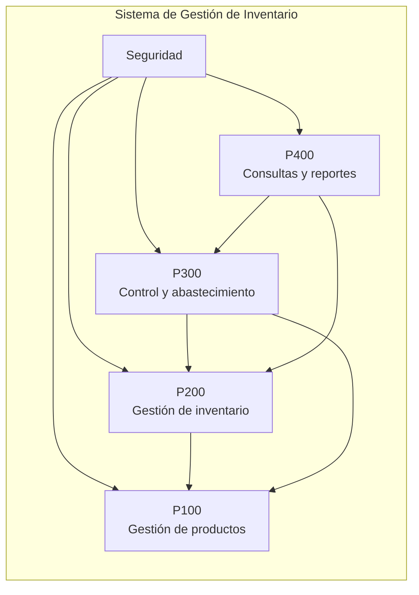

### 3.3.4 Lista de Casos de Uso del Sistema por Paquete

Los casos de uso del sistema se organizan en paquetes según la función que cumplen y el conjunto de datos que administran. Esta agrupación facilita la asignación de responsabilidades, la construcción por ciclos y la trazabilidad con los procesos del negocio. Cada tabla presenta el código, el nombre y una descripción breve del caso de uso; las relaciones de inclusión y extensión se muestran en los diagramas del apartado 3.3.5.

#### Paquete: Seguridad

| Caso de uso | Descripción |
|---|---|
| CUS001 – Iniciar sesión | Valida el nombre de usuario, la contraseña y el estado de la cuenta, y emite una credencial de acceso temporal con el rol del usuario. |
| CUS002 – Cambiar contraseña | Permite al usuario autenticado cambiar su contraseña, exigiendo la contraseña actual y una nueva que cumpla la política mínima. No está disponible en la versión actual. |
| CUS003 – Gestionar usuarios | Registra usuarios con rol de Jefe de taller o Mecánico; el registro está reservado al administrador del sistema. La edición y la desactivación no están disponibles en la versión actual. |
| CUS004 – Gestionar roles | Los roles de Jefe de taller, Mecánico y Administrador son fijos; la gestión de roles y permisos no está disponible en la versión actual. |

#### Paquete: P100 – Gestión de productos

| Caso de uso | Descripción |
|---|---|
| CUS101 – Buscar producto | Busca productos por nombre o categoría, con paginación, y devuelve una lista con el código, el stock actual, la unidad de medida y el estado de cada coincidencia, incluyendo los productos inactivos. |
| CUS102 – Registrar y actualizar producto | Crea, edita y desactiva productos, valida el código único y los campos obligatorios, y conserva el stock y el historial cuando el producto ya tiene movimientos; el código solo puede modificarse mientras el producto no tenga movimientos. |
| CUS103 – Gestionar categorías | Registra categorías con nombre único, sin distinguir mayúsculas, y descripción; la edición y la desactivación no están disponibles en la versión actual. Los productos solo se asocian a categorías activas. |
| CUS104 – Gestionar proveedores | Registra proveedores con RUC único y datos de contacto; la edición y la desactivación no están disponibles en la versión actual, por lo que los proveedores vinculados a productos o movimientos se conservan. |

#### Paquete: P200 – Gestión de inventario

| Caso de uso | Descripción |
|---|---|
| CUS201 – Registrar entrada | Registra el ingreso de un producto con proveedor, cantidad y costo unitario, actualiza el stock y el costo de última compra, y deja un movimiento de entrada. |
| CUS202 – Registrar consumo | Registra los productos utilizados por el mecánico con cantidad y finalidad, valida el stock de todos los ítems y descuenta las existencias en una sola transacción. |
| CUS203 – Registrar ajuste de inventario | Registra un ajuste con conteo físico y justificación obligatoria, calcula la diferencia y actualiza el stock conservando el movimiento para auditoría. |
| CUS204 – Consultar historial de movimientos | Consulta los movimientos de un rango de fechas con filtro opcional por tipo, paginados y con totales por tipo; muestra stock anterior, stock posterior, motivo y responsable. No admite filtros por producto ni por usuario. |

#### Paquete: P300 – Control y abastecimiento

| Caso de uso | Descripción |
|---|---|
| CUS301 – Configurar stock mínimo | Define o modifica el stock mínimo de un producto; la situación de alerta se refleja de inmediato porque se calcula en cada consulta. |
| CUS302 – Consultar alertas de bajo stock | Muestra los productos activos con existencias iguales o inferiores al mínimo, con su stock actual, cantidad sugerida y proveedor principal. |

#### Paquete: P400 – Consultas y reportes

| Caso de uso | Descripción |
|---|---|
| CUS401 – Consultar existencias | Muestra el stock actual, el stock mínimo y el indicador de stock crítico de los productos activos indicados por identificador. |
| CUS402 – Generar reporte de movimientos | Genera el reporte de entradas, consumos y ajustes de un periodo, con filtro opcional por tipo, totales por tipo, paginación y exportación a PDF o Excel. |
| CUS403 – Generar reporte de consumo | Genera el reporte de consumo por producto y mecánico, con finalidades, cantidades y fechas para analizar el uso de materiales, y permite exportarlo a PDF o Excel. |
| CUS404 – Generar reporte de bajo stock | Genera la lista de productos a reponer agrupada por proveedor, con stock actual, mínimo y cantidad sugerida, y permite exportarla a PDF o Excel. |
| CUS405 – Consultar valor estimado del inventario | Calcula el valor operativo del inventario multiplicando el stock actual por el costo de última compra y lo presenta como estimación, no como valoración contable. |

### 3.3.5 Diagramas de Casos de Uso del Sistema por Paquete

#### 3.3.5.1 Paquete P100 – Gestión de productos

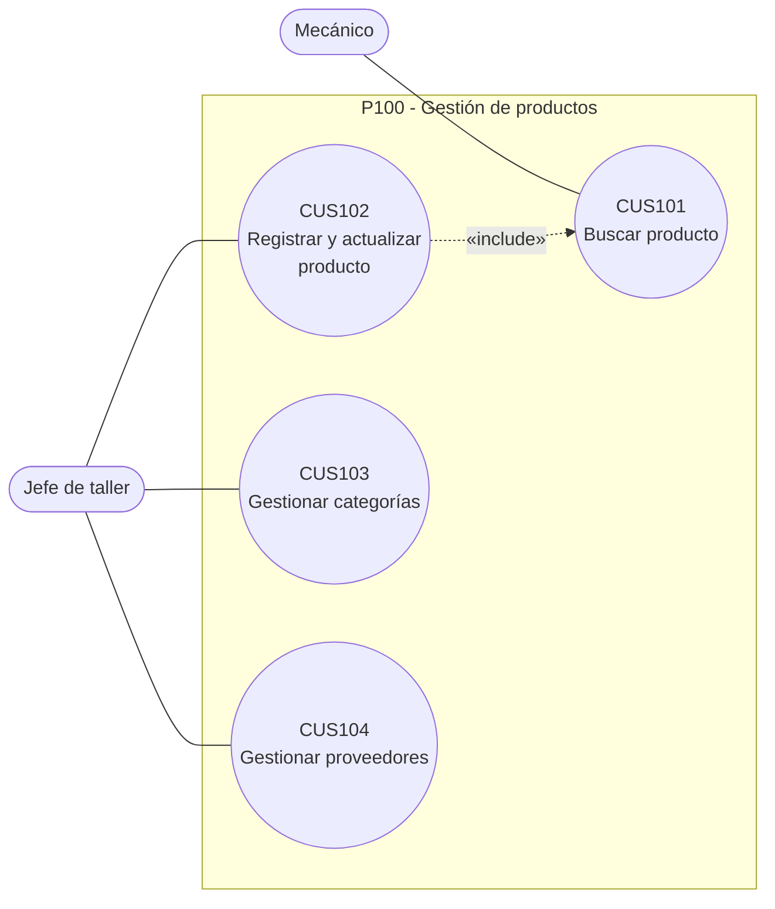

#### 3.3.5.2 Paquete P200 – Gestión de inventario

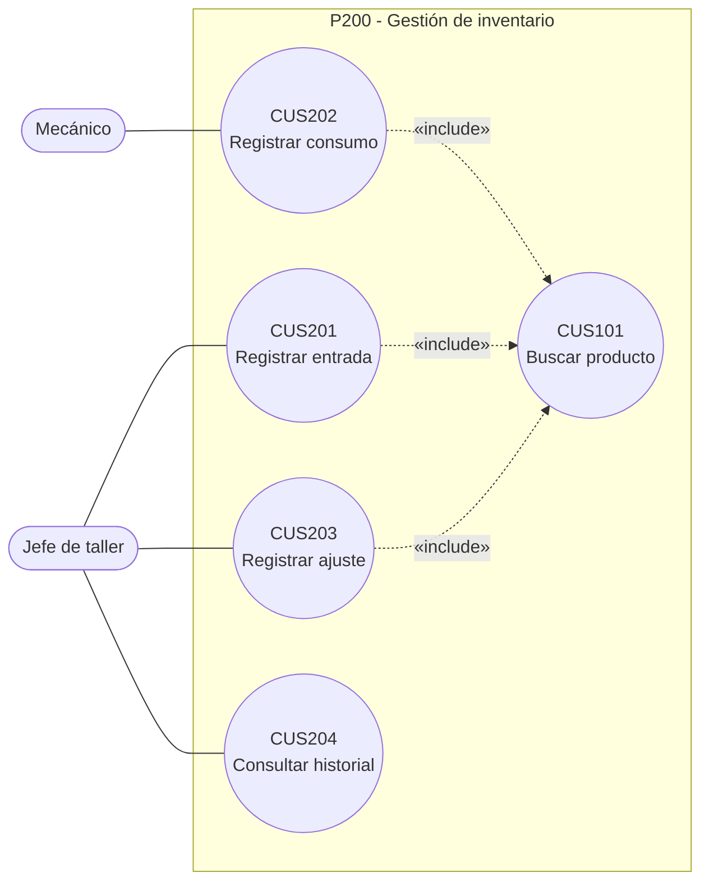

#### 3.3.5.3 Paquete P300 – Control y abastecimiento

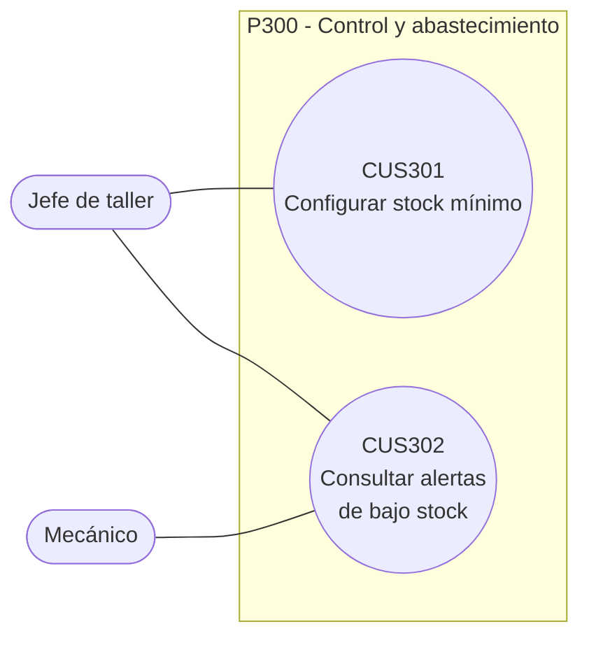

#### 3.3.5.4 Paquete P400 – Consultas y reportes

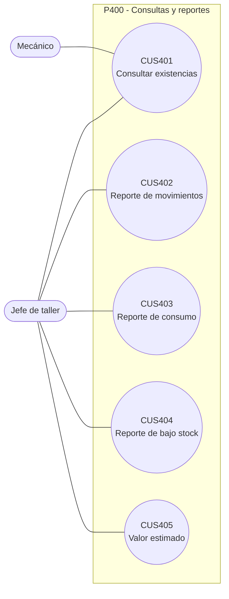

#### 3.3.5.5 Paquete Seguridad

```mermaid
flowchart LR
    USR(["Usuario"])
    ADM(["Administrador del sistema"])
    subgraph SEG["Seguridad"]
        CUS001(("CUS001<br/>Iniciar sesión"))
        CUS002(("CUS002<br/>Cambiar contraseña"))
        CUS003(("CUS003<br/>Gestionar usuarios"))
        CUS004(("CUS004<br/>Gestionar roles"))
    end
    USR --- CUS001
    USR --- CUS002
    ADM --- CUS003
    ADM --- CUS004
```

### 3.3.6 Clasificación de los Casos de Uso del Sistema

La clasificación orienta el orden de construcción y el nivel de detalle con que se especifica cada caso de uso. Se considera **primario** el caso que aporta valor directo al proceso y forma parte del núcleo central; **secundario** el que complementa o mantiene la información necesaria para los primarios; y **opcional** el que puede incorporarse después sin afectar la operación básica del inventario.

| Caso de uso | Clasificación |
|---|---|
| CUS101 – Buscar producto | Primario |
| CUS102 – Registrar y actualizar producto | Primario |
| CUS201 – Registrar entrada | Primario |
| CUS202 – Registrar consumo | Primario |
| CUS203 – Registrar ajuste de inventario | Primario |
| CUS302 – Consultar alertas de bajo stock | Primario |
| CUS401 – Consultar existencias | Primario |
| CUS103 – Gestionar categorías | Secundario |
| CUS104 – Gestionar proveedores | Secundario |
| CUS204 – Consultar historial de movimientos | Secundario |
| CUS301 – Configurar stock mínimo | Secundario |
| CUS402 – Generar reporte de movimientos | Secundario |
| CUS403 – Generar reporte de consumo | Secundario |
| CUS404 – Generar reporte de bajo stock | Secundario |
| CUS405 – Consultar valor estimado del inventario | Secundario |
| CUS001 – Iniciar sesión | Opcional |
| CUS002 – Cambiar contraseña | Opcional (no disponible en la versión actual) |
| CUS003 – Gestionar usuarios | Opcional (solo registro de usuarios) |
| CUS004 – Gestionar roles | Opcional (no disponible en la versión actual) |

### 3.3.7 Ciclos de Desarrollo de los Casos de Uso

Los ciclos agrupan los casos de uso en entregas incrementales. El **Ciclo 0** concentra el núcleo necesario para operar el inventario: catálogo, entradas, consumos, ajustes, stock mínimo, alertas y consultas básicas. El **Ciclo 1** incorpora los reportes ampliados y las funciones de seguridad, que pueden construirse sobre el núcleo ya validado.

| Ciclo | Casos de uso |
|---|---|
| **Ciclo 0 (núcleo central)** | CUS101, CUS102, CUS103, CUS104, CUS201, CUS202, CUS203, CUS204, CUS301, CUS302, CUS401 |
| **Ciclo 1** | CUS402, CUS403, CUS404, CUS405, CUS001, CUS002, CUS003, CUS004 |

---

### 3.3.8 Realización de los Casos de Uso del Sistema

#### 3.3.8.1 Especificación de Alto Nivel

La especificación de alto nivel resume, para cada caso de uso, el actor que lo inicia, el propósito que persigue, el caso de uso asociado —cuando existe una relación de inclusión—, el resultado esperado y su clasificación. Esta vista permite comparar rápidamente el alcance de los casos y seleccionar cuáles requieren una especificación detallada; las columnas «Propósito» y «Resumen» se redactan en términos del negocio, mientras que el detalle de flujos y validaciones se desarrolla en las ECUS.

| Caso de uso | Actor | Propósito | Caso de uso asociado | Resumen | Clasificación |
|---|---|---|---|---|---|
| CUS101 – Buscar producto | Jefe de taller, Mecánico | Localizar productos | — | Busca por nombre o categoría y devuelve las coincidencias con su stock. | Primario |
| CUS102 – Registrar y actualizar producto | Jefe de taller | Mantener el catálogo | CUS101 | Crea, modifica y desactiva productos con su configuración. | Primario |
| CUS103 – Gestionar categorías | Jefe de taller | Mantener categorías | — | Registra categorías. | Secundario |
| CUS104 – Gestionar proveedores | Jefe de taller | Mantener proveedores | — | Registra proveedores. | Secundario |
| CUS201 – Registrar entrada | Jefe de taller | Registrar ingresos | CUS101 | Registra el ingreso con proveedor, cantidad y costo, y actualiza el stock. | Primario |
| CUS202 – Registrar consumo | Mecánico | Registrar consumos reales | CUS101 | Registra los productos utilizados con cantidad y finalidad, validando el stock. | Primario |
| CUS203 – Registrar ajuste | Jefe de taller | Corregir diferencias | CUS101 | Registra un ajuste con conteo físico y justificación obligatoria. | Primario |
| CUS204 – Consultar historial | Jefe de taller | Trazabilidad | — | Consulta movimientos de un periodo, con filtro por tipo. | Secundario |
| CUS301 – Configurar stock mínimo | Jefe de taller | Control de existencias | — | Define el stock mínimo de un producto. | Secundario |
| CUS302 – Consultar alertas | Jefe de taller, Mecánico | Evitar desabastecimiento | — | Muestra productos con stock menor o igual al mínimo y su proveedor. | Primario |
| CUS401 – Consultar existencias | Jefe de taller, Mecánico | Conocer el stock real | — | Muestra el stock actual de los productos. | Primario |
| CUS402 – Reporte de movimientos | Jefe de taller | Apoyar decisiones | — | Genera el reporte de movimientos por periodo. | Secundario |
| CUS403 – Reporte de consumo | Jefe de taller | Analizar el uso de materiales | — | Genera el reporte de consumo por producto, mecánico y finalidad. | Secundario |
| CUS404 – Reporte de bajo stock | Jefe de taller | Planificar compras | — | Genera la lista de productos a reponer con su proveedor. | Secundario |
| CUS405 – Valor estimado del inventario | Jefe de taller | Conocer el valor operativo | — | Calcula stock por costo de última compra. | Secundario |
| CUS001 – Iniciar sesión | Usuario | Controlar el acceso | — | Valida credenciales y emite el acceso según el rol. | Opcional |
| CUS002 – Cambiar contraseña | Usuario | Seguridad de la cuenta | — | Permite cambiar la contraseña. | Opcional |
| CUS003 – Gestionar usuarios | Administrador del sistema | Administrar el acceso | — | Registra usuarios. | Opcional |
| CUS004 – Gestionar roles | Administrador del sistema | Asignar permisos | — | Los roles son fijos; sin gestión de roles. | Opcional |

> **Evidencia de prototipo:** las capturas de pantalla se incorporarán cuando el prototipo navegable esté disponible. En cada caso de uso se indica la pantalla que se espera documentar.

---

#### 3.3.8.2 ECUS: CUS101 – Buscar producto

**1. Actores:** Jefe de taller, Mecánico.

**2. Propósito:** Consultar y retornar los productos que cumplan los criterios de búsqueda.

**3. Breve descripción**

El usuario localiza un producto del catálogo mediante un criterio de búsqueda y selecciona el registro que necesita para consultar su stock o continuar con otra operación. La búsqueda no modifica información y puede realizarse por nombre o categoría.

**4. Flujo básico de eventos**

1. El usuario indica "Buscar producto".
2. El sistema muestra las opciones de búsqueda.
3. El usuario elige el criterio: nombre o categoría.
4. El usuario escribe el valor y pulsa "Buscar".
5. El sistema muestra la lista paginada de productos con código, nombre, categoría, unidad de medida, stock actual y estado, ordenada por nombre.
6. El usuario selecciona un registro y pulsa "Aceptar".
7. El sistema cierra el formulario y el caso de uso termina.

**5. Subflujos**

**5.1 Búsqueda por nombre.** El usuario selecciona «nombre», ingresa una palabra o frase y el sistema devuelve los productos cuyo nombre contiene el texto, sin distinguir mayúsculas de minúsculas.

**5.2 Búsqueda por categoría.** El usuario selecciona una categoría y el sistema lista los productos asociados, activos e inactivos, con su stock actual y unidad de medida.

**6. Flujos alternativos**

- **6.1 Sin resultados:** si en el paso 5 no hay productos, el sistema muestra un mensaje informativo y el caso continúa en el paso 3.

**7. Precondiciones**

El usuario inició sesión con rol Jefe de taller o Mecánico. El catálogo contiene al menos un producto registrado y el usuario tiene acceso a la consulta de productos.

**8. Poscondiciones**

Se muestra la lista de productos que cumplen el criterio y, si el usuario selecciona uno, el sistema devuelve el registro elegido. No se modifican productos, stock ni movimientos.

**9. Puntos de extensión**

Si el producto buscado no existe, el Jefe de taller puede registrarlo mediante CUS102. Si el usuario necesita consultar el stock de varios productos, puede continuar en CUS401.

**10. Requerimientos especiales**

La búsqueda debe admitir coincidencias parciales, ser insensible a mayúsculas y minúsculas y responder en menos de 3 segundos para el volumen previsto (RNF05). La consulta no modifica datos y respeta el rol del usuario.

**11. Información adicional**

El formulario de búsqueda, la lista de resultados y el mensaje de «sin resultados» se representan en la captura sugerida.

> **Captura sugerida:** formulario con selector de criterio, campo de búsqueda, botón "Buscar" y tabla de resultados.

---

#### 3.3.8.3 ECUS: CUS102 – Registrar y actualizar producto

**1. Actores:** Jefe de taller.

**2. Propósito:** Mantener actualizado el catálogo de productos.

**3. Breve descripción**

El Jefe de taller incorpora un producto nuevo o actualiza los datos de uno existente, manteniendo la integridad del catálogo y la conservación del historial de stock. El caso cubre el alta, la edición y la desactivación lógica del producto.

**4. Flujo básico de eventos**

1. El Jefe de taller indica "Productos".
2. El sistema muestra la lista de productos con código, nombre, categoría, stock actual y estado.
3. El Jefe de taller pulsa "Nuevo producto".
4. El sistema muestra el formulario en blanco: código, nombre, descripción, categoría, unidad de medida, proveedor principal y stock mínimo.
5. El Jefe de taller registra los datos. [RN101] [RN102] [RN103] [RN104] [RN105]
6. El Jefe de taller pulsa "Guardar".
7. El sistema valida que el código sea único y crea el producto con stock inicial cero. [RN106]
8. El sistema muestra un mensaje de confirmación y regresa a la lista.

**5. Subflujos**

**5.1 Editar producto.** El Jefe de taller selecciona un producto existente, modifica los datos descriptivos o la configuración permitida y guarda. El código solo puede modificarse si el producto no tiene movimientos; si los tiene, únicamente se admiten cambios de nombre, descripción y unidad de medida. El stock no se modifica desde este formulario.

**5.2 Desactivar producto.** El Jefe de taller selecciona «Desactivar», confirma la acción y el sistema retira el producto de las operaciones nuevas sin eliminar su historial.

**6. Flujos alternativos**

- **6.1 Código duplicado:** si en el paso 7 el código ya existe, se muestra un error y el caso continúa en el paso 5. [RN101]
- **6.2 Proveedor no registrado:** el Jefe de taller puede abrir CUS104 para registrarlo y volver al paso 5.
- **6.3 Categoría inexistente o inactiva:** el sistema impide asociarla y el Jefe de taller puede registrarla mediante CUS103.

**7. Precondiciones**

El Jefe de taller está autenticado. Para asociar el producto, existen al menos una categoría y un proveedor activos, o el Jefe de taller puede registrarlos mediante CUS103 y CUS104.

**8. Poscondiciones**

El producto queda creado o actualizado. Si se desactivó, conserva sus movimientos y deja de estar disponible para entradas, consumos y consultas operativas, según corresponda.

**9. Puntos de extensión**

Si faltan la categoría o el proveedor, el caso se extiende a CUS103 o CUS104 y regresa al formulario del producto. Si el producto tiene movimientos, la eliminación física se rechaza y se ofrece la desactivación.

**10. Requerimientos especiales**

El código es único y solo puede modificarse mientras el producto no tenga movimientos; el stock inicial es cero y no se edita desde el catálogo; los campos obligatorios deben validarse; los productos con historial no se eliminan. La operación se restringe al Jefe de taller (RN101–RN109).

**11. Información adicional**

La lista de productos, el formulario de alta y edición, y el diagrama de secuencia de diseño se presentan en esta sección y en el apartado 4.6.2.

> **Captura sugerida:** lista de productos con filtros y botones Nuevo, Editar y Desactivar; formulario de producto con combos de categoría, unidad y proveedor.

**Diagrama de secuencia – CUS102**

```mermaid
sequenceDiagram
    actor JT as Jefe de taller
    participant UI as Vista de productos
    participant C as Controlador de productos
    participant S as Servicio de productos
    participant R as Persistencia de productos
    participant DB as Base de datos

    JT->>UI: Nuevo producto
    UI-->>JT: Muestra formulario
    JT->>UI: Ingresa datos y pulsa Guardar
    UI->>C: Envía el registro del producto
    C->>S: Crear producto
    S->>R: Verificar si existe el código
    R->>DB: SELECT
    DB-->>R: resultado
    alt Código duplicado
        S-->>C: Error de negocio (RN101)
        C-->>UI: Conflicto por duplicado
        UI-->>JT: Mensaje de error
    else Código disponible
        S->>R: Guardar producto
        R->>DB: INSERT
        DB-->>R: OK
        S-->>C: producto creado
        C-->>UI: Registro creado
        UI-->>JT: Confirmación
    end
```

---

#### 3.3.8.4 ECUS: CUS103 – Gestionar categorías

**1. Actores:** Jefe de taller.

**2. Propósito:** Mantener el catálogo de categorías de productos.

**3. Breve descripción**

El Jefe de taller mantiene el catálogo de categorías que clasifican los productos, registrando nuevas categorías. La categoría debe estar activa para asociarse a un producto.

**4. Flujo básico de eventos**

1. El Jefe de taller indica "Categorías".
2. El Jefe de taller pulsa "Nueva categoría".
3. El sistema muestra el formulario con nombre y descripción.
4. El Jefe de taller registra los datos y pulsa "Guardar".
5. El sistema valida que el nombre sea único y crea la categoría.

**5. Subflujos**

**5.1 Edición y desactivación no disponibles.** La edición, la desactivación y la reactivación de categorías no forman parte de la versión actual; el catálogo de categorías solo admite nuevos registros.

**6. Flujos alternativos**

- **6.1 Nombre duplicado:** si ya existe una categoría con ese nombre (sin distinguir mayúsculas), el sistema rechaza el registro. [RN102]

**7. Precondiciones**

El Jefe de taller está autenticado y tiene acceso a la administración del catálogo.

**8. Poscondiciones**

La categoría queda registrada y disponible para asociarse a nuevos productos.

**9. Puntos de extensión**

Si el usuario necesita crear un producto con una categoría inexistente, el caso se extiende desde CUS102.

**10. Requerimientos especiales**

El nombre de la categoría es obligatorio y único; solo el Jefe de taller puede ejecutar el caso (RN102, RN107).

**11. Información adicional**

El formulario de alta de categorías se representa en la captura sugerida. El diagrama de secuencia de diseño se presenta en el apartado 4.6.14.

> **Captura sugerida:** formulario de alta de categorías.

---

#### 3.3.8.5 ECUS: CUS104 – Gestionar proveedores

**1. Actores:** Jefe de taller.

**2. Propósito:** Mantener la información de los proveedores que abastecen al taller.

**3. Breve descripción**

El Jefe de taller mantiene la información de los proveedores que abastecen el almacén, con RUC único y datos de contacto que permiten coordinar la reposición. El caso cubre el alta del proveedor.

**4. Flujo básico de eventos**

1. El Jefe de taller indica "Proveedores".
2. El Jefe de taller pulsa "Nuevo proveedor".
3. El sistema muestra el formulario: RUC, razón social, contacto, teléfono, correo y dirección. [RN105]
4. El Jefe de taller registra los datos y pulsa "Guardar".
5. El sistema valida que el RUC no esté duplicado y crea el proveedor. [RN109]

**5. Subflujos**

**5.1 Edición y desactivación no disponibles.** La edición, la desactivación y la reactivación de proveedores no forman parte de la versión actual; el proveedor registrado se conserva con sus productos y movimientos.

**6. Flujos alternativos**

- **6.1 Eliminación de proveedores:** el sistema no ofrece la eliminación de proveedores, por lo que los vinculados a productos o movimientos se conservan. [RN308]
- **6.2 RUC duplicado:** el sistema muestra un error y el caso continúa en el paso 3. [RN109]

**7. Precondiciones**

El Jefe de taller está autenticado y tiene acceso a la administración del catálogo.

**8. Poscondiciones**

El proveedor queda registrado y disponible para asociarse a productos y para nuevas entradas.

**9. Puntos de extensión**

Si el usuario necesita un proveedor inexistente al registrar una entrada, el caso se extiende desde CUS201.

**10. Requerimientos especiales**

El RUC es obligatorio y único; los datos de contacto deben permitir la comunicación; solo el Jefe de taller puede ejecutar el caso (RN105, RN109, RN308).

**11. Información adicional**

El formulario de alta y el diagrama de secuencia de diseño se presentan en esta sección y en el apartado 4.6.11.

> **Captura sugerida:** formulario de proveedor.

---

#### 3.3.8.6 ECUS: CUS201 – Registrar entrada

**1. Actores:** Jefe de taller.

**2. Propósito:** Registrar el ingreso de productos al almacén y actualizar el stock y el costo de última compra.

**3. Breve descripción**

El Jefe de taller registra el ingreso de un producto recibido del proveedor, actualizando el stock y el costo de última compra. Cada entrada genera un movimiento de entrada.

**4. Flujo básico de eventos**

1. El Jefe de taller indica "Registrar entrada".
2. El sistema muestra el formulario con la fecha actual.
3. El Jefe de taller busca y selecciona el producto.
4. El Jefe de taller selecciona el proveedor que realizó la entrega.
5. El Jefe de taller ingresa la cantidad recibida y el costo unitario. [RN201]
6. El Jefe de taller pulsa "Registrar".
7. El sistema valida que la cantidad sea mayor que cero, que el costo no sea negativo y que el producto y el proveedor estén activos. [RN202]
8. El sistema registra el movimiento de entrada y actualiza el stock y el costo de última compra. [RN203]
9. El sistema guarda el movimiento en el historial con el usuario. [RN208]
10. El sistema muestra la confirmación con el nuevo stock.

**5. Subflujos**

**5.1 Varios productos recibidos.** Cada entrada corresponde a un solo producto; cuando el proveedor entrega varios productos, el Jefe de taller registra una entrada por cada uno y cada una genera su propio movimiento.

**6. Flujos alternativos**

- **6.1 Cantidad inválida:** si en el paso 7 la cantidad es cero o negativa, el sistema muestra un error y el caso continúa en el paso 5.
- **6.2 Costo inválido:** si el costo es negativo, el sistema muestra un error y continúa en el paso 5.
- **6.3 Error transaccional:** si falla la actualización del stock, no se registra el movimiento y se informa el error.

**7. Precondiciones**

El Jefe de taller está autenticado. El producto y el proveedor existen y están activos; si no existen, el caso se extiende a CUS102 o CUS104.

**8. Poscondiciones**

El stock del producto se incrementa, el costo de última compra se actualiza con el costo registrado y se conserva un movimiento de entrada con el usuario y la fecha; el proveedor de la entrega queda indicado en el motivo del movimiento.

**9. Puntos de extensión**

Si el producto no está registrado, se extiende a CUS102. Si el proveedor no está registrado, se extiende a CUS104. Si el producto está inactivo, el sistema impide la entrada.

**10. Requerimientos especiales**

La cantidad debe ser mayor que cero y el costo no negativo; la operación es transaccional; se conserva el stock anterior y posterior; los productos y proveedores deben estar activos (RN201–RN203, RN208).

**11. Información adicional**

El formulario de entrada y el diagrama de secuencia de diseño se presentan en esta sección y en el apartado 4.6.3.

> **Captura sugerida:** formulario con fecha, buscador de producto, proveedor, cantidad, costo unitario y botón Registrar.

**Diagrama de secuencia – CUS201**

```mermaid
sequenceDiagram
    actor JT as Jefe de taller
    participant UI as Vista de entradas
    participant C as Controlador de movimientos
    participant S as Servicio de inventario
    participant PR as Persistencia de productos
    participant MR as Persistencia de movimientos
    participant DB as Base de datos

    JT->>UI: Registrar entrada
    JT->>UI: Selecciona producto, proveedor,<br/>cantidad y costo
    UI->>C: Envía el registro de la entrada
    C->>S: Registrar entrada
    S->>PR: Buscar producto por identificador
    PR-->>S: producto
    alt Producto o proveedor inactivo / datos inválidos
        S-->>C: Error de validación (RN202)
        C-->>UI: Datos inválidos
        UI-->>JT: Mensaje de error
    else Datos válidos
        S->>S: Calcular stock posterior = stock + cantidad
        S->>PR: Actualizar stock y costo
        S->>MR: Guardar movimiento de entrada
        MR->>DB: INSERT
        DB-->>MR: OK
        S-->>C: entrada registrada
        C-->>UI: Registro creado
        UI-->>JT: Confirmación y nuevo stock
    end
```

---

#### 3.3.8.7 ECUS: CUS202 – Registrar consumo

**1. Actores:** Mecánico, Jefe de taller.

**2. Propósito:** Registrar los productos utilizados en una tarea y descontarlos del inventario.

**3. Breve descripción**

El mecánico registra directamente los productos que utilizó en una tarea, con la cantidad y la finalidad del uso, y el sistema descuenta el stock de forma atómica. No existe una solicitud previa ni una aprobación del Jefe de taller.

**4. Flujo básico de eventos**

1. El mecánico indica "Registrar consumo".
2. El sistema muestra el formulario con la fecha actual.
3. El mecánico registra la finalidad del uso. [RN205]
4. El mecánico busca y selecciona un producto; el sistema muestra el stock disponible. [RN402]
5. El mecánico ingresa la cantidad utilizada. [RN206]
6. El mecánico agrega más productos si corresponde.
7. El mecánico pulsa "Confirmar".
8. El sistema valida la finalidad, las cantidades, el estado de los productos y el stock de todos los ítems. [RN206]
9. El sistema registra el consumo y un movimiento de salida por producto. [RN205]
10. El sistema descuenta el stock en una sola transacción. [RN207]
11. El sistema refleja el nuevo stock en las alertas, que se calculan en cada consulta. [RN302]
12. El sistema muestra la confirmación.

**5. Subflujos**

**5.1 Agregar producto.** El mecánico busca un producto, consulta el stock disponible, ingresa la cantidad utilizada y lo agrega a la lista del consumo.

**5.2 Modificar cantidad.** El mecánico puede corregir la cantidad de un ítem antes de confirmar; el sistema recalcula la disponibilidad y valida que no se supere el stock.

**5.3 Quitar producto.** El mecánico elimina un ítem de la lista antes de confirmar, sin que se descuente stock hasta la confirmación del consumo.

**6. Flujos alternativos**

- **6.1 Stock insuficiente:** si la cantidad supera el stock de algún producto, el sistema muestra el error, no registra ningún descuento y el caso continúa en el paso 5. [RN207]
- **6.2 Finalidad no indicada:** el sistema exige la finalidad y el caso continúa en el paso 3.
- **6.3 Producto inactivo:** el sistema impide agregarlo y el caso continúa en el paso 4.
- **6.4 Error al confirmar:** se revierte el consumo completo y se informa al mecánico.

**7. Precondiciones**

El mecánico está autenticado. Los productos existen y están activos, y la tarea o servicio que origina el consumo está identificado por la finalidad declarada.

**8. Poscondiciones**

El consumo queda confirmado, se registra un movimiento de salida por producto y el stock se descuenta en una sola transacción. Si el stock queda en o bajo el mínimo, el producto aparece en las alertas en la siguiente consulta.

**9. Puntos de extensión**

Si no hay stock suficiente, el mecánico puede consultar existencias mediante CUS401 o comunicar la necesidad al Jefe de taller para que revise las alertas en CUS302. Si el producto no existe, se solicita su registro mediante CUS102.

**10. Requerimientos especiales**

La finalidad es obligatoria; las cantidades deben ser mayores que cero; el consumo de varios productos es atómico; no se permite stock negativo; no se requiere aprobación previa; el movimiento conserva usuario, fecha y stock anterior y posterior (RN205–RN208).

**11. Información adicional**

El formulario de consumo, la lista de ítems y el diagrama de secuencia de diseño se presentan en esta sección y en el apartado 4.6.4.

> **Captura sugerida:** formulario con finalidad, buscador de producto, stock disponible, cantidad y lista de ítems agregados.

**Diagrama de secuencia – CUS202**

```mermaid
sequenceDiagram
    actor M as Mecánico
    participant UI as Vista de consumos
    participant C as Controlador de consumos
    participant S as Servicio de consumos
    participant PR as Persistencia de productos
    participant CR as Persistencia de consumos
    participant MR as Persistencia de movimientos

    M->>UI: Registrar consumo 
    UI->>C: Envía el registro del consumo
    C->>S: Registrar consumo
    S->>PR: Validar productos y stock
    PR-->>S: productos y stock
    alt Algún producto sin stock o inactivo
        S-->>C: Error (RN206, RN207)
        C-->>UI: Datos inválidos
        UI-->>M: Mensaje con el producto observado
    else Todos los ítems válidos
        S->>CR: Guardar consumo
        S->>MR: Guardar movimientos de salida
        S->>PR: Descontar stock
        S-->>C: consumo confirmado
        C-->>UI: Registro creado
        UI-->>M: Confirmación
    end
```

---

#### 3.3.8.8 ECUS: CUS203 – Registrar ajuste de inventario

**1. Actores:** Jefe de taller.

**2. Propósito:** Corregir diferencias entre el stock del sistema y el conteo físico.

**3. Breve descripción**

El Jefe de taller corrige el stock registrado a partir del conteo físico, dejando un movimiento de ajuste con la justificación obligatoria. El caso también se utiliza para la carga del inventario inicial.

**4. Flujo básico de eventos**

1. El Jefe de taller indica "Ajuste de inventario".
2. El sistema muestra el formulario con producto, stock actual y campo "Cantidad física".
3. El Jefe de taller selecciona el producto e ingresa la cantidad física contada.
4. El sistema calcula la diferencia entre la cantidad física y el stock registrado.
5. El Jefe de taller ingresa la justificación. [RN209]
6. El Jefe de taller pulsa "Registrar ajuste".
7. El sistema valida el producto, la cantidad no negativa y la justificación.
8. El sistema crea el movimiento de tipo ajuste con stock anterior y posterior, y actualiza el stock. [RN208] [RN209]
9. El sistema muestra una confirmación.

**5. Subflujos**

**5.1 Ajuste por diferencia.** El Jefe de taller selecciona el producto, ingresa la cantidad física contada y la justificación; el sistema calcula la diferencia y registra el ajuste.

**5.2 Carga de inventario inicial.** El Jefe de taller registra la cantidad física inicial de cada producto y utiliza la misma operación de ajuste para dejar el stock de apertura, con una justificación que identifique la carga.

**6. Flujos alternativos**

- **6.1 Sin justificación:** el sistema no permite registrar y el caso continúa en el paso 5. [RN209]
- **6.2 Sin diferencia:** el sistema registra el ajuste con variación cero y conserva el movimiento.
- **6.3 Cantidad negativa:** el sistema la rechaza. [RN209]

**7. Precondiciones**

El Jefe de taller está autenticado. El producto existe y se encuentra activo; el conteo físico fue realizado y documentado.

**8. Poscondiciones**

El stock queda corregido, se registra un movimiento de ajuste con stock anterior y posterior, y la justificación queda asociada al usuario y a la fecha.

**9. Puntos de extensión**

Si no existe diferencia entre el conteo y el stock del sistema, el ajuste se registra con variación cero. Si el producto no existe, el caso se extiende a CUS102.

**10. Requerimientos especiales**

La justificación es obligatoria; la cantidad física no puede ser negativa; el ajuste no elimina movimientos anteriores; la operación queda auditada con el usuario y la fecha (RN208, RN209).

**11. Información adicional**

El formulario de ajuste y el diagrama de secuencia de diseño se presentan en esta sección y en el apartado 4.6.5.

> **Captura sugerida:** formulario con stock del sistema, cantidad física, diferencia calculada y justificación obligatoria.

**Diagrama de secuencia – CUS203**

```mermaid
sequenceDiagram
    actor JT as Jefe de taller
    participant UI as Vista de ajustes
    participant C as Controlador de movimientos
    participant S as Servicio de inventario
    participant PR as Persistencia de productos
    participant MR as Persistencia de movimientos

    JT->>UI: Ingresa cantidad física y justificación
    UI->>C: Envía el registro del ajuste
    C->>S: Registrar ajuste
    alt Justificación vacía o cantidad negativa
        S-->>C: Error (RN209)
        C-->>UI: Datos inválidos
        UI-->>JT: Mensaje de error
    else Datos válidos
        S->>PR: Buscar producto por identificador
        PR-->>S: producto
        S->>S: variacion = fisico - stockActual
        S->>PR: Actualizar stock
        S->>MR: Guardar movimiento de ajuste
        S-->>C: ajuste registrado
        C-->>UI: Registro creado
        UI-->>JT: Confirmación
    end
```

---

#### 3.3.8.9 ECUS: CUS204 – Consultar historial de movimientos

**1. Actores:** Jefe de taller.

**2. Propósito:** Consultar la trazabilidad de los movimientos del inventario.

**3. Breve descripción**

El Jefe de taller consulta los movimientos del inventario de un periodo para reconstruir su trazabilidad, con un rango de fechas obligatorio y un filtro opcional por tipo de movimiento. No admite filtros por producto ni por usuario.

**4. Flujo básico de eventos**

1. El Jefe de taller indica "Historial de movimientos".
2. El sistema muestra los filtros: rango de fechas y tipo de movimiento (opcional).
3. El Jefe de taller define los filtros y pulsa "Consultar".
4. El sistema valida el rango de fechas. [RN405]
5. El sistema muestra la lista: fecha, producto, tipo, cantidad o variación, stock anterior, stock posterior, motivo o finalidad y usuario. [RN403]
6. El Jefe de taller puede exportar el resultado mediante el reporte de movimientos (CUS402).

**5. Subflujos**

**5.1 Filtro por tipo.** El Jefe de taller selecciona entradas, consumos o ajustes y el sistema limita el resultado al tipo elegido.

**5.2 Paginación y totales.** El sistema muestra los movimientos paginados, del más reciente al más antiguo, junto con los totales por tipo calculados sobre todo el filtro.

**6. Flujos alternativos**

- **6.1 Sin resultados:** el sistema informa que no hay movimientos para los filtros. [RN406]
- **6.2 Rango inválido:** el sistema muestra un error y el caso continúa en el paso 3.

**7. Precondiciones**

El Jefe de taller está autenticado y existen movimientos registrados en el sistema.

**8. Poscondiciones**

Se muestra el historial filtrado con fecha, producto, tipo, cantidad o variación, stock anterior, stock posterior, motivo y usuario. No se modifican datos.

**9. Puntos de extensión**

Si no hay resultados, el sistema informa y permite ajustar los filtros. Si el usuario necesita el detalle de un consumo, puede consultar el reporte de consumo (CUS403).

**10. Requerimientos especiales**

El rango de fechas debe ser válido; la consulta es de solo lectura; se conserva la información histórica aunque el producto esté inactivo; se incluye el stock anterior y posterior (RN403, RN406).

**11. Información adicional**

La tabla de resultados, los filtros y el diagrama de secuencia de diseño se presentan en esta sección y en el apartado 4.6.6.

> **Captura sugerida:** tabla con filtros por producto, tipo, usuario y fechas, y botón de exportar.

---

#### 3.3.8.10 ECUS: CUS301 – Configurar stock mínimo

**1. Actores:** Jefe de taller.

**2. Propósito:** Definir el nivel mínimo de existencias de cada producto.

**3. Breve descripción**

El Jefe de taller define el nivel mínimo de existencias de un producto, que sirve de umbral para la alerta de reposición. El cambio no altera el stock actual.

**4. Flujo básico de eventos**

1. El Jefe de taller indica "Stock mínimo".
2. El sistema muestra la lista de productos con su stock actual y mínimo.
3. El Jefe de taller selecciona un producto y edita el stock mínimo. [RN301]
4. El Jefe de taller pulsa "Guardar".
5. El sistema valida que el valor sea numérico y mayor o igual que cero. [RN104]
6. El sistema actualiza el valor; la situación de alerta se refleja en la siguiente consulta de alertas. [RN304]

**5. Subflujos**

**5.1 Configurar el mínimo.** El Jefe de taller selecciona un producto, ingresa el nuevo stock mínimo y guarda; el sistema valida el valor y actualiza el umbral.

**5.2 Reflejar el cambio en las alertas.** Después de guardar, el nuevo mínimo se considera en la siguiente consulta de alertas, donde el sistema compara el stock actual con él.

**6. Flujos alternativos**

- **6.1 Valor inválido:** si el valor es negativo o no numérico, el sistema muestra un error.

**7. Precondiciones**

El Jefe de taller está autenticado y el producto existe.

**8. Poscondiciones**

El stock mínimo queda actualizado y la situación de alerta del producto se refleja de inmediato en las consultas de alertas.

**9. Puntos de extensión**

Si el valor ingresado es inválido, el sistema rechaza el cambio y conserva el mínimo anterior. Si el producto no existe, el caso se extiende a CUS102.

**10. Requerimientos especiales**

El stock mínimo debe ser numérico y mayor o igual que cero; el cambio no modifica el stock actual y se aplica aunque el producto tenga movimientos; solo el Jefe de taller puede configurarlo (RN104, RN301, RN304).

**11. Información adicional**

La tabla editable de productos y el diagrama de secuencia de diseño se presentan en esta sección y en el apartado 4.6.7.

> **Captura sugerida:** tabla editable con producto, stock actual y stock mínimo.

---

#### 3.3.8.11 ECUS: CUS302 – Consultar alertas de bajo stock

**1. Actores:** Jefe de taller, Mecánico.

**2. Propósito:** Identificar oportunamente los productos con existencias críticas.

**3. Breve descripción**

El usuario consulta los productos activos cuyo stock está en el mínimo o por debajo, con la cantidad sugerida para alcanzar el mínimo y el proveedor principal para coordinar la reposición.

**4. Flujo básico de eventos**

1. El usuario indica "Alertas".
2. El sistema obtiene los productos activos con stock menor o igual al mínimo. [RN302]
3. El sistema muestra la lista: producto, stock actual, stock mínimo, cantidad sugerida y proveedor principal. [RN303] [RN305]
4. El usuario identifica el proveedor principal de cada producto para coordinar la reposición.

**5. Subflujos**

**5.1 Consultar la lista de alertas.** El sistema obtiene los productos activos con stock menor o igual al mínimo y los presenta ordenados por cantidad sugerida de mayor a menor y, ante empate, por nombre.

**5.2 Consultar el proveedor principal.** El usuario revisa, para cada producto, el stock actual, el mínimo, la cantidad sugerida y la razón social del proveedor principal.

**6. Flujos alternativos**

- **6.1 Sin alertas:** el sistema muestra "No hay productos con bajo stock".
- **6.2 Producto sin proveedor principal válido:** el sistema lo indica y permite actualizar el producto mediante CUS102.

**7. Precondiciones**

El usuario está autenticado con rol de Jefe de taller o Mecánico. Existen productos activos con stock mínimo configurado.

**8. Poscondiciones**

El usuario dispone de la lista de productos a reponer y de la información del proveedor. No se crea una orden de compra ni se modifica el stock.

**9. Puntos de extensión**

Si un producto no tiene proveedor principal válido, el sistema lo indica y permite actualizarlo mediante CUS102. Si la reposición se recibe, se registra mediante CUS201.

**10. Requerimientos especiales**

La alerta se calcula cuando el stock actual es menor o igual al stock mínimo; solo se consideran productos activos; la cantidad sugerida es referencial; no se generan órdenes de compra ni seguimiento de pedidos (RN302–RN307).

**11. Información adicional**

La lista de alertas, el detalle del proveedor y el diagrama de secuencia de diseño se presentan en esta sección y en el apartado 4.6.8.

> **Captura sugerida:** lista con indicador de criticidad, stock actual frente al mínimo, cantidad sugerida y proveedor.

**Diagrama de secuencia – CUS302**

```mermaid
sequenceDiagram
    actor JT as Jefe de taller
    participant UI as Vista de alertas
    participant C as Controlador de alertas
    participant S as Servicio de alertas
    participant PR as Persistencia de productos

    JT->>UI: Abre "Alertas"
    UI->>C: Solicita las alertas
    C->>S: Listar productos con bajo stock
    S->>PR: Buscar productos activos con stock menor o igual al mínimo
    PR-->>S: listaProductos
    S-->>C: listaAlertas
    C-->>UI: Respuesta exitosa
    UI-->>JT: Productos críticos y proveedor
```

---

#### 3.3.8.12 ECUS: CUS401 – Consultar existencias

**1. Actores:** Jefe de taller, Mecánico.

**2. Propósito:** Conocer el stock actual de cualquier producto. [RN402]

**3. Breve descripción**

El usuario consulta el stock actual de los productos activos que indica por identificador, con el estado de cada producto respecto a su stock mínimo.

**4. Flujo básico de eventos**

1. El usuario indica "Existencias".
2. El sistema solicita los productos que se desean consultar.
3. El usuario indica los productos por su identificador.
4. El sistema muestra la lista con código, nombre, stock actual, stock mínimo y estado respecto al mínimo.

**5. Subflujos**

**5.1 Consulta de varios productos.** El usuario indica uno o varios productos y el sistema muestra los datos de cada uno; los identificadores repetidos se consideran una sola vez.

**5.2 Búsqueda previa.** Para localizar productos por nombre o categoría, el usuario utiliza la búsqueda de productos (CUS101).

**6. Flujos alternativos**

- **6.1 Producto inexistente o inactivo:** el sistema rechaza la consulta e indica el producto observado. [RN406]

**7. Precondiciones**

El usuario está autenticado con rol Jefe de taller o Mecánico.

**8. Poscondiciones**

Se muestra la información de existencias solicitada. No se modifica el stock, el catálogo ni los movimientos.

**9. Puntos de extensión**

Si el usuario necesita localizar productos, puede continuar en CUS101; si necesita revisar movimientos, puede continuar en CUS204.

**10. Requerimientos especiales**

La consulta es de solo lectura; se muestra el estado respecto al mínimo; el mecánico puede consultar existencias, pero no acceder a reportes administrativos (RN402, RN406).

**11. Información adicional**

La tabla de existencias con indicador de nivel y el diagrama de secuencia de diseño se presentan en esta sección y en el apartado 4.6.12.

> **Captura sugerida:** tabla de existencias con semáforo de nivel y filtros por categoría.

---

#### 3.3.8.13 ECUS: CUS402 – Generar reporte de movimientos

**1. Actores:** Jefe de taller.

**2. Propósito:** Obtener el detalle de movimientos en un periodo. [RN405]

**3. Breve descripción**

El Jefe de taller genera un reporte de entradas, consumos y ajustes de un periodo, con filtro opcional por tipo de movimiento, totales por tipo y paginación del detalle.

**4. Flujo básico de eventos**

1. El Jefe de taller indica "Reporte de movimientos".
2. El sistema solicita fecha de inicio, fecha de fin y, opcionalmente, el tipo de movimiento.
3. El Jefe de taller pulsa "Generar".
4. El sistema valida el rango de fechas. [RN405]
5. El sistema consulta los movimientos confirmados. [RN408]
6. El sistema muestra una vista previa con totales de entradas, consumos y ajustes.
7. El Jefe de taller exporta a PDF o Excel.

**5. Subflujos**

**5.1 Vista previa.** El sistema consulta los movimientos confirmados del periodo y muestra el detalle y los totales antes de exportar.

**5.2 Exportación.** El Jefe de taller elige PDF o Excel y el sistema genera el archivo conservando los filtros y el periodo seleccionados.

**6. Flujos alternativos**

- **6.1 Rango inválido:** si la fecha final es anterior a la inicial, se muestra un error.
- **6.2 Sin datos:** se informa que no hay movimientos en el periodo.

**7. Precondiciones**

El Jefe de taller está autenticado y existen movimientos registrados en el periodo solicitado.

**8. Poscondiciones**

El reporte queda generado y disponible para visualización, impresión o exportación. No se modifican datos.

**9. Puntos de extensión**

Si no hay movimientos en el periodo, el sistema informa y permite cambiar las fechas. Si se requiere el detalle de consumo, se utiliza CUS403.

**10. Requerimientos especiales**

El rango de fechas debe ser válido; solo se incluyen movimientos confirmados; la exportación conserva los filtros; el acceso se restringe al Jefe de taller (RN405, RN408).

**11. Información adicional**

Los filtros, la vista previa y el diagrama de secuencia de diseño se presentan en esta sección y en el apartado 4.6.9.

> **Captura sugerida:** filtros de periodo y vista previa con totales por tipo de movimiento.

**Diagrama de secuencia – CUS402**

```mermaid
sequenceDiagram
    actor JT as Jefe de taller
    participant UI as Vista de reportes
    participant C as Controlador de reportes
    participant S as Servicio de reportes
    participant MR as Persistencia de movimientos

    JT->>UI: Define periodo y pulsa Generar
    UI->>C: Solicita el reporte de movimientos
    C->>S: Generar reporte de movimientos
    S->>MR: Buscar por período
    MR-->>S: movimientos
    S->>S: calcular totales
    S-->>C: reporte
    C-->>UI: Respuesta exitosa
    UI-->>JT: Vista previa del reporte
```

---

#### 3.3.8.14 ECUS: CUS403 – Generar reporte de consumo

**1. Actores:** Jefe de taller.

**2. Propósito:** Analizar el consumo de productos por periodo, producto, mecánico y finalidad. [RN404]

**3. Breve descripción**

El Jefe de taller analiza el consumo de productos por periodo, producto, mecánico y finalidad, con cantidades y fechas para apoyar el control de materiales.

**4. Flujo básico de eventos**

1. El Jefe de taller indica "Reporte de consumo".
2. El sistema solicita el rango de fechas.
3. El Jefe de taller pulsa "Generar".
4. El sistema valida el rango de fechas y consulta los consumos confirmados.
5. El sistema muestra producto, cantidad utilizada, fecha, mecánico y finalidad.
6. El Jefe de taller exporta el reporte a PDF o Excel.

**5. Subflujos**

**5.1 Agrupación por producto y mecánico.** El sistema agrupa las salidas por producto y mecánico, y muestra la cantidad total consumida, las finalidades distintas y las fechas de los movimientos agrupados.

**5.2 Orden del resultado.** El resultado se ordena por nombre de producto y, luego, por mecánico.

**6. Flujos alternativos**

- **6.1 Sin datos:** se informa que no hay consumos en el periodo.
- **6.2 Rango inválido:** se muestra un error y se solicita corregirlo.

**7. Precondiciones**

El Jefe de taller está autenticado y existen consumos confirmados en el periodo solicitado.

**8. Poscondiciones**

El reporte de consumo queda generado y disponible para visualización, impresión o exportación. No se modifican datos.

**9. Puntos de extensión**

Si no hay consumos en el periodo, el sistema informa y permite ajustar las fechas o los filtros.

**10. Requerimientos especiales**

Solo se incluyen consumos confirmados; el rango de fechas debe ser válido; el reporte es de solo lectura y se restringe al Jefe de taller (RN404, RN405).

**11. Información adicional**

La vista previa del reporte y el diagrama de secuencia de diseño se presentan en esta sección y en el apartado 4.6.13.

> **Captura sugerida:** reporte de consumo agrupado por producto y mecánico, con totales del periodo.

---

#### 3.3.8.15 ECUS: CUS404 – Generar reporte de bajo stock

**1. Actores:** Jefe de taller.

**2. Propósito:** Planificar las compras de reposición.

**3. Breve descripción**

El Jefe de taller obtiene la lista de productos que deben reponerse, agrupada por proveedor, con stock actual, stock mínimo y cantidad sugerida para apoyar la compra.

**4. Flujo básico de eventos**

1. El Jefe de taller indica "Reporte de bajo stock".
2. El sistema obtiene los productos activos con stock menor o igual al mínimo. [RN302]
3. El sistema muestra la vista previa agrupada por proveedor, con stock actual, mínimo y cantidad sugerida. [RN305]
4. El Jefe de taller exporta el reporte a PDF o Excel.

**5. Subflujos**

**5.1 Agrupación por proveedor.** El sistema agrupa los productos en alerta según su proveedor principal para facilitar la coordinación de la compra.

**5.2 Exportación.** El Jefe de taller exporta el reporte a PDF o Excel con la misma agrupación.

**6. Flujos alternativos**

- **6.1 Sin productos en alerta:** se informa que no hay productos por reponer.

**7. Precondiciones**

El Jefe de taller está autenticado y existen productos activos con stock mínimo configurado.

**8. Poscondiciones**

El reporte de bajo stock queda generado y disponible para revisión. No se crea una orden de compra ni se modifica el stock.

**9. Puntos de extensión**

Si no hay productos en alerta, el sistema informa que no existen necesidades de reposición. Si la reposición se recibe, se registra mediante CUS201.

**10. Requerimientos especiales**

Solo se consideran productos activos; la cantidad sugerida es referencial; el reporte no genera compras ni compromete pedidos (RN302, RN305, RN306).

**11. Información adicional**

El reporte agrupado por proveedor se representa en la captura sugerida. El diagrama de secuencia de diseño se incorpora en el apartado 4.6.15.

> **Captura sugerida:** reporte agrupado por proveedor con stock actual, mínimo y cantidad sugerida.

---

#### 3.3.8.16 ECUS: CUS405 – Consultar valor estimado del inventario

**1. Actores:** Jefe de taller.

**2. Propósito:** Conocer el valor operativo del inventario a partir del costo de última compra. [RN407]

**3. Breve descripción**

El Jefe de taller consulta el valor operativo del inventario a partir del stock actual y el costo de última compra de cada producto, considerando los productos activos.

**4. Flujo básico de eventos**

1. El Jefe de taller indica "Valor estimado del inventario".
2. El sistema considera los productos activos.
3. El sistema obtiene el stock actual y el costo de última compra de cada producto.
4. El sistema calcula stock por costo y suma los valores.
5. El sistema muestra el detalle por producto y el total, identificando la estimación como operativa. [RN408]
6. El Jefe de taller revisa el total, la cantidad de productos con costo y la de productos sin costo.

**5. Subflujos**

**5.1 Cálculo total.** El sistema multiplica el stock actual por el costo de última compra de cada producto y suma los valores para obtener el total estimado.

**5.2 Detalle por producto.** El Jefe de taller revisa el detalle por producto y el total, e identifica los productos que no tienen costo registrado y que se excluyen del cálculo.

**6. Flujos alternativos**

- **6.1 Producto sin costo de última compra:** el sistema no inventa un costo, lo identifica y lo excluye del total, informando la cantidad de productos excluidos.

**7. Precondiciones**

El Jefe de taller está autenticado y existen productos con stock y costo de última compra registrados.

**8. Poscondiciones**

Se muestra el valor estimado del inventario y el detalle por producto. No se modifica información.

**9. Puntos de extensión**

Si un producto no tiene costo de última compra, el sistema lo identifica, lo excluye del total e informa la cantidad de productos excluidos. Si el usuario necesita actualizar el costo, se registra una nueva entrada mediante CUS201.

**10. Requerimientos especiales**

El valor es una estimación operativa, no una valoración contable oficial; se identifica el método de cálculo y las exclusiones; la consulta es de solo lectura (RN407, RN408).

**11. Información adicional**

La tabla con producto, stock, costo y valor estimado, y el diagrama de secuencia de diseño se presentan en esta sección y en el apartado 4.6.10.

> **Captura sugerida:** tabla con producto, stock, costo de última compra, valor estimado y total general.

**Diagrama de secuencia – CUS405**

```mermaid
sequenceDiagram
    actor JT as Jefe de taller
    participant UI as Vista de valor del inventario
    participant C as Controlador de reportes
    participant S as Servicio de reportes
    participant PR as Persistencia de productos

    JT->>UI: Consultar valor estimado
    UI->>C: Solicita el valor estimado del inventario
    C->>S: Calcular valor estimado
    S->>PR: Buscar productos con costo
    PR-->>S: productos
    S->>S: Sumar stock actual por costo de última compra
    S-->>C: valor con productos sin costo
    C-->>UI: Respuesta exitosa
    UI-->>JT: Detalle y total estimado
```

---

#### 3.3.8.17 ECUS: CUS001 – Iniciar sesión

**1. Actores:** Usuario.

**2. Propósito:** Permitir el acceso controlado al sistema mediante credenciales válidas y aplicar las funciones permitidas para el rol del usuario.

**3. Breve descripción**

El usuario se autentica con sus credenciales y el sistema valida su identidad y estado para determinar los permisos correspondientes a su rol.

**4. Flujo básico de eventos**

1. El usuario abre el sistema.
2. El sistema muestra el formulario de acceso.
3. El usuario ingresa su usuario y contraseña, y pulsa "Ingresar".
4. El sistema valida las credenciales y el estado del usuario.
5. El sistema emite una credencial de acceso temporal e informa el rol del usuario.

**5. Subflujos**

No existen subflujos para este caso de uso.

**6. Flujos alternativos**

- **6.1 Credenciales incorrectas:** si el usuario o la contraseña no coinciden, el sistema muestra un error genérico y el caso continúa en el paso 3.

- **6.2 Usuario inactivo:** si la cuenta está desactivada, el sistema deniega el acceso y muestra un mensaje informativo.

**7. Precondiciones**

El usuario está registrado, activo y conoce sus credenciales de acceso.

**8. Poscondiciones**

La sesión queda iniciada con una credencial de acceso temporal y el sistema aplica las opciones permitidas según el rol del usuario.

**9. Puntos de extensión**

Si el usuario olvidó su contraseña, debe solicitar apoyo al administrador del sistema; la versión actual no incluye el restablecimiento de contraseñas. Si la cuenta está inactiva, el acceso se deniega.

**10. Requerimientos especiales**

Las contraseñas se almacenan cifradas con hash y sal; los mensajes de error no revelan si el usuario existe; se bloquea el acceso de cuentas inactivas (RNF07, RNF08).

**11. Información adicional**

La pantalla de inicio de sesión con usuario, contraseña y botón «Ingresar» se representa en la captura sugerida.

> **Captura sugerida:** pantalla de inicio de sesión con usuario, contraseña y botón Ingresar.

---

#### 3.3.8.18 ECUS: CUS002 – Cambiar contraseña

> **Alcance actual:** este caso de uso no está disponible en la versión actual del sistema; se conserva como especificación para una versión posterior.

**1. Actores:** Usuario.

**2. Propósito:** Permitir que el usuario autenticado cambie su contraseña de forma segura, validando la contraseña actual y la política mínima.

**3. Breve descripción**

El usuario autenticado cambia su contraseña, validando la contraseña actual y el cumplimiento de la política mínima de seguridad.

**4. Flujo básico de eventos**

1. El usuario autenticado indica "Cambiar contraseña".
2. El sistema solicita la contraseña actual y la nueva.
3. El usuario ingresa los datos y confirma.
4. El sistema valida la contraseña actual y la política mínima.
5. El sistema guarda la nueva contraseña cifrada.

**5. Subflujos**

No existen subflujos para este caso de uso.

**6. Flujos alternativos**

- **6.1 Contraseña actual incorrecta:** el sistema muestra un error y no realiza el cambio; el caso continúa en el paso 3.

**7. Precondiciones**

El usuario está autenticado y conoce su contraseña actual.

**8. Poscondiciones**

La contraseña queda actualizada y almacenada cifrada. La sesión continúa activa.

**9. Puntos de extensión**

Si la contraseña actual es incorrecta, el sistema muestra un error y permite reintentar sin cerrar la sesión.

**10. Requerimientos especiales**

La nueva contraseña se almacena con hash y sal; no se muestran contraseñas en texto plano; la política de longitud y complejidad se acuerda con el usuario (RNF08).

**11. Información adicional**

El formulario de cambio de contraseña se representa en la captura sugerida.

---

#### 3.3.8.19 ECUS: CUS003 – Gestionar usuarios

**1. Actores:** Administrador del sistema.

**2. Propósito:** Administrar las cuentas de usuario, asignar roles y conservar el historial de las operaciones realizadas por cada cuenta.

**3. Breve descripción**

El administrador registra usuarios y les asigna un rol (Jefe de taller o Mecánico). La edición y la desactivación de usuarios no están disponibles en la versión actual.

**4. Flujo básico de eventos**

1. El administrador indica "Usuarios".
2. El sistema muestra la lista de usuarios.
3. El administrador pulsa "Nuevo usuario".
4. El sistema solicita usuario, contraseña inicial y rol.
5. El administrador registra los datos y guarda.
6. El sistema valida la unicidad del usuario y crea la cuenta.

**5. Subflujos**

**5.1 Registrar usuario.** El administrador ingresa usuario, contraseña inicial y rol; el sistema valida la unicidad del usuario, el formato del nombre y la política de contraseña, y crea la cuenta.

**5.2 Editar usuario (no disponible).** La edición de usuarios no forma parte de la versión actual.

**5.3 Desactivar usuario (no disponible).** La desactivación de usuarios no forma parte de la versión actual; las cuentas existentes conservan sus movimientos y consumos.

**6. Flujos alternativos**

- **6.1 Usuario duplicado:** el sistema muestra un error y el caso continúa en el paso 4.

- **6.2 Rol no permitido:** el sistema rechaza el registro si el rol no es Jefe de taller o Mecánico; el rol de administrador no se asigna por registro.

**7. Precondiciones**

El administrador del sistema está autenticado y tiene acceso a la gestión de usuarios.

**8. Poscondiciones**

El usuario queda registrado y puede iniciar sesión con las credenciales asignadas.

**9. Puntos de extensión**

El sistema no ofrece la eliminación de usuarios, por lo que los movimientos y consumos registrados por cada cuenta se conservan.

**10. Requerimientos especiales**

El nombre de usuario es único, de 3 a 20 caracteres (letras, números y guion bajo); la contraseña inicial tiene al menos 8 caracteres, una mayúscula y un número, y se almacena cifrada; el rol debe ser Jefe de taller o Mecánico; solo el administrador puede ejecutar el caso (RNF07, RNF09).

**11. Información adicional**

El formulario de registro de usuarios se representa en la captura sugerida.

---

#### 3.3.8.20 ECUS: CUS004 – Gestionar roles

> **Alcance actual:** este caso de uso no está disponible en la versión actual del sistema; los roles son fijos y se conservan como especificación para una versión posterior.

**1. Actores:** Administrador del sistema.

**2. Propósito:** Definir y mantener los permisos asociados a cada rol, de modo que los usuarios accedan solo a las funciones que les corresponden.

**3. Breve descripción**

El administrador revisa y ajusta los permisos asociados a los roles del sistema, de modo que cada usuario acceda solo a las funciones que le corresponden.

**4. Flujo básico de eventos**

1. El administrador indica "Roles".
2. El sistema muestra los roles disponibles: Jefe de taller, Mecánico y Administrador.
3. El administrador selecciona un rol y revisa sus permisos.
4. El sistema guarda la asignación y la aplica en el siguiente inicio de sesión.

**5. Subflujos**

**5.1 Revisar permisos.** El administrador selecciona un rol y revisa las funciones habilitadas para ese rol.

**5.2 Asignar permisos.** El administrador modifica los permisos y guarda; el sistema aplica los cambios en el siguiente inicio de sesión de los usuarios afectados.

**6. Flujos alternativos**

- **6.1 Rol con usuarios activos:** el sistema advierte el impacto antes de modificar los permisos y solicita confirmación.

**7. Precondiciones**

El administrador del sistema está autenticado y existen roles definidos.

**8. Poscondiciones**

Los permisos del rol quedan actualizados y se aplican a los usuarios que lo tengan asignado.

**9. Puntos de extensión**

Si el rol tiene usuarios activos, el sistema advierte el impacto del cambio antes de confirmarlo.

**10. Requerimientos especiales**

Los roles base no se eliminan; los cambios de permisos se auditan; solo el administrador puede ejecutar el caso (RNF07, RNF09).

**11. Información adicional**

La matriz de permisos por rol se representa en la captura sugerida.

---
### 3.3.9 Modelo Conceptual Refinado

```mermaid
classDiagram
    class Categoria {
        +Entero id
        +Texto nombre
        +Texto descripcion
        +Booleano activo
    }
    class Proveedor {
        +Entero id
        +Texto ruc
        +Texto razonSocial
        +Texto contacto
        +Texto telefono
        +Texto correo
        +Texto direccion
        +Booleano activo
    }
    class Producto {
        +Entero id
        +Texto codigo
        +Texto nombre
        +Texto descripcion
        +Texto unidadMedida
        +Entero stockActual
        +Entero stockMinimo
        +Decimal costoUltimaCompra
        +Booleano activo
    }
    class Consumo {
        +Entero id
        +Fecha y hora fecha
        +Texto finalidad
        +Texto referenciaVehiculoCliente
    }
    class MovimientoInventario {
        +Entero id
        +Fecha y hora fecha
        +Tipo de movimiento tipo
        +Entero cantidad
        +Entero variacion
        +Entero stockAnterior
        +Entero stockPosterior
        +Decimal costoUnitario
        +Texto motivo
    }
    class Usuario {
        +Entero id
        +Texto username
        +Texto passwordHash
        +Booleano activo
    }
    class Rol {
        +Entero id
        +Texto nombre
    }
    class TipoMovimiento {
        <<enumeration>>
        ENTRADA
        CONSUMO
        AJUSTE
    }
    Categoria "1" --> "*" Producto
    Proveedor "1" --> "*" Producto : proveedor principal
    Producto "1" --> "*" MovimientoInventario
    Consumo "0..1" --> "*" MovimientoInventario
    Usuario "1" --> "*" Consumo : registra
    Usuario "1" --> "*" MovimientoInventario : registra
    Usuario "*" --> "1" Rol
    MovimientoInventario --> TipoMovimiento
```

> **Decisión de modelado:** la alerta de bajo stock no se almacena como una entidad independiente. Se calcula comparando el stock actual con el stock mínimo para los productos activos. De esta manera la alerta desaparece automáticamente cuando el stock supera el mínimo y no requiere un proceso de "atención" o cierre.

### 3.3.10 Diccionario de Clases

El diccionario describe las clases del modelo conceptual y sus atributos. Para cada atributo se indica su significado, el tipo de dato, el valor inicial —cuando aplica— y la visibilidad; las relaciones entre clases se muestran en el diagrama del apartado 3.3.9 y las operaciones que las utilizan se detallan en las ECUS y en los diagramas de secuencia. Los nombres se mantienen en singular para facilitar su correspondencia con el modelo de datos. El diccionario se organiza en tres grupos: entidades, interfaces o fronteras y controladoras.

#### 3.3.10.1 Entidades

Las entidades representan los objetos persistentes del dominio y conservan los datos que el sistema debe recordar. Sus atributos se detallan a continuación; las operaciones asociadas se describen en las ECUS y en los DSD.

##### Producto

Representa el repuesto, herramienta o insumo que el taller administra. Concentra los datos de identificación, la unidad de medida, el stock actual y mínimo, el costo de la última compra y el estado; las relaciones con categoría, proveedor y movimientos se muestran en el modelo conceptual.

| Atributo | Descripción | Tipo | Valor inicial | Visibilidad |
|---|---|---|---|---|
| id | Identificador interno | Entero | – | Privado |
| codigo | Código único del producto [RN101] | Texto | – | Privado |
| sku | Código interno generado a partir del identificador | Texto | – | Privado |
| nombre | Nombre del producto | Texto | – | Privado |
| descripcion | Descripción | Texto | – | Privado |
| unidadMedida | Unidad de medida principal [RN103] | Texto | – | Privado |
| stockActual | Existencias disponibles | Entero | 0 | Privado |
| stockMinimo | Nivel mínimo de existencias [RN104] | Entero | 0 | Privado |
| costoUltimaCompra | Costo de la última entrada confirmada [RN203] | Decimal | null | Privado |
| activo | Indica si el producto está activo | Booleano | true | Privado |

##### Categoría

Clasifica los productos para agruparlos y facilitar la búsqueda y los reportes. El atributo activo permite retirar una categoría del uso sin perder la clasificación de los productos que ya la tenían.

| Atributo | Descripción | Tipo | Valor inicial | Visibilidad |
|---|---|---|---|---|
| id | Identificador | Entero | – | Privado |
| nombre | Nombre de la categoría | Texto | – | Privado |
| descripcion | Descripción | Texto | – | Privado |
| activo | Estado de la categoría | Booleano | true | Privado |

##### Proveedor

Representa a la empresa o persona que abastece al taller. El RUC identifica al proveedor de forma única y los datos de contacto permiten coordinar la reposición cuando el stock llega al mínimo.

| Atributo | Descripción | Tipo | Valor inicial | Visibilidad |
|---|---|---|---|---|
| id | Identificador | Entero | – | Privado |
| ruc | RUC del proveedor | Texto | – | Privado |
| razonSocial | Razón social | Texto | – | Privado |
| contacto | Persona de contacto | Texto | – | Privado |
| telefono | Teléfono | Texto | – | Privado |
| correo | Correo electrónico | Texto | – | Privado |
| direccion | Dirección | Texto | – | Privado |
| activo | Estado | Booleano | true | Privado |

##### Consumo

Agrupa los productos utilizados en una misma tarea y conserva la finalidad declarada por el mecánico. La referencia del vehículo o del cliente es opcional; los movimientos de salida se asocian a este consumo para mantener el detalle por producto.

| Atributo | Descripción | Tipo | Valor inicial | Visibilidad |
|---|---|---|---|---|
| id | Identificador | Entero | – | Privado |
| fecha | Fecha y hora del consumo | Fecha y hora | Fecha actual | Privado |
| finalidad | Finalidad declarada por el mecánico [RN205] | Texto | – | Privado |
| referenciaVehiculoCliente | Referencia opcional de vehículo o cliente | Texto | null | Privado |

##### MovimientoInventario

Registra cada variación del stock con su tipo, cantidad o variación, stock anterior y posterior, costo unitario y motivo. Es la clase que garantiza la trazabilidad y la que permite reconstruir el historial de un producto.

| Atributo | Descripción | Tipo | Valor inicial | Visibilidad |
|---|---|---|---|---|
| id | Identificador | Entero | – | Privado |
| fecha | Fecha y hora del movimiento | Fecha y hora | Fecha actual | Privado |
| tipo | ENTRADA, CONSUMO o AJUSTE | Tipo de movimiento | – | Privado |
| cantidad | Cantidad movida en entradas y consumos; nula en los ajustes | Entero | – | Privado |
| variacion | Diferencia aplicada al stock: coincide con la cantidad en las entradas, es nula en los consumos y es la diferencia con signo en los ajustes | Entero | 0 | Privado |
| stockAnterior | Stock antes del movimiento [RN208] | Entero | – | Privado |
| stockPosterior | Stock después del movimiento [RN208] | Entero | – | Privado |
| costoUnitario | Costo unitario de la entrada [RN201] | Decimal | 0 | Privado |
| motivo | Proveedor de la entrada, finalidad del consumo o justificación del ajuste | Texto | – | Privado |

##### Usuario y Rol

Usuario representa a la persona que opera el sistema y Rol define el conjunto de permisos que se le asignan. La cuenta conserva el estado y la contraseña cifrada, mientras que el rol determina el acceso al catálogo, a los movimientos y a los reportes.

| Clase | Atributo | Descripción | Tipo |
|---|---|---|---|
| Usuario | username | Nombre de usuario | Texto |
| Usuario | passwordHash | Contraseña cifrada | Texto |
| Usuario | activo | Estado | Booleano |
| Rol | nombre | Nombre del rol: Jefe de taller, Mecánico o Administrador | Texto |

#### 3.3.10.2 Interfaces o Fronteras

Las interfaces o fronteras representan las pantallas y formularios con los que interactúa el usuario. Cada clase CI agrupa los datos que se muestran, las acciones disponibles y los mensajes de validación; no contiene reglas de negocio ni acceso directo a la persistencia.

| Clase | Responsabilidad | Casos de uso |
|---|---|---|
| CI_BuscarProducto | Formulario de búsqueda y selección de productos | CUS101 |
| CI_ListaProductos | Lista del catálogo con acciones de alta, edición y desactivación | CUS102 |
| CI_FormularioProducto | Captura y edición de los datos del producto | CUS102 |
| CI_FormularioCategoria | Captura de categorías | CUS103 |
| CI_FormularioProveedor | Captura de proveedores | CUS104 |
| CI_RegistrarEntrada | Formulario de entrada con producto, proveedor, cantidad y costo | CUS201 |
| CI_RegistrarConsumo | Formulario de consumo con finalidad e ítems utilizados | CUS202 |
| CI_AjusteInventario | Formulario de conteo físico y justificación | CUS203 |
| CI_HistorialMovimientos | Filtros por fecha y tipo, y tabla de movimientos | CUS204 |
| CI_StockMinimo | Tabla editable de stock mínimo por producto | CUS301 |
| CI_AlertasStock | Lista de productos en situación crítica y proveedor | CUS302 |
| CI_Existencias | Consulta de existencias por producto con indicador de nivel | CUS401 |
| CI_ReporteMovimientos | Filtros, vista previa y exportación del reporte de movimientos | CUS402 |
| CI_ReporteConsumo | Filtros, vista previa y exportación del reporte de consumo | CUS403 |
| CI_ReporteBajoStock | Reporte de reposición agrupado por proveedor | CUS404 |
| CI_ValorInventario | Detalle y total del valor estimado del inventario | CUS405 |
| CI_Login | Formulario de autenticación | CUS001 |
| CI_Usuarios | Formulario de registro de usuarios | CUS003 |
| CI_Roles | Matriz de permisos por rol (no disponible en la versión actual) | CUS004 |

#### 3.3.10.3 Controladoras

Las controladoras coordinan el flujo entre la interfaz y las entidades: reciben la solicitud, validan las reglas de negocio, acceden a la persistencia y devuelven el resultado. No contienen lógica de presentación ni detalles de la base de datos.

| Clase | Responsabilidad | Casos de uso |
|---|---|---|
| CC_BuscarProducto | Coordinar la búsqueda y devolver las coincidencias | CUS101 |
| CC_ActualizarProducto | Validar unicidad y persistir altas, ediciones y desactivaciones | CUS102 |
| CC_GestionarCategoria | Validar y persistir categorías | CUS103 |
| CC_GestionarProveedor | Validar RUC y persistir proveedores | CUS104 |
| CC_RegistrarMovimiento | Registrar entradas y actualizar stock y costo | CUS201 |
| CC_RegistrarConsumo | Validar stock, registrar consumo y descontar existencias | CUS202 |
| CC_RegistrarAjuste | Calcular la diferencia y registrar el ajuste | CUS203 |
| CC_ConsultarHistorial | Filtrar y devolver movimientos | CUS204 |
| CC_ConfigurarStockMinimo | Actualizar el stock mínimo | CUS301 |
| CC_ConsultarAlertas | Obtener productos bajo el mínimo | CUS302 |
| CC_ConsultarExistencias | Consultar productos activos y su stock | CUS401 |
| CC_GenerarReporte | Generar reportes de movimientos, consumo y bajo stock | CUS402, CUS403, CUS404 |
| CC_CalcularValor | Calcular el valor estimado del inventario | CUS405 |
| CC_Autenticar | Validar credenciales y cargar el rol | CUS001 |
| CC_GestionarUsuarios | Registrar usuarios | CUS003 |
| CC_GestionarRoles | Revisar y actualizar los permisos de cada rol (no disponible en la versión actual) | CUS004 |

---

# 4. ARQUITECTURA DE SOFTWARE

## 4.1 Metas y Restricciones de la Arquitectura

La arquitectura debe satisfacer los requerimientos no funcionales y respetar las restricciones tecnológicas acordadas. La siguiente tabla relaciona cada categoría de requerimiento con los códigos que condicionan el diseño; esta relación guía las decisiones de capas, mecanismos y patrones que se presentan en el resto del capítulo.

| Clasificación | Requerimientos con impacto |
|---|---|
| **Usabilidad** | RNF01, RNF02, RNF03 |
| **Confiabilidad** | RNF04, RNF11, RNF13, RNF15 |
| **Rendimiento** | RNF05, RNF06 |
| **Seguridad** | RNF07, RNF08, RNF09, RNF10 |
| **Integridad** | RNF11, RNF12, RNF13 |
| **Mantenibilidad** | RNF14 |
| **Restricciones de diseño** | RNF16 (servicio de aplicación con base de datos relacional) |

## 4.2 Vista de Casos de Uso

### 4.2.1 Diagrama de Actores del Sistema

```mermaid
flowchart TD
    U(["Usuario"])
    JT(["Jefe de taller"])
    MEC(["Mecánico"])
    ADM(["Administrador del sistema"])
    JT -- "es un" --> U
    MEC -- "es un" --> U
    ADM -- "es un" --> U
```

El diagrama muestra la generalización de los actores: el Jefe de taller, el Mecánico y el Administrador del sistema comparten las operaciones comunes de Usuario, como iniciar sesión, y añaden las funciones propias de su rol. Esta jerarquía permite reutilizar los casos de uso de seguridad y mantener separados los permisos administrativos.

### 4.2.2 Diagrama de Casos de Uso del Sistema (Núcleo Central)

```mermaid
flowchart LR
    JT(["Jefe de taller"])
    MEC(["Mecánico"])

    subgraph NUCLEO["Ciclo 0 - Núcleo central"]
        CUS101(("CUS101<br/>Buscar producto"))
        CUS102(("CUS102<br/>Registrar y actualizar<br/>producto"))
        CUS103(("CUS103<br/>Gestionar categorías"))
        CUS104(("CUS104<br/>Gestionar proveedores"))
        CUS201(("CUS201<br/>Registrar entrada"))
        CUS202(("CUS202<br/>Registrar consumo"))
        CUS203(("CUS203<br/>Registrar ajuste"))
        CUS204(("CUS204<br/>Consultar historial"))
        CUS301(("CUS301<br/>Configurar stock mínimo"))
        CUS302(("CUS302<br/>Consultar alertas"))
        CUS401(("CUS401<br/>Consultar existencias"))
    end

    JT --- CUS102
    JT --- CUS103
    JT --- CUS104
    JT --- CUS201
    JT --- CUS203
    JT --- CUS204
    JT --- CUS301
    JT --- CUS302
    MEC --- CUS302
    JT --- CUS401
    MEC --- CUS202
    MEC --- CUS401
    CUS102 -. "«include»" .-> CUS101
    CUS201 -. "«include»" .-> CUS101
    CUS202 -. "«include»" .-> CUS101
    CUS203 -. "«include»" .-> CUS101
```

El diagrama muestra el núcleo central del sistema y las relaciones de inclusión hacia la búsqueda de productos. El Jefe de taller concentra la administración y las consultas; el Mecánico participa en el consumo y en la consulta de existencias y alertas. Los casos de reportes y seguridad se incorporan en el Ciclo 1 y no forman parte de este núcleo.

## 4.3 Vista General

### 4.3.1 Diagrama de Capas

```mermaid
flowchart TB
    subgraph PRES["Capa de Presentación"]
        V["Interfaz de acceso al sistema"]
    end
    subgraph NEG["Capa de Negocio"]
        SV["Servicios: Producto, Inventario, Consumo,<br/>Alerta, Reporte y Seguridad"]
    end
    subgraph DAT["Capa de Datos"]
        RP["Persistencia y entidades"]
    end
    DB[("Base de datos relacional")]
    PRES --> NEG
    NEG --> DAT
    DAT --> DB
```

La lectura del diagrama es descendente: la presentación solicita operaciones al negocio, el negocio valida las reglas y coordina la transacción, y la capa de datos persiste los cambios. La base de datos solo es accesible a través de la capa de persistencia, lo que evita que las vistas o los controladores ejecuten consultas directas.

### 4.3.2 Descripción de las Capas

La separación en capas busca aislar las responsabilidades y reducir el acoplamiento: la presentación conoce la interfaz y los contratos de negocio, el negocio concentra las reglas y transacciones, y la capa de datos resuelve la persistencia. La tabla detalla qué corresponde a cada capa y qué elementos no debe asumir, de modo que las dependencias avancen siempre desde la presentación hacia los datos y nunca en sentido contrario.

| Capa | Responsabilidad |
|---|---|
| **Presentación** | Captura y presenta la información al usuario; expone las operaciones del sistema, valida el formato de entrada y traduce los errores de negocio en mensajes comprensibles. No aplica reglas de stock ni accede directamente a la base de datos. |
| **Negocio** | Implementa las reglas RN101–RN408, coordina las transacciones, valida stock y permisos, calcula alertas y elabora los reportes. Es la única capa que decide si una operación puede confirmarse. |
| **Datos** | Mantiene las entidades y gestiona la persistencia, las consultas y los bloqueos necesarios para evitar actualizaciones inconsistentes. No contiene reglas de negocio ni mensajes de interfaz. |

## 4.4 Mecanismos

Los mecanismos son las soluciones transversales que la arquitectura adopta para resolver problemas recurrentes, como el manejo de errores, la seguridad, la persistencia, la auditoría, los reportes, las alertas y la concurrencia. La tabla indica el requerimiento que justifica cada mecanismo y la solución propuesta, de manera que las decisiones puedan revisarse y trazarse frente a los RNF.

| Mecanismo | Descripción | Requerimiento | Solución |
|---|---|---|---|
| **Gestión de errores** | Manejo uniforme de excepciones de negocio y técnicas | RNF02 | Manejador global de excepciones con mensajes claros y registro en log. |
| **Seguridad** | Autenticación y autorización por rol | RNF07, RNF08, RNF10 | Autenticación con contraseña cifrada, credencial de acceso temporal sin sesión en el servidor y autorización por rol. |
| **Persistencia** | Acceso a datos y transacciones | RNF11, RNF12 | Capa de persistencia con transacciones para movimientos, consumos y actualización de stock. |
| **Auditoría** | Trazabilidad de acciones | RNF09, RN208 | Cada movimiento guarda usuario, fecha, tipo y stock anterior y posterior. |
| **Reportes** | Generación y exportación | RF407 | Generación de PDF y Excel desde consultas por periodo. |
| **Alertas** | Detección de stock bajo | RN302, RN304 | Consulta derivada que compara stock actual con stock mínimo, complementada por una tarea programada que registra periódicamente el resultado de la revisión. |
| **Concurrencia** | Evitar descuentos simultáneos inconsistentes | RNF13 | Bloqueo pesimista sobre el producto al confirmar movimientos y consumos. |
| **Tareas programadas** | Revisión periódica del stock | RN302 | Tarea con horario configurable y zona horaria del taller que solo registra el resultado, sin modificar datos. |

## 4.5 Paquetes de Diseño más Significativos

### 4.5.1 Diagrama de Paquetes

```mermaid
flowchart TB
    subgraph APP["Sistema de inventario"]
        PRES["presentación<br/>controladores"]
        NEG["negocio<br/>servicios"]
        PER["persistencia<br/>repositorios"]
        DOM["dominio<br/>entidades y objetos de transferencia"]
        SEC["seguridad"]
    end
    PRES --> NEG
    NEG --> PER
    PRES --> DOM
    NEG --> DOM
    PER --> DOM
    SEC --> PRES
    SEC --> NEG
```

Las flechas indican dependencias de compilación: la seguridad depende de la presentación y del negocio para aplicar autenticación y autorización, mientras que la presentación y el negocio no dependen de la seguridad. La persistencia y el dominio se mantienen como módulos reutilizables por los servicios.

### 4.5.2 Diagrama de Clases por Subsistema

#### Subsistema Presentación

```mermaid
classDiagram
    class ControladorProductos
    class ControladorCategorias
    class ControladorProveedores
    class ControladorMovimientos
    class ControladorConsumos
    class ControladorExistencias
    class ControladorAlertas
    class ControladorPanelResumen
    class ControladorReportes
    class ControladorExportaciones
    class ControladorEstadisticas
    class ControladorAutenticacion
    ControladorProductos --> ServicioProductos
    ControladorCategorias --> ServicioCategorias
    ControladorProveedores --> ServicioProveedores
    ControladorMovimientos --> ServicioInventario
    ControladorConsumos --> ServicioConsumos
    ControladorExistencias --> ServicioExistencias
    ControladorAlertas --> ServicioAlertas
    ControladorPanelResumen --> ServicioPanelResumen
    ControladorReportes --> ServicioReportes
    ControladorExportaciones --> ServicioExportacion
    ControladorEstadisticas --> ServicioEstadisticas
    ControladorAutenticacion --> ServicioSeguridad
```

#### Subsistema Negocio

```mermaid
classDiagram
    class ServicioProductos
    class ServicioCategorias
    class ServicioProveedores
    class ServicioInventario
    class ServicioConsumos
    class ServicioExistencias
    class ServicioAlertas
    class ServicioPanelResumen
    class ServicioReportes
    class ServicioExportacion
    class ServicioEstadisticas
    class ServicioSeguridad
    class TareaRevisionStock
    ServicioConsumos --> ServicioProductos
    ServicioInventario --> ServicioProductos
    ServicioReportes --> ServicioInventario
    ServicioReportes --> ServicioConsumos
    ServicioProductos --> ServicioCategorias
    ServicioProductos --> ServicioProveedores
    ServicioAlertas --> ServicioProductos
    ServicioExistencias --> ServicioProductos
    ServicioExportacion --> ServicioReportes
    ServicioPanelResumen --> ServicioAlertas
    ServicioEstadisticas --> ServicioInventario
    TareaRevisionStock --> ServicioAlertas
```

#### Subsistema Persistencia

```mermaid
classDiagram
    class RepositorioProductos
    class RepositorioCategorias
    class RepositorioProveedores
    class RepositorioMovimientos
    class RepositorioConsumos
    class RepositorioUsuarios
    class RepositorioRoles
    RepositorioProductos --> Producto
    RepositorioCategorias --> Categoria
    RepositorioProveedores --> Proveedor
    RepositorioMovimientos --> MovimientoInventario
    RepositorioConsumos --> Consumo
    RepositorioUsuarios --> Usuario
    RepositorioRoles --> Rol
```

#### Subsistema Dominio y objetos de transferencia

```mermaid
classDiagram
    class Producto {
        Entero id
        Texto codigo
        Texto nombre
        Texto unidadMedida
        Entero stockActual
        Entero stockMinimo
        Decimal costoUltimaCompra
        Booleano activo
    }
    class Categoria {
        Entero id
        Texto nombre
        Booleano activo
    }
    class Proveedor {
        Entero id
        Texto ruc
        Texto razonSocial
        Texto contacto
        Booleano activo
    }
    class MovimientoInventario {
        Entero id
        Fecha y hora fecha
        Tipo de movimiento tipo
        Entero cantidad
        Entero variacion
        Entero stockAnterior
        Entero stockPosterior
    }
    class Consumo {
        Entero id
        Fecha y hora fecha
        Texto finalidad
    }
    class Usuario {
        Entero id
        Texto username
        Texto passwordHash
        Booleano activo
    }
    class Rol {
        Entero id
        Texto nombre
    }
    class DatosProducto {
        Texto codigo
        Texto nombre
        Entero categoriaId
        Entero proveedorId
        Entero stockMinimo
    }
    class DatosEntrada {
        Entero productoId
        Entero proveedorId
        Entero cantidad
        Decimal costoUnitario
    }
    class DatosConsumo {
        Texto finalidad
        Lista items
    }
    class DatosAjuste {
        Entero productoId
        Entero cantidadFisica
        Texto justificacion
    }
    class DatosReporte {
        Fecha desde
        Fecha hasta
        Lista detalle
        Decimal total
    }
```

## 4.6 Realizaciones de los Casos de Uso – Diagramas de Secuencia de Diseño

Los diagramas de secuencia de diseño muestran cómo las vistas, los controladores, los servicios y la capa de persistencia colaboran para realizar cada caso de uso. Se presentan los escenarios del núcleo central y los reportes; los casos de seguridad reutilizan el mismo esquema de autenticación y se describen en las ECUS correspondientes.

### 4.6.1 DSD: CUS101 – Buscar producto

```mermaid
sequenceDiagram
    actor U as Usuario
    participant V as Vista de búsqueda de productos
    participant C as Controlador de productos
    participant S as Servicio de productos
    participant R as Persistencia de productos

    U->>V: Ingresa criterio y pulsa Buscar
    V->>C: Solicita la búsqueda de productos
    C->>S: Buscar productos según el criterio
    S->>R: Buscar por criterio
    R-->>S: listaProductos
    S-->>C: listaProductos
    C-->>V: Respuesta exitosa
    V-->>U: Muestra lista de productos
```

### 4.6.2 DSD: CUS102 – Registrar y actualizar producto

El diagrama de secuencia de diseño es el siguiente.

```mermaid
sequenceDiagram
    actor JT as Jefe de taller
    participant UI as Vista de productos
    participant C as Controlador de productos
    participant S as Servicio de productos
    participant R as Persistencia de productos
    participant DB as Base de datos

    JT->>UI: Nuevo producto
    UI-->>JT: Muestra formulario
    JT->>UI: Ingresa datos y pulsa Guardar
    UI->>C: Envía el registro del producto
    C->>S: Crear producto
    S->>R: Verificar si existe el código
    R->>DB: SELECT
    DB-->>R: resultado
    alt Código duplicado
        S-->>C: Error de negocio (RN101)
        C-->>UI: Conflicto por duplicado
        UI-->>JT: Mensaje de error
    else Código disponible
        S->>R: Guardar producto
        R->>DB: INSERT
        DB-->>R: OK
        S-->>C: producto creado
        C-->>UI: Registro creado
        UI-->>JT: Confirmación
    end
```

### 4.6.3 DSD: CUS201 – Registrar entrada

El diagrama de secuencia de diseño es el siguiente.

```mermaid
sequenceDiagram
    actor JT as Jefe de taller
    participant UI as Vista de entradas
    participant C as Controlador de movimientos
    participant S as Servicio de inventario
    participant PR as Persistencia de productos
    participant MR as Persistencia de movimientos
    participant DB as Base de datos

    JT->>UI: Registrar entrada
    JT->>UI: Selecciona producto, proveedor,<br/>cantidad y costo
    UI->>C: Envía el registro de la entrada
    C->>S: Registrar entrada
    S->>PR: Buscar producto por identificador
    PR-->>S: producto
    alt Producto o proveedor inactivo / datos inválidos
        S-->>C: Error de validación (RN202)
        C-->>UI: Datos inválidos
        UI-->>JT: Mensaje de error
    else Datos válidos
        S->>S: Calcular stock posterior = stock + cantidad
        S->>PR: Actualizar stock y costo
        S->>MR: Guardar movimiento de entrada
        MR->>DB: INSERT
        DB-->>MR: OK
        S-->>C: entrada registrada
        C-->>UI: Registro creado
        UI-->>JT: Confirmación y nuevo stock
    end
```

### 4.6.4 DSD: CUS202 – Registrar consumo

El diagrama de secuencia de diseño es el siguiente.

```mermaid
sequenceDiagram
    actor M as Mecánico
    participant UI as Vista de consumos
    participant C as Controlador de consumos
    participant S as Servicio de consumos
    participant PR as Persistencia de productos
    participant CR as Persistencia de consumos
    participant MR as Persistencia de movimientos

    M->>UI: Registrar consumo 
    UI->>C: Envía el registro del consumo
    C->>S: Registrar consumo
    S->>PR: Validar productos y stock
    PR-->>S: productos y stock
    alt Algún producto sin stock o inactivo
        S-->>C: Error (RN206, RN207)
        C-->>UI: Datos inválidos
        UI-->>M: Mensaje con el producto observado
    else Todos los ítems válidos
        S->>CR: Guardar consumo
        S->>MR: Guardar movimientos de salida
        S->>PR: Descontar stock
        S-->>C: consumo confirmado
        C-->>UI: Registro creado
        UI-->>M: Confirmación
    end
```

### 4.6.5 DSD: CUS203 – Registrar ajuste de inventario

El diagrama de secuencia de diseño es el siguiente.

```mermaid
sequenceDiagram
    actor JT as Jefe de taller
    participant UI as Vista de ajustes
    participant C as Controlador de movimientos
    participant S as Servicio de inventario
    participant PR as Persistencia de productos
    participant MR as Persistencia de movimientos

    JT->>UI: Ingresa cantidad física y justificación
    UI->>C: Envía el registro del ajuste
    C->>S: Registrar ajuste
    alt Justificación vacía o cantidad negativa
        S-->>C: Error (RN209)
        C-->>UI: Datos inválidos
        UI-->>JT: Mensaje de error
    else Datos válidos
        S->>PR: Buscar producto por identificador
        PR-->>S: producto
        S->>S: variacion = fisico - stockActual
        S->>PR: Actualizar stock
        S->>MR: Guardar movimiento de ajuste
        S-->>C: ajuste registrado
        C-->>UI: Registro creado
        UI-->>JT: Confirmación
    end
```

### 4.6.6 DSD: CUS204 – Consultar historial de movimientos

```mermaid
sequenceDiagram
    actor JT as Jefe de taller
    participant V as Vista de historial
    participant C as Controlador de movimientos
    participant S as Servicio de inventario
    participant MR as Persistencia de movimientos

    JT->>V: Define filtros y pulsa Consultar
    V->>C: Solicita los movimientos del período y tipo
    C->>S: Consultar historial
    S->>MR: Buscar por filtro
    MR-->>S: listaMovimientos
    S-->>C: listaMovimientos
    C-->>V: Respuesta exitosa
    V-->>JT: Muestra historial
```

### 4.6.7 DSD: CUS301 – Configurar stock mínimo

```mermaid
sequenceDiagram
    actor JT as Jefe de taller
    participant V as Vista de stock mínimo
    participant C as Controlador de productos
    participant S as Servicio de productos
    participant R as Persistencia de productos

    JT->>V: Selecciona producto y edita mínimo
    V->>C: Envía la actualización del stock mínimo
    C->>S: Actualizar stock mínimo
    S->>R: Guardar producto
    R-->>S: OK
    S-->>C: producto
    C-->>V: Respuesta exitosa
    V-->>JT: Confirmación y alerta recalculada
```

### 4.6.8 DSD: CUS302 – Consultar alertas de bajo stock

El diagrama de secuencia de diseño es el siguiente.

```mermaid
sequenceDiagram
    actor JT as Jefe de taller
    participant UI as Vista de alertas
    participant C as Controlador de alertas
    participant S as Servicio de alertas
    participant PR as Persistencia de productos

    JT->>UI: Abre "Alertas"
    UI->>C: Solicita las alertas
    C->>S: Listar productos con bajo stock
    S->>PR: Buscar productos activos con stock menor o igual al mínimo
    PR-->>S: listaProductos
    S-->>C: listaAlertas
    C-->>UI: Respuesta exitosa
    UI-->>JT: Productos críticos y proveedor
```

### 4.6.9 DSD: CUS402 – Generar reporte de movimientos

El diagrama de secuencia de diseño es el siguiente.

```mermaid
sequenceDiagram
    actor JT as Jefe de taller
    participant UI as Vista de reportes
    participant C as Controlador de reportes
    participant S as Servicio de reportes
    participant MR as Persistencia de movimientos

    JT->>UI: Define periodo y pulsa Generar
    UI->>C: Solicita el reporte de movimientos
    C->>S: Generar reporte de movimientos
    S->>MR: Buscar por período
    MR-->>S: movimientos
    S->>S: calcular totales
    S-->>C: reporte
    C-->>UI: Respuesta exitosa
    UI-->>JT: Vista previa del reporte
```

### 4.6.10 DSD: CUS405 – Consultar valor estimado del inventario

El diagrama de secuencia de diseño es el siguiente.

```mermaid
sequenceDiagram
    actor JT as Jefe de taller
    participant UI as Vista de valor del inventario
    participant C as Controlador de reportes
    participant S as Servicio de reportes
    participant PR as Persistencia de productos

    JT->>UI: Consultar valor estimado
    UI->>C: Solicita el valor estimado del inventario
    C->>S: Calcular valor estimado
    S->>PR: Buscar productos con costo
    PR-->>S: productos
    S->>S: Sumar stock actual por costo de última compra
    S-->>C: valor con productos sin costo
    C-->>UI: Respuesta exitosa
    UI-->>JT: Detalle y total estimado
```

### 4.6.11 DSD: CUS104 – Gestionar proveedores

```mermaid
sequenceDiagram
    actor JT as Jefe de taller
    participant V as Vista de proveedores
    participant C as Controlador de proveedores
    participant S as Servicio de proveedores
    participant R as Persistencia de proveedores

    JT->>V: Registra datos y pulsa Guardar
    V->>C: Envía el registro del proveedor
    C->>S: Crear proveedor
    S->>R: Verificar si existe el RUC
    R-->>S: false
    S->>R: Guardar proveedor
    R-->>S: proveedor
    S-->>C: proveedor
    C-->>V: Registro creado
    V-->>JT: Confirmación
```

### 4.6.12 DSD: CUS401 – Consultar existencias

```mermaid
sequenceDiagram
    actor U as Usuario
    participant V as Vista de existencias
    participant C as Controlador de productos
    participant S as Servicio de productos
    participant R as Persistencia de productos

    U->>V: Aplica filtros de categoría y nombre
    V->>C: Solicita las existencias
    C->>S: Consultar existencias
    S->>R: Buscar productos activos
    R-->>S: listaProductos
    S-->>C: listaExistencias
    C-->>V: Respuesta exitosa
    V-->>U: Stock actual y estado respecto al mínimo
```

### 4.6.13 DSD: CUS403 – Generar reporte de consumo

```mermaid
sequenceDiagram
    actor JT as Jefe de taller
    participant V as Vista de reporte de consumo
    participant C as Controlador de reportes
    participant S as Servicio de reportes
    participant CR as Persistencia de consumos
    participant MR as Persistencia de movimientos

    JT->>V: Define periodo y filtros
    V->>C: Solicita el reporte de consumo
    C->>S: Generar reporte de consumo
    S->>CR: Buscar por período
    CR-->>S: consumos
    S->>MR: Buscar salidas por consumo
    MR-->>S: movimientos
    S->>S: agrupar por producto y mecánico
    S-->>C: reporteConsumo
    C-->>V: Respuesta exitosa
    V-->>JT: Vista previa del reporte
```

### 4.6.14 DSD: CUS103 – Gestionar categorías

```mermaid
sequenceDiagram
    actor JT as Jefe de taller
    participant V as Vista de categorías
    participant C as Controlador de categorías
    participant S as Servicio de categorías
    participant R as Persistencia de categorías
    participant DB as Base de datos

    JT->>V: Nueva categoría o editar
    V->>C: Envía el registro de la categoría
    C->>S: Guardar categoría
    S->>S: Validar datos
    alt Datos incompletos
        S-->>C: Error de validación (RN102)
        C-->>V: Solicitud inválida
        V-->>JT: Mensaje de validación
    else Datos válidos
        S->>R: Guardar categoría
        R->>DB: INSERT o UPDATE
        DB-->>R: OK
        S-->>C: categoria
        C-->>V: Respuesta exitosa
        V-->>JT: Confirmación
    end
```

### 4.6.15 DSD: CUS404 – Generar reporte de bajo stock

```mermaid
sequenceDiagram
    actor JT as Jefe de taller
    participant V as Vista de reporte de bajo stock
    participant C as Controlador de reportes
    participant S as Servicio de reportes
    participant PR as Persistencia de productos
    participant DB as Base de datos

    JT->>V: Generar reporte de bajo stock
    V->>C: Solicita el reporte de bajo stock
    C->>S: Generar reporte de bajo stock
    S->>PR: Buscar productos activos bajo el mínimo
    PR->>DB: SELECT productos activos
    DB-->>PR: productos
    PR-->>S: listaProductos
    S->>S: Agrupar por proveedor
    S->>S: Calcular cantidad sugerida
    S-->>C: reporte
    C-->>V: Respuesta exitosa
    V-->>JT: Vista previa y opción de exportar
```

## 4.7 Vista de Implementación

```mermaid
flowchart LR
    subgraph Aplicacion["Aplicación"]
        WEB["Presentación<br/>Interfaz de usuario (fuera de la versión actual)"]
        API["Negocio y controladores<br/>Aplicación de servidor"]
        PERS["Persistencia<br/>Acceso a datos"]
        DOM["Dominio<br/>Entidades y objetos de transferencia"]
    end
    WEB --> API
    API --> PERS
    API --> DOM
    PERS --> DOM
```

La vista de implementación organiza el sistema en cuatro módulos: presentación, negocio y controladores, persistencia y dominio. La aplicación se empaqueta como una unidad ejecutable única: la presentación consumirá los servicios de la aplicación y esta accede a la base de datos a través de la capa de persistencia. Los módulos de dominio y persistencia son reutilizables y no dependen de la interfaz. La versión actual comprende la aplicación de servidor y la base de datos; no incluye interfaz de usuario.

## 4.8 Vista de Despliegue

```mermaid
flowchart LR
    subgraph CLI["Cliente: PC o tablet del taller"]
        BR["Navegador web"]
    end
    subgraph SRV["Servidor"]
        APP["Aplicación de servidor"]
        DB[("Base de datos relacional")]
    end
    BR -- "HTTPS" --> APP
    APP -- "Conexión a la base de datos" --> DB
```

La vista de despliegue muestra un cliente liviano —el navegador de una PC o tablet del taller— que se comunica por HTTPS con la aplicación de servidor, y esta con la base de datos relacional. Esta configuración permite instalar el sistema en un servidor local del taller o en un servicio en la nube, sin cambiar la aplicación. La elección depende del presupuesto, la conectividad y la política de respaldo del taller.

> **Nota:** el servidor puede ser local, en la nube o un hosting compartido. La decisión debe validarse con el usuario según el presupuesto y la conectividad del taller.

## 4.9 Vista de Datos

La vista de datos presenta el modelo relacional que soporta la arquitectura: las entidades principales, sus atributos y las relaciones que garantizan la integridad del inventario. El diagrama entidad-relación se complementa con el diccionario de datos, que precisa tipos, nulabilidad y claves; ambos deben mantenerse alineados con el modelo conceptual del capítulo 3.

```mermaid
erDiagram
    CATEGORIA ||--o{ PRODUCTO : clasifica
    PROVEEDOR ||--o{ PRODUCTO : abastece
    PRODUCTO ||--o{ MOVIMIENTO : registra
    CONSUMO |o--o{ MOVIMIENTO : agrupa
    USUARIO ||--o{ CONSUMO : registra
    USUARIO ||--o{ MOVIMIENTO : audita
    ROL ||--o{ USUARIO : asigna

    CATEGORIA {
        int id PK
        varchar nombre
        varchar descripcion
        boolean activo
    }
    PROVEEDOR {
        int id PK
        varchar ruc
        varchar razon_social
        varchar contacto
        varchar telefono
        varchar correo
        varchar direccion
        boolean activo
    }
    PRODUCTO {
        int id PK
        varchar codigo
        varchar sku
        varchar nombre
        varchar descripcion
        varchar unidad_medida
        int stock_actual
        int stock_minimo
        decimal costo_ultima_compra
        boolean activo
        int id_categoria FK
        int id_proveedor FK
    }
    CONSUMO {
        int id PK
        datetime fecha
        varchar finalidad
        varchar referencia_vehiculo_cliente
        int id_usuario FK
    }
    MOVIMIENTO {
        int id PK
        datetime fecha
        varchar tipo
        int cantidad
        int variacion
        int stock_anterior
        int stock_posterior
        decimal costo_unitario
        varchar motivo
        int id_producto FK
        int id_consumo FK
        int id_usuario FK
    }
    USUARIO {
        int id PK
        varchar username
        varchar password
        datetime created_at
        boolean activo
        int id_rol FK
    }
    ROL {
        int id PK
        varchar nombre
    }
```

El diagrama se lee de uno a muchos: una categoría clasifica varios productos, un proveedor abastece varios productos, y un producto acumula muchos movimientos. El consumo agrupa los movimientos de salida de una misma tarea, mientras que el usuario registra consumos y movimientos. Las cardinalidades 0..1 reflejan que un movimiento puede no tener consumo asociado, como ocurre en las entradas y los ajustes.

### Diccionario de Datos

El diccionario de datos describe las tablas que soportan el modelo, con el tipo de cada columna, su nulabilidad, su definición y las marcas de clave primaria (PK) y clave foránea (FK). Se usa la convención id_<entidad> para las claves foráneas y nombres en singular para las tablas; las columnas activo permiten conservar registros históricos sin eliminarlos físicamente. La tabla de alertas no existe como entidad: la alerta se obtiene de la comparación entre el stock actual y el stock mínimo de los productos activos.

**Tabla: categoria**

Almacena las categorías que clasifican los productos. El campo activo permite retirar una categoría del uso sin eliminarla, de modo que los productos históricos conservan su clasificación.

| Columna | Tipo | Null | Definición | PK | FK |
|---|---|---|---|---|---|
| id | int | NOT NULL | Identificador | Sí | No |
| nombre | varchar(100) | NOT NULL | Nombre de la categoría | No | No |
| descripcion | varchar(255) | NULL | Descripción | No | No |
| activo | boolean | NOT NULL | Estado de la categoría | No | No |

**Tabla: proveedor**

Registra los proveedores que abastecen al taller. El RUC es único y los datos de contacto permiten identificar a quién acudir cuando un producto entra en bajo stock; los proveedores vinculados a productos se conservan y no se eliminan.

| Columna | Tipo | Null | Definición | PK | FK |
|---|---|---|---|---|---|
| id | int | NOT NULL | Identificador | Sí | No |
| ruc | varchar(20) | NOT NULL | RUC único | No | No |
| razon_social | varchar(150) | NOT NULL | Razón social | No | No |
| contacto | varchar(100) | NULL | Persona de contacto | No | No |
| telefono | varchar(30) | NULL | Teléfono | No | No |
| correo | varchar(150) | NULL | Correo electrónico | No | No |
| direccion | varchar(255) | NULL | Dirección | No | No |
| activo | boolean | NOT NULL | Estado | No | No |

**Tabla: producto**

Es la tabla central del inventario: guarda los datos maestros, el stock actual, el stock mínimo, el costo de la última compra y las claves de categoría y proveedor principal. El stock no se edita directamente desde el catálogo; se modifica únicamente por entradas, consumos y ajustes confirmados.

| Columna | Tipo | Null | Definición | PK | FK |
|---|---|---|---|---|---|
| id | int | NOT NULL | Identificador | Sí | No |
| codigo | varchar(50) | NOT NULL | Código único [RN101] | No | No |
| sku | varchar(50) | NULL | Código interno generado a partir del identificador | No | No |
| nombre | varchar(150) | NOT NULL | Nombre | No | No |
| descripcion | varchar(500) | NULL | Descripción | No | No |
| unidad_medida | varchar(30) | NOT NULL | Unidad de medida [RN103] | No | No |
| stock_actual | int | NOT NULL | Stock actual, mayor o igual que cero | No | No |
| stock_minimo | int | NOT NULL | Stock mínimo [RN104] | No | No |
| costo_ultima_compra | decimal(12,2) | NULL | Costo de la última entrada; nulo si aún no hay entradas [RN203] | No | No |
| activo | boolean | NOT NULL | Estado | No | No |
| id_categoria | int | NOT NULL | Categoría [RN102] | No | Sí |
| id_proveedor | int | NOT NULL | Proveedor principal [RN105] | No | Sí |

**Tabla: consumo**

Agrupa los productos utilizados en una misma tarea. La finalidad es obligatoria y la referencia del vehículo o cliente es opcional; el usuario registra quién realizó el consumo y los movimientos asociados conservan el detalle por producto.

| Columna | Tipo | Null | Definición | PK | FK |
|---|---|---|---|---|---|
| id | int | NOT NULL | Identificador | Sí | No |
| fecha | datetime | NOT NULL | Fecha y hora del consumo | No | No |
| finalidad | varchar(255) | NOT NULL | Finalidad declarada [RN205] | No | No |
| referencia_vehiculo_cliente | varchar(150) | NULL | Referencia opcional | No | No |
| id_usuario | int | NOT NULL | Mecánico que registró | No | Sí |

**Tabla: movimiento**

Registra cada variación del inventario —entrada, consumo o ajuste— con el stock anterior y posterior, el usuario y el motivo que explica la operación. En las entradas el proveedor se identifica en el motivo y no como una relación. Es la tabla que sostiene la trazabilidad y permite reconstruir el historial de cada producto.

| Columna | Tipo | Null | Definición | PK | FK |
|---|---|---|---|---|---|
| id | int | NOT NULL | Identificador | Sí | No |
| fecha | datetime | NOT NULL | Fecha y hora | No | No |
| tipo | varchar(20) | NOT NULL | ENTRADA, CONSUMO o AJUSTE | No | No |
| cantidad | int | NULL | Cantidad en entradas y consumos | No | No |
| variacion | int | NULL | Diferencia en ajustes | No | No |
| stock_anterior | int | NOT NULL | Stock antes del movimiento [RN208] | No | No |
| stock_posterior | int | NOT NULL | Stock después del movimiento [RN208] | No | No |
| costo_unitario | decimal(12,2) | NULL | Costo unitario de la entrada [RN201] | No | No |
| motivo | varchar(255) | NULL | Proveedor de la entrada, finalidad del consumo o justificación del ajuste | No | No |
| id_producto | int | NOT NULL | Producto afectado | No | Sí |
| id_consumo | int | NULL | Consumo que agrupa la salida | No | Sí |
| id_usuario | int | NOT NULL | Usuario que registró | No | Sí |

**Tabla: usuario**

Contiene las cuentas que acceden al sistema, su contraseña cifrada, su estado y el rol asignado. La desactivación impide el acceso sin eliminar el historial de movimientos y consumos que la cuenta haya registrado.

| Columna | Tipo | Null | Definición | PK | FK |
|---|---|---|---|---|---|
| id | int | NOT NULL | Identificador | Sí | No |
| username | varchar(50) | NOT NULL | Usuario único | No | No |
| password | varchar(100) | NOT NULL | Contraseña cifrada | No | No |
| created_at | datetime | NOT NULL | Fecha de creación de la cuenta | No | No |
| activo | boolean | NOT NULL | Estado | No | No |
| id_rol | int | NOT NULL | Rol | No | Sí |

**Tabla: rol**

Define los roles disponibles —Jefe de taller, Mecánico y Administrador— y sirve de catálogo para asignar permisos a los usuarios. El rol se referencia desde la tabla usuario y se valida en cada operación.

| Columna | Tipo | Null | Definición | PK | FK |
|---|---|---|---|---|---|
| id | int | NOT NULL | Identificador | Sí | No |
| nombre | varchar(30) | NOT NULL | Nombre del rol: Jefe de taller, Mecánico o Administrador | No | No |

> **Nota:** no existe una tabla de alertas. La alerta se obtiene de la consulta de los productos activos cuyo stock actual es menor o igual a su stock mínimo, de acuerdo con RN302 y RN304.

---

# 5. ANÁLISIS

## 5.1 Diagramas de Secuencia y de Clases de Análisis por Escenario

Se utilizan los estereotipos de análisis **CI** (clase interfaz), **CC** (clase controladora) y **CE** (clase entidad).

El análisis se presenta para una selección de escenarios que concentran las decisiones de diseño más relevantes: búsqueda, mantenimiento del catálogo, entradas, consumos, ajustes, historial, configuración de mínimos, alertas, consulta de existencias y reportes. En cada escenario se muestra primero el diagrama de secuencia, que indica el orden de los mensajes entre el actor y las clases de análisis, y luego el diagrama de clases, que resume las clases participantes y sus asociaciones. Los escenarios no incluidos aquí siguen el mismo patrón y reutilizan las clases CI, CC y CE definidas en el capítulo 3.

### 5.1.1 CUS101 – Buscar producto

```mermaid
sequenceDiagram
    actor U as Usuario
    participant CI as CI BuscarProducto
    participant CC as CC BuscarProducto
    participant CE as CE Producto

    U->>CI: Buscar producto
    CI->>CC: Iniciar búsqueda
    CC->>CE: Obtener lista de productos
    CE-->>CC: lista
    CC-->>CI: Mostrar lista de productos
    U->>CI: Seleccionar registro
```

```mermaid
classDiagram
    class CI_BuscarProducto
    class CC_BuscarProducto
    class CE_Producto {
        codigo
        nombre
        stockActual
    }
    CI_BuscarProducto --> CC_BuscarProducto
    CC_BuscarProducto --> CE_Producto
```

### 5.1.2 CUS102 – Registrar y actualizar producto

```mermaid
sequenceDiagram
    actor JT as Jefe de taller
    participant CI1 as CI ListaProductos
    participant CI2 as CI FormularioProducto
    participant CC as CC ActualizarProducto
    participant P as CE Producto
    participant CAT as CE Categoria
    participant PRV as CE Proveedor

    JT->>CI1: Actualizar producto
    CI1->>CC: Obtener lista de productos
    CC->>P: Buscar todos
    P-->>CI1: Mostrar lista
    JT->>CI1: Nuevo producto
    CI1->>CI2: Mostrar formulario
    CI2->>CC: Obtener categorías y proveedores
    CC->>CAT: Listar
    CC->>PRV: Listar
    JT->>CI2: Ingresar datos
    CI2->>CC: Registrar producto
    CC->>P: ¿Existe código?
    CC->>P: Crear producto
    CC-->>CI2: Confirmación
```

```mermaid
classDiagram
    class CI_ListaProductos
    class CI_FormularioProducto
    class CC_ActualizarProducto
    class CE_Producto
    class CE_Categoria
    class CE_Proveedor
    CI_ListaProductos --> CC_ActualizarProducto
    CI_FormularioProducto --> CC_ActualizarProducto
    CC_ActualizarProducto --> CE_Producto
    CC_ActualizarProducto --> CE_Categoria
    CC_ActualizarProducto --> CE_Proveedor
```

### 5.1.3 CUS201 – Registrar entrada

```mermaid
sequenceDiagram
    actor JT as Jefe de taller
    participant CI as CI RegistrarEntrada
    participant CC as CC RegistrarMovimiento
    participant P as CE Producto
    participant M as CE Movimiento

    JT->>CI: Registrar entrada
    JT->>CI: Ingresar producto, proveedor,<br/>cantidad y costo
    CI->>CC: Registrar entrada
    CC->>P: Obtener producto
    CC->>P: Incrementar stock y actualizar costo
    CC->>M: Crear movimiento ENTRADA
    CC-->>CI: Mostrar confirmación
```

```mermaid
classDiagram
    class CI_RegistrarEntrada
    class CC_RegistrarMovimiento
    class CE_Producto
    class CE_Movimiento
    class CE_Proveedor
    CI_RegistrarEntrada --> CC_RegistrarMovimiento
    CC_RegistrarMovimiento --> CE_Producto
    CC_RegistrarMovimiento --> CE_Movimiento
    CC_RegistrarMovimiento --> CE_Proveedor
```

### 5.1.4 CUS202 – Registrar consumo

```mermaid
sequenceDiagram
    actor M as Mecánico
    participant CI as CI RegistrarConsumo
    participant CC as CC RegistrarConsumo
    participant P as CE Producto
    participant C as CE Consumo
    participant MV as CE Movimiento

    M->>CI: Registrar consumo
    M->>CI: Ingresar finalidad y productos
    CI->>CC: Registrar consumo
    CC->>P: Validar productos y stock
    alt Stock insuficiente
        CC-->>CI: Error y producto observado
    else Stock suficiente
        CC->>C: Crear consumo
        CC->>P: Descontar stock
        CC->>MV: Crear movimientos CONSUMO
        CC-->>CI: Confirmación
    end
```

```mermaid
classDiagram
    class CI_RegistrarConsumo
    class CC_RegistrarConsumo
    class CE_Producto
    class CE_Consumo
    class CE_Movimiento
    CI_RegistrarConsumo --> CC_RegistrarConsumo
    CC_RegistrarConsumo --> CE_Producto
    CC_RegistrarConsumo --> CE_Consumo
    CC_RegistrarConsumo --> CE_Movimiento
```

### 5.1.5 CUS203 – Registrar ajuste de inventario

```mermaid
sequenceDiagram
    actor JT as Jefe de taller
    participant CI as CI AjusteInventario
    participant CC as CC RegistrarAjuste
    participant P as CE Producto
    participant M as CE Movimiento

    JT->>CI: Ajuste de inventario
    JT->>CI: Ingresar cantidad física y justificación
    CI->>CC: Registrar ajuste
    CC->>P: Obtener stock actual
    CC->>CC: Calcular diferencia
    CC->>P: Actualizar stock
    CC->>M: Crear movimiento AJUSTE
    CC-->>CI: Mostrar confirmación
```

```mermaid
classDiagram
    class CI_AjusteInventario
    class CC_RegistrarAjuste
    class CE_Producto
    class CE_Movimiento
    CI_AjusteInventario --> CC_RegistrarAjuste
    CC_RegistrarAjuste --> CE_Producto
    CC_RegistrarAjuste --> CE_Movimiento
```

### 5.1.6 CUS204 – Consultar historial de movimientos

```mermaid
sequenceDiagram
    actor JT as Jefe de taller
    participant CI as CI HistorialMovimientos
    participant CC as CC ConsultarHistorial
    participant M as CE Movimiento

    JT->>CI: Consultar historial
    JT->>CI: Definir filtros
    CI->>CC: Buscar movimientos
    CC->>M: Obtener movimientos
    M-->>CC: lista
    CC-->>CI: Mostrar historial
```

```mermaid
classDiagram
    class CI_HistorialMovimientos
    class CC_ConsultarHistorial
    class CE_Movimiento
    CI_HistorialMovimientos --> CC_ConsultarHistorial
    CC_ConsultarHistorial --> CE_Movimiento
```

### 5.1.7 CUS302 – Consultar alertas de bajo stock

```mermaid
sequenceDiagram
    actor JT as Jefe de taller
    participant CI as CI AlertasStock
    participant CC as CC ConsultarAlertas
    participant P as CE Producto

    JT->>CI: Consultar alertas
    CI->>CC: Obtener alertas
    CC->>P: Productos activos con stock menor o igual al mínimo
    P-->>CC: lista
    CC-->>CI: Mostrar alertas y proveedor
```

```mermaid
classDiagram
    class CI_AlertasStock
    class CC_ConsultarAlertas
    class CE_Producto {
        codigo
        nombre
        stockActual
        stockMinimo
    }
    class CE_Proveedor
    CI_AlertasStock --> CC_ConsultarAlertas
    CC_ConsultarAlertas --> CE_Producto
    CE_Producto --> CE_Proveedor : proveedor principal
```

### 5.1.8 CUS403 – Generar reporte de consumo

```mermaid
sequenceDiagram
    actor JT as Jefe de taller
    participant CI as CI ReporteConsumo
    participant CC as CC GenerarReporte
    participant C as CE Consumo
    participant M as CE Movimiento

    JT->>CI: Reporte de consumo
    JT->>CI: Definir periodo y filtros
    CI->>CC: Generar reporte
    CC->>C: Obtener consumos del periodo
    CC->>M: Obtener movimientos de salida
    CC->>CC: Agrupar por producto y mecánico
    CC-->>CI: Mostrar vista previa
```

```mermaid
classDiagram
    class CI_ReporteConsumo
    class CC_GenerarReporte
    class CE_Consumo
    class CE_Movimiento
    CI_ReporteConsumo --> CC_GenerarReporte
    CC_GenerarReporte --> CE_Consumo
    CC_GenerarReporte --> CE_Movimiento
```

### 5.1.9 CUS405 – Consultar valor estimado del inventario

```mermaid
sequenceDiagram
    actor JT as Jefe de taller
    participant CI as CI ValorInventario
    participant CC as CC CalcularValor
    participant P as CE Producto

    JT->>CI: Valor estimado
    CI->>CC: Calcular valor
    CC->>P: Obtener stock y costo de última compra
    P-->>CC: lista
    CC->>CC: Sumar stock por costo
    CC-->>CI: Mostrar detalle y total
```

```mermaid
classDiagram
    class CI_ValorInventario
    class CC_CalcularValor
    class CE_Producto {
        stockActual
        costoUltimaCompra
    }
    CI_ValorInventario --> CC_CalcularValor
    CC_CalcularValor --> CE_Producto
```

### 5.1.10 CUS103 – Gestionar categorías

```mermaid
sequenceDiagram
    actor JT as Jefe de taller
    participant CI1 as CI ListaCategorias
    participant CI2 as CI FormularioCategoria
    participant CC as CC GestionarCategoria
    participant CE as CE Categoria

    JT->>CI1: Gestionar categorías
    CI1->>CC: Obtener lista de categorías
    CC->>CE: Listar
    CE-->>CI1: Mostrar lista
    JT->>CI1: Nueva categoría o editar
    CI1->>CI2: Mostrar formulario
    JT->>CI2: Ingresar nombre y descripción
    CI2->>CC: Guardar categoría
    CC->>CE: Validar datos
    alt Datos incompletos
        CE-->>CC: error
        CC-->>CI2: Error de validación
    else Datos válidos
        CC->>CE: Crear o actualizar
        CC-->>CI2: Confirmación
    end
```

```mermaid
classDiagram
    class CI_ListaCategorias
    class CI_FormularioCategoria
    class CC_GestionarCategoria
    class CE_Categoria {
        codigo
        nombre
        descripcion
        activo
    }
    CI_ListaCategorias --> CC_GestionarCategoria
    CI_FormularioCategoria --> CC_GestionarCategoria
    CC_GestionarCategoria --> CE_Categoria
```

### 5.1.11 CUS104 – Gestionar proveedores

```mermaid
sequenceDiagram
    actor JT as Jefe de taller
    participant CI1 as CI ListaProveedores
    participant CI2 as CI FormularioProveedor
    participant CC as CC GestionarProveedor
    participant CE as CE Proveedor

    JT->>CI1: Gestionar proveedores
    CI1->>CC: Obtener lista de proveedores
    CC->>CE: Listar
    CE-->>CI1: Mostrar lista
    JT->>CI1: Nuevo proveedor o editar
    CI1->>CI2: Mostrar formulario
    JT->>CI2: Ingresar RUC, razón social y contacto
    CI2->>CC: Guardar proveedor
    CC->>CE: ¿RUC duplicado?
    alt RUC duplicado
        CE-->>CC: true
        CC-->>CI2: Error de validación
    else RUC disponible
        CC->>CE: Crear o actualizar
        CC-->>CI2: Confirmación
    end
```

```mermaid
classDiagram
    class CI_ListaProveedores
    class CI_FormularioProveedor
    class CC_GestionarProveedor
    class CE_Proveedor {
        ruc
        razonSocial
        contacto
        telefono
        correo
        activo
    }
    CI_ListaProveedores --> CC_GestionarProveedor
    CI_FormularioProveedor --> CC_GestionarProveedor
    CC_GestionarProveedor --> CE_Proveedor
```

### 5.1.12 CUS301 – Configurar stock mínimo

```mermaid
sequenceDiagram
    actor JT as Jefe de taller
    participant CI as CI StockMinimo
    participant CC as CC ConfigurarStockMinimo
    participant CE as CE Producto

    JT->>CI: Configurar stock mínimo
    CI->>CC: Obtener productos
    CC->>CE: Listar activos
    CE-->>CI: Mostrar productos y stock actual
    JT->>CI: Ingresar nuevo mínimo
    CI->>CC: Guardar mínimo
    CC->>CE: Actualizar stock mínimo
    CC->>CE: ¿Stock actual menor o igual al mínimo?
    CE-->>CC: estado de alerta
    CC-->>CI: Confirmación y alerta recalculada
```

```mermaid
classDiagram
    class CI_StockMinimo
    class CC_ConfigurarStockMinimo
    class CE_Producto {
        codigo
        nombre
        stockActual
        stockMinimo
    }
    CI_StockMinimo --> CC_ConfigurarStockMinimo
    CC_ConfigurarStockMinimo --> CE_Producto
```

### 5.1.13 CUS401 – Consultar existencias

```mermaid
sequenceDiagram
    actor U as Usuario
    participant CI as CI Existencias
    participant CC as CC ConsultarExistencias
    participant CE as CE Producto

    U->>CI: Consultar existencias
    CI->>CC: Aplicar filtros
    CC->>CE: Buscar productos activos
    CE-->>CC: lista de productos
    CC-->>CI: Mostrar existencias
    U->>CI: Ver detalle
```

```mermaid
classDiagram
    class CI_Existencias
    class CC_ConsultarExistencias
    class CE_Producto {
        codigo
        nombre
        categoria
        unidadMedida
        stockActual
        stockMinimo
    }
    CI_Existencias --> CC_ConsultarExistencias
    CC_ConsultarExistencias --> CE_Producto
```

### 5.1.14 CUS402 – Generar reporte de movimientos

```mermaid
sequenceDiagram
    actor JT as Jefe de taller
    participant CI as CI ReporteMovimientos
    participant CC as CC GenerarReporte
    participant CE as CE Movimiento

    JT->>CI: Generar reporte
    CI->>CC: Solicitar periodo y filtros
    JT->>CI: Definir periodo y filtros
    CI->>CC: Generar
    CC->>CE: Buscar movimientos por periodo
    CE-->>CC: movimientos
    CC->>CC: Calcular totales por tipo
    CC-->>CI: Vista previa del reporte
    JT->>CI: Exportar PDF o Excel
    CI->>CC: Exportar
    CC-->>CI: Archivo generado
```

```mermaid
classDiagram
    class CI_ReporteMovimientos
    class CC_GenerarReporte
    class CE_Movimiento {
        fecha
        tipo
        cantidad
        stockAnterior
        stockPosterior
    }
    CI_ReporteMovimientos --> CC_GenerarReporte
    CC_GenerarReporte --> CE_Movimiento
```

### 5.1.15 CUS404 – Generar reporte de bajo stock

```mermaid
sequenceDiagram
    actor JT as Jefe de taller
    participant CI as CI ReporteBajoStock
    participant CC as CC GenerarReporte
    participant CE as CE Producto

    JT->>CI: Generar reporte de bajo stock
    CI->>CC: Obtener productos en alerta
    CC->>CE: Buscar stock menor o igual al mínimo
    CE-->>CC: lista de productos
    CC->>CC: Agrupar por proveedor
    CC->>CC: Calcular cantidad sugerida
    CC-->>CI: Vista previa del reporte
    JT->>CI: Exportar o imprimir
```

```mermaid
classDiagram
    class CI_ReporteBajoStock
    class CC_GenerarReporte
    class CE_Producto {
        codigo
        nombre
        stockActual
        stockMinimo
    }
    class CE_Proveedor {
        razonSocial
        contacto
        telefono
        correo
    }
    CI_ReporteBajoStock --> CC_GenerarReporte
    CC_GenerarReporte --> CE_Producto
    CC_GenerarReporte --> CE_Proveedor
```

## 5.2 Diagrama de Clases Entidad

```mermaid
classDiagram
    class INV_Categoria {
        Entero id
        Texto nombre
        Texto descripcion
        Booleano activo
    }
    class INV_Proveedor {
        Entero id
        Texto ruc
        Texto razonSocial
        Texto contacto
        Texto telefono
        Texto correo
        Booleano activo
    }
    class INV_Producto {
        Entero id
        Texto codigo
        Texto nombre
        Texto unidadMedida
        Entero stockActual
        Entero stockMinimo
        Decimal costoUltimaCompra
        Booleano activo
    }
    class INV_Movimiento {
        Entero id
        Fecha y hora fecha
        Tipo de movimiento tipo
        Entero cantidad
        Entero variacion
        Entero stockAnterior
        Entero stockPosterior
    }
    class INV_Consumo {
        Entero id
        Fecha y hora fecha
        Texto finalidad
        Texto referenciaVehiculoCliente
    }
    class INV_Usuario {
        Entero id
        Texto username
        Texto passwordHash
        Booleano activo
    }
    class INV_Rol {
        Entero id
        Texto nombre
    }

    INV_Categoria "1" --> "*" INV_Producto
    INV_Proveedor "1" --> "*" INV_Producto
    INV_Producto "1" --> "*" INV_Movimiento
    INV_Consumo "0..1" --> "*" INV_Movimiento
    INV_Usuario "1" --> "*" INV_Consumo
    INV_Usuario "1" --> "*" INV_Movimiento
    INV_Rol "1" --> "*" INV_Usuario
```

### 5.2.1 Diccionario de Clases

El diccionario completo de atributos, tipos y visibilidad se encuentra en la sección 3.3.10. La siguiente tabla resume la correspondencia entre las clases entidad del análisis, las tablas del modelo de datos y sus relaciones principales, para facilitar la lectura del diagrama y la verificación de la trazabilidad entre el análisis y el diseño.

| Clase entidad | Tabla | Atributos clave | Relaciones principales |
|---|---|---|---|
| INV_Categoria | categoria | id, nombre, descripcion, activo | Una categoría clasifica muchos productos. |
| INV_Proveedor | proveedor | id, ruc, razonSocial, contacto, telefono, correo, activo | Un proveedor abastece muchos productos. |
| INV_Producto | producto | id, codigo, nombre, unidadMedida, stockActual, stockMinimo, costoUltimaCompra, activo | Pertenece a una categoría y a un proveedor principal; acumula movimientos. |
| INV_Movimiento | movimiento | id, fecha, tipo, cantidad, variacion, stockAnterior, stockPosterior, costoUnitario | Pertenece a un producto y a un usuario; puede asociarse a un consumo. |
| INV_Consumo | consumo | id, fecha, finalidad, referenciaVehiculoCliente | Agrupa varios movimientos de salida y pertenece a un usuario. |
| INV_Usuario | usuario | id, username, passwordHash, activo | Tiene un rol; registra consumos y movimientos. |
| INV_Rol | rol | id, nombre | Agrupa muchos usuarios. |

## 5.3 Diagrama de Clases del Módulo CI, CC, CE

```mermaid
classDiagram
    class CI_BuscarProducto
    class CI_ListaProductos
    class CI_FormularioProducto
    class CI_FormularioProveedor
    class CI_RegistrarEntrada
    class CI_RegistrarConsumo
    class CI_AjusteInventario
    class CI_HistorialMovimientos
    class CI_StockMinimo
    class CI_AlertasStock
    class CI_Existencias
    class CI_ReporteMovimientos
    class CI_ReporteConsumo
    class CI_ReporteBajoStock
    class CI_ValorInventario
    class CI_FormularioCategoria
    class CI_Login
    class CI_Usuarios

    class CC_BuscarProducto
    class CC_ActualizarProducto
    class CC_GestionarCategoria
    class CC_GestionarProveedor
    class CC_RegistrarMovimiento
    class CC_RegistrarConsumo
    class CC_RegistrarAjuste
    class CC_ConsultarHistorial
    class CC_ConfigurarStockMinimo
    class CC_ConsultarAlertas
    class CC_ConsultarExistencias
    class CC_GenerarReporte
    class CC_CalcularValor
    class CC_Autenticar
    class CC_GestionarUsuarios

    class CE_Producto
    class CE_Categoria
    class CE_Proveedor
    class CE_Movimiento
    class CE_Consumo
    class CE_Usuario
    class CE_Rol

    CI_BuscarProducto --> CC_BuscarProducto
    CI_ListaProductos --> CC_ActualizarProducto
    CI_FormularioProducto --> CC_ActualizarProducto
    CI_FormularioCategoria --> CC_GestionarCategoria
    CI_FormularioProveedor --> CC_GestionarProveedor
    CI_RegistrarEntrada --> CC_RegistrarMovimiento
    CI_RegistrarConsumo --> CC_RegistrarConsumo
    CI_AjusteInventario --> CC_RegistrarAjuste
    CI_HistorialMovimientos --> CC_ConsultarHistorial
    CI_StockMinimo --> CC_ConfigurarStockMinimo
    CI_AlertasStock --> CC_ConsultarAlertas
    CI_Existencias --> CC_ConsultarExistencias
    CI_ReporteMovimientos --> CC_GenerarReporte
    CI_ReporteConsumo --> CC_GenerarReporte
    CI_ReporteBajoStock --> CC_GenerarReporte
    CI_ValorInventario --> CC_CalcularValor
    CI_Login --> CC_Autenticar
    CI_Usuarios --> CC_GestionarUsuarios

    CC_BuscarProducto --> CE_Producto
    CC_ActualizarProducto --> CE_Producto
    CC_ActualizarProducto --> CE_Categoria
    CC_ActualizarProducto --> CE_Proveedor
    CC_GestionarCategoria --> CE_Categoria
    CC_GestionarProveedor --> CE_Proveedor
    CC_RegistrarMovimiento --> CE_Producto
    CC_RegistrarMovimiento --> CE_Movimiento
    CC_RegistrarMovimiento --> CE_Proveedor
    CC_RegistrarConsumo --> CE_Producto
    CC_RegistrarConsumo --> CE_Consumo
    CC_RegistrarConsumo --> CE_Movimiento
    CC_RegistrarConsumo --> CE_Usuario
    CC_RegistrarAjuste --> CE_Producto
    CC_RegistrarAjuste --> CE_Movimiento
    CC_ConsultarHistorial --> CE_Movimiento
    CC_ConfigurarStockMinimo --> CE_Producto
    CC_ConsultarAlertas --> CE_Producto
    CC_ConsultarExistencias --> CE_Producto
    CC_GenerarReporte --> CE_Movimiento
    CC_GenerarReporte --> CE_Consumo
    CC_CalcularValor --> CE_Producto
    CC_Autenticar --> CE_Usuario
    CC_Autenticar --> CE_Rol
    CC_GestionarUsuarios --> CE_Usuario
    CC_GestionarUsuarios --> CE_Rol
```

El diagrama integra las tres familias de clases de análisis: las interfaces (**CI**) capturan y presentan la información, las controladoras (**CC**) coordinan las operaciones y aplican las reglas, y las entidades (**CE**) representan los datos persistentes. Las dependencias muestran que ninguna interfaz accede directamente a una entidad: toda operación pasa por una controladora. Esta separación facilita sustituir la interfaz o la persistencia sin alterar las reglas de negocio.

---

# GLOSARIO DE TÉRMINOS

| Término | Definición |
|---|---|
| **Stock** | Cantidad de unidades de un producto disponibles en el almacén. |
| **Stock mínimo** | Nivel de existencias a partir del cual se debe reponer un producto. |
| **Movimiento de inventario** | Operación que modifica el stock: entrada, consumo o ajuste. |
| **Entrada** | Ingreso de productos al almacén con proveedor, cantidad y costo unitario. |
| **Consumo** | Salida de productos registrada por el mecánico o el Jefe de taller según lo utilizado en una tarea. |
| **Ajuste de inventario** | Corrección del stock por diferencias entre el conteo físico y el sistema. |
| **Costo de última compra** | Costo unitario de la entrada más reciente de un producto. |
| **Trazabilidad** | Capacidad de reconstruir el historial de movimientos de un producto. |
| **Repuesto** | Pieza utilizada para reparar o mantener un vehículo. |
| **Insumo o consumible** | Material que se gasta durante el servicio, como lubricantes o trapos. |
| **Proveedor principal** | Proveedor asociado por defecto a un producto para la reposición. |
| **Valor estimado del inventario** | Stock actual por costo de última compra; es una referencia operativa, no contable. |
| **CI / CC / CE** | Clases de análisis: interfaz, controladora y entidad. |

---

# SIGLARIO

| Sigla | Significado |
|---|---|
| **CU** | Caso de uso |
| **CUN** | Caso de uso del negocio |
| **CUS** | Caso de uso del sistema |
| **RN** | Regla de negocio |
| **RF** | Requerimiento funcional |
| **RNF** | Requerimiento no funcional |
| **RUP** | Rational Unified Process |
| **UML** | Unified Modeling Language |
| **PF / PFA** | Puntos de función / puntos de función ajustados |
| **COCOMO** | Constructive Cost Model |
| **KLOC** | Miles de líneas de código |
| **RUC** | Registro Único de Contribuyentes |
| **DSD** | Diagrama de secuencia de diseño |
| **ECUS** | Especificación de caso de uso del sistema |

---

# BIBLIOGRAFÍA

- JACOBSON, I., RUMBAUGH, J., BOOCH, G. (2000). *El Proceso Unificado de Desarrollo de Software.* Addison Wesley.
- JACOBSON, I., RUMBAUGH, J., BOOCH, G. (2000). *El Lenguaje Unificado de Modelado.* Addison Wesley.
- JACOBSON, I., RUMBAUGH, J., BOOCH, G. (2000). *El Lenguaje Unificado de Modelado. Manual de Referencia.* Addison Wesley.
- KRUCHTEN, P. (2003). *The Rational Unified Process: An Introduction.* Addison Wesley.
- BOEHM, B. (1981). *Software Engineering Economics.* Prentice Hall.
- ODOO. *Documentación oficial del módulo Inventario.*
- ZOHO CORPORATION. *Documentación oficial de Zoho Inventory.*
- Pressman, R. (2010). *Ingeniería del software: un enfoque práctico.* McGraw-Hill.
