## Resumen

El presente documento describe el análisis y el diseño de un sistema de gestión de inventario para un taller mecánico de
pequeña escala dedicado al mantenimiento preventivo y correctivo de vehículos livianos. Actualmente el control de
existencias se realiza con registros manuales y hojas de cálculo, lo que genera diferencias entre el stock registrado y
el disponible físicamente, desconocimiento del consumo por operación, falta de trazabilidad y riesgo de
desabastecimiento.

Dentro del almacén del taller se han identificado cuatro procesos, los cuales se modelan en primera instancia para
posteriormente automatizarlos:

1. Gestionar catálogo (productos, categorías, proveedores y unidades).
2. Gestionar movimientos (entradas, consumos y ajustes).
3. Controlar existencias (alertas de stock mínimo).
4. Analizar inventario (consultas y reportes).

A diferencia de un almacén con personal dedicado, el taller no cuenta con un encargado de almacén: las funciones de
administración del inventario las ejerce el Jefe de taller, quien también es el propietario, mientras que los mecánicos
registran directamente los productos que utilizan en cada servicio. Esta particularidad se refleja en los actores, las
reglas de negocio y los casos de uso del documento.

Los beneficios esperados son la reducción del tiempo destinado al control manual, la disminución de errores y
duplicidades, la identificación oportuna de productos que requieren reposición y la disponibilidad de información
confiable sobre existencias, consumo y valor estimado del inventario.

**Alcance actual del sistema.** El sistema cubre el catálogo de productos (alta, consulta paginada con filtros por
nombre y categoría, edición, actualización del stock mínimo, desactivación y reactivación lógica), el catálogo de
categorías, proveedores y unidades, las entradas de stock, los consumos atómicos, los ajustes de inventario, la consulta
de existencias, las alertas de bajo stock, el panel de resumen, el reporte de movimientos, el reporte de valor estimado
del inventario, las estadísticas por período y la exportación del reporte de valor a PDF y Excel. La aplicación se
compone de un servicio de aplicación Spring Boot y una interfaz web Angular. El acceso se controla mediante
autenticación con credenciales y roles; el administrador del sistema gestiona las cuentas de usuario y consulta la
auditoría de operaciones.

El trabajo se organiza en seis capítulos:

- **Capítulo 1: Descripción del proyecto.** Objeto de estudio, campo de acción, objetivos y beneficios.
- **Capítulo 2: Modelado del negocio.** Actores, casos de uso del negocio, realización de cada caso y modelo de análisis
  del negocio.
- **Capítulo 3: Requerimientos.** Requerimientos funcionales y no funcionales, modelo de casos de uso del sistema,
  especificaciones y modelo conceptual.
- **Capítulo 4: Arquitectura de software.** Vistas de casos de uso, capas, mecanismos, paquetes, secuencia de diseño,
  implementación, despliegue y datos.
- **Capítulo 5: Análisis.** Diagramas de secuencia y de clases de análisis por escenario.
- **Capítulo 6: Administración del proyecto.** Benchmarking de soluciones existentes, estudio de factibilidad (puntos de
  función y costos) y control de calidad mediante matrices de trazabilidad; el documento cierra con las conclusiones.

La metodología empleada es el proceso de ingeniería de software orientado a objetos con RUP, utilizando UML como
lenguaje de modelado. Los diagramas de este documento se presentan en notación **Mermaid** para que puedan visualizarse
y mantenerse junto con el documento.

---

## Introducción

El estudio del negocio permitió identificar las actividades que el taller desarrolla diariamente para administrar su
almacén de repuestos, herramientas e insumos. Estas actividades se documentan mediante la especificación de los casos de
uso del negocio y diagramas UML que permiten a los interesados comprender el alcance del proyecto.

También se detallan las actividades que se propone automatizar, los requerimientos funcionales y no funcionales, la
arquitectura propuesta y la estimación de esfuerzo y costo. El documento permitirá, tras la aprobación del usuario,
pasar a la fase de diseño detallado e implementación.

El alcance se concentra en el inventario del taller. No se modelan la facturación, las ventas, las órdenes de trabajo
completas ni la contabilidad. El sistema tampoco administra órdenes de compra: cuando el stock llega al mínimo, la
aplicación alerta y proporciona la información del proveedor principal, pero la compra y el seguimiento del pedido se
realizan fuera del sistema.

Finalmente, la metodología empleada para el desarrollo será el proceso de ingeniería de software orientado a objetos
utilizando RUP, teniendo como guía UML. La solución se construye como un servicio de aplicación con base de datos
relacional, autenticación mediante credenciales y exportación del reporte de valor a PDF y Excel; la versión actual
incluye una interfaz web Angular que consume el servicio de aplicación.

---

# 1. DESCRIPCIÓN DEL PROYECTO

## 1.1 Objeto de Estudio

### 1.1.1 Descripción de la Organización

#### La Empresa

El objeto de estudio es un taller mecánico de pequeña escala dedicado a la prestación de servicios de mantenimiento
preventivo y correctivo para vehículos livianos. Entre las actividades que realiza se encuentran el diagnóstico
mecánico, el cambio de aceite y filtros, la revisión y reparación del sistema de frenos, la reparación de sistemas
eléctricos, el mantenimiento de la suspensión y la dirección, y otras labores relacionadas con la conservación y
reparación de vehículos.

Para el desarrollo de sus actividades, el taller dispone de un almacén donde se gestionan repuestos, herramientas e
insumos necesarios para la ejecución de los servicios. Dentro de los productos administrados se encuentran filtros,
lubricantes, baterías, bujías, pastillas de freno, amortiguadores, fusibles, accesorios automotrices y consumibles
utilizados durante las reparaciones.

El taller no cuenta con un encargado de almacén. Las funciones de administración del inventario las ejerce directamente
el Jefe de taller, quien también es el propietario: registra productos, categorías y proveedores, recibe y registra las
entradas, autoriza y registra los ajustes, configura los stocks mínimos, supervisa las alertas y consulta los reportes.
Los mecánicos realizan los servicios y registran directamente los productos que efectivamente utilizan, indicando la
finalidad del uso. El Jefe de taller también puede registrar consumos cuando lo requiera. La compra al proveedor se
coordina fuera del sistema.

La siguiente tabla sintetiza los rasgos de la organización que delimitan el objeto de estudio. La columna «Aspecto»
identifica la dimensión analizada y la columna «Descripción» precisa cómo se manifiesta en el taller; estos datos sirven
de base para justificar los procesos, los actores y el alcance que se desarrollan en los capítulos siguientes.

| Aspecto                 | Descripción                                                                                                                                              |
|-------------------------|----------------------------------------------------------------------------------------------------------------------------------------------------------|
| Tipo de organización    | Taller mecánico de pequeña escala, con administración directa del propietario y un equipo reducido de mecánicos.                                         |
| Servicios               | Mantenimiento preventivo y correctivo de vehículos livianos: diagnóstico, cambio de aceite y filtros, frenos, sistema eléctrico, suspensión y dirección. |
| Área involucrada        | Almacén de repuestos, herramientas e insumos, integrado físicamente al taller y sin personal dedicado a su control.                                      |
| Responsable del almacén | Jefe de taller (propietario), quien asume las funciones de administración, autorización y supervisión del inventario.                                    |
| Usuarios del sistema    | Jefe de taller, mecánicos y un administrador del sistema para la gestión de usuarios y la consulta de la auditoría.                                      |
| Situación actual        | Registros manuales y hojas de cálculo, con actualización tardía, escasa trazabilidad y diferencias entre el stock registrado y el físico.                |
| Alcance del proyecto    | Gestionar catálogo, movimientos, existencias e información; se excluyen facturación, ventas y órdenes de trabajo completas.                             |

#### Problemática actual

El control del inventario se realiza mediante registros manuales y hojas de cálculo, lo que dificulta mantener una
visión confiable y actualizada de las existencias. La actualización tardía o duplicada de movimientos puede generar
diferencias entre el stock registrado y el disponible físicamente, desconocimiento del consumo por operación y demoras
al identificar los productos que requieren reposición.

Esta situación genera los siguientes inconvenientes operativos:

- Dificultad para conocer el stock real disponible de los productos.
- Riesgo de desabastecimiento de repuestos necesarios para la atención de los servicios.
- Errores y duplicidad en el registro de entradas, consumos y ajustes.
- Falta de trazabilidad de los movimientos realizados dentro del almacén.
- Desconocimiento del consumo real de materiales por servicio o por mecánico.
- Dificultad para identificar productos con bajo nivel de existencias.
- Información poco clara para apoyar las decisiones de compra y abastecimiento.
- Incremento del tiempo requerido para gestionar el inventario y reducción de la eficiencia de las operaciones del
  taller.

#### Categorías de productos gestionados

El taller administra principalmente las siguientes categorías:

La clasificación agrupa los productos según su función en el vehículo y su forma de uso, lo que facilita la búsqueda en
el catálogo, la definición de stock mínimo y el análisis del consumo por tipo de repuesto. La tabla presenta cada
categoría con ejemplos representativos; los repuestos, lubricantes y consumibles se controlan por existencias y se
descuentan cuando el mecánico declara su uso, mientras que las herramientas y equipos solo se inventarían y no se
gestionan como préstamos.

| Categoría                         | Ejemplos de productos                                      |
|-----------------------------------|------------------------------------------------------------|
| Repuestos de motor                | Pistones, anillos, empaquetaduras, correas, bombas de agua |
| Sistema de frenos                 | Pastillas, discos, tambores, líquido de frenos, cilindros  |
| Sistema de suspensión y dirección | Amortiguadores, resortes, rótulas, terminales, bujes       |
| Sistema eléctrico                 | Baterías, bujías, fusibles, relés, cables, focos           |
| Filtros y lubricantes             | Filtros de aceite, aire y combustible; aceites y grasas    |
| Accesorios automotrices           | Limpiaparabrisas, espejos, tapetes, emblemas               |
| Herramientas y equipos            | Llaves, gatos, extractores, equipos de diagnóstico         |
| Consumibles de taller             | Trapos, guantes, desengrasantes, cintas, tornillería       |

Las herramientas y equipos solo se controlan por existencias; no se gestionan préstamos ni devoluciones. Los consumibles
se descuentan cuando el mecánico declara su uso.

### 1.1.2 Objetivos de la Organización

- Mantener la disponibilidad de repuestos e insumos necesarios para la prestación de los servicios.
- Controlar las existencias y reducir las diferencias causadas por registros incompletos o tardíos.
- Reducir las pérdidas ocasionadas por errores en el control manual del inventario.
- Identificar oportunamente los productos que podrían requerir reposición.
- Mejorar la eficiencia operativa y la atención a los clientes.
- Brindar una atención oportuna y de calidad a los clientes.

### 1.1.3 Visión de la Organización

Ser un taller mecánico reconocido por la calidad de sus servicios, la eficiencia de sus procesos y la adecuada gestión
de sus recursos, logrando la satisfacción y fidelización de sus clientes.

### 1.1.4 Misión de la Organización

Brindar servicios de mantenimiento y reparación vehicular de manera eficiente y confiable, utilizando repuestos de
calidad y gestionando adecuadamente los recursos del taller para satisfacer las necesidades de sus clientes.

---

## 1.2 Campo de Acción

El control de inventario del taller se realiza actualmente mediante registros manuales, lo que dificulta mantener
información actualizada y confiable sobre las existencias disponibles. Por tanto, el sistema a desarrollar estará
enfocado en la automatización de los procesos relacionados con la gestión del inventario, sin intervenir en la
facturación ni en la administración completa de las órdenes de trabajo.

### 1.2.1 Descripción de los Procesos del Negocio

El campo de acción se organiza en cuatro procesos que cubren el ciclo completo del inventario: el mantenimiento del
catálogo, el registro de los movimientos, la detección de necesidades de reposición y la consulta de información. Cada
proceso se describe a continuación en orden, desde su propósito y participantes hasta las actividades, los controles y
los límites que lo separan de los demás. Los procesos no se ejecutan de forma aislada: las entradas, los consumos y los
ajustes alimentan las existencias, y estas alimentan las alertas y los reportes.

#### a) Proceso Gestionar catálogo

El proceso «Gestionar catálogo» tiene como propósito mantener un catálogo maestro confiable de productos, categorías
y proveedores, de modo que las entradas, los consumos y los reportes se realicen siempre sobre información válida y
consistente. Se activa cuando el Jefe de taller necesita incorporar un producto, una categoría o un proveedor, corregir
sus datos o retirarlo del uso. El Jefe de taller ejecuta el proceso; el proveedor aporta sus datos de identificación y
contacto, y el mecánico solo consulta los productos disponibles para registrar sus consumos, sin capacidad de modificar el catálogo.

El proceso comienza con el registro y consulta de las categorías que clasifican los productos, verificando que estén
activas antes de asociarlas. Luego se registran y consultan los proveedores con RUC único, razón social y datos de
contacto. Con esa base, el Jefe de taller crea los productos con código único, nombre, descripción, categoría, unidad
base y, cuando corresponde, una presentación comercial con su factor, stock mínimo y proveedor principal; posteriormente
puede actualizar los datos descriptivos y la configuración del producto sin alterar su stock ni sus movimientos, o
desactivar los productos que ya no se utilizarán en nuevas operaciones, conservando su información histórica.

Durante el proceso se controla que el código del producto y el RUC del proveedor sean únicos, que la categoría y el
proveedor existan y estén activos, que el stock inicial de un producto nuevo sea cero y no se edite desde el formulario
del producto, que los productos con movimientos no se eliminen físicamente y que solo el Jefe de taller pueda
administrar el catálogo; estas condiciones se concretan en las reglas RN101–RN109. El proceso termina cuando el catálogo
queda consistente y disponible para las operaciones del inventario. No registra entradas, consumos ni ajustes, no
modifica existencias y no interviene en la compra al proveedor.

#### b) Proceso Gestionar movimientos

El proceso «Gestionar movimientos» tiene como propósito registrar de forma fiel y trazable cada variación de las
existencias, de manera que el stock del sistema refleje lo que realmente ingresa, se consume y se corrige en el almacén.
Se activa por tres situaciones: la entrega de productos por parte del proveedor, la finalización de una tarea por parte
del mecánico y la detección de una diferencia entre el conteo físico y el stock registrado. El Jefe de taller registra
las entradas y los ajustes, y también puede registrar consumos; el mecánico registra directamente los consumos de los
productos que utilizó.

En la entrada, el Jefe de taller selecciona el producto y el proveedor real de la entrega, registra la cantidad y el
costo unitario, y confirma; el sistema incrementa el stock y actualiza el costo de última compra. En el consumo, el
mecánico selecciona los productos utilizados, indica la cantidad y la finalidad del uso, y confirma; el sistema valida
el stock de todos los ítems, registra un movimiento de salida por producto y descuenta las existencias en una sola
transacción. En el ajuste, el Jefe de taller registra el conteo físico y la justificación obligatoria; el sistema
calcula la diferencia, actualiza el stock y conserva el movimiento con el stock anterior y posterior. Este mecanismo
también se utiliza para la carga del inventario inicial.

El proceso exige que las cantidades sean mayores que cero, que no se permita stock negativo, que el consumo de varios
productos sea atómico y que cada movimiento conserve tipo, producto, cantidad o variación, stock anterior, stock
posterior, fecha y usuario; además, los movimientos confirmados no se eliminan ni se alteran, condiciones que se
concretan en las reglas RN201–RN209. El proceso termina cuando la operación queda confirmada, el stock actualizado y el
movimiento disponible en el historial. No administra órdenes de trabajo, facturación ni cuentas por pagar, y no requiere
una solicitud o aprobación previa para el consumo.

#### c) Proceso Controlar existencias

El proceso «Controlar existencias» tiene como propósito detectar de forma oportuna los productos que están en el
nivel mínimo o por debajo, para que el Jefe de taller pueda decidir la reposición antes de que se produzca un
desabastecimiento. Se activa después de cada movimiento que afecta las existencias o cuando el Jefe de taller revisa
periódicamente el estado del almacén. El Jefe de taller analiza las alertas y decide; el proveedor participa fuera del
sistema en la coordinación de la compra.

El proceso compara el stock actual de los productos activos con su stock mínimo y muestra los productos en situación
crítica con código, nombre, stock actual, stock mínimo, cantidad sugerida y proveedor principal. La alerta se calcula al
consultar las existencias y una tarea programada revisa el stock periódicamente; como no se persiste, desaparece
automáticamente cuando el stock supera el mínimo. Con esa información, el Jefe de taller apoya la decisión de reposición
en la cantidad sugerida y en los datos de contacto del proveedor, y registra la entrada correspondiente cuando la
reposición se recibe, mediante el proceso «Gestionar movimientos».

El proceso solo considera productos activos; la alerta se calcula cuando el stock actual es menor o igual al stock
mínimo; la cantidad sugerida es la diferencia entre el mínimo y el stock actual y es solo referencial; y el sistema no
genera órdenes de compra, no sigue pedidos pendientes ni compromete entregas, condiciones que se concretan en las reglas
RN301–RN308. El proceso termina cuando el Jefe de taller conoce la necesidad y decide la reposición, o cuando el
producto deja de estar en situación crítica. La compra, la negociación y el seguimiento del pedido permanecen fuera del
alcance del sistema.

#### d) Proceso Analizar inventario

El proceso «Analizar inventario» tiene como propósito proporcionar información confiable y oportuna sobre existencias,
movimientos, alertas de bajo stock y valor estimado, para apoyar la operación diaria y la toma de decisiones del
propietario. Se activa cuando el Jefe de taller necesita revisar el estado del inventario o analizar el comportamiento
de un periodo, o cuando el mecánico necesita consultar la disponibilidad de un producto. El Jefe de taller accede a las
consultas, los reportes, el panel de resumen y las estadísticas; el mecánico consulta las existencias y puede filtrar
por nivel de stock. La interfaz no expone al mecánico el catálogo, el panel ni los reportes administrativos.

El proceso permite listar productos por nombre o categoría, consultar existencias con filtros paginados por nombre,
categoría, proveedor y estado de stock, revisar los movimientos de un periodo —incluidos los consumos registrados como
movimientos de salida—, consultar las alertas de bajo stock con su proveedor principal, calcular el valor estimado del
inventario multiplicando el stock actual por el costo de la última compra, consultar el dashboard y las estadísticas, y
exportar el reporte de valor de inventario a PDF o Excel para su revisión y archivo.

Durante el proceso se controla que los filtros por fecha sean válidos, que las consultas y reportes sean de solo
lectura, que se respete el rol del usuario, que se conserve la información histórica aunque los registros estén
inactivos y que el valor del inventario se identifique como estimación operativa, no como valoración contable oficial;
estas condiciones se concretan en las reglas RN401–RN408. El proceso termina cuando el usuario obtiene la información
solicitada o cierra la consulta. No modifica stock, productos ni movimientos, y no sustituye la contabilidad ni los
estados financieros del taller.

La siguiente tabla resume los cuatro procesos y permite comparar su disparador, su actor principal, su resultado y las
reglas que los gobiernan.

| Proceso                  | Disparador                                                                | Actor principal                           | Resultado                               | Reglas      |
|--------------------------|---------------------------------------------------------------------------|-------------------------------------------|-----------------------------------------|-------------|
| Gestionar catálogo       | Alta, actualización o desactivación de un producto, categoría o proveedor | Jefe de taller                            | Catálogo consistente y disponible       | RN101–RN109 |
| Gestionar movimientos    | Entrega del proveedor, consumo del mecánico o diferencia de conteo        | Jefe de taller y mecánico                 | Stock actualizado y movimiento trazable | RN201–RN209 |
| Controlar existencias    | Movimiento de stock o revisión periódica                                  | Jefe de taller                            | Alerta y decisión de reposición         | RN301–RN308 |
| Analizar inventario      | Necesidad de información operativa o de gestión                           | Jefe de taller; mecánico solo existencias | Consulta o reporte de solo lectura      | RN401–RN408 |

#### Alcance y exclusiones

El sistema cubre el catálogo de productos, categorías y proveedores; las entradas, los consumos y los ajustes; las
alertas de stock mínimo; y las consultas y reportes. La tabla siguiente precisa qué queda dentro del alcance y qué se
excluye, para evitar expectativas que el proyecto no cubre.

| Incluido en el alcance                                                                                  | Excluido del alcance                         |
|---------------------------------------------------------------------------------------------------------|----------------------------------------------|
| Registro y mantenimiento de productos; alta y listado de categorías y proveedores; catálogo de unidades | Facturación, ventas, cotizaciones y pagos    |
| Registro de entradas con proveedor, cantidad y costo unitario                                           | Órdenes de trabajo completas                 |
| Registro de consumos por parte del mecánico o del Jefe de taller, con finalidad                         | Contabilidad y valoración contable oficial   |
| Registro de ajustes con justificación obligatoria                                                       | Gestión de múltiples almacenes               |
| Actualización automática del stock y del costo de última compra                                         | Lectura de códigos de barras                 |
| Alertas de bajo stock y consulta del proveedor principal                                                | Préstamo y devolución de herramientas        |
| Consultas de productos y existencias, reporte de movimientos y consulta de alertas                      | Órdenes de compra y seguimiento de pedidos   |
| Dashboard, estadísticas y valor estimado del inventario                                                 | —                                            |
| Exportación del reporte de valor de inventario a PDF y Excel                                            | —                                            |
| Autenticación con credenciales, gestión de usuarios por el administrador y auditoría de operaciones     | —                                            |
| Interfaz web Angular y servicio de aplicación Spring Boot                                               | Historial con filtros por producto o usuario |
| Revisión programada de stock con registro del resultado                                                 | —                                            |

La finalidad del consumo será una descripción breve. Los datos del vehículo o del cliente podrán registrarse como
referencia opcional si se acuerda incluirlos; no forman parte del núcleo del inventario.

### 1.2.2 Reglas del Negocio

Las reglas se organizan por proceso y establecen las condiciones que deben respetarse tanto en la operación del taller
como en el sistema. Cada grupo contiene entre siete y nueve reglas, salvo RN118, que se conserva de una reclasificación
anterior. El código de cada regla tiene tres dígitos: el primero identifica el proceso (1, gestionar catálogo; 2,
gestionar movimientos; 3, controlar existencias; 4, analizar inventario; 5, unidades) y los dos siguientes la
numeración secuencial dentro de ese proceso. Las reglas se citan en los casos de uso, los requerimientos y el
diccionario de datos para conservar la trazabilidad entre el negocio y el sistema.

**Estado de aplicación de las reglas.** El sistema aplica las reglas de los procesos A, B, C, D y E que cuentan con una
operación disponible: unicidad y obligatoriedad de los datos del producto (RN101, RN102), unidad base y presentación
(RN103, RN501–RN507), stock mínimo no negativo (RN104), proveedor principal activo (RN105), stock inicial en cero y
modificación exclusiva mediante movimientos (RN106), desactivación lógica y reactivación sin borrado físico (RN108),
restricciones de edición de productos con historial (RN118), registro de entradas y consumos con sus validaciones y
atomicidad (RN201–RN208) y ajustes con justificación (RN209). También se cumplen el umbral de bajo stock, el cálculo de
la cantidad sugerida y la estimación del inventario (RN301, RN302, RN305, RN407), junto con la validación de rangos de
fechas y la conservación del histórico en los reportes (RN405, RN408). La regla RN107 se cumple porque solo el Jefe de
taller administra el catálogo, mientras que el Mecánico únicamente lo consulta y el administrador del sistema gestiona
usuarios y consulta la auditoría. La regla RN109 se refleja como una restricción del modelo y de la base de datos, sin
una operación propia; la regla RN103 se aplica en RN502–RN507 y en las operaciones de consulta y conversión de unidades
de RF109 y RF110. Las reglas RN203 y RN307 se cumplen parcialmente: la entrada actualiza el stock y el costo, pero el
proveedor de la entrega queda registrado en el motivo del movimiento y no como una relación, y el proveedor principal
solo puede cambiarse mientras el producto no tenga movimientos. Las reglas RN303, RN304, RN306 y RN308 describen el
comportamiento esperado de la alerta y de la operación: la alerta se calcula en cada consulta y el sistema no incluye
módulos de órdenes de compra ni de pedidos pendientes. La regla RN401 debe leerse conforme al acceso real por rol: las
consultas de existencias están disponibles para el Jefe de taller y el Mecánico; las alertas se consultan en el panel
de resumen y mediante el filtro de nivel de stock; las estadísticas y los reportes, solo para el Jefe de taller; y el
registro de consumos, para ambos. Las reglas
RN402, RN403, RN404 y RN406 se cumplen en las consultas disponibles, con la salvedad de que el historial no admite
filtros por producto ni por usuario.

#### A. Gestionar catálogo

Las reglas RN101–RN109 y RN118 regulan la identidad del producto, la obligatoriedad de sus datos maestros, la unidad
base, el stock mínimo, el proveedor principal, el stock inicial y la conservación del historial. También delimitan quién
puede administrar el catálogo y exigen que el RUC del proveedor sea único.

| Código | Regla de negocio                                                                                                                                                                                                                  |
|--------|-----------------------------------------------------------------------------------------------------------------------------------------------------------------------------------------------------------------------------------|
| RN101  | Cada producto tendrá un identificador interno y un código únicos; no se admitirán códigos duplicados.                                                                                                                             |
| RN102  | El registro requiere nombre, categoría y unidad base; la categoría debe existir y estar activa.                                                                                                                                   |
| RN103  | Cada producto tendrá una única unidad base, inmutable desde su primer movimiento, en la que se expresarán el stock, las entradas, los consumos y los ajustes; podrá tener además una presentación comercial con un factor entero. |
| RN104  | El stock mínimo será numérico y mayor o igual que cero.                                                                                                                                                                           |
| RN105  | Cada producto tendrá un proveedor principal registrado y activo; registrar una entrada con otro proveedor no cambiará automáticamente esa asociación.                                                                             |
| RN106  | El stock inicial de un producto nuevo será cero y no podrá editarse directamente desde el formulario del producto.                                                                                                                |
| RN107  | Solo el Jefe de taller podrá administrar productos, categorías y proveedores; el mecánico no podrá modificar estos catálogos.                                                                                                     |
| RN108  | Los productos con movimientos históricos no se eliminarán físicamente. Un producto inactivo no podrá incluirse en nuevas entradas ni consumos, y su historial se conservará.                                                      |
| RN109  | Todo proveedor tendrá un RUC único y datos de contacto registrados; no se admitirán proveedores duplicados.                                                                                                                       |
| RN118  | Cuando un producto ya tiene movimientos, solo se pueden modificar su nombre, su descripción, su presentación y su factor; la unidad base es inmutable.                                                                            |

#### B. Gestionar movimientos

Las reglas RN201–RN209 regulan las entradas, los consumos y los ajustes: quién registra cada operación, qué datos son
obligatorios, cómo se actualiza el stock y el costo de última compra, y cómo se garantiza que un consumo de varios
productos sea atómico y quede trazado con stock anterior y posterior. Además, establecen que los movimientos confirmados
no se eliminan ni se alteran.

| Código | Regla de negocio                                                                                                                                                                                                                                |
|--------|-------------------------------------------------------------------------------------------------------------------------------------------------------------------------------------------------------------------------------------------------|
| RN201  | El Jefe de taller registrará cada entrada con producto, proveedor, cantidad recibida y costo unitario; el sistema asignará automáticamente fecha y usuario.                                                                                     |
| RN202  | La cantidad de entrada debe ser mayor que cero, el costo unitario igual o mayor que cero y el proveedor debe estar activo.                                                                                                                      |
| RN203  | Al confirmar una entrada, el sistema incrementará el stock y actualizará el costo de última compra; los consumos y ajustes no modificarán ese costo.                                                                                            |
| RN204  | El mecánico registrará directamente los productos utilizados, sus cantidades y la finalidad del uso, sin crear una solicitud al Jefe de taller ni duplicar el registro de salida.                                                               |
| RN205  | Cada consumo identificará al mecánico autenticado, fecha, producto o productos, cantidades y finalidad; el vehículo o cliente son referencias opcionales que se registran cuando se declaran.                                                   |
| RN206  | Cada producto consumido debe existir, estar activo y contar con stock suficiente; toda cantidad debe ser mayor que cero y expresarse en su unidad base.                                                                                         |
| RN207  | Un consumo de varios productos será atómico: si alguna validación falla o se produce un error, no se aplicará ningún descuento parcial.                                                                                                         |
| RN208  | Cada movimiento confirmado conservará tipo, producto, cantidad o variación, stock anterior y posterior, fecha y usuario, además de motivo o finalidad cuando corresponda.                                                                       |
| RN209  | Solo el Jefe de taller podrá ajustar existencias, con conteo físico no negativo y justificación obligatoria. Los movimientos confirmados no se eliminarán ni alterarán; los errores se corregirán mediante una operación autorizada y trazable. |

#### C. Controlar existencias

Las reglas RN301–RN308 definen el umbral de bajo stock, el contenido mínimo de la alerta, su recálculo automático y el
cálculo de la cantidad sugerida. También distinguen la alerta del sistema de la decisión de compra: la aplicación
informa qué reponer y a qué proveedor contactar, pero no genera órdenes de compra ni gestiona pedidos pendientes.

| Código | Regla de negocio                                                                                                                                                             |
|--------|------------------------------------------------------------------------------------------------------------------------------------------------------------------------------|
| RN301  | Cada producto activo tendrá un stock mínimo configurado por el Jefe de taller.                                                                                               |
| RN302  | Se considerará bajo stock cuando las existencias de un producto activo sean menores o iguales a su stock mínimo. La consulta de existencias clasifica cada producto activo como `NORMAL`, `BAJO` o `SIN_STOCK` según su stock actual. |
| RN303  | La alerta mostrará como mínimo código, nombre, stock actual, stock mínimo y proveedor principal.                                                                             |
| RN304  | Las alertas se calcularán en cada consulta, por lo que reflejan cada movimiento que afecte las existencias y desaparecen cuando el stock supera el mínimo.                   |
| RN305  | El sistema mostrará una cantidad sugerida para alcanzar el mínimo, calculada como stock mínimo menos stock actual; será solo una referencia.                                 |
| RN306  | El Jefe de taller decidirá qué reponer, cuánto comprar y cuándo contactar al proveedor; la aplicación no generará órdenes de compra.                                         |
| RN307  | El Jefe de taller podrá actualizar el proveedor principal mientras el producto no tenga movimientos; cada entrada conservará el proveedor real utilizado en esa operación.   |
| RN308  | El sistema no gestionará pedidos pendientes ni entregas comprometidas. Los proveedores vinculados a productos o movimientos históricos se conservan, sin eliminación física. |

#### D. Analizar inventario

Las reglas RN401–RN408 delimitan el acceso a las consultas, validan los filtros por fecha, definen el contenido del
historial y del reporte de valor de inventario, y aclaran que el valor del inventario es una estimación operativa basada
en el costo de la última compra, no una valoración contable oficial. Las consultas y los reportes son de solo lectura y
conservan la información histórica aunque los registros estén inactivos.

| Código | Regla de negocio                                                                                                                                                                                                    |
|--------|---------------------------------------------------------------------------------------------------------------------------------------------------------------------------------------------------------------------|
| RN401  | Solo el Jefe de taller podrá consultar los reportes administrativos; el mecánico podrá registrar consumos, pero no acceder a reportes restringidos.                                                                 |
| RN402  | La consulta de existencias mostrará el stock vigente del sistema y los datos relevantes del producto.                                                                                                               |
| RN403  | El historial distinguirá entradas, consumos y ajustes, con producto, cantidad o variación, fecha, usuario, stock anterior y posterior, y motivo o finalidad cuando corresponda.                                     |
| RN404  | El historial de movimientos de consumo permitirá identificar producto, cantidad utilizada, fecha, usuario que registró el consumo y finalidad declarada.                                                            |
| RN405  | Los filtros por fecha validarán que el rango sea correcto y que la fecha inicial no sea posterior a la final; los demás filtros deberán aplicarse de forma consistente.                                             |
| RN406  | Cuando no existan resultados, el sistema mostrará un mensaje claro y no reutilizará datos de consultas anteriores.                                                                                                  |
| RN407  | El valor estimado del inventario será la suma de stock actual multiplicado por el costo de última compra de cada producto incluido; se identificará como estimación operativa, no como valoración contable oficial. |
| RN408  | Los reportes usarán datos actuales y movimientos confirmados, serán de solo lectura y conservarán la consulta histórica aunque un producto, proveedor o usuario esté inactivo.                                      |

#### E. Unidades base y presentaciones

Las reglas RN501–RN507 gobiernan la unidad en la que se almacena y se mueve el inventario. El catálogo de unidades es
dato de negocio sembrado en las migraciones y no se edita desde la aplicación.

| Código | Regla de negocio                                                                                                                                                                                                                                                                                                                                                           |
|--------|----------------------------------------------------------------------------------------------------------------------------------------------------------------------------------------------------------------------------------------------------------------------------------------------------------------------------------------------------------------------------|
| RN501  | El catálogo de unidades contiene 22 códigos sembrados en V9 y V10. Son unidades base `UND`, `GALON`, `BOTELLA`, `BIDON`, `TUBO`, `POTE`, `BALDE`, `AEROSOL` y `CARTUCHO`; son presentaciones `CAJA`, `JUEGO`, `PAR`, `PAQUETE`, `BOLSA` y `BLISTER`; y completan el catálogo `LITRO`, `KG`, `KIT`, `METRO`, `CM`, `ROLLO` y `LATA`, que no se asocian a ninguna categoría. |
| RN502  | Todo producto tiene una unidad base, inmutable desde su primer movimiento. El stock actual y mínimo se expresan en esa unidad; si se usa parte de un envase, se descuenta el envase entero.                                                                                                                                                                                |
| RN503  | Cada categoría determina las unidades válidas para sus productos. El usuario no crea ni asigna unidades: las relaciones de las categorías base se siembran en V10.                                                                                                                                                                                                         |
| RN504  | La presentación comercial y su factor son el valor por defecto del producto, pero cada movimiento conserva su propia presentación, factor y cantidad en unidad base.                                                                                                                                                                                                       |
| RN505  | Una entrada se convierte a unidades base multiplicando por el factor, y su costo unitario se divide por el factor para valorar cada unidad base.                                                                                                                                                                                                                           |
| RN506  | Los consumos descuentan unidades base enteras; los ajustes fijan el stock directamente en unidad base y no registran cantidad base.                                                                                                                                                                                                                                        |
| RN507  | Abrir una caja o un paquete no genera un movimiento adicional: la conversión ya ocurrió al registrar la entrada.                                                                                                                                                                                                                                                           |

---

## 1.3 Objetivos del Proyecto

### 1.3.1 Objetivo General

Desarrollar un sistema de gestión de inventario para un taller mecánico de pequeña escala que permita controlar
productos, entradas, consumos, ajustes y niveles de stock, ofreciendo información confiable y trazable para las
operaciones del taller y para la toma de decisiones de abastecimiento.

### 1.3.2 Objetivos Específicos

- Automatizar el registro y mantenimiento de productos y el registro de categorías y proveedores.
- Registrar entradas, consumos y ajustes con validaciones y trazabilidad.
- Permitir que los mecánicos y el Jefe de taller registren directamente los productos utilizados y su finalidad.
- Actualizar las existencias automáticamente después de cada operación confirmada.
- Detectar productos con bajo stock y mostrar sus proveedores principales.
- Proporcionar consultas, indicadores y reportes sobre existencias, movimientos, alertas de bajo stock y valor estimado,
  con exportación del reporte de valor a PDF y Excel.
- Reducir los errores y la duplicidad derivados del control manual del inventario.
- Conservar el historial de movimientos con stock anterior y posterior para cada operación.

---

## 1.4 Beneficios del Proyecto

Los beneficios se separan en tangibles e intangibles. Los primeros son aquellos que pueden asociarse a una reducción de
tiempo, errores o costos operativos; los segundos corresponden a mejoras en la confianza, la trazabilidad, la
visibilidad y la imagen del taller. Esta distinción permite valorar el proyecto desde la operación diaria y desde la
toma de decisiones del propietario.

### 1.4.1 Beneficios Tangibles

- Menor tiempo destinado al control manual del inventario.
- Disminución de errores y duplicidad en el registro de movimientos.
- Mayor precisión de las existencias registradas.
- Identificación oportuna de productos que requieren reposición.
- Disponibilidad de información sobre consumo y valor estimado del inventario.
- Mayor rapidez en la búsqueda y consulta de información del inventario.
- Disponibilidad de reportes para el seguimiento de las operaciones realizadas.

### 1.4.2 Beneficios Intangibles

- Mayor confianza en la información del inventario.
- Mejor trazabilidad sobre quién registró cada operación.
- Mayor visibilidad sobre el uso de materiales en las tareas del taller.
- Mejor soporte para las decisiones operativas del propietario.
- Incremento de la satisfacción de los clientes al reducir retrasos por falta de productos.
- Fortalecimiento de la imagen profesional y tecnológica de la organización.

# 2. MODELADO DEL NEGOCIO

## 2.1 Modelo de Casos de Uso del Negocio

### 2.1.1 Lista de los Actores del Negocio

Un actor del negocio representa a una persona, área o entidad externa que participa en los procesos del taller y obtiene
un resultado de ellos. La siguiente tabla distingue a los actores internos que ejecutan las actividades —el Jefe de
taller y el Mecánico— de los actores externos que intervienen en el contexto —el Proveedor y el Cliente—. Para cada uno
se indica su responsabilidad, su relación con el almacén y, cuando corresponde, su grado de interacción con el sistema.

| Actor del negocio                | Descripción                                                                                                                                                                                                                                                                        |
|----------------------------------|------------------------------------------------------------------------------------------------------------------------------------------------------------------------------------------------------------------------------------------------------------------------------------|
| **Jefe de taller (propietario)** | Responsable del taller y administrador del almacén. Registra productos, categorías y proveedores; recibe y registra entradas; autoriza y registra ajustes; configura los stocks mínimos; supervisa las alertas; decide las compras y contacta al proveedor; consulta los reportes. |
| **Mecánico**                     | Operario que realiza los servicios de mantenimiento y reparación. Registra directamente los productos que utiliza, las cantidades y la finalidad del uso. No modifica el catálogo ni los ajustes.                                                                                  |
| **Proveedor**                    | Empresa o persona que abastece repuestos, insumos y herramientas. Entrega los productos y confirma pedidos durante la coordinación externa de reposición. No interactúa directamente con el sistema.                                                                               |
| **Cliente**                      | Propietario del vehículo que solicita el servicio. Origina la necesidad de utilizar repuestos e insumos, pero no participa en los casos de uso del inventario.                                                                                                                     |

### 2.1.2 Lista de los Casos de Uso del Negocio

Los casos de uso del negocio describen qué hace el taller para administrar su inventario, sin entrar todavía en las
pantallas ni en las operaciones del sistema. La lista se organiza con el prefijo CUN y tres dígitos: el primer bloque
identifica el proceso del negocio y los dos siguientes la numeración secuencial. Cada descripción resume el disparador,
las actividades principales, las validaciones del negocio y el estado final que deja la ejecución.

| Caso de uso del negocio                                    | Descripción                                                                                                                                                                                                                                                                                                                                                                                                                                                                                                                                                                                                                                                                                                                                                                                                                                                                                                                                                                                                                                                                        |
|------------------------------------------------------------|------------------------------------------------------------------------------------------------------------------------------------------------------------------------------------------------------------------------------------------------------------------------------------------------------------------------------------------------------------------------------------------------------------------------------------------------------------------------------------------------------------------------------------------------------------------------------------------------------------------------------------------------------------------------------------------------------------------------------------------------------------------------------------------------------------------------------------------------------------------------------------------------------------------------------------------------------------------------------------------------------------------------------------------------------------------------------------|
| **CUN101 – Gestionar productos, categorías y proveedores** | Se activa cuando el Jefe de taller necesita incorporar un producto, una categoría o un proveedor, o actualizar los datos de un producto. Verifica si el registro existe para evitar duplicados y luego ingresa los datos maestros: para el producto, código, nombre, descripción, categoría, unidad base y, cuando corresponde, presentación y factor, stock mínimo y proveedor principal; para el proveedor, RUC, razón social y datos de contacto; para la categoría, nombre y descripción. El sistema valida los campos obligatorios, la unicidad del código y del RUC, que la categoría y el proveedor estén activos, y que la unidad pertenezca a la categoría. El código se genera automáticamente. Si el producto es nuevo, asigna stock inicial cero; si ya tiene movimientos, limita la edición de sus campos y permite desactivarlo y reactivarlo, pero no eliminarlo. Las categorías y los proveedores pueden registrarse y listarse; no pueden editarse ni desactivarse. Termina cuando el catálogo queda registrado y disponible para las operaciones del inventario. |
| **CUN201 – Registrar entrada de productos**                | Se activa cuando el proveedor entrega los productos y el Jefe de taller los recibe en el almacén. El Jefe identifica el producto y el proveedor real de la entrega y registra la cantidad y el costo unitario. Cada entrada corresponde a un solo producto y no admite una referencia opcional ni varias líneas; el proveedor de la entrega queda registrado en el motivo del movimiento. El sistema valida que el producto y el proveedor estén activos, que la cantidad sea mayor que cero y que el costo no sea negativo. Al confirmar, registra un movimiento de entrada, incrementa el stock y actualiza el costo de última compra; si falla la actualización del stock, no se registra el movimiento y se informa el error. Termina cuando la entrada queda confirmada y disponible en el historial.                                                                                                                                                                                                                                                                         |
| **CUN202 – Registrar consumo de productos**                | Se activa cuando el mecánico ha utilizado uno o varios productos en un servicio; el Jefe de taller también puede registrar el consumo. El usuario registra directamente los artículos, las cantidades y la finalidad del uso, y puede consultar el stock disponible. El sistema valida que la finalidad esté indicada, que las cantidades sean mayores que cero, que los productos estén activos y que exista stock suficiente para todos los ítems; si un producto se repite, agrupa las cantidades antes de validar. Si alguna validación falla, no descuenta ningún producto; si todo es correcto, registra el consumo, genera un movimiento de salida por producto y descuenta el stock en una sola transacción. No existe solicitud previa ni aprobación del Jefe de taller. Termina cuando el consumo queda confirmado y el historial refleja la salida.                                                                                                                                                                                                                     |
| **CUN203 – Registrar ajuste de inventario**                | Se activa cuando el Jefe de taller detecta una diferencia entre el stock del sistema y el conteo físico, o cuando necesita cargar el inventario inicial. Registra el producto, la cantidad física contada y la justificación obligatoria. El sistema calcula la diferencia respecto del stock actual, registra un movimiento de ajuste con stock anterior y posterior, y actualiza las existencias. La operación queda asociada al usuario y a la fecha, no admite conteos negativos ni ajustes sin justificación y conserva el historial para auditoría. Termina cuando el stock queda corregido y el ajuste disponible para consulta.                                                                                                                                                                                                                                                                                                                                                                                                                                            |
| **CUN301 – Controlar abastecimiento de productos**         | Se activa cuando el Jefe de taller revisa las alertas de bajo stock o después de un movimiento que deja un producto en el umbral. El sistema compara el stock de los productos activos con su stock mínimo y muestra los que están iguales o por debajo, junto con el stock actual, la cantidad sugerida para alcanzar el mínimo y el proveedor principal. El Jefe evalúa la prioridad, decide qué reponer y contacta al proveedor fuera del sistema; la aplicación no genera órdenes de compra ni sigue pedidos pendientes. Cuando la reposición se recibe, se registra mediante CUN201 y la alerta se recalcula. Termina cuando la necesidad queda atendida o cuando el Jefe decide postergar la reposición.                                                                                                                                                                                                                                                                                                                                                                     |
| **CUN401 – Consultar información del inventario**          | Se activa cuando el Jefe de taller necesita información para operar o decidir, o cuando el mecánico consulta la disponibilidad de un producto. El usuario selecciona el tipo de consulta —existencias, movimientos, alertas de bajo stock, valor estimado, dashboard o estadísticas— y, cuando la consulta lo admite, define filtros por tipo o rango de fechas. El historial no admite filtros por producto ni por usuario, y el listado de productos se pagina y filtra por nombre y categoría, e incluye productos activos e inactivos. El sistema valida el rango de fechas, respeta el rol del usuario y no modifica stock, productos ni movimientos. El mecánico accede a las existencias con filtro de nivel de stock; el Jefe de taller accede además al listado de productos, al panel de resumen, a las estadísticas y a los reportes; el reporte de valor de inventario puede exportarse a PDF y Excel. Termina cuando el usuario obtiene la información o cierra la consulta.                                                                                               |

### 2.1.3 Diagrama de Casos de Uso del Negocio

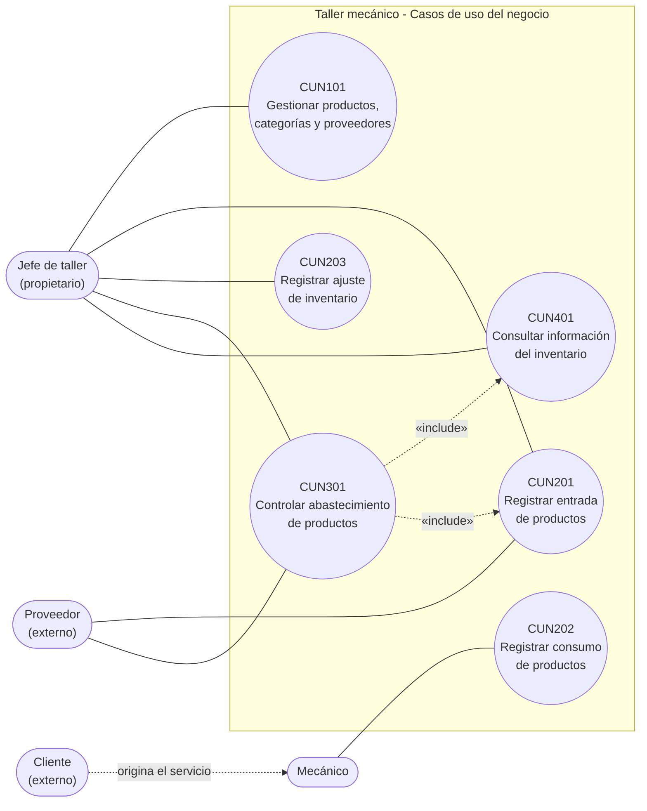

**Lectura del diagrama.** El Jefe de taller concentra la administración del catálogo, las entradas, los ajustes, el
control de abastecimiento y las consultas. El mecánico participa únicamente en el registro del consumo. El proveedor y
el cliente son actores externos: el primero interviene en la entrega y en la coordinación de la reposición; el segundo
origina el servicio, pero no ejecuta ningún caso de uso del inventario.

---

## 2.2 Realización de los Casos de Uso del Negocio

Cada caso de uso se especifica con los once apartados requeridos. Los diagramas de actividades y de clases se presentan
en notación Mermaid y reflejan las reglas de negocio, la validación de stock y la trazabilidad de los movimientos.

### 2.2.1 Especificación del caso de uso del negocio CUN101 – Gestionar productos, categorías y proveedores

#### 1. Actores

Jefe de taller.

#### 2. Propósito

Registrar y mantener la información de los productos, sus categorías y proveedores para disponer de un catálogo
consistente para las operaciones de inventario.

#### 3. Breve descripción

El caso comienza cuando el Jefe de taller necesita incorporar un producto o actualizar datos del catálogo. Registra la
información requerida, relaciona el producto con una categoría y un proveedor principal, y configura la unidad base y,
cuando corresponde, la presentación y el factor, además del stock mínimo. El sistema valida los datos y conserva la
información. Cuando el producto ya tiene movimientos, no se elimina físicamente: se desactiva para preservar el
historial y puede reactivarse después.

#### 4. Flujo Básico de Eventos

1. El Jefe de taller accede a la gestión del catálogo.
2. Selecciona si desea gestionar productos, categorías o proveedores.
3. Para un producto nuevo, introduce código, nombre, descripción si corresponde, categoría, unidad base, presentación y
   factor si corresponde, stock mínimo y proveedor principal.
4. Para una categoría o proveedor nuevo, introduce los datos identificativos y de contacto que correspondan.
5. El sistema valida los campos obligatorios, la unicidad del código del producto, la unicidad del RUC del proveedor y
   la existencia y estado de la categoría y del proveedor asociados.
6. El Jefe de taller revisa los datos ingresados.
7. Confirma el registro o la actualización.
8. El sistema guarda los datos válidos y asigna stock inicial cero a todo producto nuevo.
9. El sistema muestra la confirmación de la operación.

#### 5. Subflujos

**SF1 – Registrar una categoría**

1. El Jefe de taller selecciona la opción "Categorías".
2. Ingresa el nombre y la descripción de la categoría.
3. El sistema valida que el nombre esté completo y que los campos obligatorios estén completos.
4. El sistema guarda la categoría y actualiza la lista.
5. El flujo regresa al paso 6 del flujo básico si el Jefe de taller continúa con el registro de un producto.

**SF2 – Registrar un proveedor**

1. El Jefe de taller selecciona la opción "Proveedores".
2. Ingresa RUC, razón social, contacto, teléfono, correo y dirección.
3. El sistema valida la unicidad del RUC y los campos obligatorios.
4. El sistema guarda el proveedor y lo deja disponible para asociarlo a un producto.
5. El flujo regresa al paso 6 del flujo básico.

**SF3 – Desactivar un producto con historial**

1. El Jefe de taller selecciona un producto existente.
2. Elige la opción "Desactivar".
3. El sistema verifica que el producto tenga movimientos registrados.
4. El sistema confirma la desactivación lógica y conserva el historial y los movimientos.
5. El flujo termina sin eliminar físicamente el producto.

#### 6. Flujos Alternativos

**6.1. Código de producto duplicado**

1. El sistema rechaza el registro y señala que debe utilizarse un código único.
2. El Jefe de taller corrige el código y continúa en el paso 5 del flujo básico.

**6.2. Datos obligatorios incompletos o inválidos**

1. El sistema identifica los campos que deben completarse o corregirse.
2. El Jefe de taller corrige los datos y continúa en el paso 5.

**6.3. Categoría o proveedor inexistente o inactivo**

1. El sistema impide asociar el producto con ese registro.
2. El Jefe de taller selecciona una categoría o proveedor válido, o actualiza el catálogo antes de continuar.

**6.4. Intento de eliminar un producto con historial**

1. El sistema impide la eliminación física.
2. El Jefe de taller desactiva el producto si ya no debe utilizarse en nuevas operaciones.

#### 7. Precondiciones

- El Jefe de taller está autenticado y autorizado para administrar el catálogo.
- Para asociar un producto, existe al menos una categoría y un proveedor principal válidos, o estos se registran antes
  de confirmar el producto.

#### 8. Poscondiciones

- El producto, categoría o proveedor queda registrado o actualizado.
- Los productos nuevos tienen stock cero y quedan disponibles para operaciones si su estado es activo.
- Los datos históricos y movimientos existentes no se alteran por cambios descriptivos ni por desactivaciones.

#### 9. Puntos de Extensión

CUN201 y CUN202 dependen de que los productos y proveedores necesarios estén registrados y activos.

#### 10. Requerimientos Especiales

- El código del producto debe ser único.
- El RUC del proveedor debe ser único.
- El stock no se modifica desde el formulario del catálogo.
- Los productos con movimientos históricos se desactivan, no se eliminan físicamente.
- Solo el Jefe de taller administra los catálogos.
- **Alcance actual:** se pueden registrar y listar categorías y proveedores; crear, editar, listar, desactivar y
  reactivar productos; y actualizar el stock mínimo. La edición de un producto con movimientos se limita a nombre,
  descripción, presentación y factor; la unidad base es inmutable y el stock mínimo se actualiza mediante una operación
  específica.

#### 11. Información Adicional

##### 11.1 Diagrama de Actividades

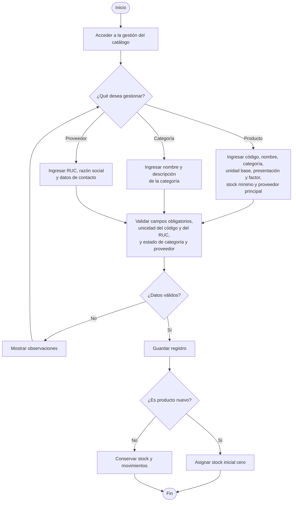

##### 11.2 Diagrama de Clases

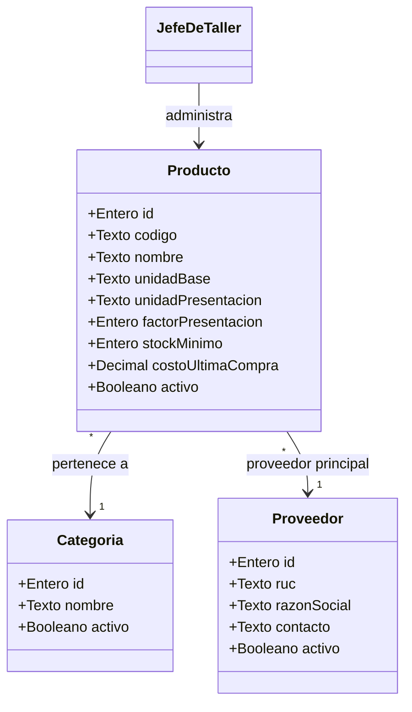

##### 11.3 Actividades a Automatizar

- Registrar producto.
- Validar la unicidad del código y los campos obligatorios.
- Validar la unicidad del RUC del proveedor.
- Seleccionar categoría y proveedor principal.
- Configurar unidad base y stock mínimo.
- Registrar y listar categorías y proveedores.
- Activar o desactivar registros del catálogo.
- Validar que no se eliminen físicamente productos con historial.

---

### 2.2.2 Especificación del caso de uso del negocio CUN201 – Registrar entrada de productos

#### 1. Actores

Jefe de taller; Proveedor como actor externo de la entrega.

#### 2. Propósito

Registrar los productos recibidos, incrementar el stock disponible y conservar la información de la entrada y el costo
de última compra.

#### 3. Breve descripción

El caso comienza cuando el taller recibe productos. El Jefe de taller verifica las cantidades recibidas y registra
producto, proveedor real de la entrega, cantidad y costo unitario. Tras validar y confirmar, el sistema registra el
movimiento, aumenta las existencias y actualiza el costo de última compra.

#### 4. Flujo Básico de Eventos

1. El proveedor entrega los productos al taller.
2. El Jefe de taller verifica los productos y las cantidades recibidas.
3. Accede al registro de entradas.
4. Selecciona el producto y el proveedor que realizó la entrega.
5. Introduce la cantidad recibida y el costo unitario.
6. El sistema valida que el producto y el proveedor estén activos, que la cantidad sea mayor que cero y que el costo
   unitario no sea negativo.
7. El Jefe de taller revisa y confirma la entrada.
8. El sistema registra el movimiento con fecha y usuario, incrementa el stock y actualiza el costo de última compra.
9. El sistema informa que la entrada se registró correctamente; las alertas se recalculan cuando se consultan.

#### 5. Subflujos

**SF1 – Registrar una entrada de un solo producto**

1. El Jefe de taller selecciona el producto y el proveedor de la entrega.
2. Introduce la cantidad recibida y el costo unitario.
3. El sistema valida los datos y muestra el stock resultante del producto.
4. Al confirmar, el sistema genera un movimiento de entrada y actualiza el stock.
5. El flujo regresa al paso 8 del flujo básico.

**SF2 – Corregir los datos antes de confirmar**

1. El Jefe de taller revisa la entrada registrada.
2. Modifica la cantidad o el costo unitario, o cancela la operación.
3. El sistema recalcula el stock resultante.
4. El flujo continúa en el paso 7 del flujo básico.

#### 6. Flujos Alternativos

**6.1. Producto no registrado o inactivo**

1. El sistema impide registrar la entrada.
2. El Jefe de taller registra o reactiva el producto mediante CUN101 y vuelve al paso 4.

**6.2. Proveedor inactivo o no registrado**

1. El sistema rechaza el proveedor seleccionado.
2. El Jefe de taller registra, activa o selecciona un proveedor válido y vuelve al paso 4.

**6.3. Cantidad no válida**

1. El sistema rechaza una cantidad igual o menor que cero y solicita corregirla.
2. El flujo continúa en el paso 5 cuando la cantidad es válida.

**6.4. Costo unitario inválido**

1. El sistema rechaza un costo negativo o un valor no válido.
2. El Jefe de taller corrige el costo y continúa en el paso 6.

**6.5. Error al confirmar**

1. El sistema revierte la operación completa si no puede registrar el movimiento y actualizar el stock.
2. El sistema informa que no se registró la entrada; el Jefe de taller puede reintentar verificando que no exista un
   movimiento duplicado.

#### 7. Precondiciones

- El Jefe de taller está autenticado y autorizado para registrar entradas.
- El producto y el proveedor de la entrega están registrados y activos.

#### 8. Poscondiciones

- El stock del producto aumenta por la cantidad recibida.
- El costo de última compra se actualiza con el costo unitario de la entrada confirmada.
- El movimiento queda en el historial con fecha, usuario, cantidad y stock anterior y posterior; el proveedor de la
  entrega se conserva en el motivo del movimiento.

#### 9. Puntos de Extensión

La confirmación de la entrada actualiza las alertas del CUN301.

#### 10. Requerimientos Especiales

- La cantidad debe ser mayor que cero y el costo unitario no puede ser negativo.
- El movimiento y la actualización del stock deben confirmarse en una sola transacción.
- Cada entrada corresponde a un solo producto; el proveedor de la entrega se conserva en el texto del motivo del
  movimiento.
- **Alcance actual:** no existe una referencia opcional ni un registro de varias líneas por entrada; cada entrada recibe
  un producto, un proveedor, la cantidad y el costo unitario, y el proveedor de la entrega queda registrado en el motivo
  del movimiento.

#### 11. Información Adicional

##### 11.1 Diagrama de Actividades


##### 11.2 Diagrama de Clases

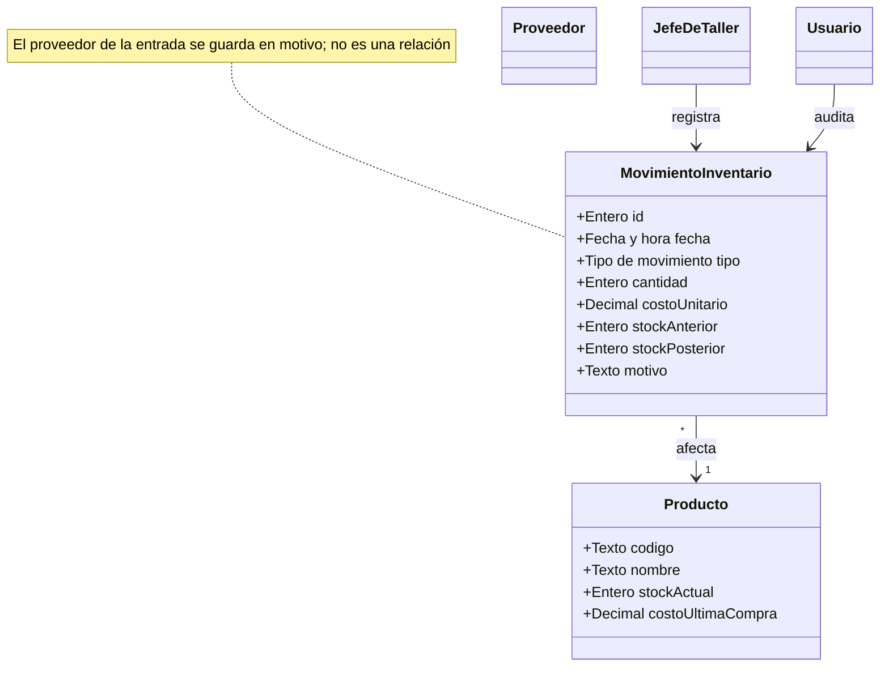

##### 11.3 Actividades a Automatizar

- Seleccionar producto y proveedor.
- Registrar cantidad y costo unitario.
- Validar datos y estado de los registros.
- Calcular el stock posterior.
- Registrar el movimiento de entrada.
- Actualizar stock y costo de última compra de forma atómica.
- Recalcular alertas y mostrar confirmación.

---

### 2.2.3 Especificación del caso de uso del negocio CUN202 – Registrar consumo de productos

#### 1. Actores

Mecánico; el Jefe de taller también puede registrar consumos.

#### 2. Propósito

Registrar los productos efectivamente utilizados durante una tarea de mantenimiento o reparación, asociarlos a una
finalidad declarada y descontarlos del inventario.

#### 3. Breve descripción

El caso comienza cuando el mecánico ha utilizado uno o varios productos. El mecánico registra directamente los
artículos, las cantidades y la finalidad del uso. El sistema valida los productos y el stock disponible para todos los
artículos; al confirmar, registra los movimientos de salida y descuenta las cantidades. No se crea una solicitud al Jefe
de taller ni se requiere que este vuelva a registrar el consumo.

#### 4. Flujo Básico de Eventos

1. El mecánico realiza una tarea de mantenimiento o reparación.
2. Accede al registro de consumo.
3. Describe la finalidad del uso, por ejemplo, cambio de aceite o reparación del sistema de frenos.
4. Selecciona el primer producto utilizado e indica la cantidad consumida.
5. Agrega los demás productos utilizados en la misma tarea, si corresponde.
6. Si la funcionalidad está habilitada, añade una referencia opcional del vehículo o cliente.
7. El sistema valida que la finalidad esté registrada, que las cantidades sean mayores que cero y que todos los
   productos estén activos.
8. El sistema comprueba que exista stock suficiente para cada producto incluido.
9. El usuario revisa y confirma el consumo.
10. El sistema registra un movimiento de salida por producto, asociado al usuario, la fecha y la finalidad, y descuenta
    las cantidades del stock.
11. El sistema confirma que el consumo se registró completamente.

#### 5. Subflujos

**SF1 – Incorporar otro producto al consumo**

1. El mecánico selecciona otro producto utilizado.
2. Indica la cantidad correspondiente.
3. El sistema incorpora el producto a la lista de consumo pendiente de confirmación.
4. El flujo retorna al paso 7 del flujo básico para validar la lista completa.

#### 6. Flujos Alternativos

**6.1. Cantidad inválida**

1. El sistema identifica la cantidad que no es mayor que cero.
2. El mecánico corrige el dato y continúa en el paso 7.

**6.2. Producto no registrado o inactivo**

1. El sistema impide agregar ese producto.
2. El mecánico selecciona un producto válido y continúa en el paso 7.

**6.3. Stock insuficiente**

1. El sistema indica qué producto o productos no tienen existencias suficientes.
2. No se registra ningún movimiento ni se descuenta parcialmente el stock.
3. El mecánico corrige las cantidades o excluye los productos que no puede registrar y vuelve al paso 7.

**6.4. Error durante la confirmación**

1. El sistema revierte el consumo completo si falla el registro de algún movimiento o la actualización de existencias.
2. El sistema informa que el consumo no fue confirmado y evita duplicarlo al reintentar.

#### 7. Precondiciones

- El usuario que registra está autenticado y autorizado para registrar consumos (Mecánico o Jefe de taller).
- Los productos que se desean consumir están registrados en el catálogo.

#### 8. Poscondiciones

- El consumo queda asociado al usuario autenticado, a la fecha, a los productos, las cantidades y la finalidad
  declarada.
- El stock disminuye por las cantidades confirmadas y el historial contiene los movimientos de salida.
- Si alguna validación falla, el stock y el historial permanecen sin cambios para esa operación.

#### 9. Puntos de Extensión

CUN202 genera movimientos de salida que pueden consultarse mediante CUN401 y que se reflejan en las alertas de CUN301.

#### 10. Requerimientos Especiales

- El consumo lo registra directamente quien utiliza los productos; no se modela como solicitud o aprobación del Jefe de
  taller.
- Todos los productos se validan antes de confirmar; no se permite stock negativo ni descuento parcial. Si un producto
  se repite, las cantidades se agrupan para validar el stock total.
- El registro del consumo y los descuentos deben ser atómicos.
- La finalidad del uso es obligatoria; la referencia de vehículo o cliente es opcional.
- **Alcance actual:** el consumo admite una lista de ítems con producto y cantidad, además de la finalidad y la
  referencia opcional del vehículo o cliente. El administrador del sistema no puede registrar consumos.

#### 11. Información Adicional

##### 11.1 Diagrama de Actividades


##### 11.2 Diagrama de Clases

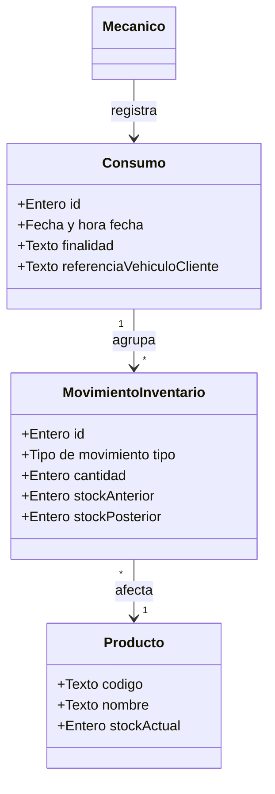

##### 11.3 Actividades a Automatizar

- Capturar la finalidad del consumo.
- Seleccionar productos y cantidades.
- Agregar o retirar productos antes de confirmar.
- Validar estado, cantidad y stock de todos los productos.
- Registrar el consumo y sus movimientos de salida.
- Descontar existencias en una sola transacción.
- Evitar confirmaciones duplicadas.
- Mostrar confirmación o errores de validación.

### 2.2.4 Especificación del caso de uso del negocio CUN203 – Registrar ajuste de inventario

#### 1. Actores

Jefe de taller.

#### 2. Propósito

Corregir las existencias registradas cuando el conteo físico evidencia una diferencia, conservando la justificación y la
trazabilidad del ajuste.

#### 3. Breve descripción

El caso comienza cuando el Jefe de taller compara el stock registrado con el conteo físico y detecta una diferencia.
Registra el producto, la cantidad física observada y una justificación. El sistema calcula la diferencia, valida los
datos y registra un movimiento de ajuste que actualiza el stock. La misma operación se utiliza para la carga del
inventario inicial.

#### 4. Flujo Básico de Eventos

1. El Jefe de taller realiza o recibe el conteo físico de un producto.
2. Accede a la función de ajuste de inventario.
3. Selecciona el producto que se va a ajustar.
4. Introduce la cantidad física contada y la justificación del ajuste.
5. El sistema obtiene el stock registrado y calcula la diferencia entre la cantidad física y el stock registrado.
6. El sistema valida que el producto esté activo, que la cantidad física no sea negativa y que la justificación esté
   completa.
7. El Jefe de taller revisa el stock registrado, el conteo físico y la diferencia calculada.
8. Confirma el ajuste.
9. El sistema registra el movimiento con la variación, stock anterior y posterior, fecha, usuario y justificación.
10. El sistema actualiza las existencias y recalcula las alertas de stock.
11. El sistema confirma que el ajuste fue registrado.

#### 5. Subflujos

**SF1 – Cargar el inventario inicial**

1. El Jefe de taller selecciona la opción "Carga de inventario inicial".
2. Registra el producto, la cantidad física contada y la justificación "Inventario inicial".
3. El sistema calcula la diferencia contra el stock actual, que para un producto nuevo es cero.
4. El sistema registra el movimiento de ajuste con stock anterior y posterior.
5. El Jefe de taller repite la operación para cada producto y el flujo termina cuando el inventario inicial queda
   cargado.

#### 6. Flujos Alternativos

**6.1. Producto inactivo o inexistente**

1. El sistema rechaza el ajuste.
2. El Jefe de taller verifica el catálogo y selecciona un producto válido.

**6.2. Cantidad física negativa o inválida**

1. El sistema rechaza el valor e indica que debe ser numérico y mayor o igual que cero.
2. El Jefe de taller corrige el conteo y vuelve al paso 6.

**6.3. Justificación no indicada**

1. El sistema impide confirmar el ajuste hasta que se introduzca un motivo.
2. El Jefe de taller registra la justificación y continúa.

**6.4. Error al guardar**

1. El sistema revierte la operación completa y mantiene las existencias previas.
2. El Jefe de taller recibe un mensaje de error y puede reintentar tras verificar el historial.

#### 7. Precondiciones

- El Jefe de taller está autenticado y autorizado para ajustar el inventario.
- El producto que se va a ajustar existe en el catálogo.

#### 8. Poscondiciones

- El stock queda igual a la cantidad física confirmada.
- El movimiento de ajuste conserva la variación calculada, la justificación, el usuario, la fecha y el stock anterior y
  posterior.
- Las alertas se recalculan según las nuevas existencias.

#### 9. Puntos de Extensión

CUN203 actualiza el stock utilizado por CUN301 y la información histórica consultada mediante CUN401.

#### 10. Requerimientos Especiales

- Solo el Jefe de taller puede confirmar ajustes.
- La cantidad física debe ser mayor o igual que cero y la justificación es obligatoria.
- La diferencia se calcula como cantidad física menos stock registrado.
- Los ajustes no modifican el costo de última compra.
- Los movimientos confirmados no se borran ni editan; los errores requieren una operación correctiva trazable.

#### 11. Información Adicional

##### 11.1 Diagrama de Actividades

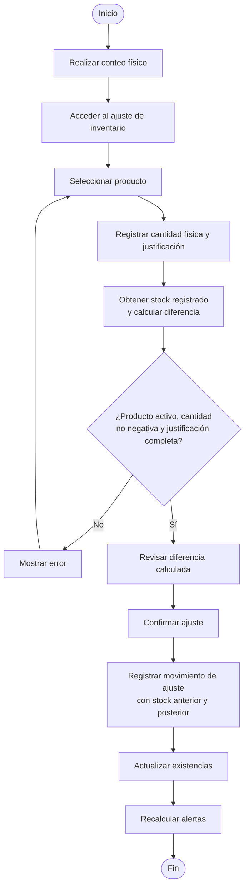

##### 11.2 Diagrama de Clases

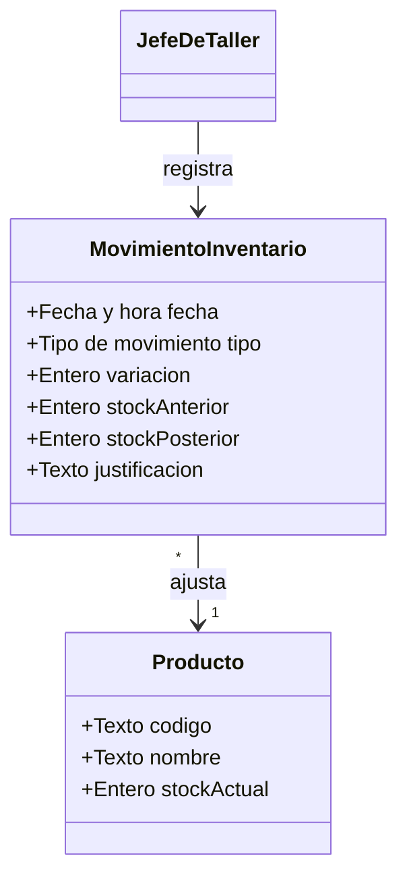

##### 11.3 Actividades a Automatizar

- Seleccionar producto.
- Registrar conteo físico y justificación.
- Obtener el stock actual y calcular la diferencia.
- Validar permisos y datos.
- Registrar el movimiento de ajuste.
- Actualizar existencias de forma transaccional.
- Recalcular alertas.
- Conservar la trazabilidad del ajuste.

---

### 2.2.5 Especificación del caso de uso del negocio CUN301 – Controlar abastecimiento de productos

#### 1. Actores

Jefe de taller; Proveedor como actor externo de la coordinación de compra.

#### 2. Propósito

Identificar productos con existencias bajas y proporcionar información para que el Jefe de taller decida si debe
reponerlos.

#### 3. Breve descripción

El caso comienza cuando el Jefe de taller consulta las alertas de bajo stock. El sistema compara las existencias de los
productos activos con sus mínimos y muestra aquellos que están en el umbral o por debajo. El Jefe de taller revisa la
información y decide qué productos reponer; el contacto y la compra se realizan fuera del sistema. Cuando llegan
productos, la entrada se registra mediante CUN201.

#### 4. Flujo Básico de Eventos

1. El Jefe de taller abre la consulta de bajo stock.
2. El sistema obtiene las existencias vigentes de los productos activos.
3. Compara el stock actual con el mínimo configurado para cada producto.
4. El sistema muestra los productos cuyo stock es menor o igual al mínimo, incluyendo código, nombre, stock actual,
   stock mínimo y proveedor principal.
5. Cuando corresponde, el sistema muestra una cantidad de referencia para alcanzar el stock mínimo.
6. El Jefe de taller revisa las alertas y decide qué productos requieren reposición.
7. El Jefe de taller contacta al proveedor fuera del sistema y consulta disponibilidad y condiciones.
8. El Jefe de taller coordina la compra y recibe los productos fuera del sistema.
9. Al recibirlos, verifica las cantidades y registra la entrada mediante CUN201.
10. El sistema actualiza el stock; las alertas se recalculan en la siguiente consulta.
11. El Jefe de taller revisa el resultado actualizado.

#### 5. Subflujos

**SF1 – Consultar el detalle de un producto en alerta**

1. El Jefe de taller selecciona un producto de la lista de alertas.
2. El sistema muestra stock actual, stock mínimo, cantidad sugerida y razón social del proveedor principal.
3. El Jefe de taller evalúa la prioridad y decide contactar al proveedor fuera del sistema.
4. El flujo regresa al paso 11 del flujo básico para continuar con la revisión de otras alertas.

#### 6. Flujos Alternativos

**6.1. No existen productos con bajo stock**

1. El sistema informa que no hay productos activos con stock igual o inferior al mínimo.
2. El caso de uso termina sin necesidad de gestionar una reposición.

**6.2. El producto no tiene un proveedor principal válido**

1. El sistema muestra que no existe un proveedor principal disponible.
2. El Jefe de taller revisa o actualiza la asociación del proveedor mediante CUN101.

**6.3. El proveedor no dispone del producto**

1. El Jefe de taller consulta otra alternativa o posterga la reposición fuera del sistema.
2. No se registra un pedido pendiente en la aplicación.

**6.4. Se recibe una cantidad diferente a la esperada**

1. El Jefe de taller registra únicamente la cantidad efectivamente recibida y verificada mediante CUN201.

#### 7. Precondiciones

- Los productos que se desean supervisar tienen configurado un stock mínimo.
- El Jefe de taller está autenticado y autorizado para consultar alertas.

#### 8. Poscondiciones

- El Jefe de taller obtiene la lista actualizada de productos con bajo stock y sus proveedores principales.
- Si se registran entradas, el stock se actualiza mediante CUN201; las alertas se recalculan cada vez que se consultan.
- El sistema no registra órdenes de compra ni controla entregas pendientes.

#### 9. Puntos de Extensión

La recepción de productos se realiza mediante CUN201; la actualización del proveedor principal, si es necesaria, se
realiza mediante CUN101.

#### 10. Requerimientos Especiales

- El umbral de bajo stock incluye la igualdad: stock actual menor o igual al mínimo.
- Los productos inactivos se excluyen de las alertas operativas.
- La cantidad sugerida es informativa y no crea una orden de compra.
- La coordinación con el proveedor y la compra ocurren fuera del sistema.
- **Alcance actual:** las alertas se calculan en el momento de la consulta y se ordenan por cantidad sugerida
  descendente y luego por nombre; se consultan en el panel de resumen del Jefe de taller y mediante el filtro de nivel
  de stock de existencias. Una tarea programada revisa
  periódicamente las alertas y solo registra el resultado en la bitácora, sin persistirlas. La consulta devuelve la
  lista completa, sin detalle por producto.

#### 11. Información Adicional

##### 11.1 Diagrama de Actividades


##### 11.2 Diagrama de Clases

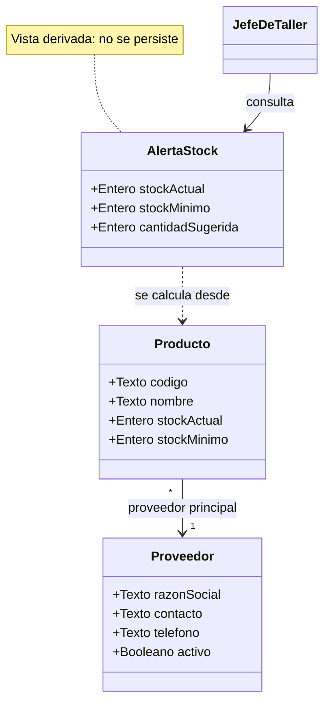

##### 11.3 Actividades a Automatizar

- Consultar productos activos.
- Comparar stock actual con stock mínimo.
- Generar y mostrar alertas de bajo stock.
- Mostrar proveedor principal y cantidad de referencia.
- Acceder a la gestión de productos y proveedores.
- Acceder al registro de entrada cuando se reciban productos.
- Recalcular las alertas después de actualizar el stock.

---

### 2.2.6 Especificación del caso de uso del negocio CUN401 – Consultar información del inventario

#### 1. Actores

Jefe de taller; Mecánico para la consulta de existencias con filtro de nivel de stock.

#### 2. Propósito

Consultar las existencias, el historial de movimientos, el consumo de productos, el bajo stock y el valor estimado del
inventario para apoyar la supervisión y la toma de decisiones.

#### 3. Breve descripción

El caso comienza cuando el usuario necesita revisar el estado del inventario. Selecciona una consulta o reporte y define
filtros cuando corresponde. El sistema valida los criterios, obtiene los datos vigentes y presenta los resultados sin
modificar productos, existencias ni movimientos. El Jefe de taller accede además al dashboard, las estadísticas y las
exportaciones.

#### 4. Flujo Básico de Eventos

1. El usuario accede al módulo de consultas y reportes.
2. Selecciona el tipo de consulta: productos, existencias con filtros, alertas de bajo stock, movimientos, valor
   estimado, dashboard o estadísticas.
3. Cuando corresponde, define filtros por nombre, categoría, tipo de movimiento o rango de fechas.
4. El sistema valida los filtros y comprueba que la fecha inicial no sea posterior a la fecha final.
5. El sistema consulta las existencias actuales o los movimientos confirmados que cumplen los criterios.
6. Si se solicita el valor estimado, calcula la suma del stock actual multiplicado por el costo de última compra de cada
   producto incluido.
7. El sistema presenta los resultados con los campos pertinentes para el tipo de consulta.
8. El usuario revisa la información y, si lo necesita, modifica los filtros para realizar otra consulta.
9. El sistema presenta el nuevo resultado o informa que no existen registros coincidentes.
10. El usuario finaliza la consulta.

#### 5. Subflujos

**SF1 – Consultar existencias**

1. El usuario selecciona "Existencias".
2. Define filtros opcionales por nombre, categoría, proveedor y estado de stock, además de la paginación.
3. El sistema muestra código, producto, categoría, proveedor, stock actual, stock mínimo, estado respecto al mínimo y
   cantidad sugerida, ordenados por nombre. El listado general de productos permite filtrar por nombre y categoría.

**SF2 – Consultar historial de movimientos**

1. El Jefe de taller selecciona "Movimientos".
2. Define un rango de fechas y, opcionalmente, el tipo de movimiento.
3. El sistema valida el rango y muestra los movimientos con stock anterior y posterior, paginados. No existen filtros
   por producto ni por usuario.

**SF3 – Consultar alertas de bajo stock**

1. El Jefe de taller revisa las alertas prioritarias del panel de resumen o filtra las existencias por nivel de stock.
2. El sistema muestra los productos activos con stock menor o igual al mínimo, la cantidad sugerida y el proveedor
   principal.

**SF4 – Consultar valor estimado**

1. El Jefe de taller selecciona "Valor estimado".
2. El sistema multiplica el stock actual por el costo de última compra y muestra el detalle y el total.
3. El sistema identifica los productos sin costo y los excluye del total.

#### 6. Flujos Alternativos

**6.1. Filtros inválidos**

1. El sistema indica los criterios incorrectos, como un rango de fechas invertido.
2. El Jefe de taller corrige los filtros y continúa en el paso 4.

**6.2. No existen registros coincidentes**

1. El sistema muestra un mensaje de resultado vacío.
2. El caso termina o el Jefe de taller modifica los filtros en el paso 8.

**6.3. El producto no tiene costo de última compra registrado**

1. El sistema no inventa un costo; identifica el dato faltante o excluye ese producto del cálculo según la política
   definida y lo informa en el resultado.
2. El Jefe de taller puede registrar una entrada con costo para completar la información.

#### 7. Precondiciones

- El usuario está autenticado; el acceso a cada consulta depende de su rol (Jefe de taller o Mecánico).
- El sistema dispone de datos de productos y, si se consulta historial, de movimientos registrados.

#### 8. Poscondiciones

- El sistema presenta la información que coincide con los criterios de consulta.
- La consulta no modifica stock, productos ni movimientos.
- El valor estimado se identifica como referencia operativa y no como valoración contable oficial.

#### 9. Puntos de Extensión

Las consultas de bajo stock corresponden funcionalmente a CUN301; la consulta de movimientos permite revisar operaciones
generadas por CUN201, CUN202 y CUN203.

#### 10. Requerimientos Especiales

- Los reportes son de solo lectura.
- Los rangos de fechas deben validarse.
- Las consultas deben usar datos vigentes y movimientos confirmados.
- El valor estimado se calcula con el costo de última compra y no representa FIFO, costo promedio ni valoración contable
  oficial.
- Los datos históricos deben seguir siendo consultables aunque un producto, proveedor o usuario esté inactivo.
- **Alcance actual:** el listado de productos se pagina y filtra por nombre y categoría e incluye productos inactivos;
  las existencias se consultan con paginación y filtros por nombre, categoría, proveedor y estado de stock sobre
  productos activos; las alertas se consultan sin parámetros; el reporte de movimientos exige un rango de fechas, admite
  un filtro opcional por tipo y está paginado; el valor estimado devuelve el resultado completo. El panel de resumen y
  las estadísticas son exclusivos del Jefe de taller. El reporte de valor de inventario puede exportarse a PDF y Excel.

#### 11. Información Adicional

##### 11.1 Diagrama de Actividades


##### 11.2 Diagrama de Clases

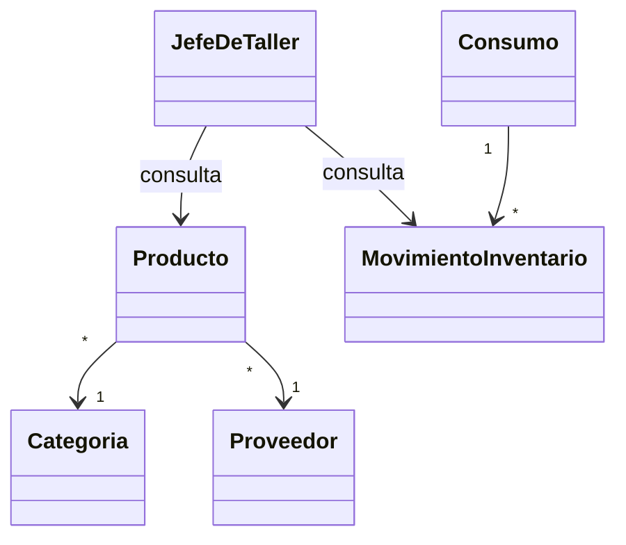

##### 11.3 Actividades a Automatizar

- Seleccionar el tipo de consulta.
- Validar fechas y filtros.
- Consultar el stock actual.
- Consultar movimientos confirmados por tipo o periodo, con paginación.
- Consultar el consumo y la finalidad declarada.
- Calcular el valor estimado del inventario.
- Mostrar resultados o mensaje de consulta vacía.
- Restringir el acceso según el rol.
- Evitar modificaciones desde las vistas de reporte.

---

## 2.3 Modelo de Análisis del Negocio

El modelo de análisis del negocio identifica a los trabajadores que ejecutan los procesos y las entidades que se crean,
consultan o modifican durante su ejecución. A partir de esta base se construye el diagrama de clases del negocio y se
prepara el paso a los requerimientos del sistema. Las entidades y los trabajadores definidos aquí se reutilizan en el
modelo conceptual del capítulo 3.

### 2.3.1 Lista de Trabajadores del Negocio

Los trabajadores del negocio son los roles internos que ejecutan las actividades del taller y asumen responsabilidades
dentro de los procesos. La tabla incluye al Jefe de taller y al Mecánico como trabajadores internos, y al Proveedor como
colaborador externo cuya actuación se limita a la entrega de productos y a la confirmación de pedidos; por ello no opera
el sistema ni participa en los casos de uso del sistema.

| Trabajador del negocio  | Responsabilidades                                                                                                                                                                                         |
|-------------------------|-----------------------------------------------------------------------------------------------------------------------------------------------------------------------------------------------------------|
| **Jefe de taller**      | Administrar productos, categorías y proveedores; registrar entradas; autorizar y registrar ajustes; configurar stocks mínimos; supervisar alertas; decidir y coordinar la reposición; consultar reportes. |
| **Mecánico**            | Ejecutar los servicios de mantenimiento y reparación y registrar los productos utilizados, sus cantidades y la finalidad del uso, sin modificar el catálogo ni los ajustes.                               |
| **Proveedor** (externo) | Entregar los productos solicitados y confirmar pedidos. Es un actor externo y no opera el sistema.                                                                                                        |

### 2.3.2 Lista de Entidades del Negocio

Las entidades del negocio representan los objetos o conceptos sobre los que actúan los trabajadores y que deben
conservarse para mantener la trazabilidad del inventario. La tabla indica el identificador, una descripción del rol de
la entidad y los atributos principales que se reconocen en el análisis; en el capítulo 3 estos atributos se refinan como
clases del sistema, con tipos, visibilidad y relaciones.

| Entidad                              | Descripción                                                                                                                                                      | Atributos principales                                                                                                                                   |
|--------------------------------------|------------------------------------------------------------------------------------------------------------------------------------------------------------------|---------------------------------------------------------------------------------------------------------------------------------------------------------|
| **EN001 – Producto**                 | Repuesto, herramienta o insumo administrado en el almacén, identificado por un código único y controlado mediante stock actual y stock mínimo en su unidad base. | código, nombre, descripción, unidad base, presentación, factor, stock actual, stock mínimo, costo de última compra, estado                              |
| **EN002 – Categoría**                | Clasificación funcional de los productos que permite agruparlos para la búsqueda, el control y los reportes.                                                     | nombre, descripción, estado                                                                                                                             |
| **EN003 – Proveedor**                | Empresa o persona que abastece los productos; se identifica por su RUC y mantiene los datos de contacto para la reposición.                                      | RUC, razón social, contacto, teléfono, correo, dirección, estado                                                                                        |
| **EN004 – Movimiento de inventario** | Registro histórico de una entrada, un consumo o un ajuste, con el stock anterior y posterior para reconstruir la trazabilidad.                                   | fecha, tipo, producto, cantidad o variación, stock anterior, stock posterior, costo unitario, usuario, motivo o justificación, identificador de consumo |
| **EN005 – Consumo**                  | Agrupación de los productos utilizados en una misma tarea, con la finalidad declarada por el usuario y una referencia opcional del vehículo o cliente.           | fecha, usuario, finalidad, referencia opcional de vehículo o cliente                                                                                    |
| **EN006 – Alerta de stock**          | Vista derivada de los productos activos cuyas existencias están en el mínimo o por debajo; no se almacena como entidad independiente.                            | producto, stock actual, stock mínimo, cantidad sugerida, proveedor principal                                                                            |
| **EN007 – Usuario**                  | Persona que opera el sistema, con credenciales, rol y estado que determinan sus permisos.                                                                        | nombre de usuario, contraseña cifrada, rol, estado, fecha de creación                                                                                   |

#### Diagrama de Clases de Entidades del Negocio

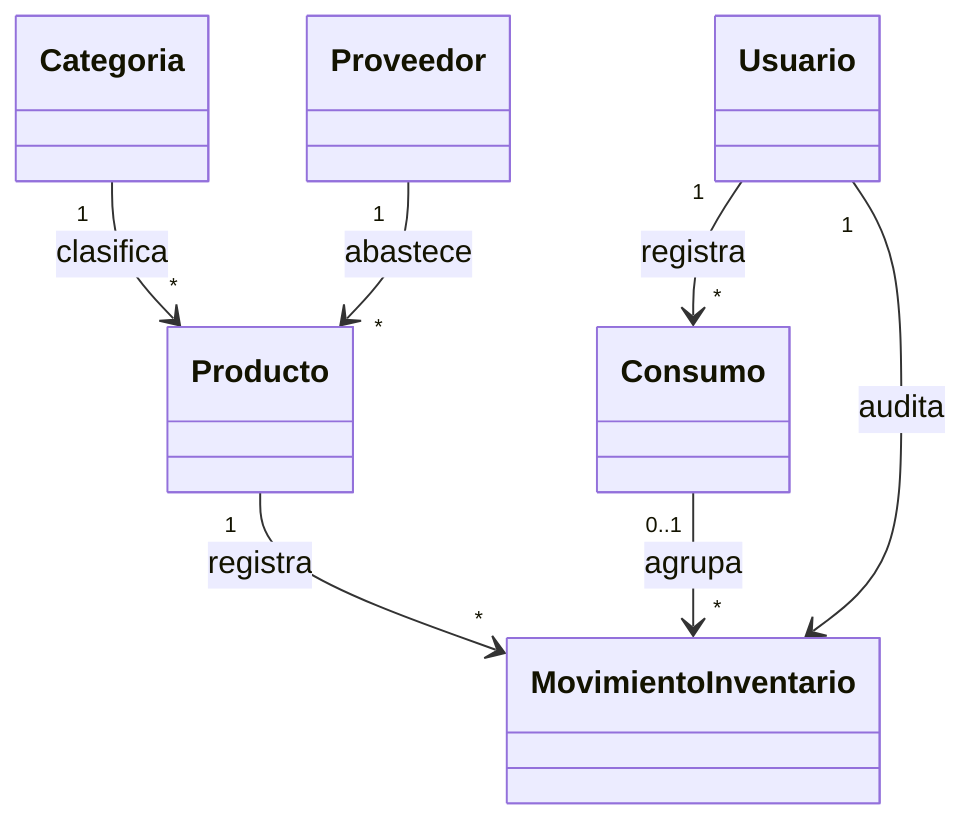

# 3. REQUERIMIENTOS

## 3.1 Lista de Requerimientos Funcionales

Los requerimientos funcionales describen qué debe hacer el sistema para apoyar los procesos del negocio. Se agrupan por
proceso, usan el prefijo RF y tres dígitos —el primer bloque coincide con el proceso y los dos siguientes con la
numeración secuencial— y, cuando una regla de negocio condiciona el comportamiento, se indica entre corchetes para
conservar la trazabilidad. La descripción de cada requerimiento precisa la acción esperada, los datos que intervienen y
la restricción principal que debe respetarse.

### Gestionar catálogo

Este grupo reúne las funciones de mantenimiento del catálogo: crear y actualizar productos, desactivarlos sin perder su
historial, buscarlos y administrar las categorías y los proveedores asociados. Las restricciones de unicidad,
obligatoriedad y conservación del historial provienen de las reglas RN101–RN109.

| Código | Requerimiento                             | Descripción                                                                                                                                                                                                                                                                                                      |
|--------|-------------------------------------------|------------------------------------------------------------------------------------------------------------------------------------------------------------------------------------------------------------------------------------------------------------------------------------------------------------------|
| RF101  | Registrar producto                        | Permite crear un producto con código único, categoría, unidad base, presentación y factor cuando corresponde, proveedor principal y stock mínimo. [RN101, RN102, RN103, RN104, RN105, RN106, RN501–RN507]                                                                                                        |
| RF102  | Actualizar producto                       | Permite modificar los datos de un producto registrado sin alterar su stock. Si el producto ya tiene movimientos, solo admite cambios de nombre, descripción, presentación y factor; la unidad base es inmutable y el stock mínimo se actualiza por una operación específica. [RN101, RN102, RN105, RN118, RN502] |
| RF103  | Desactivar producto                       | Permite desactivar un producto que ya no se utilizará y reactivarlo mientras su categoría y su proveedor sigan activos. No existe eliminación física; el historial se conserva. [RN108]                                                                                                                          |
| RF104  | Buscar producto                           | Permite listar y localizar productos con paginación y filtros por nombre y categoría, incluyendo los inactivos; devuelve el stock actual, la unidad base y el indicador de stock crítico.                                                                                                                        |
| RF105  | Registrar categorías                      | Permite registrar y listar categorías con nombre único y descripción. [RN102]                                                                                                                                                                                                                                    |
| RF106  | Registrar proveedores                     | Permite registrar y listar proveedores con RUC único y datos de contacto. [RN105, RN109]                                                                                                                                                                                                                         |
| RF107  | Restringir la administración del catálogo | Solo el Jefe de taller puede crear, actualizar, desactivar y reactivar productos y registrar categorías y proveedores; el administrador del sistema gestiona usuarios y consulta la auditoría. [RN107]                                                                                                           |
| RF108  | Conservar productos con historial         | Impide la eliminación física de productos con movimientos y conserva su información histórica. [RN108]                                                                                                                                                                                                           |
| RF109  | Consultar catálogo de unidades            | Exponer las unidades de negocio y las unidades válidas por categoría para que el Jefe de taller seleccione la unidad base y la presentación al crear o editar un producto. [RN501, RN503, RN504]                                                                                                                 |
| RF110  | Convertir presentaciones                  | Convertir la cantidad introducida a unidades base y valorar el costo unitario dividiéndolo por el factor, conservando en cada movimiento la unidad, el factor y la cantidad base. [RN504, RN505, RN507]                                                                                                          |

### Gestionar movimientos

Este grupo describe el registro de entradas, consumos y ajustes, la validación de stock y la actualización automática de
existencias. Su comportamiento se deriva de las reglas RN201–RN209 y constituye el núcleo transaccional del sistema,
porque cada operación confirmada debe dejar un movimiento trazable y actualizar el stock en una sola transacción.

| Código | Requerimiento                     | Descripción                                                                                                                                                                                   |
|--------|-----------------------------------|-----------------------------------------------------------------------------------------------------------------------------------------------------------------------------------------------|
| RF201  | Registrar entrada                 | Registra el ingreso de un solo producto con proveedor, cantidad y costo unitario, asignando fecha y usuario. [RN201, RN202, RN203]                                                            |
| RF202  | Registrar consumo                 | Permite al mecánico o al Jefe de taller registrar los productos utilizados, sus cantidades y la finalidad. [RN204, RN205, RN206]                                                              |
| RF203  | Validar stock suficiente          | Impide confirmar consumos que superen las existencias disponibles, verifica todos los ítems del consumo y no aplica descuentos parciales cuando algún producto no tiene stock. [RN206, RN207] |
| RF204  | Actualizar stock automáticamente  | Actualiza las existencias después de cada entrada, consumo o ajuste confirmado. [RN203, RN205]                                                                                                |
| RF205  | Registrar ajuste de inventario    | Permite corregir el stock con conteo físico y justificación obligatoria. [RN209]                                                                                                              |
| RF206  | Registrar historial               | Guarda todos los movimientos con stock anterior y posterior, fecha y usuario. [RN208]                                                                                                         |
| RF207  | Registrar consumo atómico         | Un consumo con varios productos se registra por completo o no se registra. [RN207]                                                                                                            |
| RF208  | Actualizar costo de última compra | Actualiza el costo del producto con el costo unitario de la entrada confirmada. [RN203]                                                                                                       |

### Controlar existencias

Este grupo cubre la configuración del stock mínimo, la generación de alertas y la información que apoya la reposición.
No incluye órdenes de compra: el sistema identifica la necesidad y muestra el proveedor principal, mientras que la
decisión y la coordinación de la compra permanecen en el negocio.

| Código | Requerimiento                        | Descripción                                                                                                                                                                                                      |
|--------|--------------------------------------|------------------------------------------------------------------------------------------------------------------------------------------------------------------------------------------------------------------|
| RF301  | Configurar stock mínimo              | Permite establecer y modificar el stock mínimo de cada producto activo, con un valor numérico mayor o igual que cero que sirve de umbral para la alerta. [RN104, RN301]                                          |
| RF302  | Generar alertas de bajo stock        | Genera una alerta cuando el stock de un producto activo es menor o igual a su mínimo; la alerta se calcula en cada consulta y refleja de inmediato los movimientos y los cambios de stock mínimo. [RN302, RN304] |
| RF303  | Mostrar cantidad sugerida            | Muestra la cantidad de referencia para alcanzar el stock mínimo, calculada como la diferencia entre el mínimo y el stock actual, sin generar una orden de compra. [RN305]                                        |
| RF304  | Mostrar proveedor principal          | Incluye en la alerta la razón social del proveedor principal. [RN303, RN307]                                                                                                                                     |
| RF305  | Recalcular alertas                   | Recalcula las alertas en cada consulta, de modo que desaparecen cuando el stock supera el mínimo. [RN304]                                                                                                        |
| RF306  | Conservar proveedores                | Los proveedores asociados a productos o movimientos se conservan. [RN308]                                                                                                                                        |
| RF307  | Revisar el stock de forma programada | Una tarea programada revisa periódicamente el stock en la zona horaria del taller y registra en la bitácora un resumen y el detalle de las alertas, sin modificar datos. [RN302, RN304]                          |

### Analizar inventario

Este grupo reúne las consultas de existencias, alertas e historial y los reportes de movimientos y valor estimado. Todos
son de solo lectura, respetan el rol del usuario y conservan la información histórica; el valor estimado se calcula con
el costo de la última compra y se presenta como referencia operativa.

| Código | Requerimiento                           | Descripción                                                                                                                                                                                                                                                                                                                       |
|--------|-----------------------------------------|-----------------------------------------------------------------------------------------------------------------------------------------------------------------------------------------------------------------------------------------------------------------------------------------------------------------------------------|
| RF401  | Consultar existencias                   | Muestra el stock actual, el stock mínimo, la clasificación operativa (`NORMAL`, `BAJO` o `SIN_STOCK`) y la cantidad sugerida de los productos activos que coinciden con los filtros aplicados, junto con su código y nombre. [RN402]                                                                                                                            |
| RF402  | Consultar historial de movimientos      | Permite consultar los movimientos de un rango de fechas con filtro opcional por tipo, mostrando stock anterior, stock posterior, motivo y usuario; no admite filtros por producto ni por usuario. [RN403]                                                                                                                         |
| RF403  | Reporte de movimientos por periodo      | Genera un reporte paginado de entradas, consumos y ajustes en un rango de fechas, con totales por tipo calculados sobre todo el filtro. [RN405, RN408]                                                                                                                                                                            |
| RF406  | Consultar valor estimado del inventario | Calcula el stock actual por el costo de última compra, identifica los productos sin costo, los excluye del total y lo presenta como estimación operativa. [RN407, RN408]                                                                                                                                                          |
| RF407  | Exportar reportes                       | Permite exportar el reporte de valor de inventario a PDF o Excel con el mismo contenido del reporte de origen; las exportaciones no se paginan y el reporte de movimientos no se exporta.                                                                                                                                         |
| RF408  | Restringir reportes administrativos     | Solo el Jefe de taller accede a los reportes administrativos; el mecánico puede consultar existencias y registrar consumos, pero no generar reportes restringidos. [RN401]                                                                                                                                                        |
| RF409  | Consultar el panel de resumen           | Muestra el resumen del inventario activo (total de productos, con stock normal, con bajo stock y sin stock), los indicadores del mes en curso (valor estimado, productos sin costo, entradas, consumos y ajustes), las cinco alertas más urgentes y los cinco movimientos más recientes. Es exclusivo del Jefe de taller. [RN407] |
| RF410  | Consultar estadísticas de movimientos   | Cuenta los movimientos de un rango de fechas agrupados por día, semana o mes, omitiendo los períodos sin movimientos. Es exclusivo del Jefe de taller. [RN405]                                                                                                                                                                    |

### Seguridad

Este grupo contiene los requerimientos de autenticación, gestión de usuarios y consulta de la auditoría de operaciones.
Aunque la seguridad es transversal, se separa en este bloque para identificar las funciones que habilitan el acceso
controlado al resto del sistema.

| Código | Requerimiento                      | Descripción                                                                                                                                                                                                                                                                                                                 |
|--------|------------------------------------|-----------------------------------------------------------------------------------------------------------------------------------------------------------------------------------------------------------------------------------------------------------------------------------------------------------------------------|
| RF501  | Iniciar sesión                     | Autentica al usuario con su nombre de usuario y contraseña, valida que la cuenta esté activa y emite un token JWT que determina sus permisos según su rol.                                                                                                                                                                  |
| RF502  | Gestionar usuarios                 | Permite al administrador del sistema registrar usuarios con rol de Jefe de taller o Mecánico, listarlos con filtros, editarlos, activarlos o desactivarlos y restablecer su contraseña; esta operación queda registrada en la auditoría. El rol de administrador lo crea el sistema al iniciar y no se asigna por registro. |
| RF503  | Auditar movimientos                | Todo movimiento registra el usuario que lo realizó, la fecha y el stock anterior y posterior, de modo que la operación pueda reconstruirse. [RN208]                                                                                                                                                                         |
| RF504  | Consultar auditoría de operaciones | Permite al administrador consultar el registro append-only de las operaciones, con el actor, el endpoint, el resultado y la fecha; la información es de solo lectura.                                                                                                                                                       |

## 3.2 Lista de Requerimientos No Funcionales

Los requerimientos no funcionales establecen las cualidades que debe cumplir el sistema y las restricciones que
condicionan su diseño. Se agrupan por categoría —usabilidad, disponibilidad, rendimiento, seguridad, integridad,
mantenibilidad, respaldo y restricciones de diseño— y se identifican con el prefijo RNF. Cada fila indica la categoría,
el código, el requerimiento y el criterio de verificación que se espera; cuando el valor es una propuesta, se señala
expresamente para que el equipo lo valide con el usuario.

| Categoría                   | Código | Requerimiento                                                                                                 | Criterio de verificación                                                                                                              |
|-----------------------------|--------|---------------------------------------------------------------------------------------------------------------|---------------------------------------------------------------------------------------------------------------------------------------|
| **Usabilidad**              | RNF01  | La interfaz debe ser intuitiva para usuarios sin formación técnica.                                           | Un usuario nuevo completa las tareas básicas de consulta y registro sin ayuda externa, tras una demostración breve.                   |
|                             | RNF02  | Los formularios mostrarán mensajes claros de validación y error.                                              | Cada validación indica el campo afectado, la causa y la acción esperada; no se muestran mensajes técnicos ni códigos internos.        |
|                             | RNF03  | La interfaz será responsive y usable desde computadora y tablet.                                              | Las pantallas principales se visualizan y operan sin desplazamiento horizontal en resoluciones de 1 366 × 768 y superiores.           |
| **Disponibilidad**          | RNF04  | El sistema estará disponible al menos el 98 % del horario de atención del taller.                             | Se mide el tiempo disponible frente al horario acordado; las caídas planificadas se registran y no superan el 2 %.                    |
| **Rendimiento**             | RNF05  | Las consultas simples responderán en menos de 3 segundos.                                                     | Una búsqueda de productos o existencias con hasta 1 000 registros devuelve resultados en menos de 3 segundos en condiciones normales. |
|                             | RNF06  | Los reportes por periodo se generarán en menos de 10 segundos.                                                | Un reporte de movimientos de un mes se genera y muestra en menos de 10 segundos con la base de prueba definida.                       |
| **Seguridad**               | RNF07  | El acceso se controlará por usuario, contraseña y rol.                                                        | Ninguna operación se ejecuta sin sesión autenticada; las opciones y los servicios respetan el rol asignado.                           |
|                             | RNF08  | Las contraseñas se almacenarán cifradas con hash y sal.                                                       | La base de datos no contiene contraseñas en texto plano; el hash incluye una sal distinta por usuario.                                |
|                             | RNF09  | Todo movimiento registrará el usuario que lo realizó.                                                         | Cada fila de movimiento tiene un usuario válido y una fecha; no se aceptan movimientos sin responsable.                               |
|                             | RNF10  | El mecánico no podrá acceder a los reportes administrativos ni modificar el catálogo.                         | Un usuario con rol Mecánico recibe denegación al intentar acceder a reportes, catálogo o ajustes.                                     |
| **Integridad**              | RNF11  | Las operaciones de movimiento y actualización de stock serán transaccionales.                                 | Ante un error durante la confirmación, no queda movimiento ni descuento de stock parcial.                                             |
|                             | RNF12  | El consumo de varios productos se confirmará de forma atómica.                                                | Si uno de los ítems falla, se revierte el consumo completo y se informa el producto observado.                                        |
|                             | RNF13  | No se permitirá stock negativo en ninguna operación.                                                          | Toda operación que intentaría dejar stock menor que cero se rechaza y el stock permanece sin cambios.                                 |
| **Mantenibilidad**          | RNF14  | El sistema se construirá en capas con bajo acoplamiento.                                                      | La presentación no accede directamente a la persistencia; los cambios en una capa no obligan a reescribir las otras.                  |
| **Respaldo**                | RNF15  | La base de datos tendrá copias de seguridad periódicas.                                                       | Existe una copia diaria verificable y una prueba de restauración documentada antes de la puesta en operación.                         |
| **Restricciones de diseño** | RNF16  | Servicio de aplicación del lado del servidor con base de datos relacional y control de versiones del esquema. | La decisión tecnológica se valida con el equipo y el usuario; cualquier cambio debe reflejarse en la arquitectura.                    |

> **Nota:** La restricción de RNF16 se expresa a nivel descriptivo; cualquier cambio de tecnología debe reflejarse en la
> arquitectura de software.

---

## 3.3 Modelo de Casos de Uso del Sistema

El modelo de casos de uso del sistema traduce los procesos del negocio en funciones que la aplicación debe ofrecer. Se
organiza en actores, paquetes, casos de uso, clasificación por prioridad y ciclos de desarrollo; luego, cada caso se
especifica con su flujo básico, flujos alternativos y requisitos especiales. Este recorrido permite pasar del «qué hace
el taller» al «qué debe hacer el sistema» sin perder la trazabilidad con las reglas de negocio.

### 3.3.1 Lista de Actores del Sistema

Los actores del sistema son los roles que interactúan directamente con la aplicación. Se derivan de los actores del
negocio, pero se separan cuando una misma persona asume funciones distintas o cuando se requiere un rol técnico de
administración. La tabla indica la responsabilidad de cada actor y el alcance de sus operaciones; el detalle de sus
permisos se concreta en los casos de uso y en la matriz de seguridad.

| Actor                         | Descripción                                                                                                                                                                                                                                                              |
|-------------------------------|--------------------------------------------------------------------------------------------------------------------------------------------------------------------------------------------------------------------------------------------------------------------------|
| **Jefe de taller**            | Opera el sistema a diario: administra el catálogo, registra entradas y ajustes, configura stocks mínimos, consulta alertas y reportes, y decide la reposición. Es el único actor con acceso a los reportes administrativos y a la configuración del catálogo.            |
| **Mecánico**                  | Registra los consumos de los productos utilizados, indicando cantidad y finalidad, y consulta las existencias disponibles para planificar su trabajo. No modifica el catálogo, no registra entradas ni ajustes y no accede a reportes restringidos.                      |
| **Usuario**                   | Rol general que agrupa a los actores para los casos de uso de seguridad; permite iniciar sesión sin asumir permisos administrativos.                                                                                                                                     |
| **Administrador del sistema** | Gestiona las cuentas de usuario (alta, consulta, edición, activación y reseteo de contraseña) y consulta la auditoría de operaciones. Es un usuario creado por el sistema al iniciar y no participa en la operación del inventario ni accede a las funciones de negocio. |

### 3.3.2 Diagrama de Actores del Sistema

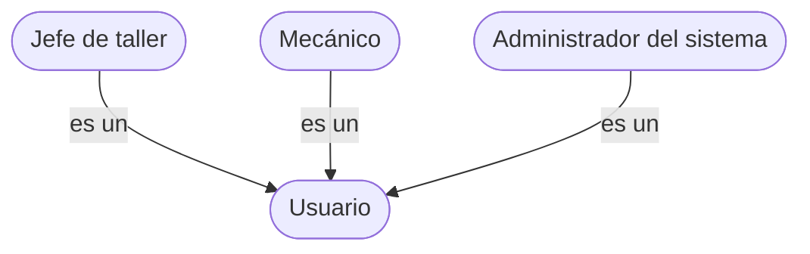

### 3.3.3 Diagrama de Paquetes de Diseño más Significativos

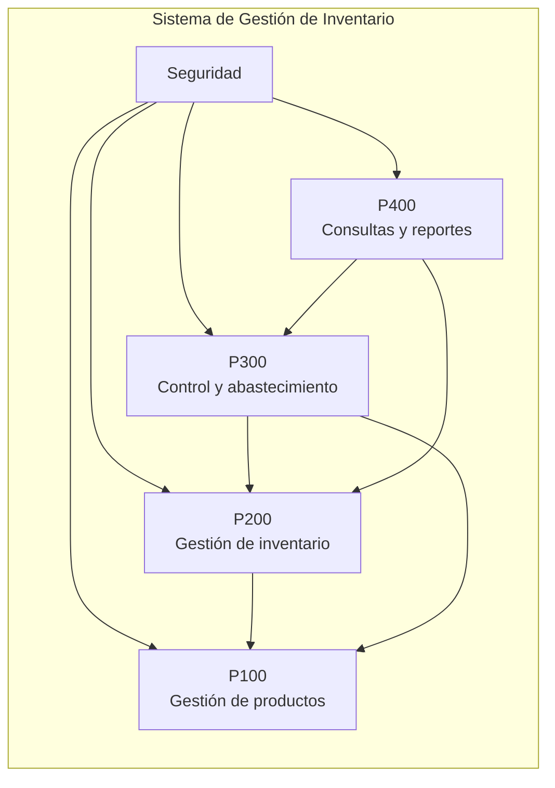

### 3.3.4 Lista de Casos de Uso del Sistema por Paquete

Los casos de uso del sistema se organizan en paquetes según la función que cumplen y el conjunto de datos que
administran. Esta agrupación facilita la asignación de responsabilidades, la construcción por ciclos y la trazabilidad
con los procesos del negocio. Cada tabla presenta el código, el nombre y una descripción breve del caso de uso; las
relaciones de inclusión y extensión se muestran en los diagramas del apartado 3.3.5.

#### Paquete: Seguridad

| Caso de uso                 | Descripción                                                                                                                                                                         |
|-----------------------------|-------------------------------------------------------------------------------------------------------------------------------------------------------------------------------------|
| CUS001 – Iniciar sesión     | Valida el nombre de usuario, la contraseña y el estado de la cuenta, y emite una credencial de acceso con el rol del usuario.                                                       |
| CUS003 – Gestionar usuarios | El administrador registra, lista, consulta, edita, activa o desactiva usuarios con rol de Jefe de taller o Mecánico, restablece contraseñas y consulta la auditoría de operaciones. |

#### Paquete: P100 – Gestión de productos

| Caso de uso                              | Descripción                                                                                                                                                                                                                                                               |
|------------------------------------------|---------------------------------------------------------------------------------------------------------------------------------------------------------------------------------------------------------------------------------------------------------------------------|
| CUS101 – Buscar producto                 | Busca productos por nombre o categoría, con paginación, y devuelve una lista con el código, el stock actual, la unidad base y el estado de cada coincidencia, incluyendo los productos inactivos.                                                                         |
| CUS102 – Registrar y actualizar producto | Crea, edita, desactiva y reactiva productos; valida el código único, los campos obligatorios y que la unidad pertenezca a la categoría; conserva el stock y el historial cuando el producto ya tiene movimientos. La unidad base es inmutable desde el primer movimiento. |
| CUS103 – Gestionar categorías            | Registra y lista categorías con nombre único, sin distinguir mayúsculas, y descripción. Los productos solo se asocian a categorías activas.                                                                                                                               |
| CUS104 – Gestionar proveedores           | Registra y lista proveedores con RUC único y datos de contacto; los proveedores vinculados a productos o movimientos se conservan.                                                                                                                                        |

#### Paquete: P200 – Gestión de inventario

| Caso de uso                                 | Descripción                                                                                                                                                                                                                  |
|---------------------------------------------|------------------------------------------------------------------------------------------------------------------------------------------------------------------------------------------------------------------------------|
| CUS201 – Registrar entrada                  | Registra el ingreso de un producto con proveedor, cantidad y costo unitario, actualiza el stock y el costo de última compra, y deja un movimiento de entrada.                                                                |
| CUS202 – Registrar consumo                  | Registra los productos utilizados por el mecánico o el Jefe de taller con cantidad y finalidad, valida el stock de todos los ítems y descuenta las existencias en una sola transacción.                                      |
| CUS203 – Registrar ajuste de inventario     | Registra un ajuste con conteo físico y justificación obligatoria, calcula la diferencia y actualiza el stock conservando el movimiento para auditoría.                                                                       |
| CUS204 – Consultar historial de movimientos | Consulta los movimientos de un rango de fechas con filtro opcional por tipo, paginados y con totales por tipo; muestra stock anterior, stock posterior, motivo y responsable. No admite filtros por producto ni por usuario. |

#### Paquete: P300 – Control y abastecimiento

| Caso de uso                              | Descripción                                                                                                                                 |
|------------------------------------------|---------------------------------------------------------------------------------------------------------------------------------------------|
| CUS301 – Configurar stock mínimo         | Define o modifica el stock mínimo de un producto; la situación de alerta se refleja de inmediato porque se calcula en cada consulta.        |
| CUS302 – Consultar alertas de bajo stock | Muestra los productos activos con existencias iguales o inferiores al mínimo, con su stock actual, cantidad sugerida y proveedor principal. |

#### Paquete: P400 – Consultas y reportes

| Caso de uso                                      | Descripción                                                                                                                                                            |
|--------------------------------------------------|------------------------------------------------------------------------------------------------------------------------------------------------------------------------|
| CUS401 – Consultar existencias                   | Muestra el stock actual, el stock mínimo, la clasificación operativa (`NORMAL`, `BAJO` o `SIN_STOCK`) y la cantidad sugerida de los productos activos según los filtros aplicados. |
| CUS402 – Generar reporte de movimientos          | Genera el reporte de entradas, consumos y ajustes de un periodo, con filtro opcional por tipo, totales por tipo y paginación. No se exporta a PDF ni Excel.            |
| CUS405 – Consultar valor estimado del inventario | Calcula el valor operativo del inventario multiplicando el stock actual por el costo de última compra, lo presenta como estimación y permite exportarlo a PDF o Excel. |

El panel de resumen (RF409) y las estadísticas de movimientos (RF410) se exponen dentro de CUS401 y CUS402
respectivamente; por eso no se especifican como casos de uso independientes.

### 3.3.5 Diagramas de Casos de Uso del Sistema por Paquete

#### 3.3.5.1 Paquete P100 – Gestión de productos

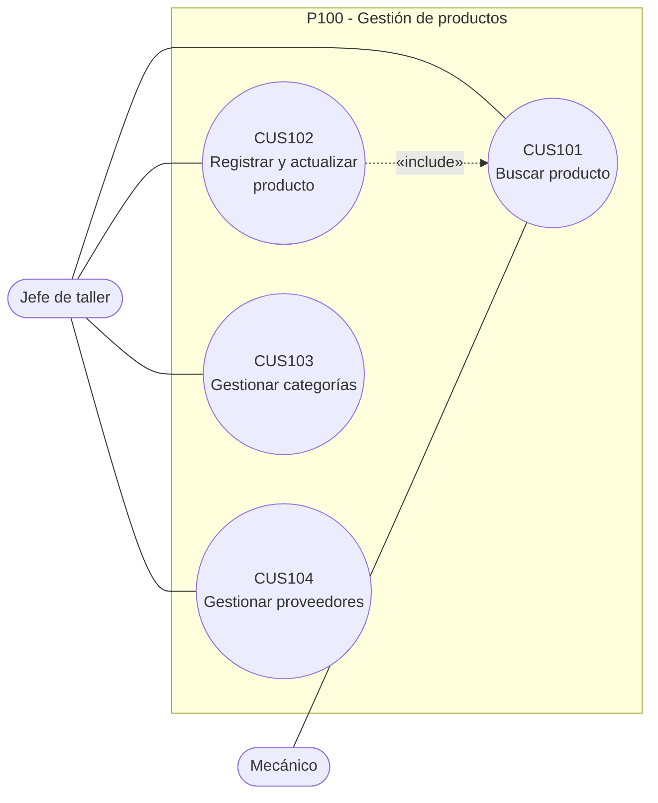

#### 3.3.5.2 Paquete P200 – Gestión de inventario

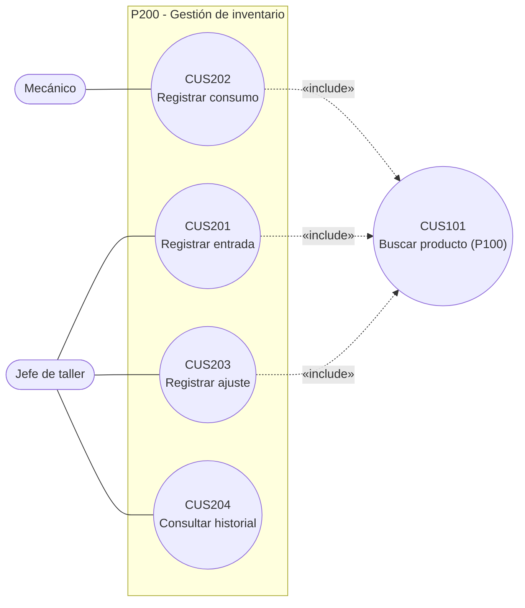

#### 3.3.5.3 Paquete P300 – Control y abastecimiento

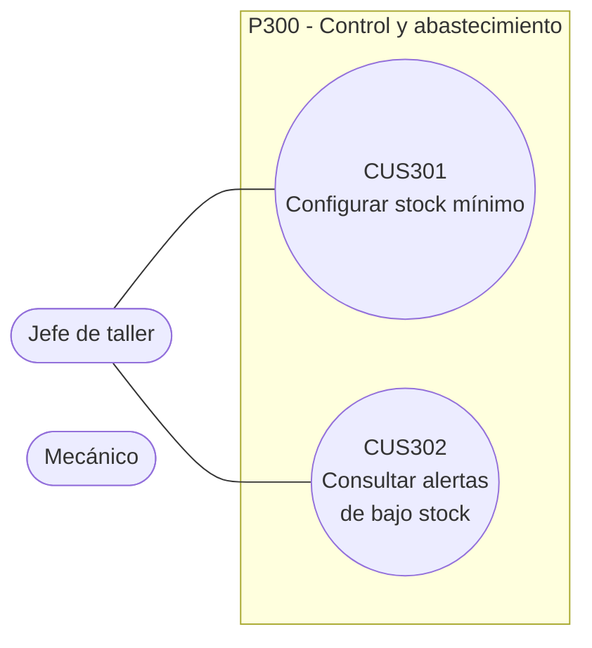

#### 3.3.5.4 Paquete P400 – Consultas y reportes

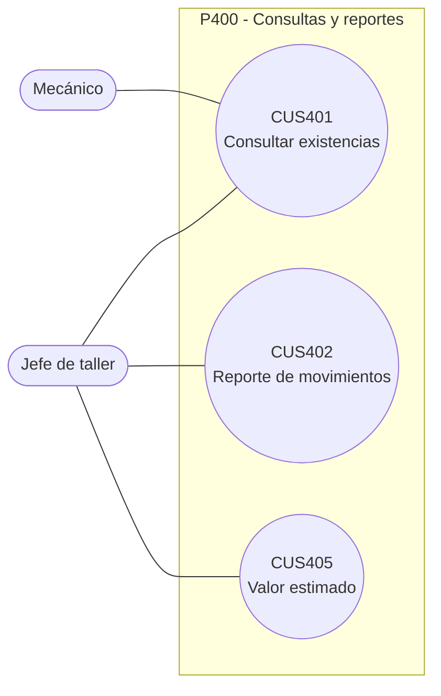

#### 3.3.5.5 Paquete Seguridad

```mermaid
flowchart LR
    USR(["Usuario"])
    ADM(["Administrador del sistema"])
    subgraph SEG["Seguridad"]
        CUS001(("CUS001<br/>Iniciar sesión"))
        CUS003(("CUS003<br/>Gestionar usuarios"))
    end
    USR --- CUS001
    ADM --- CUS003
```

### 3.3.6 Clasificación de los Casos de Uso del Sistema

La clasificación orienta el orden de construcción y el nivel de detalle con que se especifica cada caso de uso. Se
considera **primario** el caso que aporta valor directo al proceso y forma parte del núcleo central; **secundario** el
que complementa o mantiene la información necesaria para los primarios; y **opcional** el que puede incorporarse después
sin afectar la operación básica del inventario.

| Caso de uso                                      | Clasificación |
|--------------------------------------------------|---------------|
| CUS101 – Buscar producto                         | Primario      |
| CUS102 – Registrar y actualizar producto         | Primario      |
| CUS201 – Registrar entrada                       | Primario      |
| CUS202 – Registrar consumo                       | Primario      |
| CUS203 – Registrar ajuste de inventario          | Primario      |
| CUS302 – Consultar alertas de bajo stock         | Primario      |
| CUS401 – Consultar existencias                   | Primario      |
| CUS103 – Gestionar categorías                    | Secundario    |
| CUS104 – Gestionar proveedores                   | Secundario    |
| CUS204 – Consultar historial de movimientos      | Secundario    |
| CUS301 – Configurar stock mínimo                 | Secundario    |
| CUS402 – Generar reporte de movimientos          | Secundario    |
| CUS405 – Consultar valor estimado del inventario | Secundario    |
| CUS001 – Iniciar sesión                          | Opcional      |
| CUS003 – Gestionar usuarios                      | Opcional      |

### 3.3.7 Ciclos de Desarrollo de los Casos de Uso

Los ciclos agrupan los casos de uso en entregas incrementales. El **Ciclo 0** concentra el núcleo necesario para operar
el inventario: catálogo, entradas, consumos, ajustes, stock mínimo, alertas y consultas básicas. El **Ciclo 1**
incorpora los reportes ampliados y las funciones de seguridad, que pueden construirse sobre el núcleo ya validado.

| Ciclo                        | Casos de uso                                                                           |
|------------------------------|----------------------------------------------------------------------------------------|
| **Ciclo 0 (núcleo central)** | CUS101, CUS102, CUS103, CUS104, CUS201, CUS202, CUS203, CUS204, CUS301, CUS302, CUS401 |
| **Ciclo 1**                  | CUS402, CUS405, CUS001, CUS003                                                         |

---

### 3.3.8 Realización de los Casos de Uso del Sistema

#### 3.3.8.1 Especificación de Alto Nivel

La especificación de alto nivel resume, para cada caso de uso, el actor que lo inicia, el propósito que persigue, el
caso de uso asociado —cuando existe una relación de inclusión—, el resultado esperado y su clasificación. Esta vista
permite comparar rápidamente el alcance de los casos y seleccionar cuáles requieren una especificación detallada; las
columnas «Propósito» y «Resumen» se redactan en términos del negocio, mientras que el detalle de flujos y validaciones
se desarrolla en las ECUS.

| Campo | Valor |
|---|---|
| Caso de uso: | CUS101 – Buscar producto |
| Actor(es): | Jefe de taller, Mecánico |
| Propósito: | Localizar productos |
| Caso de uso asociado: | — |
| Resumen: | Busca por nombre o categoría y devuelve las coincidencias con su stock. |
| Clasificación: | Primario |

| Campo | Valor |
|---|---|
| Caso de uso: | CUS102 – Registrar y actualizar producto |
| Actor(es): | Jefe de taller |
| Propósito: | Mantener el catálogo |
| Caso de uso asociado: | CUS101 |
| Resumen: | Crea, modifica, desactiva y reactiva productos con su configuración. |
| Clasificación: | Primario |

| Campo | Valor |
|---|---|
| Caso de uso: | CUS103 – Gestionar categorías |
| Actor(es): | Jefe de taller |
| Propósito: | Mantener categorías |
| Caso de uso asociado: | — |
| Resumen: | Registra y lista categorías. |
| Clasificación: | Secundario |

| Campo | Valor |
|---|---|
| Caso de uso: | CUS104 – Gestionar proveedores |
| Actor(es): | Jefe de taller |
| Propósito: | Mantener proveedores |
| Caso de uso asociado: | — |
| Resumen: | Registra y lista proveedores. |
| Clasificación: | Secundario |

| Campo | Valor |
|---|---|
| Caso de uso: | CUS201 – Registrar entrada |
| Actor(es): | Jefe de taller |
| Propósito: | Registrar ingresos |
| Caso de uso asociado: | CUS101 |
| Resumen: | Registra el ingreso con proveedor, cantidad y costo, y actualiza el stock. |
| Clasificación: | Primario |

| Campo | Valor |
|---|---|
| Caso de uso: | CUS202 – Registrar consumo |
| Actor(es): | Mecánico, Jefe de taller |
| Propósito: | Registrar consumos reales |
| Caso de uso asociado: | CUS101 |
| Resumen: | Registra los productos utilizados con cantidad y finalidad, validando el stock. |
| Clasificación: | Primario |

| Campo | Valor |
|---|---|
| Caso de uso: | CUS203 – Registrar ajuste |
| Actor(es): | Jefe de taller |
| Propósito: | Corregir diferencias |
| Caso de uso asociado: | CUS101 |
| Resumen: | Registra un ajuste con conteo físico y justificación obligatoria. |
| Clasificación: | Primario |

| Campo | Valor |
|---|---|
| Caso de uso: | CUS204 – Consultar historial |
| Actor(es): | Jefe de taller |
| Propósito: | Trazabilidad |
| Caso de uso asociado: | — |
| Resumen: | Consulta movimientos de un periodo, con filtro por tipo. |
| Clasificación: | Secundario |

| Campo | Valor |
|---|---|
| Caso de uso: | CUS301 – Configurar stock mínimo |
| Actor(es): | Jefe de taller |
| Propósito: | Control de existencias |
| Caso de uso asociado: | — |
| Resumen: | Define el stock mínimo de un producto. |
| Clasificación: | Secundario |

| Campo | Valor |
|---|---|
| Caso de uso: | CUS302 – Consultar alertas |
| Actor(es): | Jefe de taller |
| Propósito: | Evitar desabastecimiento |
| Caso de uso asociado: | — |
| Resumen: | Muestra productos con stock menor o igual al mínimo y su proveedor. |
| Clasificación: | Primario |

| Campo | Valor |
|---|---|
| Caso de uso: | CUS401 – Consultar existencias |
| Actor(es): | Jefe de taller, Mecánico |
| Propósito: | Conocer el stock real |
| Caso de uso asociado: | — |
| Resumen: | Muestra el stock actual y la clasificación operativa (`NORMAL`, `BAJO` o `SIN_STOCK`) de los productos. |
| Clasificación: | Primario |

| Campo | Valor |
|---|---|
| Caso de uso: | CUS402 – Reporte de movimientos |
| Actor(es): | Jefe de taller |
| Propósito: | Apoyar decisiones |
| Caso de uso asociado: | — |
| Resumen: | Genera el reporte de movimientos por periodo. |
| Clasificación: | Secundario |

| Campo | Valor |
|---|---|
| Caso de uso: | CUS405 – Valor estimado del inventario |
| Actor(es): | Jefe de taller |
| Propósito: | Conocer el valor operativo |
| Caso de uso asociado: | — |
| Resumen: | Calcula stock por costo de última compra y permite exportarlo. |
| Clasificación: | Secundario |

| Campo | Valor |
|---|---|
| Caso de uso: | CUS001 – Iniciar sesión |
| Actor(es): | Usuario |
| Propósito: | Controlar el acceso |
| Caso de uso asociado: | — |
| Resumen: | Valida credenciales y emite el acceso según el rol. |
| Clasificación: | Opcional |

| Campo | Valor |
|---|---|
| Caso de uso: | CUS003 – Gestionar usuarios |
| Actor(es): | Administrador del sistema |
| Propósito: | Administrar el acceso |
| Caso de uso asociado: | — |
| Resumen: | Gestiona cuentas y consulta la auditoría. |
| Clasificación: | Opcional |


---

#### 3.3.8.2 ECUS: CUS101 – Buscar producto

**1. Actores:** Jefe de taller, Mecánico.

**2. Propósito:** Consultar y retornar los productos que cumplan los criterios de búsqueda.

**3. Breve descripción**

El usuario localiza un producto del catálogo mediante un criterio de búsqueda y selecciona el registro que necesita para
consultar su stock o continuar con otra operación. La búsqueda no modifica información y puede realizarse por nombre o
categoría.

**4. Flujo básico de eventos**

1. El usuario indica "Buscar producto".
2. El sistema muestra las opciones de búsqueda.
3. El usuario elige el criterio: nombre o categoría.
4. El usuario escribe el valor y pulsa "Buscar".
5. El sistema muestra la lista paginada de productos con código, nombre, categoría, unidad base, stock actual y estado,
   ordenada por nombre.
6. El usuario selecciona un registro y pulsa "Aceptar".
7. El sistema cierra el formulario y el caso de uso termina.

**5. Subflujos**

**5.1 Búsqueda por nombre.** El usuario selecciona «nombre», ingresa una palabra o frase y el sistema devuelve los
productos cuyo nombre contiene el texto, sin distinguir mayúsculas de minúsculas.

**5.2 Búsqueda por categoría.** El usuario selecciona una categoría y el sistema lista los productos asociados, activos
e inactivos, con su stock actual y unidad base.

**6. Flujos alternativos**

- **6.1 Sin resultados:** si en el paso 5 no hay productos, el sistema muestra un mensaje informativo y el caso continúa
  en el paso 3.

**7. Precondiciones**

El usuario inició sesión con rol Jefe de taller o Mecánico. El catálogo contiene al menos un producto registrado y el
usuario tiene acceso a la consulta de productos.

**8. Poscondiciones**

Se muestra la lista de productos que cumplen el criterio y, si el usuario selecciona uno, el sistema devuelve el
registro elegido. No se modifican productos, stock ni movimientos.

**9. Puntos de extensión**

Si el producto buscado no existe, el Jefe de taller puede registrarlo mediante CUS102. Si el usuario necesita consultar
el stock de varios productos, puede continuar en CUS401.

**10. Requerimientos especiales**

La búsqueda debe admitir coincidencias parciales, ser insensible a mayúsculas y minúsculas y responder en menos de 3
segundos para el volumen previsto (RNF05). La consulta no modifica datos y respeta el rol del usuario.

**11. Información adicional**

1. **Captura del sistema — Catálogo de productos** (`/catalogo/productos`)

   > [Captura pendiente de inserción]

   Listado paginado con filtros por nombre, categoría, unidad base y estado; muestra código, producto, categoría, stock, criticidad y estado. El Jefe de taller lo abre desde `/catalogo/productos`; el mecánico realiza la misma búsqueda desde `/operaciones/consumo`.

2. **Captura del sistema — Resultado vacío de la búsqueda** (`/catalogo/productos`)

   > [Captura pendiente de inserción]

   Mensaje informativo cuando los filtros no devuelven coincidencias; el listado no reutiliza resultados de consultas anteriores.

3. **Captura del sistema — Notificación de error de consulta** (`/catalogo/productos`)

   > [Captura pendiente de inserción]

   Aviso del sistema cuando la solicitud es denegada o falla; no se muestran códigos técnicos al usuario.

---

#### 3.3.8.3 ECUS: CUS102 – Registrar y actualizar producto

**1. Actores:** Jefe de taller.

**2. Propósito:** Mantener actualizado el catálogo de productos.

**3. Breve descripción**

El Jefe de taller incorpora un producto nuevo o actualiza los datos de uno existente, manteniendo la integridad del
catálogo y la conservación del historial de stock. El caso cubre el alta, la edición y la desactivación lógica del
producto.

**4. Flujo básico de eventos**

1. El Jefe de taller indica "Productos".
2. El sistema muestra la lista de productos con código, nombre, categoría, stock actual y estado.
3. El Jefe de taller pulsa "Nuevo producto".
4. El sistema muestra el formulario en blanco: código, nombre, descripción, categoría, unidad base, presentación y
   factor si corresponde, proveedor principal y stock mínimo.
5. El Jefe de taller registra los datos. [RN101] [RN102] [RN103] [RN104] [RN105]
6. El Jefe de taller pulsa "Guardar".
7. El sistema valida que el código sea único y crea el producto con stock inicial cero. [RN106]
8. El sistema muestra un mensaje de confirmación y regresa a la lista.

**5. Subflujos**

**5.1 Editar producto.** El Jefe de taller selecciona un producto existente, modifica los datos descriptivos o la
configuración permitida y guarda. El código solo puede modificarse si el producto no tiene movimientos; si los tiene,
únicamente se admiten cambios de nombre, descripción, presentación y factor. La unidad base nunca se modifica y el stock
no se cambia desde este formulario.

**5.2 Desactivar producto.** El Jefe de taller selecciona «Desactivar», confirma la acción y el sistema retira el
producto de las operaciones nuevas sin eliminar su historial.

**6. Flujos alternativos**

- **6.1 Código duplicado:** si en el paso 7 el código ya existe, se muestra un error y el caso continúa en el
  paso 5. [RN101]
- **6.2 Proveedor no registrado:** el Jefe de taller puede abrir CUS104 para registrarlo y volver al paso 5.
- **6.3 Categoría inexistente o inactiva:** el sistema impide asociarla y el Jefe de taller puede registrarla mediante
  CUS103.

**7. Precondiciones**

El Jefe de taller está autenticado. Para asociar el producto, existen al menos una categoría y un proveedor activos, o
el Jefe de taller puede registrarlos mediante CUS103 y CUS104.

**8. Poscondiciones**

El producto queda creado o actualizado. Si se desactivó, conserva sus movimientos y deja de estar disponible para
entradas, consumos y consultas operativas, según corresponda.

**9. Puntos de extensión**

Si faltan la categoría o el proveedor, el caso se extiende a CUS103 o CUS104 y regresa al formulario del producto. Si el
producto tiene movimientos, la eliminación física se rechaza y se ofrece la desactivación.

**10. Requerimientos especiales**

El código es único y solo puede modificarse mientras el producto no tenga movimientos; el stock inicial es cero y no se
edita desde el catálogo; los campos obligatorios deben validarse; los productos con historial no se eliminan. La
operación se restringe al Jefe de taller (RN101–RN109).

**11. Información adicional**

1. **Captura del sistema — Formulario de producto** (`/catalogo/productos`)

   > [Captura pendiente de inserción]

   Campos de nombre, descripción, categoría, proveedor, unidad base, presentación, factor y stock mínimo; la edición conserva stock e historial.

2. **Captura del sistema — Confirmación de desactivación** (`/catalogo/productos`)

   > [Captura pendiente de inserción]

   Diálogo de confirmación previo a desactivar el producto; no se elimina físicamente.

3. **Captura del sistema — Notificación de código duplicado** (`/catalogo/productos`)

   > [Captura pendiente de inserción]

   Aviso de error cuando el código ya existe; el formulario conserva los datos introducidos para corregirlos.

---

#### 3.3.8.4 ECUS: CUS103 – Gestionar categorías

**1. Actores:** Jefe de taller.

**2. Propósito:** Mantener el catálogo de categorías de productos.

**3. Breve descripción**

El Jefe de taller mantiene el catálogo de categorías que clasifican los productos, registrando nuevas categorías. La
categoría debe estar activa para asociarse a un producto.

**4. Flujo básico de eventos**

1. El Jefe de taller indica "Categorías".
2. El Jefe de taller pulsa "Nueva categoría".
3. El sistema muestra el formulario con nombre y descripción.
4. El Jefe de taller registra los datos y pulsa "Guardar".
5. El sistema valida que el nombre sea único y crea la categoría.

**5. Subflujos**

No existen subflujos para este caso de uso.

**6. Flujos alternativos**

- **6.1 Nombre duplicado:** si ya existe una categoría con ese nombre (sin distinguir mayúsculas), el sistema rechaza el
  registro. [RN102]

**7. Precondiciones**

El Jefe de taller está autenticado y tiene acceso a la administración del catálogo.

**8. Poscondiciones**

La categoría queda registrada y disponible para asociarse a nuevos productos.

**9. Puntos de extensión**

Si el usuario necesita crear un producto con una categoría inexistente, el caso se extiende desde CUS102.

**10. Requerimientos especiales**

El nombre de la categoría es obligatorio y único; solo el Jefe de taller puede ejecutar el caso (RN102, RN107).

**11. Información adicional**

1. **Captura del sistema — Listado y registro de categorías** (`/catalogo/categorias`)

   > [Captura pendiente de inserción]

   Lista paginada con búsqueda por nombre y filtro por estado, con alta de categoría; no hay edición ni desactivación.

2. **Captura del sistema — Validación del nombre** (`/catalogo/categorias`)

   > [Captura pendiente de inserción]

   Mensaje de campo cuando el nombre está vacío o no cumple el formato requerido.

3. **Captura del sistema — Notificación de nombre duplicado** (`/catalogo/categorias`)

   > [Captura pendiente de inserción]

   Aviso de error cuando ya existe una categoría con el mismo nombre.

---

#### 3.3.8.5 ECUS: CUS104 – Gestionar proveedores

**1. Actores:** Jefe de taller.

**2. Propósito:** Mantener la información de los proveedores que abastecen al taller.

**3. Breve descripción**

El Jefe de taller mantiene la información de los proveedores que abastecen el almacén, con RUC único y datos de contacto
que permiten coordinar la reposición. El caso cubre el alta del proveedor.

**4. Flujo básico de eventos**

1. El Jefe de taller indica "Proveedores".
2. El Jefe de taller pulsa "Nuevo proveedor".
3. El sistema muestra el formulario: RUC, razón social, contacto, teléfono, correo y dirección. [RN105]
4. El Jefe de taller registra los datos y pulsa "Guardar".
5. El sistema valida que el RUC no esté duplicado y crea el proveedor. [RN109]

**5. Subflujos**

No existen subflujos para este caso de uso.

**6. Flujos alternativos**

- **6.1 Eliminación de proveedores:** el sistema no ofrece la eliminación de proveedores, por lo que los vinculados a
  productos o movimientos se conservan. [RN308]
- **6.2 RUC duplicado:** el sistema muestra un error y el caso continúa en el paso 3. [RN109]

**7. Precondiciones**

El Jefe de taller está autenticado y tiene acceso a la administración del catálogo.

**8. Poscondiciones**

El proveedor queda registrado y disponible para asociarse a productos y para nuevas entradas.

**9. Puntos de extensión**

Si el usuario necesita un proveedor inexistente al registrar una entrada, el caso se extiende desde CUS201.

**10. Requerimientos especiales**

El RUC es obligatorio y único; los datos de contacto deben permitir la comunicación; solo el Jefe de taller puede
ejecutar el caso (RN105, RN109, RN308).

**11. Información adicional**

1. **Captura del sistema — Listado y registro de proveedores** (`/catalogo/proveedores`)

   > [Captura pendiente de inserción]

   Lista paginada con filtros por razón social, RUC y estado, con alta de proveedor.

2. **Captura del sistema — Validación de datos de contacto** (`/catalogo/proveedores`)

   > [Captura pendiente de inserción]

   Mensajes de campo para RUC, razón social y datos de contacto obligatorios.

3. **Captura del sistema — Notificación de RUC duplicado** (`/catalogo/proveedores`)

   > [Captura pendiente de inserción]

   Aviso de error cuando el RUC ya está registrado.

---

#### 3.3.8.6 ECUS: CUS201 – Registrar entrada

**1. Actores:** Jefe de taller.

**2. Propósito:** Registrar el ingreso de productos al almacén y actualizar el stock y el costo de última compra.

**3. Breve descripción**

El Jefe de taller registra el ingreso de un producto recibido del proveedor, actualizando el stock y el costo de última
compra. Cada entrada genera un movimiento de entrada.

**4. Flujo básico de eventos**

1. El Jefe de taller indica "Registrar entrada".
2. El sistema muestra el formulario con la fecha actual.
3. El Jefe de taller busca y selecciona el producto.
4. El Jefe de taller selecciona el proveedor que realizó la entrega.
5. El Jefe de taller ingresa la cantidad recibida y el costo unitario. [RN201]
6. El Jefe de taller pulsa "Registrar".
7. El sistema valida que la cantidad sea mayor que cero, que el costo no sea negativo y que el producto y el proveedor
   estén activos. [RN202]
8. El sistema registra el movimiento de entrada y actualiza el stock y el costo de última compra. [RN203]
9. El sistema guarda el movimiento en el historial con el usuario. [RN208]
10. El sistema muestra la confirmación con el nuevo stock.

**5. Subflujos**

**5.1 Varios productos recibidos.** Cada entrada corresponde a un solo producto; cuando el proveedor entrega varios
productos, el Jefe de taller registra una entrada por cada uno y cada una genera su propio movimiento.

**6. Flujos alternativos**

- **6.1 Cantidad inválida:** si en el paso 7 la cantidad es cero o negativa, el sistema muestra un error y el caso
  continúa en el paso 5.
- **6.2 Costo inválido:** si el costo es negativo, el sistema muestra un error y continúa en el paso 5.
- **6.3 Error transaccional:** si falla la actualización del stock, no se registra el movimiento y se informa el error.

**7. Precondiciones**

El Jefe de taller está autenticado. El producto y el proveedor existen y están activos; si no existen, el caso se
extiende a CUS102 o CUS104.

**8. Poscondiciones**

El stock del producto se incrementa, el costo de última compra se actualiza con el costo registrado y se conserva un
movimiento de entrada con el usuario y la fecha; el proveedor de la entrega queda indicado en el motivo del movimiento.

**9. Puntos de extensión**

Si el producto no está registrado, se extiende a CUS102. Si el proveedor no está registrado, se extiende a CUS104. Si el
producto está inactivo, el sistema impide la entrada.

**10. Requerimientos especiales**

La cantidad debe ser mayor que cero y el costo no negativo; la operación es transaccional; se conserva el stock anterior
y posterior; los productos y proveedores deben estar activos (RN201–RN203, RN208).

**11. Información adicional**

1. **Captura del sistema — Formulario de entrada** (`/operaciones/entrada`)

   > [Captura pendiente de inserción]

   Producto, proveedor derivado del producto, unidad de registro, cantidad, costo unitario y total estimado.

2. **Captura del sistema — Confirmación de entrada registrada** (`/operaciones/entrada`)

   > [Captura pendiente de inserción]

   Aviso de éxito con el movimiento generado, las unidades sumadas y el nuevo stock.

3. **Captura del sistema — Notificación de error de validación** (`/operaciones/entrada`)

   > [Captura pendiente de inserción]

   Aviso cuando la cantidad, el costo o el estado del producto o proveedor impiden registrar la entrada; no se aplica ningún cambio.

---

#### 3.3.8.7 ECUS: CUS202 – Registrar consumo

**1. Actores:** Mecánico, Jefe de taller.

**2. Propósito:** Registrar los productos utilizados en una tarea y descontarlos del inventario.

**3. Breve descripción**

El mecánico registra directamente los productos que utilizó en una tarea, con la cantidad y la finalidad del uso, y el
sistema descuenta el stock de forma atómica. No existe una solicitud previa ni una aprobación del Jefe de taller.

**4. Flujo básico de eventos**

1. El mecánico indica "Registrar consumo".
2. El sistema muestra el formulario con la fecha actual.
3. El mecánico registra la finalidad del uso. [RN205]
4. El mecánico busca y selecciona un producto; el sistema muestra el stock disponible. [RN402]
5. El mecánico ingresa la cantidad utilizada. [RN206]
6. El mecánico agrega más productos si corresponde.
7. El mecánico pulsa "Confirmar".
8. El sistema valida la finalidad, las cantidades, el estado de los productos y el stock de todos los ítems. [RN206]
9. El sistema registra el consumo y un movimiento de salida por producto. [RN205]
10. El sistema descuenta el stock en una sola transacción. [RN207]
11. El sistema refleja el nuevo stock en las alertas, que se calculan en cada consulta. [RN302]
12. El sistema muestra la confirmación.

**5. Subflujos**

**5.1 Agregar producto.** El mecánico busca un producto, consulta el stock disponible, ingresa la cantidad utilizada y
lo agrega a la lista del consumo.

**5.2 Modificar cantidad.** El mecánico puede corregir la cantidad de un ítem antes de confirmar; el sistema recalcula
la disponibilidad y valida que no se supere el stock.

**5.3 Quitar producto.** El mecánico elimina un ítem de la lista antes de confirmar, sin que se descuente stock hasta la
confirmación del consumo.

**6. Flujos alternativos**

- **6.1 Stock insuficiente:** si la cantidad supera el stock de algún producto, el sistema muestra el error, no registra
  ningún descuento y el caso continúa en el paso 5. [RN207]
- **6.2 Finalidad no indicada:** el sistema exige la finalidad y el caso continúa en el paso 3.
- **6.3 Producto inactivo:** el sistema impide agregarlo y el caso continúa en el paso 4.
- **6.4 Error al confirmar:** se revierte el consumo completo y se informa al mecánico.

**7. Precondiciones**

El mecánico está autenticado. Los productos existen y están activos, y la tarea o servicio que origina el consumo está
identificado por la finalidad declarada.

**8. Poscondiciones**

El consumo queda confirmado, se registra un movimiento de salida por producto y el stock se descuenta en una sola
transacción. Si el stock queda en o bajo el mínimo, el producto aparece en las alertas en la siguiente consulta.

**9. Puntos de extensión**

Si no hay stock suficiente, el mecánico puede consultar existencias mediante CUS401 o comunicar la necesidad al Jefe de
taller para que revise las alertas en CUS302. Si el producto no existe, se solicita su registro mediante CUS102.

**10. Requerimientos especiales**

La finalidad es obligatoria; las cantidades deben ser mayores que cero; el consumo de varios productos es atómico; no se
permite stock negativo; no se requiere aprobación previa; el movimiento conserva usuario, fecha y stock anterior y
posterior (RN205–RN208).

**11. Información adicional**

1. **Captura del sistema — Formulario de consumo con carrito** (`/operaciones/consumo`)

   > [Captura pendiente de inserción]

   Productos frecuentes, buscador, unidad y cantidad por ítem, finalidad y referencia opcional.

2. **Captura del sistema — Resultado del consumo** (`/operaciones/consumo`)

   > [Captura pendiente de inserción]

   Diálogo con el consumo confirmado, su finalidad y los movimientos de salida con stock anterior y posterior.

3. **Captura del sistema — Notificación de stock insuficiente** (`/operaciones/consumo`)

   > [Captura pendiente de inserción]

   Aviso del producto observado y conservación del carrito; no se descuenta ningún ítem.

4. **Captura del sistema — Confirmación de salida con cambios** (`/operaciones/consumo`)

   > [Captura pendiente de inserción]

   Aviso al intentar abandonar la pantalla con ítems sin confirmar.

---

#### 3.3.8.8 ECUS: CUS203 – Registrar ajuste de inventario

**1. Actores:** Jefe de taller.

**2. Propósito:** Corregir diferencias entre el stock del sistema y el conteo físico.

**3. Breve descripción**

El Jefe de taller corrige el stock registrado a partir del conteo físico, dejando un movimiento de ajuste con la
justificación obligatoria. El caso también se utiliza para la carga del inventario inicial.

**4. Flujo básico de eventos**

1. El Jefe de taller indica "Ajuste de inventario".
2. El sistema muestra el formulario con producto, stock actual y campo "Cantidad física".
3. El Jefe de taller selecciona el producto e ingresa la cantidad física contada.
4. El sistema calcula la diferencia entre la cantidad física y el stock registrado.
5. El Jefe de taller ingresa la justificación. [RN209]
6. El Jefe de taller pulsa "Registrar ajuste".
7. El sistema valida el producto, la cantidad no negativa y la justificación.
8. El sistema crea el movimiento de tipo ajuste con stock anterior y posterior, y actualiza el stock. [RN208] [RN209]
9. El sistema muestra una confirmación.

**5. Subflujos**

**5.1 Ajuste por diferencia.** El Jefe de taller selecciona el producto, ingresa la cantidad física contada y la
justificación; el sistema calcula la diferencia y registra el ajuste.

**5.2 Carga de inventario inicial.** El Jefe de taller registra la cantidad física inicial de cada producto y utiliza la
misma operación de ajuste para dejar el stock de apertura, con una justificación que identifique la carga.

**6. Flujos alternativos**

- **6.1 Sin justificación:** el sistema no permite registrar y el caso continúa en el paso 5. [RN209]
- **6.2 Sin diferencia:** el sistema registra el ajuste con variación cero y conserva el movimiento.
- **6.3 Cantidad negativa:** el sistema la rechaza. [RN209]

**7. Precondiciones**

El Jefe de taller está autenticado. El producto existe y se encuentra activo; el conteo físico fue realizado y
documentado.

**8. Poscondiciones**

El stock queda corregido, se registra un movimiento de ajuste con stock anterior y posterior, y la justificación queda
asociada al usuario y a la fecha.

**9. Puntos de extensión**

Si no existe diferencia entre el conteo y el stock del sistema, el ajuste se registra con variación cero. Si el producto
no existe, el caso se extiende a CUS102.

**10. Requerimientos especiales**

La justificación es obligatoria; la cantidad física no puede ser negativa; el ajuste no elimina movimientos anteriores;
la operación queda auditada con el usuario y la fecha (RN208, RN209).

**11. Información adicional**

1. **Captura del sistema — Formulario de ajuste** (`/operaciones/ajuste`)

   > [Captura pendiente de inserción]

   Producto, stock actual, unidad de registro, cantidad física, justificación y variación calculada antes de confirmar.

2. **Captura del sistema — Confirmación de ajuste registrado** (`/operaciones/ajuste`)

   > [Captura pendiente de inserción]

   Aviso de éxito con la variación aplicada y el stock anterior y posterior.

3. **Captura del sistema — Notificación de error de ajuste** (`/operaciones/ajuste`)

   > [Captura pendiente de inserción]

   Aviso cuando la cantidad es negativa o la justificación está vacía; el stock permanece sin cambios.

---

#### 3.3.8.9 ECUS: CUS204 – Consultar historial de movimientos

**1. Actores:** Jefe de taller.

**2. Propósito:** Consultar la trazabilidad de los movimientos del inventario.

**3. Breve descripción**

El Jefe de taller consulta los movimientos del inventario de un periodo para reconstruir su trazabilidad, con un rango
de fechas obligatorio y un filtro opcional por tipo de movimiento. No admite filtros por producto ni por usuario.

**4. Flujo básico de eventos**

1. El Jefe de taller indica "Historial de movimientos".
2. El sistema muestra los filtros: rango de fechas y tipo de movimiento (opcional).
3. El Jefe de taller define los filtros y pulsa "Consultar".
4. El sistema valida el rango de fechas. [RN405]
5. El sistema muestra la lista: fecha, producto, tipo, cantidad o variación, stock anterior, stock posterior, motivo o
   finalidad y usuario. [RN403]
6. El Jefe de taller puede consultar el resultado agregado en el reporte de movimientos (CUS402).

**5. Subflujos**

**5.1 Filtro por tipo.** El Jefe de taller selecciona entradas, consumos o ajustes y el sistema limita el resultado al
tipo elegido.

**5.2 Paginación y totales.** El sistema muestra los movimientos paginados, del más reciente al más antiguo, junto con
los totales por tipo calculados sobre todo el filtro.

**6. Flujos alternativos**

- **6.1 Sin resultados:** el sistema informa que no hay movimientos para los filtros. [RN406]
- **6.2 Rango inválido:** el sistema muestra un error y el caso continúa en el paso 3.

**7. Precondiciones**

El Jefe de taller está autenticado y existen movimientos registrados en el sistema.

**8. Poscondiciones**

Se muestra el historial filtrado con fecha, producto, tipo, cantidad o variación, stock anterior, stock posterior,
motivo y usuario. No se modifican datos.

**9. Puntos de extensión**

Si no hay resultados, el sistema informa y permite ajustar los filtros. Si el usuario necesita el detalle de un consumo,
puede consultar los movimientos de tipo consumo en el historial.

**10. Requerimientos especiales**

El rango de fechas debe ser válido; la consulta es de solo lectura; se conserva la información histórica aunque el
producto esté inactivo; se incluye el stock anterior y posterior (RN403, RN406).

**11. Información adicional**

1. **Captura del sistema — Historial de movimientos** (`/inventario/movimientos`)

   > [Captura pendiente de inserción]

   Filtros por rango de fechas y tipo, detalle paginado con stock anterior y posterior, motivo y usuario, y totales por tipo.

2. **Captura del sistema — Estado sin movimientos** (`/inventario/movimientos`)

   > [Captura pendiente de inserción]

   Mensaje informativo cuando el periodo filtrado no tiene registros.

3. **Captura del sistema — Notificación de rango inválido** (`/inventario/movimientos`)

   > [Captura pendiente de inserción]

   Aviso cuando la fecha final es anterior a la inicial; el resultado no se calcula.

---

#### 3.3.8.10 ECUS: CUS301 – Configurar stock mínimo

**1. Actores:** Jefe de taller.

**2. Propósito:** Definir el nivel mínimo de existencias de cada producto.

**3. Breve descripción**

El Jefe de taller define el nivel mínimo de existencias de un producto, que sirve de umbral para la alerta de
reposición. El cambio no altera el stock actual.

**4. Flujo básico de eventos**

1. El Jefe de taller indica "Stock mínimo".
2. El sistema muestra la lista de productos con su stock actual y mínimo.
3. El Jefe de taller selecciona un producto y edita el stock mínimo. [RN301]
4. El Jefe de taller pulsa "Guardar".
5. El sistema valida que el valor sea numérico y mayor o igual que cero. [RN104]
6. El sistema actualiza el valor; la situación de alerta se refleja en la siguiente consulta de alertas. [RN304]

**5. Subflujos**

**5.1 Configurar el mínimo.** El Jefe de taller selecciona un producto, ingresa el nuevo stock mínimo y guarda; el
sistema valida el valor y actualiza el umbral.

**5.2 Reflejar el cambio en las alertas.** Después de guardar, el nuevo mínimo se considera en la siguiente consulta de
alertas, donde el sistema compara el stock actual con él.

**6. Flujos alternativos**

- **6.1 Valor inválido:** si el valor es negativo o no numérico, el sistema muestra un error.

**7. Precondiciones**

El Jefe de taller está autenticado y el producto existe.

**8. Poscondiciones**

El stock mínimo queda actualizado y la situación de alerta del producto se refleja de inmediato en las consultas de
alertas.

**9. Puntos de extensión**

Si el valor ingresado es inválido, el sistema rechaza el cambio y conserva el mínimo anterior. Si el producto no existe,
el caso se extiende a CUS102.

**10. Requerimientos especiales**

El stock mínimo debe ser numérico y mayor o igual que cero; el cambio no modifica el stock actual y se aplica aunque el
producto tenga movimientos; solo el Jefe de taller puede configurarlo (RN104, RN301, RN304).

**11. Información adicional**

1. **Captura del sistema — Diálogo de stock mínimo** (`/catalogo/productos`)

   > [Captura pendiente de inserción]

   Edición del mínimo por producto con el stock actual de referencia; el stock no se modifica.

2. **Captura del sistema — Confirmación del cambio** (`/catalogo/productos`)

   > [Captura pendiente de inserción]

   Aviso de éxito al guardar el nuevo umbral, que se aplica en la siguiente consulta.

3. **Captura del sistema — Notificación de valor inválido** (`/catalogo/productos`)

   > [Captura pendiente de inserción]

   Aviso cuando el valor no es numérico o es negativo; se conserva el mínimo anterior.

---

#### 3.3.8.11 ECUS: CUS302 – Consultar alertas de bajo stock

**1. Actores:** Jefe de taller.

**2. Propósito:** Identificar oportunamente los productos con existencias críticas.

**3. Breve descripción**

El usuario consulta los productos activos cuyo stock está en el mínimo o por debajo, con la cantidad sugerida para
alcanzar el mínimo y el proveedor principal para coordinar la reposición.

**4. Flujo básico de eventos**

1. El usuario abre el panel de resumen o aplica el filtro de nivel de stock en la consulta de existencias.
2. El sistema obtiene los productos activos con stock menor o igual al mínimo. [RN302]
3. El sistema muestra la lista: producto, stock actual, stock mínimo, cantidad sugerida y proveedor
   principal. [RN303] [RN305]
4. El usuario identifica el proveedor principal de cada producto para coordinar la reposición.

**5. Subflujos**

**5.1 Consultar la lista de alertas.** El sistema obtiene los productos activos con stock menor o igual al mínimo y los
presenta ordenados por cantidad sugerida de mayor a menor y, ante empate, por nombre.

**5.2 Consultar el proveedor principal.** El usuario revisa, para cada producto, el stock actual, el mínimo, la cantidad
sugerida y la razón social del proveedor principal.

**6. Flujos alternativos**

- **6.1 Sin alertas:** el sistema muestra "No hay productos con bajo stock".
- **6.2 Producto sin proveedor principal válido:** el sistema lo indica y permite actualizar el producto mediante
  CUS102.

**7. Precondiciones**

El usuario está autenticado con rol de Jefe de taller. Existen productos activos con stock mínimo
configurado.

**8. Poscondiciones**

El usuario dispone de la lista de productos a reponer y de la información del proveedor. No se crea una orden de compra
ni se modifica el stock.

**9. Puntos de extensión**

Si un producto no tiene proveedor principal válido, el sistema lo indica y permite actualizarlo mediante CUS102. Si la
reposición se recibe, se registra mediante CUS201.

**10. Requerimientos especiales**

La alerta se calcula cuando el stock actual es menor o igual al stock mínimo; solo se consideran productos activos; la
cantidad sugerida es referencial; no se generan órdenes de compra ni seguimiento de pedidos (RN302–RN307).

**11. Información adicional**

1. **Captura del sistema — Alertas prioritarias del panel** (`/dashboard`)

   > [Captura pendiente de inserción]

   Tabla de las cinco alertas más urgentes con producto, proveedor, stock actual, sugerido y estado.

2. **Captura del sistema — Existencias filtradas por nivel** (`/inventario/existencias`)

   > [Captura pendiente de inserción]

   Filtro de estado para ver productos sin stock o con stock bajo y su cantidad a reponer.

3. **Captura del sistema — Estado sin alertas** (`/dashboard`)

   > [Captura pendiente de inserción]

   Indicación de que no hay productos en situación crítica.

---

#### 3.3.8.12 ECUS: CUS401 – Consultar existencias

**1. Actores:** Jefe de taller, Mecánico.

**2. Propósito:** Conocer el stock actual de cualquier producto. [RN402]

**3. Breve descripción**

El usuario consulta el stock actual de los productos activos mediante filtros de nombre, categoría, proveedor y estado
de stock, con el estado de cada producto respecto a su stock mínimo.

**4. Flujo básico de eventos**

1. El usuario indica "Existencias".
2. El sistema solicita los criterios de la consulta.
3. El usuario define filtros opcionales y la paginación.
4. El sistema muestra la lista con código, nombre, categoría, proveedor, stock actual, stock mínimo, estado respecto al
   mínimo y cantidad sugerida.

**5. Subflujos**

**5.1 Consulta filtrada.** El usuario combina filtros opcionales por nombre, categoría, proveedor y estado de stock; el
sistema devuelve la lista paginada de productos activos que cumplen todos los criterios.

**5.2 Búsqueda previa.** Para localizar productos por nombre o categoría, el usuario utiliza la búsqueda de productos
(CUS101).

**6. Flujos alternativos**

- **6.1 Producto inexistente o inactivo:** el sistema rechaza la consulta e indica el producto observado. [RN406]

**7. Precondiciones**

El usuario está autenticado con rol Jefe de taller o Mecánico.

**8. Poscondiciones**

Se muestra la información de existencias solicitada. No se modifica el stock, el catálogo ni los movimientos.

**9. Puntos de extensión**

Si el usuario necesita localizar productos, puede continuar en CUS101; si necesita revisar movimientos, puede continuar
en CUS204.

**10. Requerimientos especiales**

La consulta es de solo lectura; se muestra el estado respecto al mínimo; el mecánico puede consultar existencias, pero
no acceder a reportes administrativos (RN402, RN406).

**11. Información adicional**

1. **Captura del sistema — Listado de existencias** (`/inventario/existencias`)

   > [Captura pendiente de inserción]

   Filtros por nombre, categoría, proveedor y estado; columnas de stock actual, mínimo, criticidad y cantidad a reponer.

2. **Captura del sistema — Detalle del producto** (`/inventario/existencias`)

   > [Captura pendiente de inserción]

   Diálogo de detalle con datos generales, unidad base, presentación y estado del stock.

3. **Captura del sistema — Notificación de error de consulta** (`/inventario/existencias`)

   > [Captura pendiente de inserción]

   Aviso cuando la consulta no puede completarse o no hay resultados para los filtros.

---

#### 3.3.8.13 ECUS: CUS402 – Generar reporte de movimientos

**1. Actores:** Jefe de taller.

**2. Propósito:** Obtener el detalle de movimientos en un periodo. [RN405]

**3. Breve descripción**

El Jefe de taller genera un reporte de entradas, consumos y ajustes de un periodo, con filtro opcional por tipo de
movimiento, totales por tipo y paginación del detalle.

**4. Flujo básico de eventos**

1. El Jefe de taller indica "Reporte de movimientos".
2. El sistema solicita fecha de inicio, fecha de fin y, opcionalmente, el tipo de movimiento.
3. El Jefe de taller pulsa "Generar".
4. El sistema valida el rango de fechas. [RN405]
5. El sistema consulta los movimientos confirmados. [RN408]
6. El sistema muestra una vista previa con totales de entradas, consumos y ajustes.
7. El Jefe de taller revisa la vista previa y cierra la consulta.

**5. Subflujos**

**5.1 Vista previa.** El sistema consulta los movimientos confirmados del periodo y muestra el detalle y los totales por
tipo.

**5.2 Cierre.** El Jefe de taller cierra la consulta sin modificar ningún dato.

**6. Flujos alternativos**

- **6.1 Rango inválido:** si la fecha final es anterior a la inicial, se muestra un error.
- **6.2 Sin datos:** se informa que no hay movimientos en el periodo.

**7. Precondiciones**

El Jefe de taller está autenticado y existen movimientos registrados en el periodo solicitado.

**8. Poscondiciones**

El reporte queda generado y disponible para visualización. No se modifican datos.

**9. Puntos de extensión**

Si no hay movimientos en el periodo, el sistema informa y permite cambiar las fechas. El detalle de los consumos se
consulta en los movimientos de tipo consumo.

**10. Requerimientos especiales**

El rango de fechas debe ser válido; solo se incluyen movimientos confirmados; el acceso se restringe al Jefe de taller
(RN405, RN408).

**11. Información adicional**

1. **Captura del sistema — Vista previa del reporte** (`/inventario/movimientos`)

   > [Captura pendiente de inserción]

   Detalle paginado del periodo y totales globales por tipo calculados sobre todo el filtro.

2. **Captura del sistema — Estado sin datos** (`/inventario/movimientos`)

   > [Captura pendiente de inserción]

   Mensaje informativo cuando no hay movimientos confirmados en el periodo.

3. **Captura del sistema — Notificación de rango inválido** (`/inventario/movimientos`)

   > [Captura pendiente de inserción]

   Aviso de validación del rango de fechas antes de generar el reporte.

---

#### 3.3.8.14 ECUS: CUS405 – Consultar valor estimado del inventario

**1. Actores:** Jefe de taller.

**2. Propósito:** Conocer el valor operativo del inventario a partir del costo de última compra. [RN407]

**3. Breve descripción**

El Jefe de taller consulta el valor operativo del inventario a partir del stock actual y el costo de última compra de
cada producto, considerando los productos activos.

**4. Flujo básico de eventos**

1. El Jefe de taller indica "Valor estimado del inventario".
2. El sistema considera los productos activos.
3. El sistema obtiene el stock actual y el costo de última compra de cada producto.
4. El sistema calcula stock por costo y suma los valores.
5. El sistema muestra el detalle por producto y el total, identificando la estimación como operativa. [RN408]
6. El Jefe de taller revisa el total, la cantidad de productos con costo y la de productos sin costo.

**5. Subflujos**

**5.1 Cálculo total.** El sistema multiplica el stock actual por el costo de última compra de cada producto y suma los
valores para obtener el total estimado.

**5.2 Detalle por producto.** El Jefe de taller revisa el detalle por producto y el total, e identifica los productos
que no tienen costo registrado y que se excluyen del cálculo.

**6. Flujos alternativos**

- **6.1 Producto sin costo de última compra:** el sistema no inventa un costo, lo identifica y lo excluye del total,
  informando la cantidad de productos excluidos.

**7. Precondiciones**

El Jefe de taller está autenticado y existen productos con stock y costo de última compra registrados.

**8. Poscondiciones**

Se muestra el valor estimado del inventario y el detalle por producto. No se modifica información.

**9. Puntos de extensión**

Si un producto no tiene costo de última compra, el sistema lo identifica, lo excluye del total e informa la cantidad de
productos excluidos. Si el usuario necesita actualizar el costo, se registra una nueva entrada mediante CUS201.

**10. Requerimientos especiales**

El valor es una estimación operativa, no una valoración contable oficial; se identifica el método de cálculo y las
exclusiones; la consulta es de solo lectura (RN407, RN408).

**11. Información adicional**

1. **Captura del sistema — Reporte de valor del inventario** (`/reportes/valor-inventario`)

   > [Captura pendiente de inserción]

   Valor total, productos con y sin costo y detalle por producto con stock, último costo y valor estimado.

2. **Captura del sistema — Aviso de productos sin costo** (`/reportes/valor-inventario`)

   > [Captura pendiente de inserción]

   Indicación de los productos excluidos del total por no tener costo de última compra.

3. **Captura del sistema — Descarga del reporte** (`/reportes/valor-inventario`)

   > [Captura pendiente de inserción]

   Botones PDF y Excel y notificación de éxito al generar el archivo adjunto.

---

#### 3.3.8.15 ECUS: CUS001 – Iniciar sesión

**1. Actores:** Usuario.

**2. Propósito:** Permitir el acceso controlado al sistema mediante credenciales válidas y aplicar las funciones
permitidas para el rol del usuario.

**3. Breve descripción**

El usuario se autentica con sus credenciales y el sistema valida su identidad y estado para determinar los permisos
correspondientes a su rol.

**4. Flujo básico de eventos**

1. El usuario abre el sistema.
2. El sistema muestra el formulario de acceso.
3. El usuario ingresa su usuario y contraseña, y pulsa "Ingresar".
4. El sistema valida las credenciales y el estado del usuario.
5. El sistema emite un token JWT con el rol del usuario y devuelve su tiempo de expiración en segundos.

**5. Subflujos**

No existen subflujos para este caso de uso.

**6. Flujos alternativos**

- **6.1 Credenciales incorrectas:** si el usuario o la contraseña no coinciden, el sistema muestra un error genérico y
  el caso continúa en el paso 3.

- **6.2 Usuario inactivo:** si la cuenta está desactivada, el sistema deniega el acceso y muestra un mensaje
  informativo.

**7. Precondiciones**

El usuario está registrado, activo y conoce sus credenciales de acceso.

**8. Poscondiciones**

La sesión queda iniciada con un token JWT y el sistema aplica las opciones permitidas según el rol del usuario.

**9. Puntos de extensión**

Si el usuario olvidó su contraseña, debe solicitar al administrador del sistema que la restablezca. Si la cuenta está
inactiva, el acceso se deniega.

**10. Requerimientos especiales**

Las contraseñas se almacenan cifradas con hash y sal; los mensajes de error no revelan si el usuario existe; se bloquea
el acceso de cuentas inactivas (RNF07, RNF08).

**11. Información adicional**

1. **Captura del sistema — Formulario de inicio de sesión** (`/login`)

   > [Captura pendiente de inserción]

   Campos de usuario y contraseña, control de visibilidad y botón Ingresar.

2. **Captura del sistema — Notificación de credenciales incorrectas** (`/login`)

   > [Captura pendiente de inserción]

   Aviso genérico que no revela si el usuario existe.

3. **Captura del sistema — Mensaje de límite de intentos** (`/login`)

   > [Captura pendiente de inserción]

   Aviso de espera cuando se supera el número de intentos permitidos.

---

#### 3.3.8.16 ECUS: CUS003 – Gestionar usuarios

**1. Actores:** Administrador del sistema.

**2. Propósito:** Administrar las cuentas de usuario, asignar roles y conservar el historial de las operaciones
realizadas por cada cuenta.

**3. Breve descripción**

El administrador registra usuarios y les asigna un rol (Jefe de taller o Mecánico), puede listarlos, consultarlos,
editarlos, activarlos o desactivarlos y restablecer su contraseña. También consulta la auditoría de operaciones.

**4. Flujo básico de eventos**

1. El administrador indica "Usuarios".
2. El sistema muestra la lista de usuarios.
3. El administrador pulsa "Nuevo usuario".
4. El sistema solicita usuario, contraseña inicial y rol.
5. El administrador registra los datos y guarda.
6. El sistema valida la unicidad del usuario y crea la cuenta.

**5. Subflujos**

**5.1 Registrar usuario.** El administrador ingresa usuario, contraseña inicial y rol; el sistema valida la unicidad del
usuario, el formato del nombre y la política de contraseña, y crea la cuenta.

**5.2 Editar usuario.** El administrador modifica el nombre de usuario, el rol o el estado de una cuenta existente; el
sistema valida la unicidad y el formato antes de guardar.

**5.3 Activar o desactivar usuario.** El administrador cambia el estado de la cuenta. Una cuenta desactivada no puede
iniciar sesión, pero conserva sus movimientos y consumos.

**5.4 Restablecer contraseña.** El administrador fija una nueva contraseña que debe cumplir la política mínima. La
operación queda registrada en la auditoría y puede ser consultada por el administrador.

**5.5 Consultar auditoría.** El administrador consulta el registro de operaciones con el actor, el endpoint, el
resultado y la fecha.

**6. Flujos alternativos**

- **6.1 Usuario duplicado:** el sistema muestra un error y el caso continúa en el paso 4.

- **6.2 Rol no permitido:** el sistema rechaza el registro si el rol no es Jefe de taller o Mecánico; el rol de
  administrador no se asigna por registro.

**7. Precondiciones**

El administrador del sistema está autenticado y tiene acceso a la gestión de usuarios.

**8. Poscondiciones**

El usuario queda registrado, actualizado o desactivado según la operación, y puede iniciar sesión con las credenciales
asignadas mientras su cuenta esté activa. La consulta de auditoría no modifica datos.

**9. Puntos de extensión**

El sistema no ofrece la eliminación de usuarios, por lo que los movimientos y consumos registrados por cada cuenta se
conservan.

**10. Requerimientos especiales**

El nombre de usuario es único, de 3 a 20 caracteres (letras, números y guion bajo); la contraseña inicial tiene al menos
8 caracteres, una mayúscula y un número, y se almacena cifrada; el rol debe ser Jefe de taller o Mecánico; solo el
administrador puede ejecutar el caso (RNF07, RNF09).

**11. Información adicional**

1. **Captura del sistema — Listado de usuarios** (`/admin/usuarios`)

   > [Captura pendiente de inserción]

   Usuarios con rol y estado, filtros y acciones de edición y restablecimiento de contraseña.

2. **Captura del sistema — Diálogos de registro y reseteo** (`/admin/usuarios`)

   > [Captura pendiente de inserción]

   Alta con rol Jefe de taller o Mecánico, edición de rol y estado, y nueva contraseña.

3. **Captura del sistema — Consulta de auditoría** (`/admin/auditoria`)

   > [Captura pendiente de inserción]

   Registro paginado por fecha, actor, tipo, resultado y recurso.

4. **Captura del sistema — Notificación de usuario duplicado** (`/admin/usuarios`)

   > [Captura pendiente de inserción]

   Aviso de error cuando el nombre de usuario ya existe o el rol no es permitido.

---

### 3.3.9 Modelo Conceptual Refinado

```mermaid
classDiagram
    class Categoria {
        +Entero id
        +Texto nombre
        +Texto descripcion
        +Booleano activo
    }
    class Proveedor {
        +Entero id
        +Texto ruc
        +Texto razonSocial
        +Texto contacto
        +Texto telefono
        +Texto correo
        +Texto direccion
        +Booleano activo
    }
    class Producto {
        +Entero id
        +Texto codigo
        +Texto nombre
        +Texto descripcion
        +Texto unidadBase
        +Texto unidadPresentacion
        +Entero factorPresentacion
        +Entero stockActual
        +Entero stockMinimo
        +Decimal costoUltimaCompra
        +Booleano activo
    }
    class Unidad {
        +Entero id
        +Texto codigo
        +Texto nombre
        +Booleano permiteFragmentacion
        +Booleano activo
    }
    class CategoriaUnidad {
        +Entero categoriaId
        +Entero unidadId
    }
    class Consumo {
        +Entero id
        +Fecha y hora fecha
        +Texto finalidad
        +Texto referenciaVehiculoCliente
    }
    class MovimientoInventario {
        +Entero id
        +Fecha y hora fecha
        +Tipo de movimiento tipo
        +Entero cantidad
        +Entero variacion
        +Entero stockAnterior
        +Entero stockPosterior
        +Decimal costoUnitario
        +Texto motivo
        +Texto unidadRegistro
        +Entero factorAplicado
        +Entero cantidadBase
    }
    class Usuario {
        +Entero id
        +Texto username
        +Texto passwordHash
        +Booleano activo
        +Entero versionSesion
    }
    class AuditoriaOperacion {
        +Entero id
        +Fecha y hora fecha
        +Texto tipo
        +Entero actorId
        +Texto actorUsername
        +Texto metodo
        +Texto endpoint
        +Texto recurso
        +Texto recursoId
        +Texto resultado
        +Booleano exito
    }
    class Rol {
        +Entero id
        +Texto nombre
    }
    class TipoMovimiento {
        <<enumeration>>
        ENTRADA
        CONSUMO
        AJUSTE
    }
    Categoria "1" --> "*" Producto
    Categoria "1" --> "*" CategoriaUnidad
    Unidad "1" --> "*" CategoriaUnidad
    Unidad "1" --> "*" Producto: unidad base
    Unidad "0..1" --> "*" Producto: presentación
    Proveedor "1" --> "*" Producto: proveedor principal
    Producto "1" --> "*" MovimientoInventario
    Consumo "0..1" --> "*" MovimientoInventario
    Usuario "1" --> "*" Consumo: registra
    Usuario "1" --> "*" MovimientoInventario: registra
    Usuario "0..1" --> "*" AuditoriaOperacion: registra
    Usuario "*" --> "1" Rol
    MovimientoInventario --> TipoMovimiento
```

> **Decisión de modelado:** la alerta de bajo stock no se almacena como una entidad independiente. Se calcula comparando
> el stock actual con el stock mínimo para los productos activos. De esta manera la alerta desaparece automáticamente
> cuando el stock supera el mínimo y no requiere un proceso de "atención" o cierre. El catálogo de unidades y sus
> relaciones por categoría son dato de negocio sembrado en las migraciones; no se editan desde la aplicación. La
> auditoría
> es append-only y la idempotencia de operaciones se resuelve en la capa técnica, no como entidad de negocio.

### 3.3.10 Diccionario de Clases

El diccionario describe las clases del modelo conceptual y sus atributos. Para cada atributo se indica su significado,
el tipo de dato, el valor inicial —cuando aplica— y la visibilidad; las relaciones entre clases se muestran en el
diagrama del apartado 3.3.9 y las operaciones que las utilizan se detallan en las ECUS y en los diagramas de secuencia.
Los nombres se mantienen en singular para facilitar su correspondencia con el modelo de datos. El diccionario se
organiza en tres grupos: entidades, interfaces o fronteras y controladoras.

#### 3.3.10.1 Entidades

Las entidades representan los objetos persistentes del dominio y conservan los datos que el sistema debe recordar. Sus
atributos se detallan a continuación; las operaciones asociadas se describen en las ECUS y en los DSD.

##### Producto

Representa el repuesto, herramienta o insumo que el taller administra. Concentra los datos de identificación, la unidad
base, la presentación y el factor, el stock actual y mínimo, el costo de la última compra y el estado; las relaciones
con categoría, proveedor, unidades y movimientos se muestran en el modelo conceptual.

| Atributo           | Descripción                                   | Tipo     | Valor inicial | Visibilidad |
|--------------------|-----------------------------------------------|----------|---------------|-------------|
| id                 | Identificador interno                         | Entero   | –             | Privado     |
| codigo             | Código único del producto [RN101]             | Texto    | –             | Privado     |
| nombre             | Nombre del producto                           | Texto    | –             | Privado     |
| descripcion        | Descripción                                   | Texto    | null          | Privado     |
| unidadBase         | Unidad base inmutable [RN502]                 | Texto    | –             | Privado     |
| unidadPresentacion | Presentación comercial por defecto [RN504]    | Texto    | null          | Privado     |
| factorPresentacion | Unidades base por presentación [RN504]        | Entero   | null          | Privado     |
| stockActual        | Existencias disponibles en unidad base        | Entero   | 0             | Privado     |
| stockMinimo        | Nivel mínimo de existencias [RN104]           | Entero   | 0             | Privado     |
| costoUltimaCompra  | Costo de la última entrada confirmada [RN203] | Decimal  | null          | Privado     |
| activo             | Indica si el producto está activo             | Booleano | true          | Privado     |

##### Categoría

Clasifica los productos para agruparlos y facilitar la búsqueda y los reportes. El atributo activo permite retirar una
categoría del uso sin perder la clasificación de los productos que ya la tenían.

| Atributo    | Descripción            | Tipo     | Valor inicial | Visibilidad |
|-------------|------------------------|----------|---------------|-------------|
| id          | Identificador          | Entero   | –             | Privado     |
| nombre      | Nombre de la categoría | Texto    | –             | Privado     |
| descripcion | Descripción            | Texto    | –             | Privado     |
| activo      | Estado de la categoría | Booleano | true          | Privado     |

##### Unidad y CategoríaUnidad

Unidad es el catálogo de unidades de negocio sembrado en V9 y V10. `permiteFragmentacion` distingue la unidad base de la
presentación. CategoríaUnidad es la relación que restringe las unidades que puede usar cada categoría; ambas son de solo
lectura desde la aplicación.

| Clase           | Atributo             | Descripción                                                 | Tipo     |
|-----------------|----------------------|-------------------------------------------------------------|----------|
| Unidad          | codigo               | Código único de la unidad                                   | Texto    |
| Unidad          | nombre               | Nombre legible de la unidad                                 | Texto    |
| Unidad          | permiteFragmentacion | Indica si es presentación (verdadero) o unidad base (falso) | Booleano |
| Unidad          | activo               | Estado de la unidad                                         | Booleano |
| CategoriaUnidad | categoriaId          | Categoría de la relación                                    | Entero   |
| CategoriaUnidad | unidadId             | Unidad válida para la categoría                             | Entero   |

##### Proveedor

Representa a la empresa o persona que abastece al taller. El RUC identifica al proveedor de forma única y los datos de
contacto permiten coordinar la reposición cuando el stock llega al mínimo.

| Atributo    | Descripción         | Tipo     | Valor inicial | Visibilidad |
|-------------|---------------------|----------|---------------|-------------|
| id          | Identificador       | Entero   | –             | Privado     |
| ruc         | RUC del proveedor   | Texto    | –             | Privado     |
| razonSocial | Razón social        | Texto    | –             | Privado     |
| contacto    | Persona de contacto | Texto    | –             | Privado     |
| telefono    | Teléfono            | Texto    | –             | Privado     |
| correo      | Correo electrónico  | Texto    | –             | Privado     |
| direccion   | Dirección           | Texto    | –             | Privado     |
| activo      | Estado              | Booleano | true          | Privado     |

##### Consumo

Agrupa los productos utilizados en una misma tarea y conserva la finalidad declarada por el mecánico. La referencia del
vehículo o del cliente es opcional; los movimientos de salida se asocian a este consumo para mantener el detalle por
producto.

| Atributo                  | Descripción                                 | Tipo         | Valor inicial | Visibilidad |
|---------------------------|---------------------------------------------|--------------|---------------|-------------|
| id                        | Identificador                               | Entero       | –             | Privado     |
| fecha                     | Fecha y hora del consumo                    | Fecha y hora | Fecha actual  | Privado     |
| finalidad                 | Finalidad declarada por el mecánico [RN205] | Texto        | –             | Privado     |
| referenciaVehiculoCliente | Referencia opcional de vehículo o cliente   | Texto        | null          | Privado     |

##### MovimientoInventario

Registra cada variación del stock con su tipo, cantidad o variación, stock anterior y posterior, costo unitario y
motivo. Es la clase que garantiza la trazabilidad y la que permite reconstruir el historial de un producto.

| Atributo       | Descripción                                                                                                                                 | Tipo               | Valor inicial | Visibilidad |
|----------------|---------------------------------------------------------------------------------------------------------------------------------------------|--------------------|---------------|-------------|
| id             | Identificador                                                                                                                               | Entero             | –             | Privado     |
| fecha          | Fecha y hora del movimiento                                                                                                                 | Fecha y hora       | Fecha actual  | Privado     |
| tipo           | ENTRADA, CONSUMO o AJUSTE                                                                                                                   | Tipo de movimiento | –             | Privado     |
| cantidad       | Cantidad movida en entradas y consumos; nula en los ajustes                                                                                 | Entero             | –             | Privado     |
| variacion      | Diferencia aplicada al stock: coincide con la cantidad en las entradas, es nula en los consumos y es la diferencia con signo en los ajustes | Entero             | 0             | Privado     |
| stockAnterior  | Stock antes del movimiento [RN208]                                                                                                          | Entero             | –             | Privado     |
| stockPosterior | Stock después del movimiento [RN208]                                                                                                        | Entero             | –             | Privado     |
| costoUnitario  | Costo unitario de la entrada [RN201]                                                                                                        | Decimal            | 0             | Privado     |
| motivo         | Proveedor de la entrada, finalidad del consumo o justificación del ajuste                                                                   | Texto              | –             | Privado     |
| unidadRegistro | Unidad introducida por el operador en la operación                                                                                          | Texto              | –             | Privado     |
| factorAplicado | Factor de conversión aplicado en la operación                                                                                               | Entero             | null          | Privado     |
| cantidadBase   | Cantidad resultante en unidad base; nula en ajustes                                                                                         | Entero             | null          | Privado     |

##### Usuario y Rol

Usuario representa a la persona que opera el sistema y Rol define el conjunto de permisos que se le asignan. La cuenta
conserva el estado y la contraseña cifrada, mientras que el rol determina el acceso al catálogo, a los movimientos y a
los reportes.

| Clase   | Atributo      | Descripción                                              | Tipo     |
|---------|---------------|----------------------------------------------------------|----------|
| Usuario | username      | Nombre de usuario                                        | Texto    |
| Usuario | passwordHash  | Contraseña cifrada                                       | Texto    |
| Usuario | activo        | Estado                                                   | Booleano |
| Usuario | versionSesion | Control de concurrencia de la sesión del usuario         | Entero   |
| Rol     | nombre        | Nombre del rol: Jefe de taller, Mecánico o Administrador | Texto    |

##### Auditoría de operaciones

AuditoriaOperacion conserva las acciones registradas por el interceptor de auditoría. Es append-only: la base de datos
impide actualizar o borrar asientos mediante un trigger.

| Atributo      | Descripción                                  | Tipo         | Valor inicial | Visibilidad |
|---------------|----------------------------------------------|--------------|---------------|-------------|
| id            | Identificador interno                        | Entero       | –             | Privado     |
| fecha         | Fecha y hora de la operación                 | Fecha y hora | Fecha actual  | Privado     |
| tipo          | Tipo de evento auditado                      | Texto        | –             | Privado     |
| actorId       | Usuario autenticado                          | Entero       | NULL          | Privado     |
| actorUsername | Usuario autenticado que realizó la operación | Texto        | –             | Privado     |
| metodo        | Método HTTP                                  | Texto        | –             | Privado     |
| endpoint      | Ruta solicitada                              | Texto        | –             | Privado     |
| recurso       | Recurso afectado por la operación            | Texto        | NULL          | Privado     |
| recursoId     | Identificador del recurso afectado           | Texto        | NULL          | Privado     |
| resultado     | Resultado de la operación                    | Texto        | –             | Privado     |
| exito         | Indica si la operación terminó correctamente | Booleano     | –             | Privado     |

#### 3.3.10.2 Interfaces o Fronteras

Las interfaces o fronteras representan las pantallas y formularios con los que interactúa el usuario. Cada clase CI
agrupa los datos que se muestran, las acciones disponibles y los mensajes de validación; no contiene reglas de negocio
ni acceso directo a la persistencia.

| Clase                   | Responsabilidad                                                        | Casos de uso  |
|-------------------------|------------------------------------------------------------------------|---------------|
| CI_BuscarProducto       | Formulario de búsqueda y selección de productos                        | CUS101        |
| CI_ListaProductos       | Lista del catálogo con acciones de alta, edición y desactivación       | CUS102        |
| CI_FormularioProducto   | Captura y edición de los datos del producto                            | CUS102        |
| CI_FormularioCategoria  | Captura y listado de categorías                                        | CUS103        |
| CI_FormularioProveedor  | Captura y listado de proveedores                                       | CUS104        |
| CI_SeleccionUnidades    | Selección de unidad base y presentación según la categoría             | CUS102, RF109 |
| CI_RegistrarEntrada     | Formulario de entrada con producto, proveedor, cantidad y costo        | CUS201        |
| CI_RegistrarConsumo     | Formulario de consumo con finalidad e ítems utilizados                 | CUS202        |
| CI_AjusteInventario     | Formulario de conteo físico y justificación                            | CUS203        |
| CI_HistorialMovimientos | Filtros por fecha y tipo, y tabla de movimientos                       | CUS204        |
| CI_StockMinimo          | Tabla editable de stock mínimo por producto                            | CUS301        |
| CI_AlertasStock         | Lista de productos en situación crítica y proveedor                    | CUS302        |
| CI_Existencias          | Consulta de existencias por producto con indicador de nivel            | CUS401        |
| CI_ReporteMovimientos   | Filtros y vista previa del reporte de movimientos                      | CUS402        |
| CI_ValorInventario      | Detalle, total y exportación del valor estimado del inventario         | CUS405        |
| CI_Login                | Formulario de autenticación                                            | CUS001        |
| CI_Usuarios             | Listado, alta, edición, activación y reseteo de contraseña de usuarios | CUS003        |
| CI_Auditoria            | Consulta del registro de auditoría de operaciones                      | CUS003, RF504 |

#### 3.3.10.3 Controladoras

Las controladoras coordinan el flujo entre la interfaz y las entidades: reciben la solicitud, validan las reglas de
negocio, acceden a la persistencia y devuelven el resultado. No contienen lógica de presentación ni detalles de la base
de datos.

| Clase                    | Responsabilidad                                                                 | Casos de uso  |
|--------------------------|---------------------------------------------------------------------------------|---------------|
| CC_BuscarProducto        | Coordinar la búsqueda y devolver las coincidencias                              | CUS101        |
| CC_ActualizarProducto    | Validar unicidad y persistir altas, ediciones, desactivaciones y reactivaciones | CUS102        |
| CC_GestionarCategoria    | Validar y persistir categorías                                                  | CUS103        |
| CC_GestionarProveedor    | Validar RUC y persistir proveedores                                             | CUS104        |
| CC_ConsultarUnidades     | Exponer el catálogo de unidades y las unidades válidas por categoría            | CUS102, RF109 |
| CC_ConvertirPresentacion | Convertir cantidades a unidad base y conservar el snapshot de la operación      | CUS201, RF110 |
| CC_RegistrarMovimiento   | Registrar entradas y actualizar stock y costo                                   | CUS201        |
| CC_RegistrarConsumo      | Validar stock, registrar consumo y descontar existencias                        | CUS202        |
| CC_RegistrarAjuste       | Calcular la diferencia y registrar el ajuste                                    | CUS203        |
| CC_ConsultarHistorial    | Filtrar y devolver movimientos                                                  | CUS204        |
| CC_ConfigurarStockMinimo | Actualizar el stock mínimo                                                      | CUS301        |
| CC_ConsultarAlertas      | Obtener productos bajo el mínimo                                                | CUS302        |
| CC_ConsultarExistencias  | Consultar productos activos y su stock                                          | CUS401        |
| CC_GenerarReporte        | Generar el reporte de movimientos                                               | CUS402        |
| CC_CalcularValor         | Calcular y exportar el valor estimado del inventario                            | CUS405        |
| CC_Autenticar            | Validar credenciales, emitir el token JWT y cargar el rol                       | CUS001        |
| CC_GestionarUsuarios     | Registrar, listar, editar, activar, desactivar y restablecer contraseñas        | CUS003        |
| CC_ConsultarAuditoria    | Consultar las operaciones registradas                                           | CUS003, RF504 |

---

# 4. ARQUITECTURA DE SOFTWARE

## 4.1 Metas y Restricciones de la Arquitectura

La arquitectura debe satisfacer los requerimientos no funcionales y respetar las restricciones tecnológicas acordadas.
La siguiente tabla relaciona cada categoría de requerimiento con los códigos que condicionan el diseño; esta relación
guía las decisiones de capas, mecanismos y patrones que se presentan en el resto del capítulo.

| Clasificación               | Requerimientos con impacto                                  |
|-----------------------------|-------------------------------------------------------------|
| **Usabilidad**              | RNF01, RNF02, RNF03                                         |
| **Disponibilidad**          | RNF04, RNF11, RNF13, RNF15                                  |
| **Rendimiento**             | RNF05, RNF06                                                |
| **Seguridad**               | RNF07, RNF08, RNF09, RNF10                                  |
| **Integridad**              | RNF11, RNF12, RNF13                                         |
| **Mantenibilidad**          | RNF14                                                       |
| **Restricciones de diseño** | RNF16 (servicio de aplicación con base de datos relacional) |

## 4.2 Vista de Casos de Uso

### 4.2.1 Diagrama de Actores del Sistema

```mermaid
flowchart TB
    U(["Usuario"])
    JT(["Jefe de taller"])
    MEC(["Mecánico"])
    ADM(["Administrador del sistema"])
    JT -- " es un " --> U
    MEC -- " es un " --> U
    ADM -- " es un " --> U
```

El diagrama muestra la generalización de los actores: el Jefe de taller, el Mecánico y el Administrador del sistema
comparten las operaciones comunes de Usuario, como iniciar sesión, y añaden las funciones propias de su rol. Esta
jerarquía permite reutilizar los casos de uso de seguridad y mantener separados los permisos administrativos.

### 4.2.2 Diagrama de Casos de Uso del Sistema (Núcleo Central)

```mermaid
flowchart LR
    JT(["Jefe de taller"])
    MEC(["Mecánico"])

    subgraph NUCLEO["Ciclo 0 - Núcleo central"]
        CUS101(("CUS101<br/>Buscar producto"))
        CUS102(("CUS102<br/>Registrar y actualizar<br/>producto"))
        CUS103(("CUS103<br/>Gestionar categorías"))
        CUS104(("CUS104<br/>Gestionar proveedores"))
        CUS201(("CUS201<br/>Registrar entrada"))
        CUS202(("CUS202<br/>Registrar consumo"))
        CUS203(("CUS203<br/>Registrar ajuste"))
        CUS204(("CUS204<br/>Consultar historial"))
        CUS301(("CUS301<br/>Configurar stock mínimo"))
        CUS302(("CUS302<br/>Consultar alertas"))
        CUS401(("CUS401<br/>Consultar existencias"))
    end
    JT --- CUS101
    MEC --- CUS101
    JT --- CUS102
    JT --- CUS103
    JT --- CUS104
    JT --- CUS201
    JT --- CUS203
    JT --- CUS204
    JT --- CUS301
    JT --- CUS302
    JT --- CUS401
    MEC --- CUS202
    MEC --- CUS401
    CUS102 -. " «include» " .-> CUS101
    CUS201 -. " «include» " .-> CUS101
    CUS202 -. " «include» " .-> CUS101
    CUS203 -. " «include» " .-> CUS101
```

El diagrama muestra el núcleo central del sistema y las relaciones de inclusión hacia la búsqueda de productos. El Jefe
de taller concentra la administración y las consultas; el Mecánico participa en el consumo y en la consulta de
existencias y alertas. Los casos de reportes y seguridad se incorporan en el Ciclo 1 y no forman parte de este núcleo.

## 4.3 Vista General

### 4.3.1 Diagrama de Capas

```mermaid
flowchart TB
    subgraph PRES["Capa de Presentación"]
        V["Interfaz de acceso al sistema"]
    end
    subgraph NEG["Capa de Negocio"]
        SV["Servicios: Producto, Inventario, Consumo,<br/>Alerta, Reporte y Seguridad"]
    end
    subgraph DAT["Capa de Datos"]
        RP["Persistencia y entidades"]
    end
    DB[("Base de datos relacional")]
    PRES --> NEG
    NEG --> DAT
    DAT --> DB
```

La lectura del diagrama es descendente: la presentación solicita operaciones al negocio, el negocio valida las reglas y
coordina la transacción, y la capa de datos persiste los cambios. La base de datos solo es accesible a través de la capa
de persistencia, lo que evita que las vistas o los controladores ejecuten consultas directas.

### 4.3.2 Descripción de las Capas

La separación en capas busca aislar las responsabilidades y reducir el acoplamiento: la presentación conoce la interfaz
y los contratos de negocio, el negocio concentra las reglas y transacciones, y la capa de datos resuelve la
persistencia. La tabla detalla qué corresponde a cada capa y qué elementos no debe asumir, de modo que las dependencias
avancen siempre desde la presentación hacia los datos y nunca en sentido contrario.

| Capa             | Responsabilidad                                                                                                                                                                                                                                                |
|------------------|----------------------------------------------------------------------------------------------------------------------------------------------------------------------------------------------------------------------------------------------------------------|
| **Presentación** | Captura y presenta la información al usuario; expone las operaciones del sistema, valida el formato de entrada y traduce los errores de negocio en mensajes comprensibles. No aplica reglas de stock ni accede directamente a la base de datos.                |
| **Negocio**      | Aplica las reglas de los procesos Gestionar catálogo, Gestionar movimientos, Controlar existencias, Analizar inventario y unidades, coordina las transacciones, valida stock y permisos, calcula alertas y elabora los reportes. Es la única capa que decide si una operación puede confirmarse. |
| **Datos**        | Mantiene las entidades y gestiona la persistencia, las consultas y los bloqueos necesarios para evitar actualizaciones inconsistentes. No contiene reglas de negocio ni mensajes de interfaz.                                                                  |

## 4.4 Mecanismos

Los mecanismos son las soluciones transversales que la arquitectura adopta para resolver problemas recurrentes, como el
manejo de errores, la seguridad, la persistencia, la auditoría, los reportes, las alertas y la concurrencia. La tabla
indica el requerimiento que justifica cada mecanismo y la solución propuesta, de manera que las decisiones puedan
revisarse y trazarse frente a los RNF.

| Mecanismo              | Descripción                                                           | Requerimiento       | Solución                                                                                                                                                                                                                                          |
|------------------------|-----------------------------------------------------------------------|---------------------|---------------------------------------------------------------------------------------------------------------------------------------------------------------------------------------------------------------------------------------------------|
| **Gestión de errores** | Contrato uniforme de errores de negocio y técnicos                    | RNF02               | Manejador global de excepciones con respuestas claras y registro en la bitácora.                                                                                                                                                                  |
| **Seguridad**          | Autenticación y autorización por rol                                  | RNF07, RNF08, RNF10 | Autenticación con contraseña cifrada, token de acceso sin sesión en el servidor y restricción de operaciones según el rol.                                                                                                                        |
| **Límite de peticiones** | Control de frecuencia de solicitudes                                | RNF07               | Límite de intentos de acceso por dirección y usuario, y límite de peticiones por usuario autenticado; las solicitudes excedidas devuelven el código 429 con el tiempo de espera indicado.                                                          |
| **Persistencia**       | Acceso a datos, transacciones y evolución del esquema                 | RNF11, RNF12, RNF16 | Capa de persistencia con transacciones para movimientos, consumos y actualización de stock, y migraciones versionadas de la base de datos.                                                                                                        |
| **Auditoría**          | Trazabilidad de las operaciones                                       | RNF09, RN208, RF504 | Registro de solo inserción con actor, operación, resultado y fecha, consultable por el administrador; incluye el restablecimiento de contraseñas y conserva para cada movimiento el usuario, la fecha, el tipo y los stocks anterior y posterior. |
| **Reportes**           | Generación y exportación                                              | RF407               | Reporte de valor de inventario con exportación a PDF y Excel, y reporte de movimientos por periodo.                                                                                                                                               |
| **Alertas**            | Detección de stock bajo                                               | RN302, RN304        | Consulta derivada que compara stock actual con stock mínimo, complementada por una tarea programada que registra periódicamente el resultado de la revisión.                                                                                      |
| **Concurrencia**       | Evitar descuentos simultáneos inconsistentes y operaciones duplicadas | RNF13               | Bloqueo de los registros afectados al confirmar movimientos y consumos, y control de operaciones repetidas mediante una clave de idempotencia.                                                                                                    |
| **Tareas programadas** | Revisión periódica del stock                                          | RN302               | Tarea con horario configurable y zona horaria del taller que solo registra el resultado, sin modificar datos.                                                                                                                                     |

## 4.5 Paquetes de Diseño más Significativos

### 4.5.1 Diagrama de Paquetes

```mermaid
flowchart TB
    subgraph APP["Sistema de inventario"]
        PRES["presentación<br/>controladores"]
        NEG["negocio<br/>servicios"]
        PER["persistencia<br/>repositorios"]
        DOM["dominio<br/>entidades y objetos de transferencia"]
        SEC["seguridad"]
    end
    PRES --> NEG
    NEG --> PER
    PRES --> DOM
    NEG --> DOM
    PER --> DOM
    SEC --> PRES
    SEC --> NEG
```

Las flechas indican dependencias de compilación: la seguridad depende de la presentación y del negocio para aplicar
autenticación y autorización, mientras que la presentación y el negocio no dependen de la seguridad. La persistencia y
el dominio se mantienen como módulos reutilizables por los servicios.

### 4.5.2 Diagrama de Clases por Subsistema

#### Subsistema Presentación

```mermaid
classDiagram
    class ControladorProductos
    class ControladorCategorias
    class ControladorProveedores
    class ControladorMovimientos
    class ControladorConsumos
    class ControladorExistencias
    class ControladorAlertas
    class ControladorPanelResumen
    class ControladorReportes
    class ControladorExportaciones
    class ControladorEstadisticas
    class ControladorAutenticacion
    class ControladorUsuarios
    class ControladorAuditoria
    class ControladorUnidades
    ControladorProductos --> ServicioProductos
    ControladorCategorias --> ServicioCategorias
    ControladorProveedores --> ServicioProveedores
    ControladorMovimientos --> ServicioInventario
    ControladorConsumos --> ServicioConsumos
    ControladorExistencias --> ServicioExistencias
    ControladorAlertas --> ServicioAlertas
    ControladorPanelResumen --> ServicioPanelResumen
    ControladorReportes --> ServicioReportes
    ControladorExportaciones --> ServicioExportacion
    ControladorEstadisticas --> ServicioEstadisticas
    ControladorAutenticacion --> ServicioSeguridad
    ControladorUsuarios --> ServicioUsuarios
    ControladorAuditoria --> ServicioAuditoria
    ControladorUnidades --> ServicioUnidades
```

#### Subsistema Negocio

```mermaid
classDiagram
    class ServicioProductos
    class ServicioCategorias
    class ServicioProveedores
    class ServicioInventario
    class ServicioConsumos
    class ServicioExistencias
    class ServicioAlertas
    class ServicioPanelResumen
    class ServicioReportes
    class ServicioExportacion
    class ServicioEstadisticas
    class ServicioSeguridad
    class ServicioUsuarios
    class ServicioAuditoria
    class ServicioUnidades
    class TareaRevisionStock
    ServicioConsumos --> ServicioProductos
    ServicioInventario --> ServicioProductos
    ServicioReportes --> ServicioInventario
    ServicioReportes --> ServicioConsumos
    ServicioProductos --> ServicioCategorias
    ServicioProductos --> ServicioProveedores
    ServicioAlertas --> ServicioProductos
    ServicioExistencias --> ServicioProductos
    ServicioExportacion --> ServicioReportes
    ServicioPanelResumen --> ServicioAlertas
    ServicioEstadisticas --> ServicioInventario
    ServicioProductos --> ServicioUnidades
    ServicioUnidades --> ServicioCategorias
    ServicioUsuarios --> ServicioAuditoria
    TareaRevisionStock --> ServicioAlertas
```

#### Subsistema Persistencia

```mermaid
classDiagram
    class RepositorioProductos
    class RepositorioCategorias
    class RepositorioProveedores
    class RepositorioMovimientos
    class RepositorioConsumos
    class RepositorioUsuarios
    class RepositorioRoles
    class RepositorioUnidades
    class RepositorioAuditoria
    RepositorioProductos --> Producto
    RepositorioCategorias --> Categoria
    RepositorioProveedores --> Proveedor
    RepositorioMovimientos --> MovimientoInventario
    RepositorioConsumos --> Consumo
    RepositorioUsuarios --> Usuario
    RepositorioRoles --> Rol
    RepositorioUnidades --> Unidad
    RepositorioAuditoria --> AuditoriaOperacion
```

#### Subsistema Dominio y objetos de transferencia

```mermaid
classDiagram
    class Producto {
        Entero id
        Texto codigo
        Texto nombre
        Texto unidadBase
        Texto unidadPresentacion
        Entero factorPresentacion
        Entero stockActual
        Entero stockMinimo
        Decimal costoUltimaCompra
        Booleano activo
    }
    class Unidad {
        Entero id
        Texto codigo
        Texto nombre
        Booleano permiteFragmentacion
        Booleano activo
    }
    class Categoria {
        Entero id
        Texto nombre
        Booleano activo
    }
    class Proveedor {
        Entero id
        Texto ruc
        Texto razonSocial
        Texto contacto
        Booleano activo
    }
    class MovimientoInventario {
        Entero id
        Fecha y hora fecha
        Tipo de movimiento tipo
        Entero cantidad
        Entero variacion
        Entero stockAnterior
        Entero stockPosterior
        Texto unidadRegistro
        Entero factorAplicado
        Entero cantidadBase
    }
    class Consumo {
        Entero id
        Fecha y hora fecha
        Texto finalidad
    }
    class Usuario {
        Entero id
        Texto username
        Texto passwordHash
        Booleano activo
    }
    class Rol {
        Entero id
        Texto nombre
    }
    class AuditoriaOperacion {
        Entero id
        Fecha y hora fecha
        Texto actor
        Texto operacion
        Texto resultado
        Booleano exito
    }
    class DatosProducto {
        Texto codigo
        Texto nombre
        Entero categoriaId
        Entero proveedorId
        Texto unidadBase
        Texto unidadPresentacion
        Entero factorPresentacion
        Entero stockMinimo
    }
    class DatosEntrada {
        Entero productoId
        Entero proveedorId
        Entero cantidad
        Decimal costoUnitario
    }
    class DatosConsumo {
        Texto finalidad
        Lista items
    }
    class DatosAjuste {
        Entero productoId
        Entero cantidadFisica
        Texto justificacion
    }
    class DatosReporte {
        Fecha desde
        Fecha hasta
        Lista detalle
        Decimal total
    }
```

## 4.6 Realizaciones de los Casos de Uso – Diagramas de Secuencia de Diseño

Los diagramas de secuencia de diseño muestran cómo las vistas, los controladores, los servicios y la capa de
persistencia colaboran para realizar cada caso de uso. Se presentan los escenarios del núcleo central y los reportes;
los casos de seguridad reutilizan el mismo esquema de autenticación y se describen en las ECUS correspondientes.

### 4.6.1 DSD: CUS101 – Buscar producto

```mermaid
sequenceDiagram
    actor U as Usuario
    participant V as Vista de búsqueda de productos
    participant C as Controlador de productos
    participant S as Servicio de productos
    participant R as Persistencia de productos
    U ->> V: Ingresa criterio y pulsa Buscar
    V ->> C: Solicita la búsqueda de productos
    C ->> S: Buscar productos según el criterio
    S ->> R: Buscar por criterio
    R -->> S: listaProductos
    S -->> C: listaProductos
    C -->> V: Respuesta exitosa
    V -->> U: Muestra lista de productos
```

### 4.6.2 DSD: CUS102 – Registrar y actualizar producto

El diagrama de secuencia de diseño es el siguiente.

```mermaid
sequenceDiagram
    autonumber
    actor JT as Jefe de taller
    participant UI as Vista de productos
    participant C as Controlador de productos
    participant S as Servicio de productos
    participant R as Persistencia de productos
    participant DB as Base de datos
    JT ->> UI: Nuevo producto
    UI -->> JT: Muestra formulario
    JT ->> UI: Ingresa datos y pulsa Guardar
    UI ->> C: Envía el registro del producto
    C ->> S: Crear producto
    S ->> R: Verificar si existe el código
    R ->> DB: SELECT
    DB -->> R: resultado
    alt Código duplicado
        S -->> C: Error de negocio (RN101)
        C -->> UI: Conflicto por duplicado
        UI -->> JT: Mensaje de error
    else Código disponible
        S ->> R: Guardar producto
        R ->> DB: INSERT
        DB -->> R: OK
        S -->> C: producto creado
        C -->> UI: Registro creado
        UI -->> JT: Confirmación
    end
```

### 4.6.3 DSD: CUS201 – Registrar entrada

El diagrama de secuencia de diseño es el siguiente.

```mermaid
sequenceDiagram
    autonumber
    actor JT as Jefe de taller
    participant UI as Vista de entradas
    participant C as Controlador de movimientos
    participant S as Servicio de inventario
    participant PR as Persistencia de productos
    participant MR as Persistencia de movimientos
    participant DB as Base de datos
    JT ->> UI: Registrar entrada
    JT ->> UI: Selecciona producto, proveedor,<br/>cantidad y costo
    UI ->> C: Envía el registro de la entrada
    C ->> S: Registrar entrada
    S ->> PR: Buscar producto por identificador
    PR -->> S: producto
    alt Producto o proveedor inactivo / datos inválidos
        S -->> C: Error de validación (RN202)
        C -->> UI: Datos inválidos
        UI -->> JT: Mensaje de error
    else Datos válidos
        S ->> S: Calcular stock posterior = stock + cantidad
        S ->> PR: Actualizar stock y costo
        S ->> MR: Guardar movimiento de entrada
        MR ->> DB: INSERT
        DB -->> MR: OK
        S -->> C: entrada registrada
        C -->> UI: Registro creado
        UI -->> JT: Confirmación y nuevo stock
    end
```

### 4.6.4 DSD: CUS202 – Registrar consumo

El diagrama de secuencia de diseño es el siguiente.

```mermaid
sequenceDiagram
    autonumber
    actor M as Mecánico
    participant UI as Vista de consumos
    participant C as Controlador de consumos
    participant S as Servicio de consumos
    participant PR as Persistencia de productos
    participant CR as Persistencia de consumos
    participant MR as Persistencia de movimientos
    M ->> UI: Registrar consumo
    UI ->> C: Envía el registro del consumo
    C ->> S: Registrar consumo
    S ->> PR: Validar productos y stock
    PR -->> S: productos y stock
    alt Algún producto sin stock o inactivo
        S -->> C: Error (RN206, RN207)
        C -->> UI: Datos inválidos
        UI -->> M: Mensaje con el producto observado
    else Todos los ítems válidos
        S ->> CR: Guardar consumo
        S ->> MR: Guardar movimientos de salida
        S ->> PR: Descontar stock
        S -->> C: consumo confirmado
        C -->> UI: Registro creado
        UI -->> M: Confirmación
    end
```

### 4.6.5 DSD: CUS203 – Registrar ajuste de inventario

El diagrama de secuencia de diseño es el siguiente.

```mermaid
sequenceDiagram
    autonumber
    actor JT as Jefe de taller
    participant UI as Vista de ajustes
    participant C as Controlador de movimientos
    participant S as Servicio de inventario
    participant PR as Persistencia de productos
    participant MR as Persistencia de movimientos
    JT ->> UI: Ingresa cantidad física y justificación
    UI ->> C: Envía el registro del ajuste
    C ->> S: Registrar ajuste
    alt Justificación vacía o cantidad negativa
        S -->> C: Error (RN209)
        C -->> UI: Datos inválidos
        UI -->> JT: Mensaje de error
    else Datos válidos
        S ->> PR: Buscar producto por identificador
        PR -->> S: producto
        S ->> S: variacion = fisico - stockActual
        S ->> PR: Actualizar stock
        S ->> MR: Guardar movimiento de ajuste
        S -->> C: ajuste registrado
        C -->> UI: Registro creado
        UI -->> JT: Confirmación
    end
```

### 4.6.6 DSD: CUS204 – Consultar historial de movimientos

```mermaid
sequenceDiagram
    actor JT as Jefe de taller
    participant V as Vista de historial
    participant C as Controlador de movimientos
    participant S as Servicio de inventario
    participant MR as Persistencia de movimientos
    JT ->> V: Define filtros y pulsa Consultar
    V ->> C: Solicita los movimientos del período y tipo
    C ->> S: Consultar historial
    S ->> MR: Buscar por filtro
    MR -->> S: listaMovimientos
    S -->> C: listaMovimientos
    C -->> V: Respuesta exitosa
    V -->> JT: Muestra historial
```

### 4.6.7 DSD: CUS301 – Configurar stock mínimo

```mermaid
sequenceDiagram
    actor JT as Jefe de taller
    participant V as Vista de stock mínimo
    participant C as Controlador de productos
    participant S as Servicio de productos
    participant R as Persistencia de productos
    JT ->> V: Selecciona producto y edita mínimo
    V ->> C: Envía la actualización del stock mínimo
    C ->> S: Actualizar stock mínimo
    S ->> R: Guardar producto
    R -->> S: OK
    S -->> C: producto
    C -->> V: Respuesta exitosa
    V -->> JT: Confirmación y alerta recalculada
```

### 4.6.8 DSD: CUS302 – Consultar alertas de bajo stock

El diagrama de secuencia de diseño es el siguiente.

```mermaid
sequenceDiagram
    autonumber
    actor JT as Jefe de taller
    participant UI as Vista de alertas
    participant C as Controlador de alertas
    participant S as Servicio de alertas
    participant PR as Persistencia de productos
    JT ->> UI: Abre "Alertas"
    UI ->> C: Solicita las alertas
    C ->> S: Listar productos con bajo stock
    S ->> PR: Buscar productos activos con stock menor o igual al mínimo
    PR -->> S: listaProductos
    S -->> C: listaAlertas
    C -->> UI: Respuesta exitosa
    UI -->> JT: Productos críticos y proveedor
```

### 4.6.9 DSD: CUS402 – Generar reporte de movimientos

El diagrama de secuencia de diseño es el siguiente.

```mermaid
sequenceDiagram
    autonumber
    actor JT as Jefe de taller
    participant UI as Vista de reportes
    participant C as Controlador de reportes
    participant S as Servicio de reportes
    participant MR as Persistencia de movimientos
    JT ->> UI: Define periodo y pulsa Generar
    UI ->> C: Solicita el reporte de movimientos
    C ->> S: Generar reporte de movimientos
    S ->> MR: Buscar por período
    MR -->> S: movimientos
    S ->> S: calcular totales
    S -->> C: reporte
    C -->> UI: Respuesta exitosa
    UI -->> JT: Vista previa del reporte
```

### 4.6.10 DSD: CUS405 – Consultar valor estimado del inventario

El diagrama de secuencia de diseño es el siguiente.

```mermaid
sequenceDiagram
    autonumber
    actor JT as Jefe de taller
    participant UI as Vista de valor del inventario
    participant C as Controlador de reportes
    participant S as Servicio de reportes
    participant PR as Persistencia de productos
    JT ->> UI: Consultar valor estimado
    UI ->> C: Solicita el valor estimado del inventario
    C ->> S: Calcular valor estimado
    S ->> PR: Buscar productos con costo
    PR -->> S: productos
    S ->> S: Sumar stock actual por costo de última compra
    S -->> C: valor con productos sin costo
    C -->> UI: Respuesta exitosa
    UI -->> JT: Detalle y total estimado
```

### 4.6.11 DSD: CUS104 – Gestionar proveedores

```mermaid
sequenceDiagram
    actor JT as Jefe de taller
    participant V as Vista de proveedores
    participant C as Controlador de proveedores
    participant S as Servicio de proveedores
    participant R as Persistencia de proveedores
    JT ->> V: Registra datos y pulsa Guardar
    V ->> C: Envía el registro del proveedor
    C ->> S: Crear proveedor
    S ->> R: Verificar si existe el RUC
    R -->> S: false
    S ->> R: Guardar proveedor
    R -->> S: proveedor
    S -->> C: proveedor
    C -->> V: Registro creado
    V -->> JT: Confirmación
```

### 4.6.12 DSD: CUS401 – Consultar existencias

```mermaid
sequenceDiagram
    actor U as Usuario
    participant V as Vista de existencias
    participant C as Controlador de productos
    participant S as Servicio de productos
    participant R as Persistencia de productos
    U ->> V: Aplica filtros de nombre, categoría, proveedor y estado
    V ->> C: Solicita las existencias
    C ->> S: Consultar existencias
    S ->> R: Buscar productos activos según filtros
    R -->> S: listaProductos
    S -->> C: listaExistencias
    C -->> V: Respuesta exitosa
    V -->> U: Stock actual y estado respecto al mínimo
```

### 4.6.13 DSD: CUS103 – Gestionar categorías

```mermaid
sequenceDiagram
    actor JT as Jefe de taller
    participant V as Vista de categorías
    participant C as Controlador de categorías
    participant S as Servicio de categorías
    participant R as Persistencia de categorías
    participant DB as Base de datos
    JT ->> V: Nueva categoría
    V ->> C: Envía el registro de la categoría
    C ->> S: Guardar categoría
    S ->> S: Validar datos
    alt Datos incompletos
        S -->> C: Error de validación (RN102)
        C -->> V: Solicitud inválida
        V -->> JT: Mensaje de validación
    else Datos válidos
        S ->> R: Guardar categoría
        R ->> DB: INSERT
        DB -->> R: OK
        S -->> C: categoria
        C -->> V: Respuesta exitosa
        V -->> JT: Confirmación
    end
```

## 4.7 Vista de Implementación

```mermaid
flowchart LR
    subgraph Aplicacion["Aplicación"]
        WEB["Presentación<br/>Aplicación web Angular"]
        API["Negocio y controladores<br/>Aplicación de servidor"]
        PERS["Persistencia<br/>Acceso a datos"]
        DOM["Dominio<br/>Entidades y objetos de transferencia"]
    end
    WEB --> API
    API --> PERS
    API --> DOM
    PERS --> DOM
```

La vista de implementación organiza el sistema en cuatro módulos: presentación, negocio y controladores, persistencia y
dominio. La presentación es una aplicación web que consume los servicios de la aplicación de servidor, y esta accede a
la base de datos a través de la capa de persistencia. Los módulos de dominio y persistencia son reutilizables y no
dependen de la interfaz. La versión actual comprende la aplicación web, la aplicación de servidor y la base de datos.

## 4.8 Vista de Despliegue

```mermaid
flowchart LR
    subgraph CLI["Cliente: PC o tablet del taller"]
        BR["Navegador web"]
    end
    subgraph SRV["Servidor"]
        PROXY["Proxy inverso<br/>Sitio estático y acceso HTTPS"]
        APP["Aplicación de servidor"]
        DB[("Base de datos relacional")]
    end
    BR -- " HTTPS " --> PROXY
    PROXY -- " Sirve la aplicación web " --> BR
    PROXY -- " Servicios REST " --> APP
    APP -- " Conexión a la base de datos " --> DB
```

La vista de despliegue muestra un cliente liviano —el navegador de una PC o tablet del taller— que recibe la aplicación
web desde un proxy inverso y se comunica por HTTPS con los servicios de la aplicación de servidor, la cual accede a la
base de datos relacional. Esta configuración permite instalar el sistema en un servidor local del taller o en un
servicio en la nube, sin cambiar la aplicación. La elección depende del presupuesto, la conectividad y la política de
respaldo del taller.

> **Nota:** el servidor puede ser local, en la nube o un hosting compartido. La decisión debe validarse con el usuario
> según el presupuesto y la conectividad del taller.

## 4.9 Vista de Datos

La vista de datos presenta el modelo relacional que soporta la arquitectura: las entidades principales, sus atributos y
las relaciones que garantizan la integridad del inventario. El diagrama entidad-relación se complementa con el
diccionario de datos, que precisa tipos, nulabilidad y claves; ambos deben mantenerse alineados con el modelo conceptual
del capítulo 3.

```mermaid
erDiagram
    CATEGORIA ||--o{ PRODUCTO: clasifica
    CATEGORIA ||--o{ CATEGORIA_UNIDAD: permite
    UNIDAD ||--o{ CATEGORIA_UNIDAD: usada_en
    UNIDAD ||--o{ PRODUCTO: unidad_base
    UNIDAD |o--o{ PRODUCTO: presentacion
    PROVEEDOR ||--o{ PRODUCTO: abastece
    PRODUCTO ||--o{ MOVIMIENTO: registra
    CONSUMO |o--o{ MOVIMIENTO: agrupa
    USUARIO ||--o{ CONSUMO: registra
    USUARIO ||--o{ MOVIMIENTO: registra
    USUARIO |o--o{ AUDITORIA_OPERACION: realiza
    ROL ||--o{ USUARIO: asigna
    USUARIO ||--o{ OPERACION_IDEMPOTENTE: posee

    CATEGORIA {
        int id PK
        varchar nombre
        varchar descripcion
        boolean activo
    }
    UNIDAD {
        int id PK
        varchar codigo
        varchar nombre
        boolean permite_fragmentacion
        boolean activo
    }
    CATEGORIA_UNIDAD {
        int categoria_id PK, FK
        int unidad_id PK, FK
    }
    PROVEEDOR {
        int id PK
        varchar ruc
        varchar razon_social
        varchar contacto
        varchar telefono
        varchar correo
        varchar direccion
        boolean activo
    }
    PRODUCTO {
        int id PK
        varchar codigo
        varchar nombre
        varchar descripcion
        int unidad_base_id FK
        int unidad_presentacion_id FK
        int factor_presentacion
        int stock_actual
        int stock_minimo
        decimal costo_ultima_compra
        boolean activo
        int categoria_id FK
        int proveedor_id FK
    }
    CONSUMO {
        int id PK
        datetime fecha
        varchar finalidad
        varchar referencia_vehiculo_cliente
        int usuario_id FK
    }
    MOVIMIENTO {
        int id PK
        datetime fecha
        varchar tipo
        int cantidad
        int variacion
        int stock_anterior
        int stock_posterior
        decimal costo_unitario
        varchar motivo
        varchar unidad_registro
        int factor_aplicado
        int cantidad_base
        int producto_id FK
        int consumo_id FK
        int usuario_id FK
    }
    USUARIO {
        int id PK
        varchar username
        varchar password
        bigint version_sesion
        datetime created_at
        boolean activo
        int rol_id FK
    }
    ROL {
        int id PK
        varchar nombre
    }
    AUDITORIA_OPERACION {
        int id PK
        datetime fecha
        varchar tipo
        varchar actor_username
        varchar metodo
        varchar endpoint
        varchar resultado
        boolean exito
    }
    OPERACION_IDEMPOTENTE {
        int usuario_id PK, FK
        varchar operacion PK
        uuid clave PK
        varchar huella
        text respuesta
    }
    BLOQUEO_OPERACION {
        varchar nombre PK
    }
```

El diagrama se lee de uno a muchos: una categoría clasifica varios productos y permite varias unidades, un proveedor
abastece varios productos, y un producto acumula muchos movimientos. La unidad base es obligatoria y la presentación es
opcional. El consumo agrupa los movimientos de salida de una misma tarea, mientras que el usuario registra consumos,
movimientos y asientos de auditoría. Las cardinalidades 0..1 reflejan que un movimiento puede no tener consumo ni
presentación asociados, como ocurre en las entradas y los ajustes.

### Diccionario de Datos

El diccionario de datos describe las tablas que soportan el modelo, con el tipo de cada columna, su nulabilidad, su
definición y las marcas de clave primaria (PK) y clave foránea (FK). Se usa la convención <entidad>_id para las claves
foráneas y nombres en singular para las tablas; las columnas activo permiten conservar registros históricos sin
eliminarlos físicamente. La tabla de alertas no existe como entidad: la alerta se obtiene de la comparación entre el
stock actual y el stock mínimo de los productos activos.

**Tabla: categoria**

Almacena las categorías que clasifican los productos. El campo activo permite retirar una categoría del uso sin
eliminarla, de modo que los productos históricos conservan su clasificación.

| Columna     | Tipo         | Null     | Definición             | PK | FK |
|-------------|--------------|----------|------------------------|----|----|
| id          | int          | NOT NULL | Identificador          | Sí | No |
| nombre      | varchar(100) | NOT NULL | Nombre de la categoría | No | No |
| descripcion | varchar(255) | NULL     | Descripción            | No | No |
| activo      | boolean      | NOT NULL | Estado de la categoría | No | No |

**Tabla: unidad**

Catálogo de unidades de negocio, sembrado en las migraciones y no editable desde la aplicación. El campo
permite_fragmentacion distingue la unidad base de la presentación.

| Columna               | Tipo        | Null     | Definición                                     | PK | FK |
|-----------------------|-------------|----------|------------------------------------------------|----|----|
| id                    | int         | NOT NULL | Identificador                                  | Sí | No |
| codigo                | varchar(20) | NOT NULL | Código único de la unidad [RN501]              | No | No |
| nombre                | varchar(60) | NOT NULL | Nombre de la unidad                            | No | No |
| permite_fragmentacion | boolean     | NOT NULL | Presentación (verdadero) o unidad base (falso) | No | No |
| activo                | boolean     | NOT NULL | Estado                                         | No | No |

**Tabla: categoria_unidad**

Relación que define las unidades válidas para cada categoría. Es dato de negocio sembrado en la migración V10; el
usuario no la modifica.

| Columna      | Tipo | Null     | Definición               | PK | FK |
|--------------|------|----------|--------------------------|----|----|
| categoria_id | int  | NOT NULL | Categoría [RN503]        | Sí | Sí |
| unidad_id    | int  | NOT NULL | Unidad permitida [RN503] | Sí | Sí |

**Tabla: proveedor**

Registra los proveedores que abastecen al taller. El RUC es único y los datos de contacto permiten identificar a quién
acudir cuando un producto entra en bajo stock; los proveedores vinculados a productos se conservan y no se eliminan.

| Columna      | Tipo         | Null     | Definición          | PK | FK |
|--------------|--------------|----------|---------------------|----|----|
| id           | int          | NOT NULL | Identificador       | Sí | No |
| ruc          | varchar(20)  | NOT NULL | RUC único           | No | No |
| razon_social | varchar(150) | NOT NULL | Razón social        | No | No |
| contacto     | varchar(100) | NULL     | Persona de contacto | No | No |
| telefono     | varchar(30)  | NULL     | Teléfono            | No | No |
| correo       | varchar(150) | NULL     | Correo electrónico  | No | No |
| direccion    | varchar(255) | NULL     | Dirección           | No | No |
| activo       | boolean      | NOT NULL | Estado              | No | No |

**Tabla: producto**

Es la tabla central del inventario: guarda los datos maestros, el stock actual, el stock mínimo, el costo de la última
compra y las claves de categoría y proveedor principal. El stock no se edita directamente desde el catálogo; se modifica
únicamente por entradas, consumos y ajustes confirmados.

| Columna                | Tipo          | Null     | Definición                                                      | PK | FK |
|------------------------|---------------|----------|-----------------------------------------------------------------|----|----|
| id                     | int           | NOT NULL | Identificador                                                   | Sí | No |
| codigo                 | varchar(50)   | NOT NULL | Código único [RN101]                                            | No | No |
| nombre                 | varchar(150)  | NOT NULL | Nombre                                                          | No | No |
| descripcion            | varchar(500)  | NULL     | Descripción                                                     | No | No |
| unidad_base_id         | int           | NOT NULL | Unidad base [RN502]                                             | No | Sí |
| unidad_presentacion_id | int           | NULL     | Presentación comercial por defecto [RN504]                      | No | Sí |
| factor_presentacion    | int           | NULL     | Unidades base por presentación, mayor que cero                  | No | No |
| stock_actual           | int           | NOT NULL | Stock actual en unidad base, mayor o igual que cero             | No | No |
| stock_minimo           | int           | NOT NULL | Stock mínimo [RN104]                                            | No | No |
| costo_ultima_compra    | decimal(12,2) | NULL     | Costo de la última entrada; nulo si aún no hay entradas [RN203] | No | No |
| activo                 | boolean       | NOT NULL | Estado                                                          | No | No |
| categoria_id           | int           | NOT NULL | Categoría [RN102]                                               | No | Sí |
| proveedor_id           | int           | NOT NULL | Proveedor principal [RN105]                                     | No | Sí |

**Tabla: consumo**

Agrupa los productos utilizados en una misma tarea. La finalidad es obligatoria y la referencia del vehículo o cliente
es opcional; el usuario registra quién realizó el consumo y los movimientos asociados conservan el detalle por producto.

| Columna                     | Tipo         | Null     | Definición                  | PK | FK |
|-----------------------------|--------------|----------|-----------------------------|----|----|
| id                          | int          | NOT NULL | Identificador               | Sí | No |
| fecha                       | datetime     | NOT NULL | Fecha y hora del consumo    | No | No |
| finalidad                   | varchar(255) | NOT NULL | Finalidad declarada [RN205] | No | No |
| referencia_vehiculo_cliente | varchar(150) | NULL     | Referencia opcional         | No | No |
| usuario_id                  | int          | NOT NULL | Mecánico que registró       | No | Sí |

**Tabla: movimiento_inventario**

Registra cada variación del inventario —entrada, consumo o ajuste— con el stock anterior y posterior, el usuario y el
motivo que explica la operación. En las entradas el proveedor se identifica en el motivo y no como una relación. Es la
tabla que sostiene la trazabilidad y permite reconstruir el historial de cada producto.

| Columna         | Tipo          | Null     | Definición                                                                | PK | FK |
|-----------------|---------------|----------|---------------------------------------------------------------------------|----|----|
| id              | int           | NOT NULL | Identificador                                                             | Sí | No |
| fecha           | datetime      | NOT NULL | Fecha y hora                                                              | No | No |
| tipo            | varchar(20)   | NOT NULL | ENTRADA, CONSUMO o AJUSTE                                                 | No | No |
| cantidad        | int           | NULL     | Cantidad en entradas y consumos                                           | No | No |
| variacion       | int           | NULL     | Diferencia en ajustes                                                     | No | No |
| stock_anterior  | int           | NOT NULL | Stock antes del movimiento [RN208]                                        | No | No |
| stock_posterior | int           | NOT NULL | Stock después del movimiento [RN208]                                      | No | No |
| costo_unitario  | decimal(12,2) | NULL     | Costo unitario de la entrada [RN201]                                      | No | No |
| motivo          | varchar(255)  | NULL     | Proveedor de la entrada, finalidad del consumo o justificación del ajuste | No | No |
| unidad_registro | varchar(20)   | NULL     | Unidad introducida en la operación                                        | No | No |
| factor_aplicado | int           | NULL     | Factor de conversión aplicado                                             | No | No |
| cantidad_base   | int           | NULL     | Cantidad resultante en unidad base; nula en ajustes                       | No | No |
| producto_id     | int           | NOT NULL | Producto afectado                                                         | No | Sí |
| consumo_id      | int           | NULL     | Consumo que agrupa la salida                                              | No | Sí |
| usuario_id      | int           | NOT NULL | Usuario que registró                                                      | No | Sí |

**Tabla: usuario**

Contiene las cuentas que acceden al sistema, su contraseña cifrada, su estado y el rol asignado. La desactivación impide
el acceso sin eliminar el historial de movimientos y consumos que la cuenta haya registrado.

| Columna        | Tipo         | Null     | Definición                           | PK | FK |
|----------------|--------------|----------|--------------------------------------|----|----|
| id             | int          | NOT NULL | Identificador                        | Sí | No |
| username       | varchar(50)  | NOT NULL | Usuario único                        | No | No |
| password       | varchar(100) | NOT NULL | Contraseña cifrada                   | No | No |
| version_sesion | bigint       | NOT NULL | Control de concurrencia de la sesión | No | No |
| created_at     | datetime     | NOT NULL | Fecha de creación de la cuenta       | No | No |
| activo         | boolean      | NOT NULL | Estado                               | No | No |
| rol_id         | int          | NOT NULL | Rol                                  | No | Sí |

**Tabla: rol**

Define los roles disponibles —Jefe de taller, Mecánico y Administrador— y sirve de catálogo para asignar permisos a los
usuarios. El rol se referencia desde la tabla usuario y se valida en cada operación.

| Columna | Tipo        | Null     | Definición                                               | PK | FK |
|---------|-------------|----------|----------------------------------------------------------|----|----|
| id      | int         | NOT NULL | Identificador                                            | Sí | No |
| nombre  | varchar(30) | NOT NULL | Nombre del rol: Jefe de taller, Mecánico o Administrador | No | No |

**Tabla: auditoria_operacion**

Registro de las operaciones realizadas sobre el sistema. Es de solo inserción: la base de datos impide actualizar o
eliminar asientos.

| Columna        | Tipo         | Null     | Definición                                   | PK | FK |
|----------------|--------------|----------|----------------------------------------------|----|----|
| id             | int          | NOT NULL | Identificador                                | Sí | No |
| fecha          | datetime     | NOT NULL | Fecha y hora de la operación                 | No | No |
| tipo           | varchar(20)  | NOT NULL | Tipo de evento auditado                      | No | No |
| actor_id       | int          | NULL     | Usuario autenticado                          | No | No |
| actor_username | varchar(50)  | NOT NULL | Nombre del usuario                           | No | No |
| metodo         | varchar(10)  | NOT NULL | Método de la solicitud                       | No | No |
| endpoint       | varchar(500) | NOT NULL | Recurso solicitado                           | No | No |
| resultado      | varchar(50)  | NOT NULL | Resultado de la operación                    | No | No |
| exito          | boolean      | NOT NULL | Indica si la operación terminó correctamente | No | No |

**Tabla: operacion_idempotente**

Control de operaciones repetidas. Asocia a cada usuario y tipo de operación una clave única con la huella y la respuesta
de la primera ejecución.

| Columna    | Tipo        | Null     | Definición                        | PK | FK |
|------------|-------------|----------|-----------------------------------|----|----|
| usuario_id | int         | NOT NULL | Usuario que ejecuta la operación  | Sí | Sí |
| operacion  | varchar(30) | NOT NULL | Tipo de operación                 | Sí | No |
| clave      | uuid        | NOT NULL | Clave de idempotencia             | Sí | No |
| huella     | varchar(64) | NOT NULL | Huella de la solicitud            | No | No |
| respuesta  | text        | NULL     | Respuesta de la primera ejecución | No | No |

**Tabla: bloqueo_operacion**

Catálogo de operaciones susceptibles de bloqueo exclusivo durante su ejecución.

| Columna | Tipo        | Null     | Definición                        | PK | FK |
|---------|-------------|----------|-----------------------------------|----|----|
| nombre  | varchar(40) | NOT NULL | Nombre de la operación bloqueable | Sí | No |

> **Nota:** no existe una tabla de alertas. La alerta se obtiene de la consulta de los productos activos cuyo stock
> actual es menor o igual a su stock mínimo, de acuerdo con RN302 y RN304.

---

# 5. ANÁLISIS

## 5.1 Diagramas de Secuencia y de Clases de Análisis por Escenario

Se utilizan los estereotipos de análisis **CI** (clase interfaz), **CC** (clase controladora) y **CE** (clase entidad).

El análisis se presenta para una selección de escenarios que concentran las decisiones de diseño más relevantes:
búsqueda, mantenimiento del catálogo, entradas, consumos, ajustes, historial, configuración de mínimos, alertas,
consulta de existencias y reportes. En cada escenario se muestra primero el diagrama de secuencia, que indica el orden
de los mensajes entre el actor y las clases de análisis, y luego el diagrama de clases, que resume las clases
participantes y sus asociaciones. Los escenarios no incluidos aquí siguen el mismo patrón y reutilizan las clases CI, CC
y CE definidas en el capítulo 3.

### 5.1.1 CUS101 – Buscar producto

```mermaid
sequenceDiagram
    actor U as Usuario
    participant CI as CI BuscarProducto
    participant CC as CC BuscarProducto
    participant CE as CE Producto
    U ->> CI: Buscar producto
    CI ->> CC: Iniciar búsqueda
    CC ->> CE: Obtener lista de productos
    CE -->> CC: lista
    CC -->> CI: Mostrar lista de productos
    U ->> CI: Seleccionar registro
```

```mermaid
classDiagram
    class CI_BuscarProducto
    class CC_BuscarProducto
    class CE_Producto {
        codigo
        nombre
        stockActual
    }
    CI_BuscarProducto --> CC_BuscarProducto
    CC_BuscarProducto --> CE_Producto
```

### 5.1.2 CUS102 – Registrar y actualizar producto

```mermaid
sequenceDiagram
    actor JT as Jefe de taller
    participant CI1 as CI ListaProductos
    participant CI2 as CI FormularioProducto
    participant CC as CC ActualizarProducto
    participant P as CE Producto
    participant CAT as CE Categoria
    participant PRV as CE Proveedor
    JT ->> CI1: Actualizar producto
    CI1 ->> CC: Obtener lista de productos
    CC ->> P: Buscar todos
    P -->> CI1: Mostrar lista
    JT ->> CI1: Nuevo producto
    CI1 ->> CI2: Mostrar formulario
    CI2 ->> CC: Obtener categorías y proveedores
    CC ->> CAT: Listar
    CC ->> PRV: Listar
    JT ->> CI2: Ingresar datos
    CI2 ->> CC: Registrar producto
    CC ->> P: ¿Existe código?
    CC ->> P: Crear producto
    CC -->> CI2: Confirmación
```

```mermaid
classDiagram
    class CI_ListaProductos
    class CI_FormularioProducto
    class CC_ActualizarProducto
    class CE_Producto
    class CE_Categoria
    class CE_Proveedor
    CI_ListaProductos --> CC_ActualizarProducto
    CI_FormularioProducto --> CC_ActualizarProducto
    CC_ActualizarProducto --> CE_Producto
    CC_ActualizarProducto --> CE_Categoria
    CC_ActualizarProducto --> CE_Proveedor
```

### 5.1.3 CUS201 – Registrar entrada

```mermaid
sequenceDiagram
    actor JT as Jefe de taller
    participant CI as CI RegistrarEntrada
    participant CC as CC RegistrarMovimiento
    participant P as CE Producto
    participant M as CE Movimiento
    JT ->> CI: Registrar entrada
    JT ->> CI: Ingresar producto, proveedor,<br/>cantidad y costo
    CI ->> CC: Registrar entrada
    CC ->> P: Obtener producto
    CC ->> P: Incrementar stock y actualizar costo
    CC ->> M: Crear movimiento ENTRADA
    CC -->> CI: Mostrar confirmación
```

```mermaid
classDiagram
    class CI_RegistrarEntrada
    class CC_RegistrarMovimiento
    class CE_Producto
    class CE_Movimiento
    class CE_Proveedor
    CI_RegistrarEntrada --> CC_RegistrarMovimiento
    CC_RegistrarMovimiento --> CE_Producto
    CC_RegistrarMovimiento --> CE_Movimiento
    CC_RegistrarMovimiento --> CE_Proveedor
```

### 5.1.4 CUS202 – Registrar consumo

```mermaid
sequenceDiagram
    actor M as Mecánico
    participant CI as CI RegistrarConsumo
    participant CC as CC RegistrarConsumo
    participant P as CE Producto
    participant C as CE Consumo
    participant MV as CE Movimiento
    M ->> CI: Registrar consumo
    M ->> CI: Ingresar finalidad y productos
    CI ->> CC: Registrar consumo
    CC ->> P: Validar productos y stock
    alt Stock insuficiente
        CC -->> CI: Error y producto observado
    else Stock suficiente
        CC ->> C: Crear consumo
        CC ->> P: Descontar stock
        CC ->> MV: Crear movimientos CONSUMO
        CC -->> CI: Confirmación
    end
```

```mermaid
classDiagram
    class CI_RegistrarConsumo
    class CC_RegistrarConsumo
    class CE_Producto
    class CE_Consumo
    class CE_Movimiento
    CI_RegistrarConsumo --> CC_RegistrarConsumo
    CC_RegistrarConsumo --> CE_Producto
    CC_RegistrarConsumo --> CE_Consumo
    CC_RegistrarConsumo --> CE_Movimiento
```

### 5.1.5 CUS203 – Registrar ajuste de inventario

```mermaid
sequenceDiagram
    actor JT as Jefe de taller
    participant CI as CI AjusteInventario
    participant CC as CC RegistrarAjuste
    participant P as CE Producto
    participant M as CE Movimiento
    JT ->> CI: Ajuste de inventario
    JT ->> CI: Ingresar cantidad física y justificación
    CI ->> CC: Registrar ajuste
    CC ->> P: Obtener stock actual
    CC ->> CC: Calcular diferencia
    CC ->> P: Actualizar stock
    CC ->> M: Crear movimiento AJUSTE
    CC -->> CI: Mostrar confirmación
```

```mermaid
classDiagram
    class CI_AjusteInventario
    class CC_RegistrarAjuste
    class CE_Producto
    class CE_Movimiento
    CI_AjusteInventario --> CC_RegistrarAjuste
    CC_RegistrarAjuste --> CE_Producto
    CC_RegistrarAjuste --> CE_Movimiento
```

### 5.1.6 CUS204 – Consultar historial de movimientos

```mermaid
sequenceDiagram
    actor JT as Jefe de taller
    participant CI as CI HistorialMovimientos
    participant CC as CC ConsultarHistorial
    participant M as CE Movimiento
    JT ->> CI: Consultar historial
    JT ->> CI: Definir filtros
    CI ->> CC: Buscar movimientos
    CC ->> M: Obtener movimientos
    M -->> CC: lista
    CC -->> CI: Mostrar historial
```

```mermaid
classDiagram
    class CI_HistorialMovimientos
    class CC_ConsultarHistorial
    class CE_Movimiento
    CI_HistorialMovimientos --> CC_ConsultarHistorial
    CC_ConsultarHistorial --> CE_Movimiento
```

### 5.1.7 CUS302 – Consultar alertas de bajo stock

```mermaid
sequenceDiagram
    actor JT as Jefe de taller
    participant CI as CI AlertasStock
    participant CC as CC ConsultarAlertas
    participant P as CE Producto
    JT ->> CI: Consultar alertas
    CI ->> CC: Obtener alertas
    CC ->> P: Productos activos con stock menor o igual al mínimo
    P -->> CC: lista
    CC -->> CI: Mostrar alertas y proveedor
```

```mermaid
classDiagram
    class CI_AlertasStock
    class CC_ConsultarAlertas
    class CE_Producto {
        codigo
        nombre
        stockActual
        stockMinimo
    }
    class CE_Proveedor
    CI_AlertasStock --> CC_ConsultarAlertas
    CC_ConsultarAlertas --> CE_Producto
    CE_Producto --> CE_Proveedor: proveedor principal
```

### 5.1.8 CUS405 – Consultar valor estimado del inventario

```mermaid
sequenceDiagram
    actor JT as Jefe de taller
    participant CI as CI ValorInventario
    participant CC as CC CalcularValor
    participant P as CE Producto
    JT ->> CI: Valor estimado
    CI ->> CC: Calcular valor
    CC ->> P: Obtener stock y costo de última compra
    P -->> CC: lista
    CC ->> CC: Sumar stock por costo
    CC -->> CI: Mostrar detalle y total
```

```mermaid
classDiagram
    class CI_ValorInventario
    class CC_CalcularValor
    class CE_Producto {
        stockActual
        costoUltimaCompra
    }
    CI_ValorInventario --> CC_CalcularValor
    CC_CalcularValor --> CE_Producto
```

### 5.1.9 CUS103 – Gestionar categorías

```mermaid
sequenceDiagram
    actor JT as Jefe de taller
    participant CI1 as CI ListaCategorias
    participant CI2 as CI FormularioCategoria
    participant CC as CC GestionarCategoria
    participant CE as CE Categoria
    JT ->> CI1: Gestionar categorías
    CI1 ->> CC: Obtener lista de categorías
    CC ->> CE: Listar
    CE -->> CI1: Mostrar lista
    JT ->> CI1: Nueva categoría
    CI1 ->> CI2: Mostrar formulario
    JT ->> CI2: Ingresar nombre y descripción
    CI2 ->> CC: Guardar categoría
    CC ->> CE: Validar datos
    alt Datos incompletos
        CE -->> CC: error
        CC -->> CI2: Error de validación
    else Datos válidos
        CC ->> CE: Crear
        CC -->> CI2: Confirmación
    end
```

```mermaid
classDiagram
    class CI_ListaCategorias
    class CI_FormularioCategoria
    class CC_GestionarCategoria
    class CE_Categoria {
        nombre
        descripcion
        activo
    }
    CI_ListaCategorias --> CC_GestionarCategoria
    CI_FormularioCategoria --> CC_GestionarCategoria
    CC_GestionarCategoria --> CE_Categoria
```

### 5.1.10 CUS104 – Gestionar proveedores

```mermaid
sequenceDiagram
    actor JT as Jefe de taller
    participant CI1 as CI ListaProveedores
    participant CI2 as CI FormularioProveedor
    participant CC as CC GestionarProveedor
    participant CE as CE Proveedor
    JT ->> CI1: Gestionar proveedores
    CI1 ->> CC: Obtener lista de proveedores
    CC ->> CE: Listar
    CE -->> CI1: Mostrar lista
    JT ->> CI1: Nuevo proveedor
    CI1 ->> CI2: Mostrar formulario
    JT ->> CI2: Ingresar RUC, razón social y contacto
    CI2 ->> CC: Guardar proveedor
    CC ->> CE: ¿RUC duplicado?
    alt RUC duplicado
        CE -->> CC: true
        CC -->> CI2: Error de validación
    else RUC disponible
        CC ->> CE: Crear
        CC -->> CI2: Confirmación
    end
```

```mermaid
classDiagram
    class CI_ListaProveedores
    class CI_FormularioProveedor
    class CC_GestionarProveedor
    class CE_Proveedor {
        ruc
        razonSocial
        contacto
        telefono
        correo
        activo
    }
    CI_ListaProveedores --> CC_GestionarProveedor
    CI_FormularioProveedor --> CC_GestionarProveedor
    CC_GestionarProveedor --> CE_Proveedor
```

### 5.1.11 CUS301 – Configurar stock mínimo

```mermaid
sequenceDiagram
    actor JT as Jefe de taller
    participant CI as CI StockMinimo
    participant CC as CC ConfigurarStockMinimo
    participant CE as CE Producto
    JT ->> CI: Configurar stock mínimo
    CI ->> CC: Obtener productos
    CC ->> CE: Listar activos
    CE -->> CI: Mostrar productos y stock actual
    JT ->> CI: Ingresar nuevo mínimo
    CI ->> CC: Guardar mínimo
    CC ->> CE: Actualizar stock mínimo
    CC ->> CE: ¿Stock actual menor o igual al mínimo?
    CE -->> CC: estado de alerta
    CC -->> CI: Confirmación y alerta recalculada
```

```mermaid
classDiagram
    class CI_StockMinimo
    class CC_ConfigurarStockMinimo
    class CE_Producto {
        codigo
        nombre
        stockActual
        stockMinimo
    }
    CI_StockMinimo --> CC_ConfigurarStockMinimo
    CC_ConfigurarStockMinimo --> CE_Producto
```

### 5.1.12 CUS401 – Consultar existencias

```mermaid
sequenceDiagram
    actor U as Usuario
    participant CI as CI Existencias
    participant CC as CC ConsultarExistencias
    participant CE as CE Producto
    U ->> CI: Consultar existencias
    CI ->> CC: Envía los filtros de la consulta
    CC ->> CE: Buscar productos activos según filtros
    CE -->> CC: lista de productos
    CC -->> CI: Mostrar existencias
    U ->> CI: Ver detalle
```

```mermaid
classDiagram
    class CI_Existencias
    class CC_ConsultarExistencias
    class CE_Producto {
        codigo
        nombre
        categoria
        unidadBase
        unidadPresentacion
        factorPresentacion
        stockActual
        stockMinimo
    }
    CI_Existencias --> CC_ConsultarExistencias
    CC_ConsultarExistencias --> CE_Producto
```

### 5.1.13 CUS402 – Generar reporte de movimientos

```mermaid
sequenceDiagram
    actor JT as Jefe de taller
    participant CI as CI ReporteMovimientos
    participant CC as CC GenerarReporte
    participant CE as CE Movimiento
    JT ->> CI: Generar reporte
    CI ->> CC: Solicitar periodo y filtros
    JT ->> CI: Definir periodo y filtros
    CI ->> CC: Generar
    CC ->> CE: Buscar movimientos por periodo
    CE -->> CC: movimientos
    CC ->> CC: Calcular totales por tipo
    CC -->> CI: Vista previa del reporte
```

```mermaid
classDiagram
    class CI_ReporteMovimientos
    class CC_GenerarReporte
    class CE_Movimiento {
        fecha
        tipo
        cantidad
        stockAnterior
        stockPosterior
    }
    CI_ReporteMovimientos --> CC_GenerarReporte
    CC_GenerarReporte --> CE_Movimiento
```

## 5.2 Diagrama de Clases Entidad

```mermaid
classDiagram
    class INV_Categoria {
        Entero id
        Texto nombre
        Texto descripcion
        Booleano activo
    }
    class INV_Proveedor {
        Entero id
        Texto ruc
        Texto razonSocial
        Texto contacto
        Texto telefono
        Texto correo
        Booleano activo
    }
    class INV_Unidad {
        Entero id
        Texto codigo
        Texto nombre
        Booleano permiteFragmentacion
        Booleano activo
    }
    class INV_CategoriaUnidad {
        Entero categoriaId
        Entero unidadId
    }
    class INV_Producto {
        Entero id
        Texto codigo
        Texto nombre
        Texto unidadBase
        Texto unidadPresentacion
        Entero factorPresentacion
        Entero stockActual
        Entero stockMinimo
        Decimal costoUltimaCompra
        Booleano activo
    }
    class INV_Movimiento {
        Entero id
        Fecha y hora fecha
        Tipo de movimiento tipo
        Entero cantidad
        Entero variacion
        Entero stockAnterior
        Entero stockPosterior
    }
    class INV_Consumo {
        Entero id
        Fecha y hora fecha
        Texto finalidad
        Texto referenciaVehiculoCliente
    }
    class INV_Usuario {
        Entero id
        Texto username
        Texto passwordHash
        Booleano activo
    }
    class INV_Rol {
        Entero id
        Texto nombre
    }
    class INV_AuditoriaOperacion {
        Entero id
        Fecha y hora fecha
        Texto tipo
        Entero actorId
        Texto actorUsername
        Texto metodo
        Texto endpoint
        Texto recurso
        Texto recursoId
        Texto resultado
        Booleano exito
    }

    INV_Categoria "1" --> "*" INV_Producto
    INV_Categoria "1" --> "*" INV_CategoriaUnidad
    INV_Unidad "1" --> "*" INV_CategoriaUnidad
    INV_Unidad "1" --> "*" INV_Producto
    INV_Proveedor "1" --> "*" INV_Producto
    INV_Producto "1" --> "*" INV_Movimiento
    INV_Consumo "0..1" --> "*" INV_Movimiento
    INV_Usuario "1" --> "*" INV_Consumo
    INV_Usuario "1" --> "*" INV_Movimiento
    INV_Usuario "0..1" --> "*" INV_AuditoriaOperacion
    INV_Rol "1" --> "*" INV_Usuario
```

### 5.2.1 Diccionario de Clases

El diccionario completo de atributos, tipos y visibilidad se encuentra en la sección 3.3.10. La siguiente tabla resume
la correspondencia entre las clases entidad del análisis, las tablas del modelo de datos y sus relaciones principales,
para facilitar la lectura del diagrama y la verificación de la trazabilidad entre el análisis y el diseño.

| Clase entidad          | Tabla                 | Atributos clave                                                                                                                  | Relaciones principales                                                                        |
|------------------------|-----------------------|----------------------------------------------------------------------------------------------------------------------------------|-----------------------------------------------------------------------------------------------|
| INV_Categoria          | categoria             | id, nombre, descripcion, activo                                                                                                  | Una categoría clasifica muchos productos y permite varias unidades.                           |
| INV_Unidad             | unidad                | id, codigo, nombre, permiteFragmentacion, activo                                                                                 | Define la unidad base y las presentaciones del catálogo.                                      |
| INV_CategoriaUnidad    | categoria_unidad      | categoriaId, unidadId                                                                                                            | Asocia cada categoría con sus unidades válidas.                                               |
| INV_Proveedor          | proveedor             | id, ruc, razonSocial, contacto, telefono, correo, activo                                                                         | Un proveedor abastece muchos productos.                                                       |
| INV_Producto           | producto              | id, codigo, nombre, unidadBase, unidadPresentacion, factorPresentacion, stockActual, stockMinimo, costoUltimaCompra, activo      | Pertenece a una categoría, a un proveedor principal y a una unidad base; acumula movimientos. |
| INV_Movimiento         | movimiento_inventario | id, fecha, tipo, cantidad, variacion, stockAnterior, stockPosterior, costoUnitario, unidadRegistro, factorAplicado, cantidadBase | Pertenece a un producto y a un usuario; puede asociarse a un consumo.                         |
| INV_Consumo            | consumo               | id, fecha, finalidad, referenciaVehiculoCliente                                                                                  | Agrupa varios movimientos de salida y pertenece a un usuario.                                 |
| INV_Usuario            | usuario               | id, username, passwordHash, activo                                                                                               | Tiene un rol; registra consumos y movimientos.                                                |
| INV_Rol                | rol                   | id, nombre                                                                                                                       | Agrupa muchos usuarios.                                                                       |
| INV_AuditoriaOperacion | auditoria_operacion   | id, fecha, tipo, actorId, actorUsername, metodo, endpoint, recurso, recursoId, resultado, exito                                  | Registra las operaciones realizadas por los usuarios.                                         |

## 5.3 Diagrama de Clases del Módulo CI, CC, CE

```mermaid
classDiagram
    class CI_BuscarProducto
    class CI_ListaProductos
    class CI_FormularioProducto
    class CI_FormularioProveedor
    class CI_RegistrarEntrada
    class CI_RegistrarConsumo
    class CI_AjusteInventario
    class CI_HistorialMovimientos
    class CI_StockMinimo
    class CI_AlertasStock
    class CI_Existencias
    class CI_ReporteMovimientos
    class CI_ValorInventario
    class CI_FormularioCategoria
    class CI_SeleccionUnidades
    class CI_Login
    class CI_Usuarios
    class CI_Auditoria

    class CC_BuscarProducto
    class CC_ActualizarProducto
    class CC_GestionarCategoria
    class CC_GestionarProveedor
    class CC_RegistrarMovimiento
    class CC_RegistrarConsumo
    class CC_RegistrarAjuste
    class CC_ConsultarHistorial
    class CC_ConfigurarStockMinimo
    class CC_ConsultarAlertas
    class CC_ConsultarExistencias
    class CC_GenerarReporte
    class CC_CalcularValor
    class CC_Autenticar
    class CC_GestionarUsuarios
    class CC_ConsultarUnidades
    class CC_ConsultarAuditoria

    class CE_Producto
    class CE_Categoria
    class CE_Proveedor
    class CE_Movimiento
    class CE_Consumo
    class CE_Usuario
    class CE_Rol
    class CE_Unidad
    class CE_AuditoriaOperacion

    CI_BuscarProducto --> CC_BuscarProducto
    CI_ListaProductos --> CC_ActualizarProducto
    CI_FormularioProducto --> CC_ActualizarProducto
    CI_FormularioCategoria --> CC_GestionarCategoria
    CI_FormularioProveedor --> CC_GestionarProveedor
    CI_RegistrarEntrada --> CC_RegistrarMovimiento
    CI_RegistrarConsumo --> CC_RegistrarConsumo
    CI_AjusteInventario --> CC_RegistrarAjuste
    CI_HistorialMovimientos --> CC_ConsultarHistorial
    CI_StockMinimo --> CC_ConfigurarStockMinimo
    CI_AlertasStock --> CC_ConsultarAlertas
    CI_Existencias --> CC_ConsultarExistencias
    CI_ReporteMovimientos --> CC_GenerarReporte
    CI_ValorInventario --> CC_CalcularValor
    CI_Login --> CC_Autenticar
    CI_Usuarios --> CC_GestionarUsuarios
    CI_Auditoria --> CC_ConsultarAuditoria
    CI_SeleccionUnidades --> CC_ConsultarUnidades
    CC_BuscarProducto --> CE_Producto
    CC_ActualizarProducto --> CE_Producto
    CC_ActualizarProducto --> CE_Categoria
    CC_ActualizarProducto --> CE_Proveedor
    CC_GestionarCategoria --> CE_Categoria
    CC_GestionarProveedor --> CE_Proveedor
    CC_RegistrarMovimiento --> CE_Producto
    CC_RegistrarMovimiento --> CE_Movimiento
    CC_RegistrarMovimiento --> CE_Proveedor
    CC_RegistrarConsumo --> CE_Producto
    CC_RegistrarConsumo --> CE_Consumo
    CC_RegistrarConsumo --> CE_Movimiento
    CC_RegistrarConsumo --> CE_Usuario
    CC_RegistrarAjuste --> CE_Producto
    CC_RegistrarAjuste --> CE_Movimiento
    CC_ConsultarHistorial --> CE_Movimiento
    CC_ConfigurarStockMinimo --> CE_Producto
    CC_ConsultarAlertas --> CE_Producto
    CC_ConsultarExistencias --> CE_Producto
    CC_GenerarReporte --> CE_Movimiento
    CC_GenerarReporte --> CE_Consumo
    CC_CalcularValor --> CE_Producto
    CC_Autenticar --> CE_Usuario
    CC_Autenticar --> CE_Rol
    CC_GestionarUsuarios --> CE_Usuario
    CC_GestionarUsuarios --> CE_Rol
    CC_ConsultarAuditoria --> CE_AuditoriaOperacion
    CC_ConsultarUnidades --> CE_Unidad
```

El diagrama integra las tres familias de clases de análisis: las interfaces (**CI**) capturan y presentan la
información, las controladoras (**CC**) coordinan las operaciones y aplican las reglas, y las entidades (**CE**)
representan los datos persistentes. Las dependencias muestran que ninguna interfaz accede directamente a una entidad:
toda operación pasa por una controladora. Esta separación facilita sustituir la interfaz o la persistencia sin alterar
las reglas de negocio.

---

# 6. ADMINISTRACIÓN DEL PROYECTO

Este capítulo reúne los estudios que permiten decidir y controlar el proyecto antes de pasar al diseño detallado y la
implementación. El benchmarking compara el sistema propuesto con soluciones de inventario existentes en el mercado; el
estudio de factibilidad estima el tamaño funcional, el esfuerzo, el tiempo y el costo de desarrollo; y el control de
calidad verifica, mediante matrices de trazabilidad, que cada actividad del negocio, requerimiento y entidad del modelo
esté cubierto por al menos un caso de uso del sistema.

---

## 6.1 Benchmarking

El benchmarking responde a una pregunta práctica del propietario del taller: ¿conviene construir un sistema propio o
adoptar una solución ya existente? Para responderla se analizaron tres soluciones de inventario —Odoo Inventario, Zoho
Inventory e inFlow Inventory— a partir de su documentación y sus páginas oficiales consultadas en noviembre de 2026.
Como línea base se considera la situación actual del taller —registros manuales y hojas de cálculo— descrita en la
sección 1.1.1. Las funciones y los precios de las herramientas de terceros cambian con frecuencia, por lo que esta
comparación debe revalidarse antes de una decisión definitiva.

### 6.1.1 Descripción de las soluciones encontradas

#### A. Odoo Inventario

Odoo Inventario es la aplicación de gestión de almacenes de Odoo, una suite de aplicaciones empresariales de código
abierto. Está pensada para empresas de distintos tamaños y se integra con las aplicaciones de ventas, compras,
manufactura y contabilidad de la misma suite.

**Características de Odoo Inventario:**

- **Seguimiento en tiempo real.** Mantiene las existencias actualizadas y permite administrar varias ubicaciones de
  almacenamiento, como estantes, pasillos o depósitos.
- **Reabastecimiento automático.** Las reglas de reorden con mínimos y máximos pueden proponer o generar compras cuando
  el stock previsto cae por debajo del umbral definido.
- **Trazabilidad avanzada.** Soporta lotes y números de serie, lectura de códigos de barras, ajustes de inventario y
  conteos periódicos programados.
- **Valoración y auditoría.** Ofrece métodos de costeo (FIFO, costo promedio y precio estándar) y un registro de
  auditoría de las acciones de los usuarios sobre movimientos, conteos y ajustes.

| Componente     | Descripción                                                                                                                                        |
|----------------|----------------------------------------------------------------------------------------------------------------------------------------------------|
| Servidor       | Aplicación web de servidor Odoo con base de datos relacional PostgreSQL; puede usarse como servicio en la nube o instalarse en un servidor propio. |
| Cliente        | Navegador web.                                                                                                                                     |
| Licenciamiento | Edición comunitaria de código abierto, con alcance funcional menor, y ediciones de pago por suscripción.                                           |

#### B. Zoho Inventory

Zoho Inventory es una aplicación de inventario ofrecida como servicio en la nube por Zoho. Está orientada a pequeños
comercios y a empresas que venden por varios canales, y se integra con otras aplicaciones de la misma familia.

**Características de Zoho Inventory:**

- **Puntos de reorden.** Permite definir un nivel de reorden por producto y notifica por correo y mediante un aviso en
  pantalla cuando el stock desciende por debajo de ese nivel.
- **Ajustes de inventario.** Registra ajustes de cantidad y de valor, con motivos personalizables.
- **Trazabilidad y captura.** Admite lotes, números de serie, conversión de unidades de medida y lectura de códigos de
  barras.
- **Reportes y control de acceso.** Genera reportes de inventario y permite personalizar roles y permisos de los
  usuarios.
- **Múltiples almacenes y canales.** Administra existencias en varias ubicaciones y sincroniza pedidos de distintos
  canales de venta.

| Componente     | Descripción                                                                                                                                                                                                                    |
|----------------|--------------------------------------------------------------------------------------------------------------------------------------------------------------------------------------------------------------------------------|
| Servidor       | Servicio en la nube administrado por el proveedor; el taller no administra servidores.                                                                                                                                         |
| Cliente        | Navegador web y aplicaciones móviles.                                                                                                                                                                                          |
| Licenciamiento | Suscripción mensual o anual. El plan gratuito se limita a un usuario y una ubicación, y los planes de pago parten de alrededor de 29 USD mensuales por organización con facturación anual, según la página oficial consultada. |

#### C. inFlow Inventory

inFlow Inventory es una aplicación de control de inventario orientada a pequeñas y medianas empresas, disponible como
servicio en la nube y con aplicaciones para computadora y dispositivos móviles. Se enfoca en el control de existencias,
las compras y el cumplimiento de pedidos, y se integra con canales de venta y con la facturación de la empresa.

**Características de inFlow Inventory:**

- **Control de existencias en tiempo real.** Mantiene el stock actualizado por ubicación y permite consultar la
  disponibilidad de cada producto.
- **Puntos de reorden.** Define un nivel mínimo por producto y genera avisos y una lista de reposición cuando el stock
  cae por debajo del umbral.
- **Compras y recepción.** Registra órdenes de compra, recepciones y costos, y actualiza el stock y el costo del
  producto al recibir la mercancía.
- **Ajustes y trazabilidad.** Registra ajustes de inventario con motivo y conserva el historial de movimientos por
  producto.
- **Etiquetas y reportes.** Permite imprimir etiquetas y códigos de barras, y genera reportes de existencias, valoración
  y movimientos con exportación de datos.

| Componente     | Descripción                                                                                             |
|----------------|---------------------------------------------------------------------------------------------------------|
| Servidor       | Servicio en la nube administrado por el proveedor; el taller no administra servidores.                  |
| Cliente        | Navegador web y aplicaciones para Windows, iOS y Android.                                               |
| Licenciamiento | Suscripción mensual o anual por usuario, con período de prueba; no incluye un plan gratuito permanente. |

#### Línea base: registros manuales y hojas de cálculo

Es la situación actual del taller. No tiene costo de licencia, pero depende de la disciplina de quien registra, no
valida existencias negativas ni duplicados, no conserva el stock anterior y posterior de cada movimiento y no alerta
automáticamente sobre el bajo stock; estas carencias son la problemática descrita en la sección 1.1.1.

### 6.1.2 Análisis comparativo entre las soluciones encontradas

La tabla compara la solución propuesta con las tres soluciones existentes. Las filas se agrupan en dos bloques: los
**paquetes** funcionales del sistema (P100–P400 y seguridad) y los **requerimientos funcionales del taller**,
organizados en 13 capacidades para mantener la matriz legible; cada capacidad indica los requerimientos del capítulo 3
que representa. El valor **1** indica que la solución cubre la capacidad de forma nativa; el valor **0** indica que no
la cubre de forma directa, aunque podría aproximarse mediante configuración, ajustes de inventario o desarrollos
adicionales. Los requerimientos RF303 y RF307 no se comparan por separado porque dependen de la configuración particular
de cada herramienta.

| Bloque                                    | Capacidad o paquete                                                                                                     | Sistema de inventario del taller | Odoo Inventario | Zoho Inventory | inFlow Inventory |
|-------------------------------------------|-------------------------------------------------------------------------------------------------------------------------|:--------------------------------:|:---------------:|:--------------:|:----------------:|
| **Paquetes**                              | Gestionar catálogo (P100)                                                                                             |                1                 |        1        |       1        |        1         |
|                                           | Gestionar movimientos (P200)                                                                                            |                1                 |        1        |       1        |        1         |
|                                           | Controlar existencias (P300)                                                                                         |                1                 |        1        |       1        |        1         |
|                                           | Analizar inventario (P400)                                                                                             |                1                 |        1        |       1        |        1         |
|                                           | Seguridad                                                                                                               |                1                 |        1        |       1        |        1         |
| **Requerimientos funcionales del taller** | Catálogo de productos con categorías, búsqueda y desactivación sin pérdida de historial (RF101–RF105, RF108)            |                1                 |        1        |       1        |        1         |
|                                           | Registro de proveedores y proveedor principal por producto (RF106, RF304, RF306)                                        |                1                 |        1        |       1        |        1         |
|                                           | Entradas de stock con proveedor y costo unitario (RF201, RF208)                                                         |                1                 |        1        |       1        |        1         |
|                                           | Consumo directo por el mecánico con finalidad obligatoria y descuento atómico de varios productos (RF202, RF203, RF207) |                1                 |        0        |       0        |        0         |
|                                           | Ajuste de inventario con conteo físico y justificación (RF205)                                                          |                1                 |        1        |       1        |        1         |
|                                           | Actualización automática del stock y consulta de existencias (RF204, RF401)                                             |                1                 |        1        |       1        |        1         |
|                                           | Historial de movimientos con responsable y stock anterior y posterior (RF206, RF402, RF503)                             |                1                 |        1        |       1        |        1         |
|                                           | Alertas de bajo stock con stock mínimo configurable (RF301, RF302, RF305)                                               |                1                 |        1        |       1        |        1         |
|                                           | Reporte de movimientos por periodo (RF403)                                                                              |                1                 |        1        |       1        |        1         |
|                                           | Valor estimado del inventario (RF406)                                                                                   |                1                 |        1        |       1        |        1         |
|                                           | Exportación del reporte de valor a PDF y Excel (RF407)                                                                  |                1                 |        1        |       1        |        1         |
|                                           | Panel de resumen y estadísticas de movimientos (RF409, RF410)                                                           |                1                 |        1        |       1        |        1         |
|                                           | Autenticación y control de acceso por roles (RF107, RF408, RF501, RF502)                                                |                1                 |        1        |       1        |        1         |
|                                           | **TOTAL**                                                                                                               |              **18**              |     **17**      |     **17**     |      **17**      |

El sistema propuesto obtiene el puntaje máximo por construcción, ya que sus requerimientos provienen del propio análisis
del taller. Las tres soluciones comerciales alcanzan 17 de 18: cubren todos los paquetes y casi todas las capacidades
genéricas, y coinciden en no cubrir el consumo directo del mecánico con finalidad declarada. El puntaje mide cuánto del
alcance específico del taller cubre cada herramienta, no su calidad general como producto.

### 6.1.3 Evaluación de las soluciones encontradas

Odoo Inventario, Zoho Inventory e inFlow Inventory son productos maduros y cubren la mayor parte de las capacidades
genéricas de un inventario: catálogo, entradas, ajustes, alertas, reportes y roles. La diferencia no está en la cantidad
de funciones, sino en el ajuste al taller y en el costo de adopción:

- **Consumo directo por el mecánico.** Ninguna de las tres modela de forma nativa el consumo declarado por el mecánico
  con su finalidad. En inFlow, las órdenes de trabajo corresponden a manufactura y no representan el consumo de
  repuestos por servicio. Las tres solo pueden aproximarse con ajustes de inventario o desechos, lo que obliga a un
  proceso manual y pierde la trazabilidad por responsable que el taller necesita (RN204–RN207, RN404).
- **Funcionalidad excedente.** Gran parte de lo que ofrecen —múltiples almacenes, lotes y series, códigos de barras,
  órdenes de compra, ventas y facturación— coincide con las exclusiones del alcance de este proyecto. Para un
  propietario y un equipo reducido de mecánicos, esa amplitud implica mayor complejidad de configuración y de
  aprendizaje.
- **Costo y operación.** El plan gratuito de Zoho Inventory no alcanza para los tres roles del sistema; Odoo requiere
  suscripción o un servidor propio con su configuración y mantenimiento, e inFlow se comercializa solo por suscripción.
  Las tres opciones generan un costo recurrente y una dependencia del proveedor.
- **Control de la información.** El sistema propio permite fijar las reglas de negocio del inventario, decidir dónde se
  aloja la base de datos y evolucionar solo lo necesario.

Como contrapeso, las soluciones comerciales ofrecen soporte, aplicaciones móviles y madurez probada, mientras que el
sistema propio exige desarrollo y mantenimiento. En el escenario actual, con un solo almacén, procesos acotados y un
consumo que debe registrarse por mecánico, la solución propuesta satisface las necesidades del taller sin incorporar
módulos que no se usarán. Si el taller creciera hacia varios almacenes, ventas o compras integradas, convendría
reevaluar la adopción de una solución existente.

---

## 6.2 Estudio de factibilidad

El estudio de factibilidad estima el tamaño funcional del sistema mediante puntos de función y, a partir de él, el
esfuerzo, el tiempo y el costo de desarrollo con el modelo COCOMO básico. El alcance medido corresponde a las funciones
de la versión actual descritas en los capítulos 2 a 5: aplicación web, servicio de aplicación con base de datos
relacional y las operaciones de negocio que la interfaz expone. El procedimiento sigue siete pasos: estimar los
elementos de funcionalidad, los archivos lógicos y los factores de ajuste; calcular los puntos de función ajustados;
convertirlos en miles de instrucciones fuente; estimar el costo y distribuirlo por fases y etapas del proyecto y, cuando
el proyecto se desarrolla en dos cursos consecutivos, por curso.

### 6.2.1 Puntos de función

#### Paso 1 - Estimar los Elementos de Funcionalidad (EF)

Los elementos de funcionalidad son las entradas externas (EE), las salidas externas (SE) y las consultas externas (CE)
que el usuario percibe. Para cada uno se cuentan los elementos de datos (ED) que cruzan la frontera del sistema y los
archivos referenciados (AR), es decir, las tablas que se leen o modifican. El nivel de complejidad (B = bajo, P =
promedio, A = alto) se obtiene de las siguientes tablas de referencia, basadas en el método de puntos de función de
IFPUG:

| EE: AR \ ED | 1–4 | 5–15 | 16 o más |
|-------------|:---:|:----:|:--------:|
| 0–1         |  B  |  B   |    P     |
| 2           |  B  |  P   |    A     |
| 3 o más     |  P  |  A   |    A     |

| SE y CE: AR \ ED | 1–5 | 6–19 | 20 o más |
|------------------|:---:|:----:|:--------:|
| 0–1              |  B  |  B   |    P     |
| 2–3              |  B  |  P   |    A     |
| 4 o más          |  P  |  A   |    A     |

| N.º | Elemento de funcionalidad (EF)                        | TEF | ED | AR | Nivel |
|-----|-------------------------------------------------------|:---:|:--:|:--:|:-----:|
| 1   | Iniciar sesión                                        | EE  | 2  | 2  |   B   |
| 2   | Registrar usuario (administrador del sistema)         | EE  | 3  | 2  |   B   |
| 3   | Registrar categoría                                   | EE  | 2  | 1  |   B   |
| 4   | Registrar proveedor                                   | EE  | 6  | 1  |   B   |
| 5   | Registrar producto                                    | EE  | 7  | 3  |   A   |
| 6   | Actualizar producto                                   | EE  | 5  | 2  |   P   |
| 7   | Actualizar stock mínimo                               | EE  | 2  | 1  |   B   |
| 8   | Desactivar producto                                   | EE  | 1  | 1  |   B   |
| 9   | Registrar entrada                                     | EE  | 5  | 4  |   A   |
| 10  | Registrar consumo                                     | EE  | 5  | 4  |   A   |
| 11  | Registrar ajuste de inventario                        | EE  | 4  | 3  |   P   |
| 12  | Consultar alertas de bajo stock                       | SE  | 6  | 2  |   P   |
| 13  | Generar reporte de movimientos por periodo            | SE  | 12 | 3  |   P   |
| 14  | Consultar valor estimado del inventario               | SE  | 5  | 1  |   B   |
| 15  | Consultar panel de resumen                            | SE  | 15 | 2  |   P   |
| 16  | Consultar estadísticas de movimientos                 | SE  | 3  | 1  |   B   |
| 17  | Exportar reporte de valor de inventario (PDF y Excel) | SE  | 5  | 1  |   B   |
| 18  | Buscar producto                                       | CE  | 8  | 2  |   P   |
| 19  | Consultar existencias                                 | CE  | 7  | 1  |   B   |
| 20  | Consultar historial de movimientos                    | CE  | 10 | 3  |   P   |

#### Paso 2 - Estimar los Archivos Lógicos (AL)

Los archivos lógicos corresponden a las tablas del modelo de datos de la sección 4.9. Todos son archivos lógicos
internos (ALI), porque el sistema los mantiene; no existen archivos lógicos externos (ALE), ya que el sistema no
comparte datos con otras aplicaciones y las exportaciones a PDF y Excel son salidas, no archivos mantenidos. Se asigna
complejidad baja hasta 5 elementos de datos, promedio de 6 a 19 y alta desde 20.

| N.º | Nombre del archivo lógico (AL) | TAL | ED | AR | Nivel |
|-----|--------------------------------|:---:|:--:|:--:|:-----:|
| 1   | categoria                      | ALI | 4  | 1  |   B   |
| 2   | proveedor                      | ALI | 8  | 1  |   P   |
| 3   | producto                       | ALI | 13 | 1  |   P   |
| 4   | consumo                        | ALI | 5  | 1  |   B   |
| 5   | movimiento_inventario          | ALI | 15 | 1  |   P   |
| 6   | usuario                        | ALI | 7  | 1  |   P   |
| 7   | rol                            | ALI | 2  | 1  |   B   |
| 8   | unidad                         | ALI | 5  | 1  |   B   |
| 9   | categoria_unidad               | ALI | 2  | 1  |   B   |
| 10  | auditoria_operacion            | ALI | 11 | 1  |   P   |
| 11  | operacion_idempotente          | ALI | 5  | 1  |   B   |
| 12  | bloqueo_operacion              | ALI | 1  | 1  |   B   |

> **Nota:** los catálogos y registros de soporte incorporados en las migraciones recientes se incluyen entre los
> archivos lógicos. Su efecto sobre el tamaño funcional es reducido porque no exponen operaciones de negocio
> adicionales:
> las unidades se consultan, la auditoría se lee y el control de operaciones repetidas y los bloqueos son mecanismos
> internos.

#### Paso 3 - Estimar los Factores de Ajuste (FA)

Cada factor se valora de 0 (sin influencia) a 5 (influencia fuerte), según las características del sistema del taller.

| N.º | Sigla | Factor de ajuste                     | Nivel  | Justificación                                                                      |
|-----|-------|--------------------------------------|:------:|------------------------------------------------------------------------------------|
| 1   | DCM   | Comunicación de datos                |   2    | Cliente web local que consume servicios REST; sin integraciones externas.          |
| 2   | DDP   | Procesamiento de datos distribuidos  |   1    | Una sola aplicación de servidor y una base de datos.                               |
| 3   | PER   | Rendimiento                          |   2    | Consultas y reportes de uso interno, sin exigencias de respuesta críticas.         |
| 4   | HUC   | Restricciones sobre la configuración |   2    | Servidor único, local o en la nube, para un taller pequeño.                        |
| 5   | TRT   | Ratio de transacciones               |   2    | Decenas de movimientos por día.                                                    |
| 6   | ODE   | Entrada de datos en línea            |   3    | Formularios y consultas en línea, de complejidad baja.                             |
| 7   | EUE   | Eficiencia del usuario final         |   2    | Interfaz sencilla con mensajes claros (RNF01, RNF02).                              |
| 8   | OUP   | Actualización en línea               |   3    | Actualizaciones transaccionales de stock sobre un solo almacén (RNF11–RNF13).      |
| 9   | CPR   | Procesamiento complejo               |   1    | Operaciones de catálogo, movimientos y consultas directas, sin cálculos complejos. |
| 10  | REU   | Reusabilidad                         |   3    | Arquitectura en capas con dominio y persistencia reutilizables (RNF14).            |
| 11  | IEA   | Facilidad de instalación             |   2    | Una unidad ejecutable y una base de datos con control de versiones del esquema.    |
| 12  | OFE   | Facilidad operacional                |   2    | Copias de seguridad y tarea programada simple de revisión de stock (RNF15, RF307). |
| 13  | MSI   | Múltiples sitios                     |   0    | Un solo taller y un solo almacén.                                                  |
| 14  | FCH   | Facilidad de cambio                  |   2    | Bajo acoplamiento entre capas (RNF14).                                             |
|     |       | **Total Factores de Ajuste (TFA)**   | **27** |                                                                                    |

**Valor del Factor de Ajuste (VFA)** = 0.65 + 0.01 × TFA = 0.65 + 0.01 × 27 = **0.92**

#### Paso 4 - Ajustar los Puntos de Función (PFA)

| Tipo de punto de función        | Bajo: conteo | Peso | Promedio: conteo | Peso |                   Alto: conteo                    | Peso |  Subtotal  |
|---------------------------------|:------------:|:----:|:----------------:|:----:|:-------------------------------------------------:|:----:|:----------:|
| EE - Entradas externas          |      6       |  3   |        2         |  4   |                         3                         |  6   |     44     |
| SE - Salidas externas           |      3       |  4   |        3         |  6   |                         0                         |  7   |     30     |
| CE - Consultas externas         |      1       |  3   |        2         |  4   |                         0                         |  6   |     11     |
| ALI - Archivos lógicos internos |      7       |  7   |        5         |  10  |                         0                         |  15  |     99     |
| ALE - Archivos lógicos externos |      0       |  5   |        0         |  7   |                         0                         |  10  |     0      |
|                                 |              |      |                  |      |     **Puntos de Función Desajustados (PFD)**      |      |  **184**   |
|                                 |              |      |                  |      | **Puntos de Función Ajustados (PFA = PFD × VFA)** |      | **169.28** |

#### Paso 5 - Estimar Miles de Instrucciones Fuente (MIF)

| Variable                                                      | Valor                  |
|---------------------------------------------------------------|------------------------|
| FC - Factor de conversión (líneas por punto de función, Java) | 35                     |
| KLOC - Miles de instrucciones fuente = PFA × FC / 1 000       | 5.9248 miles de líneas |

El factor de conversión de 35 líneas por punto de función se usa porque las operaciones son principalmente altas,
ediciones, consultas y reportes simples, sin algoritmos complejos ni integraciones externas. El valor habitual de
referencia para Java es 53; el factor adoptado aquí refleja la baja complejidad del proyecto y puede calibrarse con
datos reales del equipo.

### 6.2.2 Costos del proyecto

#### Paso 6 - Estimar la factibilidad económica del proyecto

Se aplica COCOMO básico en modo orgánico, adecuado para un proyecto pequeño con un equipo reducido y requisitos bien
comprendidos: ESF = 2.4 × KLOC^1.05, TDES = 2.5 × ESF^0.38, CH = ESF / TDES y C = ESF × CHM.

| Variable                                                            | Valor     |
|---------------------------------------------------------------------|-----------|
| MD - Modo de desarrollo                                             | Orgánico  |
| ESF - Esfuerzo (hombres-mes)                                        | 15.54     |
| TDES - Tiempo de desarrollo (meses)                                 | 7.09      |
| CH - Cantidad de hombres (promedio, dedicaciones a tiempo completo) | 2.19      |
| CHM - Costo por hombre al mes (promedio, en soles)                  | 1 000     |
| C - Costo del proyecto (soles)                                      | 15 542.42 |

El valor de CH es un promedio de dedicación, no el número de integrantes del equipo. Con un grupo de 4 personas, cada
integrante participaría en promedio con el 55 % de su tiempo (2.19 / 4), de modo que el esfuerzo se reparte entre todos
los miembros sin que cada uno trabaje a tiempo completo durante todo el plazo. El costo por hombre al mes es un valor
referencial que debe ajustarse a la remuneración real del equipo. El costo estimado corresponde solo al desarrollo; no
incluye hosting, licencias ni capacitación.

#### Paso 7 - Distribuir la factibilidad económica del proyecto

**Distribución para las fases del proyecto**

| Fase         | ESF valor | ESF (%) | TDES valor | TDES (%) |
|--------------|:---------:|:-------:|:----------:|:--------:|
| Concepción   |   0.78    |    5    |    0.71    |    10    |
| Elaboración  |   3.11    |   20    |    2.13    |    30    |
| Construcción |   10.10   |   65    |    3.54    |    50    |
| Transición   |   1.55    |   10    |    0.71    |    10    |
| **Total**    | **15.54** | **100** |  **7.09**  | **100**  |

(Fuente: Philippe Kruchten, The Rational Unified Process: An Introduction.)

**Distribución para las etapas del proyecto**

| Etapa                | ESF valor | ESF (%) | TDES valor | TDES (%) |
|----------------------|:---------:|:-------:|:----------:|:--------:|
| Modelado del negocio |   0.78    |    5    |    1.06    |    15    |
| Requerimientos       |   2.33    |   15    |    1.06    |    15    |
| Análisis y diseño    |   3.88    |   25    |    1.77    |    25    |
| Implementación       |   5.44    |   35    |    2.13    |    30    |
| Prueba               |   0.78    |    5    |    0.35    |    5     |
| Implantación         |   2.33    |   15    |    0.71    |    10    |
| **Total**            | **15.54** | **100** |  **7.09**  | **100**  |

(Fuente: Philippe Kruchten, The Rational Unified Process: An Introduction.)

**Distribución para los cursos de la carrera**

Cuando el proyecto se desarrolla en dos cursos consecutivos, el plazo se reparte por igual entre ambos y el esfuerzo se
distribuye 45 % en el primero y 55 % en el segundo, de modo que el segundo curso concentra la implementación y la
transición.

| Curso                  | ESF valor | ESF (%) | TDES valor | TDES (%) |
|------------------------|:---------:|:-------:|:----------:|:--------:|
| Proyecto Informático 1 |   6.99    |   45    |    3.54    |    50    |
| Proyecto Informático 2 |   8.55    |   55    |    3.54    |    50    |
| **Total**              | **15.54** | **100** |  **7.09**  | **100**  |

(Fuente: Philippe Kruchten, The Rational Unified Process: An Introduction.)

Las diferencias de centésimas entre la suma de las filas y el total se deben al redondeo. Si el proyecto se ejecuta en
un solo curso, esta distribución no aplica y rige la distribución por fases y etapas.

#### Conclusión de la factibilidad

- **Factibilidad técnica.** El sistema se apoya en una arquitectura en capas, un servicio de aplicación del lado del
  servidor y una base de datos relacional con migraciones, tecnologías de uso común que el equipo domina (RNF14, RNF16).
- **Factibilidad económica.** El esfuerzo estimado es de aproximadamente 15.5 hombres-mes en un plazo cercano a 7.1
  meses, con un equipo de 4 personas en dedicación parcial —equivalente a un promedio de 2.2 dedicaciones a tiempo
  completo—, y con un costo de desarrollo de alrededor de S/ 15 542. Frente al costo recurrente de una suscripción y a
  las pérdidas por diferencias de stock, desabastecimiento y tiempo de control manual, la inversión se considera
  razonable para un taller de pequeña escala.
- **Factibilidad operativa.** Los usuarios son el Jefe de taller, los mecánicos y un administrador del sistema; las
  tareas coinciden con las que ya realizan con registros manuales, por lo que la adopción requiere una capacitación
  breve.

---

## 6.3 Control de Calidad

El control de calidad verifica la trazabilidad entre los artefactos de los capítulos anteriores mediante cuatro
matrices. Una fila sin ninguna marca indica una actividad, un requerimiento o una entidad que ningún caso de uso cubre,
y una columna sin marcas indica un caso de uso que no se justifica en el modelo. Las actividades a automatizar se
codifican de A01 a A44 a partir de los apartados 11.3 de las especificaciones de los casos de uso del negocio (sección
2.2); la actividad A15 aparece en tres casos de uso porque la recalculación de alertas es compartida. En las matrices
6.3.2 y 6.3.3 las columnas se identifican por el número del caso de uso del sistema (por ejemplo, 102 equivale a
CUS102).

### 6.3.1 Matriz CU del Negocio vs. Actividades del Negocio a Automatizar

En esta matriz las columnas corresponden a CUN101, CUN201, CUN202, CUN203, CUN301 y CUN401, abreviados con sus tres
últimos dígitos.

| Cód. | Actividad del negocio a automatizar                                  | 101 | 201 | 202 | 203 | 301 | 401 |
|------|----------------------------------------------------------------------|:---:|:---:|:---:|:---:|:---:|:---:|
| A01  | Registrar producto                                                   |  X  |     |     |     |     |     |
| A02  | Validar unicidad del código y campos obligatorios                    |  X  |     |     |     |     |     |
| A03  | Validar unicidad del RUC del proveedor                               |  X  |     |     |     |     |     |
| A04  | Seleccionar categoría y proveedor principal                          |  X  |     |     |     |     |     |
| A05  | Configurar unidad base y stock mínimo                                |  X  |     |     |     |     |     |
| A06  | Registrar y listar categorías y proveedores                          |  X  |     |     |     |     |     |
| A07  | Activar o desactivar registros del catálogo                          |  X  |     |     |     |     |     |
| A08  | Validar que no se eliminen físicamente productos con historial       |  X  |     |     |     |     |     |
| A09  | Seleccionar producto y proveedor de la entrada                       |     |  X  |     |     |     |     |
| A10  | Registrar cantidad y costo unitario                                  |     |  X  |     |     |     |     |
| A11  | Validar datos y estado de los registros                              |     |  X  |     |     |     |     |
| A12  | Calcular el stock posterior                                          |     |  X  |     |     |     |     |
| A13  | Registrar el movimiento de entrada                                   |     |  X  |     |     |     |     |
| A14  | Actualizar stock y costo de última compra de forma atómica           |     |  X  |     |     |     |     |
| A15  | Recalcular alertas y mostrar confirmación                            |     |  X  |     |  X  |  X  |     |
| A16  | Capturar la finalidad del consumo                                    |     |     |  X  |     |     |     |
| A17  | Seleccionar productos y cantidades consumidos                        |     |     |  X  |     |     |     |
| A18  | Agregar o retirar productos antes de confirmar                       |     |     |  X  |     |     |     |
| A19  | Validar estado, cantidad y stock de todos los productos              |     |     |  X  |     |     |     |
| A20  | Registrar el consumo y sus movimientos de salida                     |     |     |  X  |     |     |     |
| A21  | Descontar existencias en una sola transacción                        |     |     |  X  |     |     |     |
| A22  | Evitar confirmaciones duplicadas                                     |     |     |  X  |     |     |     |
| A23  | Mostrar confirmación o errores de validación del consumo             |     |     |  X  |     |     |     |
| A24  | Seleccionar el producto a ajustar                                    |     |     |     |  X  |     |     |
| A25  | Registrar conteo físico y justificación                              |     |     |     |  X  |     |     |
| A26  | Obtener el stock actual y calcular la diferencia                     |     |     |     |  X  |     |     |
| A27  | Validar permisos y datos del ajuste                                  |     |     |     |  X  |     |     |
| A28  | Registrar el movimiento de ajuste                                    |     |     |     |  X  |     |     |
| A29  | Actualizar existencias de forma transaccional                        |     |     |     |  X  |     |     |
| A30  | Conservar la trazabilidad del ajuste                                 |     |     |     |  X  |     |     |
| A31  | Consultar productos activos                                          |     |     |     |     |  X  |     |
| A32  | Comparar stock actual con stock mínimo                               |     |     |     |     |  X  |     |
| A33  | Generar y mostrar alertas de bajo stock                              |     |     |     |     |  X  |     |
| A34  | Mostrar proveedor principal y cantidad de referencia                 |     |     |     |     |  X  |     |
| A35  | Acceder a la gestión de productos y proveedores                      |     |     |     |     |  X  |     |
| A36  | Acceder al registro de entrada cuando se reciban productos           |     |     |     |     |  X  |     |
| A37  | Seleccionar el tipo de consulta                                      |     |     |     |     |     |  X  |
| A38  | Validar fechas y filtros                                             |     |     |     |     |     |  X  |
| A39  | Consultar el stock actual                                            |     |     |     |     |     |  X  |
| A40  | Consultar movimientos confirmados por tipo o periodo, con paginación |     |     |     |     |     |  X  |
| A41  | Consultar el consumo y la finalidad declarada                        |     |     |     |     |     |  X  |
| A42  | Calcular el valor estimado del inventario                            |     |     |     |     |     |  X  |
| A43  | Mostrar resultados o mensaje de consulta vacía                       |     |     |     |     |     |  X  |
| A44  | Restringir el acceso según el rol                                    |     |     |     |     |     |  X  |

### 6.3.2 Matriz CU del Sistema vs. Actividades del Negocio a Automatizar

| Cód. | Actividad                                                            | 001 | 003 | 101 | 102 | 103 | 104 | 201 | 202 | 203 | 204 | 301 | 302 | 401 | 402 | 405 |
|------|----------------------------------------------------------------------|:---:|:---:|:---:|:---:|:---:|:---:|:---:|:---:|:---:|:---:|:---:|:---:|:---:|:---:|:---:|
| A01  | Registrar producto                                                   |     |     |     |  X  |     |     |     |     |     |     |     |     |     |     |     |
| A02  | Validar unicidad del código y campos obligatorios                    |     |     |     |  X  |     |     |     |     |     |     |     |     |     |     |     |
| A03  | Validar unicidad del RUC del proveedor                               |     |     |     |     |     |  X  |     |     |     |     |     |     |     |     |     |
| A04  | Seleccionar categoría y proveedor principal                          |     |     |     |  X  |     |     |     |     |     |     |     |     |     |     |     |
| A05  | Configurar unidad base y stock mínimo                                |     |     |     |  X  |     |     |     |     |     |     |  X  |     |     |     |     |
| A06  | Registrar y listar categorías y proveedores                          |     |     |     |     |  X  |  X  |     |     |     |     |     |     |     |     |     |
| A07  | Activar o desactivar registros del catálogo                          |     |     |     |  X  |     |     |     |     |     |     |     |     |     |     |     |
| A08  | Validar que no se eliminen físicamente productos con historial       |     |     |     |  X  |     |     |     |     |     |     |     |     |     |     |     |
| A09  | Seleccionar producto y proveedor de la entrada                       |     |     |  X  |     |     |     |  X  |     |     |     |     |     |     |     |     |
| A10  | Registrar cantidad y costo unitario                                  |     |     |     |     |     |     |  X  |     |     |     |     |     |     |     |     |
| A11  | Validar datos y estado de los registros                              |     |     |     |     |     |     |  X  |     |     |     |     |     |     |     |     |
| A12  | Calcular el stock posterior                                          |     |     |     |     |     |     |  X  |     |     |     |     |     |     |     |     |
| A13  | Registrar el movimiento de entrada                                   |     |     |     |     |     |     |  X  |     |     |     |     |     |     |     |     |
| A14  | Actualizar stock y costo de última compra de forma atómica           |     |     |     |     |     |     |  X  |     |     |     |     |     |     |     |     |
| A15  | Recalcular alertas y mostrar confirmación                            |     |     |     |     |     |     |  X  |     |  X  |     |     |  X  |     |     |     |
| A16  | Capturar la finalidad del consumo                                    |     |     |     |     |     |     |     |  X  |     |     |     |     |     |     |     |
| A17  | Seleccionar productos y cantidades consumidos                        |     |     |  X  |     |     |     |     |  X  |     |     |     |     |     |     |     |
| A18  | Agregar o retirar productos antes de confirmar                       |     |     |     |     |     |     |     |  X  |     |     |     |     |     |     |     |
| A19  | Validar estado, cantidad y stock de todos los productos              |     |     |     |     |     |     |     |  X  |     |     |     |     |     |     |     |
| A20  | Registrar el consumo y sus movimientos de salida                     |     |     |     |     |     |     |     |  X  |     |     |     |     |     |     |     |
| A21  | Descontar existencias en una sola transacción                        |     |     |     |     |     |     |     |  X  |     |     |     |     |     |     |     |
| A22  | Evitar confirmaciones duplicadas                                     |     |     |     |     |     |     |     |  X  |     |     |     |     |     |     |     |
| A23  | Mostrar confirmación o errores de validación del consumo             |     |     |     |     |     |     |     |  X  |     |     |     |     |     |     |     |
| A24  | Seleccionar el producto a ajustar                                    |     |     |  X  |     |     |     |     |     |  X  |     |     |     |     |     |     |
| A25  | Registrar conteo físico y justificación                              |     |     |     |     |     |     |     |     |  X  |     |     |     |     |     |     |
| A26  | Obtener el stock actual y calcular la diferencia                     |     |     |     |     |     |     |     |     |  X  |     |     |     |     |     |     |
| A27  | Validar permisos y datos del ajuste                                  |     |     |     |     |     |     |     |     |  X  |     |     |     |     |     |     |
| A28  | Registrar el movimiento de ajuste                                    |     |     |     |     |     |     |     |     |  X  |     |     |     |     |     |     |
| A29  | Actualizar existencias de forma transaccional                        |     |     |     |     |     |     |     |     |  X  |     |     |     |     |     |     |
| A30  | Conservar la trazabilidad del ajuste                                 |     |     |     |     |     |     |     |     |  X  |  X  |     |     |     |     |     |
| A31  | Consultar productos activos                                          |     |     |     |     |     |     |     |     |     |     |     |  X  |     |     |     |
| A32  | Comparar stock actual con stock mínimo                               |     |     |     |     |     |     |     |     |     |     |  X  |  X  |     |     |     |
| A33  | Generar y mostrar alertas de bajo stock                              |     |     |     |     |     |     |     |     |     |     |     |  X  |     |     |     |
| A34  | Mostrar proveedor principal y cantidad de referencia                 |     |     |     |     |     |     |     |     |     |     |     |  X  |     |     |     |
| A35  | Acceder a la gestión de productos y proveedores                      |     |     |     |  X  |     |  X  |     |     |     |     |     |     |     |     |     |
| A36  | Acceder al registro de entrada cuando se reciban productos           |     |     |     |     |     |     |  X  |     |     |     |     |     |     |     |     |
| A37  | Seleccionar el tipo de consulta                                      |     |     |     |     |     |     |     |     |     |     |     |     |  X  |  X  |  X  |
| A38  | Validar fechas y filtros                                             |     |     |     |     |     |     |     |     |     |  X  |     |     |     |  X  |     |
| A39  | Consultar el stock actual                                            |     |     |  X  |     |     |     |     |     |     |     |     |     |  X  |     |     |
| A40  | Consultar movimientos confirmados por tipo o periodo, con paginación |     |     |     |     |     |     |     |     |     |  X  |     |     |     |  X  |     |
| A41  | Consultar el consumo y la finalidad declarada                        |     |     |     |     |     |     |     |     |     |  X  |     |     |     |     |     |
| A42  | Calcular el valor estimado del inventario                            |     |     |     |     |     |     |     |     |     |     |     |     |     |     |  X  |
| A43  | Mostrar resultados o mensaje de consulta vacía                       |     |     |  X  |     |     |     |     |     |     |  X  |     |     |  X  |  X  |  X  |
| A44  | Restringir el acceso según el rol                                    |  X  |  X  |     |     |     |     |     |     |     |     |     |     |     |     |     |

**Observación.** Todas las actividades a automatizar están cubiertas por al menos un caso de uso del sistema. El detalle
de consumo se consulta a través de CUS204.

### 6.3.3 Matriz CU del Sistema vs. Requerimientos Funcionales

| Código | Requerimiento funcional                   | 001 | 003 | 101 | 102 | 103 | 104 | 201 | 202 | 203 | 204 | 301 | 302 | 401 | 402 | 405 |
|--------|-------------------------------------------|:---:|:---:|:---:|:---:|:---:|:---:|:---:|:---:|:---:|:---:|:---:|:---:|:---:|:---:|:---:|
| RF101  | Registrar producto                        |     |     |     |  X  |     |     |     |     |     |     |     |     |     |     |     |
| RF102  | Actualizar producto                       |     |     |     |  X  |     |     |     |     |     |     |     |     |     |     |     |
| RF103  | Desactivar producto                       |     |     |     |  X  |     |     |     |     |     |     |     |     |     |     |     |
| RF104  | Buscar producto                           |     |     |  X  |     |     |     |     |     |     |     |     |     |     |     |     |
| RF105  | Registrar categorías                      |     |     |     |     |  X  |     |     |     |     |     |     |     |     |     |     |
| RF106  | Registrar proveedores                     |     |     |     |     |     |  X  |     |     |     |     |     |     |     |     |     |
| RF107  | Restringir la administración del catálogo |     |     |     |  X  |  X  |  X  |     |     |     |     |     |     |     |     |     |
| RF108  | Conservar productos con historial         |     |     |     |  X  |     |     |     |     |     |     |     |     |     |     |     |
| RF109  | Consultar catálogo de unidades            |     |     |     |  X  |     |     |     |     |     |     |     |     |     |     |     |
| RF110  | Convertir presentaciones                  |     |     |     |     |     |     |  X  |  X  |     |     |     |     |     |     |     |
| RF201  | Registrar entrada                         |     |     |     |     |     |     |  X  |     |     |     |     |     |     |     |     |
| RF202  | Registrar consumo                         |     |     |     |     |     |     |     |  X  |     |     |     |     |     |     |     |
| RF203  | Validar stock suficiente                  |     |     |     |     |     |     |     |  X  |     |     |     |     |     |     |     |
| RF204  | Actualizar stock automáticamente          |     |     |     |     |     |     |  X  |  X  |  X  |     |     |     |     |     |     |
| RF205  | Registrar ajuste de inventario            |     |     |     |     |     |     |     |     |  X  |     |     |     |     |     |     |
| RF206  | Registrar historial                       |     |     |     |     |     |     |  X  |  X  |  X  |  X  |     |     |     |     |     |
| RF207  | Registrar consumo atómico                 |     |     |     |     |     |     |     |  X  |     |     |     |     |     |     |     |
| RF208  | Actualizar costo de última compra         |     |     |     |     |     |     |  X  |     |     |     |     |     |     |     |     |
| RF301  | Configurar stock mínimo                   |     |     |     |     |     |     |     |     |     |     |  X  |     |     |     |     |
| RF302  | Generar alertas de bajo stock             |     |     |     |     |     |     |     |     |     |     |     |  X  |     |     |     |
| RF303  | Mostrar cantidad sugerida                 |     |     |     |     |     |     |     |     |     |     |     |  X  |     |     |     |
| RF304  | Mostrar proveedor principal               |     |     |     |     |     |     |     |     |     |     |     |  X  |     |     |     |
| RF305  | Recalcular alertas                        |     |     |     |     |     |     |     |     |     |     |  X  |  X  |     |     |     |
| RF306  | Conservar proveedores                     |     |     |     |     |     |  X  |     |     |     |     |     |     |     |     |     |
| RF307  | Revisar el stock de forma programada      |     |     |     |     |     |     |     |     |     |     |     |  X  |     |     |     |
| RF401  | Consultar existencias                     |     |     |     |     |     |     |     |     |     |     |     |     |  X  |     |     |
| RF402  | Consultar historial de movimientos        |     |     |     |     |     |     |     |     |     |  X  |     |     |     |     |     |
| RF403  | Reporte de movimientos por periodo        |     |     |     |     |     |     |     |     |     |     |     |     |     |  X  |     |
| RF406  | Consultar valor estimado del inventario   |     |     |     |     |     |     |     |     |     |     |     |     |     |     |  X  |
| RF407  | Exportar reportes                         |     |     |     |     |     |     |     |     |     |     |     |     |     |     |  X  |
| RF408  | Restringir reportes administrativos       |     |     |     |     |     |     |     |     |     |     |     |     |     |  X  |  X  |
| RF409  | Consultar el panel de resumen             |     |     |     |     |     |     |     |     |     |     |     |     |  X  |     |     |
| RF410  | Consultar estadísticas de movimientos     |     |     |     |     |     |     |     |     |     |     |     |     |     |  X  |     |
| RF501  | Iniciar sesión                            |  X  |     |     |     |     |     |     |     |     |     |     |     |     |     |     |
| RF502  | Gestionar usuarios                        |     |  X  |     |     |     |     |     |     |     |     |     |     |     |     |     |
| RF503  | Auditar movimientos                       |     |     |     |     |     |     |  X  |  X  |  X  |  X  |     |     |     |     |     |
| RF504  | Consultar auditoría de operaciones        |     |  X  |     |     |     |     |     |     |     |     |     |     |     |     |     |

**Observaciones.** Los requerimientos RF307 (revisión programada del stock), RF409 (panel de resumen) y RF410
(estadísticas de movimientos) se realizan como parte de CUS302, CUS401 y CUS402 respectivamente, sin un caso de uso
propio en la lista de la sección 3.3.4.

### 6.3.4 Matriz CU del Sistema vs. Clases Entidad

| Caso de uso del sistema                          | CE Producto | CE Categoría | CE Proveedor | CE Movimiento | CE Consumo | CE Usuario | CE Rol | CE Unidad | CE Auditoría |
|--------------------------------------------------|-------------|--------------|--------------|---------------|------------|------------|--------|-----------|--------------|
| CUS001 – Iniciar sesión                          |             |              |              |               |            | X          | X      |           |              |
| CUS003 – Gestionar usuarios                      |             |              |              |               |            | X          | X      |           | X            |
| CUS101 – Buscar producto                         | X           |              |              |               |            |            |        |           |              |
| CUS102 – Registrar y actualizar producto         | X           | X            | X            |               |            |            |        | X         |              |
| CUS103 – Gestionar categorías                    |             | X            |              |               |            |            |        |           |              |
| CUS104 – Gestionar proveedores                   |             |              | X            |               |            |            |        |           |              |
| CUS201 – Registrar entrada                       | X           |              | X            | X             |            |            |        | X         |              |
| CUS202 – Registrar consumo                       | X           |              |              | X             | X          | X          |        |           |              |
| CUS203 – Registrar ajuste de inventario          | X           |              |              | X             |            |            |        |           |              |
| CUS204 – Consultar historial de movimientos      |             |              |              | X             |            |            |        |           |              |
| CUS301 – Configurar stock mínimo                 | X           |              |              |               |            |            |        |           |              |
| CUS302 – Consultar alertas de bajo stock         | X           |              | X            |               |            |            |        |           |              |
| CUS401 – Consultar existencias                   | X           |              |              |               |            |            |        |           |              |
| CUS402 – Generar reporte de movimientos          |             |              |              | X             |            |            |        |           |              |
| CUS405 – Consultar valor estimado del inventario | X           |              |              |               |            |            |        |           |              |

**Observación.** Cada clase entidad es utilizada por al menos un caso de uso y la asignación es coherente con el
diagrama de clases del módulo CI, CC y CE de la sección 5.3. La entidad Consumo interviene en el registro de consumos y
la entidad Movimiento concentra la trazabilidad de entradas, consumos y ajustes.

---

# CONCLUSIONES

Después de analizar el objeto de estudio y el campo de acción del taller mecánico, y de describir con detalle las
actividades que conforman sus cuatro procesos de inventario, se determinaron las actividades que la solución propuesta
debe automatizar: el mantenimiento del catálogo de productos, categorías y proveedores; el registro de entradas,
consumos y ajustes; la detección de productos con bajo stock; y la consulta de existencias, movimientos y reportes.

Con dichas actividades se obtuvo una idea clara del sistema, de sus límites y, sobre todo, de los requerimientos
funcionales y no funcionales que debe contemplar para beneficio de los usuarios —el Jefe de taller y los mecánicos— y,
por consiguiente, del taller. El benchmarking confirmó que las soluciones comerciales cubren las funciones genéricas de
inventario, pero no el registro del consumo por mecánico con su finalidad, que es el núcleo del proceso del taller.

Gracias a lo anterior se elaboraron las especificaciones de los casos de uso del sistema (ciclos 0 y 1), cada una con su
información adicional, y se describieron los artefactos de análisis y diseño: el modelo conceptual, la arquitectura en
capas, los diagramas de secuencia y las matrices de trazabilidad. Ello permitió implementar la interfaz web y sustentar
la estimación del esfuerzo mediante puntos de función y COCOMO.

Finalmente, la metodología RUP se aplicó en el modelado de los casos de uso del sistema y en la organización por
paquetes, lo que permitió delimitar el alcance del inventario y dejar fuera la facturación, las ventas y las órdenes de
trabajo completas. El sistema contribuye a automatizar procesos que antes se realizaban de forma manual y cuenta con el
apoyo del personal directamente involucrado en ellos.

---

# GLOSARIO DE TÉRMINOS

| Término                           | Definición                                                                                                |
|-----------------------------------|-----------------------------------------------------------------------------------------------------------|
| **Stock**                         | Cantidad de unidades de un producto disponibles en el almacén.                                            |
| **Stock mínimo**                  | Nivel de existencias a partir del cual se debe reponer un producto.                                       |
| **Movimiento de inventario**      | Operación que modifica el stock: entrada, consumo o ajuste.                                               |
| **Entrada**                       | Ingreso de productos al almacén con proveedor, cantidad y costo unitario.                                 |
| **Consumo**                       | Salida de productos registrada por el mecánico o el Jefe de taller según lo utilizado en una tarea.       |
| **Ajuste de inventario**          | Corrección del stock por diferencias entre el conteo físico y el sistema.                                 |
| **Costo de última compra**        | Costo unitario de la entrada más reciente de un producto.                                                 |
| **Trazabilidad**                  | Capacidad de reconstruir el historial de movimientos de un producto.                                      |
| **Repuesto**                      | Pieza utilizada para reparar o mantener un vehículo.                                                      |
| **Insumo o consumible**           | Material que se gasta durante el servicio, como lubricantes o trapos.                                     |
| **Proveedor principal**           | Proveedor asociado por defecto a un producto para la reposición.                                          |
| **Valor estimado del inventario** | Stock actual por costo de última compra; es una referencia operativa, no contable.                        |
| **Unidad base**                   | Unidad discreta e inmutable en la que se almacena y se mueve el stock de un producto.                     |
| **Presentación comercial**        | Agrupador de unidades base con un factor entero, por ejemplo una caja de doce unidades.                   |
| **Factor de presentación**        | Número de unidades base que contiene una presentación comercial.                                          |
| **Auditoría de operaciones**      | Registro de solo inserción de las acciones realizadas sobre el sistema, consultable por el administrador. |
| **Idempotencia**                  | Control que evita aplicar dos veces una misma operación cuando se reenvía con la misma clave.             |
| **CI / CC / CE**                  | Clases de análisis: interfaz, controladora y entidad.                                                     |

---

# SIGLARIO

| Sigla        | Significado                                     |
|--------------|-------------------------------------------------|
| **CU**       | Caso de uso                                     |
| **CUN**      | Caso de uso del negocio                         |
| **CUS**      | Caso de uso del sistema                         |
| **RN**       | Regla de negocio                                |
| **RF**       | Requerimiento funcional                         |
| **RNF**      | Requerimiento no funcional                      |
| **RUP**      | Rational Unified Process                        |
| **UML**      | Unified Modeling Language                       |
| **PF / PFA** | Puntos de función / puntos de función ajustados |
| **COCOMO**   | Constructive Cost Model                         |
| **KLOC**     | Miles de líneas de código                       |
| **RUC**      | Registro Único de Contribuyentes                |
| **DSD**      | Diagrama de secuencia de diseño                 |
| **ECUS**     | Especificación de caso de uso del sistema       |

---

# BIBLIOGRAFÍA

- JACOBSON, I., RUMBAUGH, J., BOOCH, G. (2000). *El Proceso Unificado de Desarrollo de Software.* Addison Wesley.
- JACOBSON, I., RUMBAUGH, J., BOOCH, G. (2000). *El Lenguaje Unificado de Modelado.* Addison Wesley.
- JACOBSON, I., RUMBAUGH, J., BOOCH, G. (2000). *El Lenguaje Unificado de Modelado. Manual de Referencia.* Addison
  Wesley.
- KRUCHTEN, P. (2003). *The Rational Unified Process: An Introduction.* Addison Wesley.
- BOEHM, B. (1981). *Software Engineering Economics.* Prentice Hall.
- ODOO. *Documentación oficial del módulo Inventario.*
- ZOHO CORPORATION. *Documentación oficial de Zoho Inventory.*
- INFLOW. *Documentación oficial de inFlow Inventory.*
- Pressman, R. (2010). *Ingeniería del software: un enfoque práctico.* McGraw-Hill.
